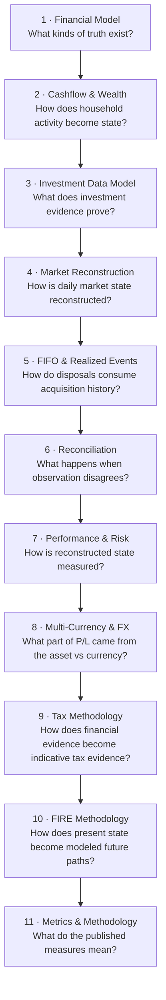
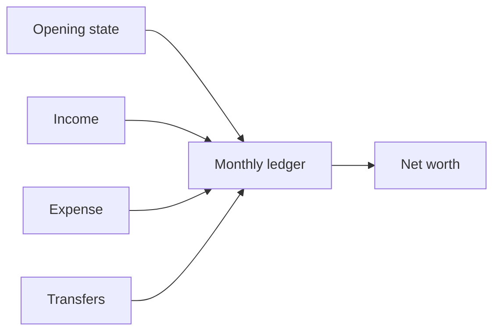
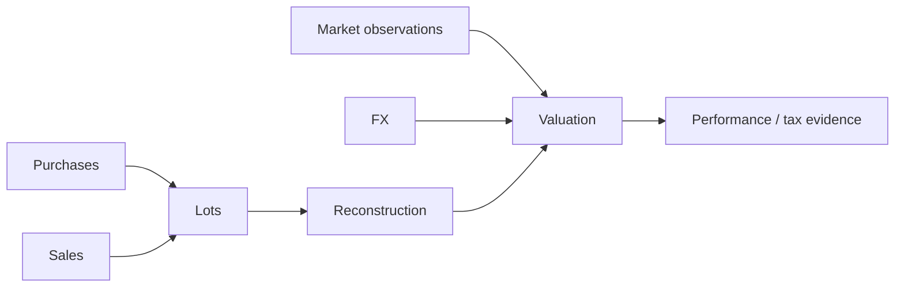

# Finance

The finance layer is where this project stops being a generic ETL pipeline with money-shaped columns.

Raw statements, household transactions, broker exports, market observations, FX rates, and configuration are only **evidence**. They become useful after I give them explicit financial meaning, preserve where that meaning came from, and keep observed facts separate from reconstructed state and forward-looking assumptions.

That distinction drives the entire Finance section.


The arrows are not permission to blur the layers. A broker quantity observation is still an observation after reconciliation. A FIFO lot is reconstructed state. An XIRR is a measure. A Monte Carlo percentile is a modeled future, not a historical fact wearing a nicer chart.

## The Finance corpus has a deliberate order

I read these pages as one financial model, not as a folder of independent topics.



This batch covers the first three steps: the semantic floor on which the rest of the finance engine stands.

## Four kinds of authority

The financial model is easier to reason about when I stop asking one dataset to be authoritative for everything.

| Authority | What it answers | Examples |
| --- | --- | --- |
| **Source authority** | What did an external or household source actually report? | broker trade, household transaction, market close, FX observation |
| **Canonical authority** | What normalized economic fact do I accept into the model? | normalized purchase, sale, income, expense, transfer |
| **Reconstruction authority** | What state follows from accepted facts and explicit algorithms? | active FIFO lots, realized events, reconstructed holdings |
| **Presentation authority** | How do I expose the state for analysis and decisions? | Gold marts, cash-flow statements, portfolio analytics |

Operational provenance is orthogonal to all four. The SQLite Control Plane records what the application did with evidence; it does not replace the economic meaning of that evidence.

## Household finance and investments share principles, not mechanics

Household finance is principally a ledger/state problem:



Investment finance adds chronology, market state, lot state, reconciliation, benchmark state, and multi-currency valuation:



Both areas obey the same deeper rules: grain is explicit, identity is deterministic where required, missing is not zero, observed and reconstructed values are not silently merged, and financial policy is configuration rather than hidden constants.

## Implementation ownership

The current domain topology mirrors those distinctions:

```text
src/personal_finance_etl/domain/
├── common/
├── household/
├── investments/
├── market/
├── tax/
├── wealth/
└── fire/
```

`domain/` owns financial meaning. Application services sequence use cases. Infrastructure persists and retrieves state. Gold tables present results. That separation matters because a database schema should not accidentally become the place where Tax law or FIFO chronology is defined.

## The first rule: say what a row means

Financial systems fail surprisingly often because a table has a name but no grain.

These are different contracts:

```text
one row per household transaction
one row per asset subcategory × month
one row per investment transaction
one row per instrument × valuation date
one row per acquisition lot
one row per realized disposal fragment
```

If grain changes, joins, aggregation, identity, reconciliation, and BI behavior change with it.

A table with the right columns at the wrong grain is still wrong. It is just wrong in a way that SUM() can make look extremely confident.

## The second rule: separate observation from reconstruction

The investment engine deliberately keeps:

```text
broker-observed quantity
reconstructed quantity
reconciliation delta
```

as distinct concepts.

Household modeling follows the same philosophy. Transactions are evidence. Monthly balances are reconstructed from opening state plus activity. Market-valued investments can override book-like ledger state for wealth presentation, but that does not rewrite the underlying transaction history.

## The third rule: policy is visible

Financial behavior is governed through validated `FinancialRules`, including household classifications, budget policy, investment policy, Tax assumptions, FIRE assumptions, and macro parameters.

The rule tree is data, not a pile of constants hidden next to calculations.

That gives the model two useful properties:

1. changing policy does not require changing algorithm ownership; and
2. run provenance can fingerprint the exact policy used.

## The fourth rule: validity survives presentation

The engine distinguishes values that are:

- observed;
- reconstructed;
- estimated;
- unavailable;
- not computable;
- zero.

That distinction is especially important for XIRR, FX, Tax estimates, reconciliations, and FIRE outputs.

A dashboard would often prefer a numeric zero. Finance would often prefer the truth.

Finance wins.

## Where to go next

Start with [Financial Model](financial-model.md) if you want the ontology and authority model.

Then follow [Cashflow & Wealth](cashflow-and-wealth.md) to see how household activity becomes monthly state.

Then read [Investment Data Model](investment-data-model.md) before the deeper investment-engine pages. It defines what purchases, sales, market observations, instrument metadata, benchmarks, and currencies actually prove.

## Related specifications

- [System Architecture](../architecture/system-architecture.md)
- [Data Model](../architecture/data-model.md)
- [Data Lifecycle](../architecture/data-lifecycle.md)
- [Financial Rules Reference](../configuration/financial-rules-reference.md)
- [Identity & Grain Contracts](../reference/identity-and-grain-contracts.md)
