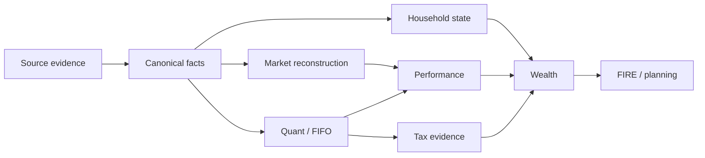
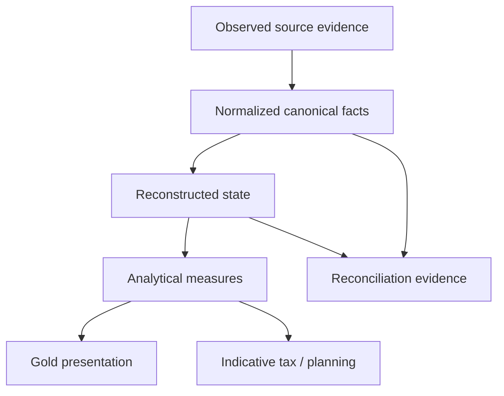

# Finance

Personal Finance ETL treats finance as a set of explicit evidence, reconstruction, valuation, realization, reconciliation, taxation, and planning contracts. This section specifies those contracts from the implementation outward. It is deliberately not a gallery of dashboard metrics: the Gold layer is downstream of the financial model, not the place where financial meaning is invented.




## Learn the financial model as a journey

This section specifies the financial algorithms and semantics. The Wiki teaches the same domain concept-first: [Financial Model](https://github.com/tks18/personal-finance-etl/wiki/06-Financial-Model) → [Investment Engine](https://github.com/tks18/personal-finance-etl/wiki/07-Investment-Engine) / [Cash Flow & Wealth](https://github.com/tks18/personal-finance-etl/wiki/08-Cash-Flow-and-Wealth) → [Tax Evidence & Planning](https://github.com/tks18/personal-finance-etl/wiki/09-Tax-Evidence-and-Planning) → [FIRE & Planning](https://github.com/tks18/personal-finance-etl/wiki/10-FIRE-and-Planning).

## Reading order

| Specification | Question it owns |
|---|---|
| [Financial Model](financial-model.md) | What kinds of financial truth exist, and which subsystem owns them? |
| [Cashflow and Wealth](cashflow-and-wealth.md) | How do household transactions become balances, cashflow and net worth? |
| [Investment Data Model](investment-data-model.md) | What canonical evidence feeds investment reconstruction and analytics? |
| [Investment Market Reconstruction](investment-market-reconstruction.md) | How is historical US market state reconstructed without broker daily holdings? |
| [FIFO and Realized Events](fifo-and-realized-events.md) | How are acquisition lots and disposals reconstructed? |
| [Investment Reconciliation](investment-reconciliation.md) | How are observed and reconstructed investment states reconciled? |
| [Investment Performance and Risk](investment-performance-and-risk.md) | How are return, benchmark, XIRR and risk measures produced? |
| [Multi-Currency and FX](multi-currency-and-fx.md) | How are local-currency economics separated from INR translation? |
| [Tax Methodology](tax-methodology.md) | How do ledger and Quant evidence become tax-preparation events? |
| [FIRE Methodology](fire-methodology.md) | How does current wealth become stochastic planning evidence? |
| [Metrics and Methodology](metrics-and-methodology.md) | What cross-domain formulas and metric semantics are exposed? |

## Financial authority map

The most important rule is that a value should be interpreted according to the subsystem that owns it. A broker statement, a reconstructed holding, a FIFO lot, an indicative tax estimate and a Monte Carlo percentile are all useful, but they are not interchangeable kinds of truth.



### Source authority

Broker statements, household transactions, market observations, FX observations and configuration inputs are evidence. Their existence does not mean every downstream row remains observed evidence.

### Canonical authority

Silver facts normalize evidence into stable grains such as one income transaction, one purchase, one sale, or one market observation. Deterministic identities are attached where downstream reconstruction requires continuity.

### Reconstruction authority

Historical US holdings and Quant acquisition lots are reconstructed state. They solve different problems and intentionally use different grains.

### Presentation authority

Gold datasets are presentation contracts. They summarize and reshape financial state; they do not supersede the canonical evidence that produced it.

## Implementation anchors

The finance specifications repeatedly refer to these implementation areas:

```text
backend/transform/facts.py
backend/transform/investments.py
backend/transform/us_stocks_transformer.py
backend/engines/analytics/
backend/engines/tax/
backend/engines/presentation/
backend/config/financial_rules.py
backend/load/schema/silver.py
backend/load/schema/gold.py
backend/load/registry.py
```

The Reference section owns exact physical schemas. Finance owns their meaning, algorithms and boundaries. Duplicating 60-column DDL blocks here would merely make two sources of documentation truth, which is how future archaeology gets invented.

## Core semantic distinctions

- **Observed** means supplied by an external or configured source.
- **Canonical** means normalized into the application's stable analytical model.
- **Reconstructed** means derived deterministically from evidence.
- **Reconciled** means an explicit event records a discrepancy or adjustment between observed and reconstructed state.
- **Realized** means an economic disposal has occurred.
- **Unrealized** means value remains attached to an open position.
- **Estimated** means a calculation is informative but does not claim statutory or external authority.
- **Local currency** preserves the instrument's own economics.
- **INR** is the reporting-currency translation used by the current financial model.

The rest of this section is built around keeping those adjectives honest.

## Related specifications

- [Financial Model](financial-model.md)
- [Cashflow and Wealth](cashflow-and-wealth.md)
- [Investment Data Model](investment-data-model.md)
- [Investment Market Reconstruction](investment-market-reconstruction.md)
- [FIFO and Realized Events](fifo-and-realized-events.md)
- [Investment Reconciliation](investment-reconciliation.md)
- [Investment Performance and Risk](investment-performance-and-risk.md)
- [Multi-Currency and FX](multi-currency-and-fx.md)
- [Tax Methodology](tax-methodology.md)
- [FIRE Methodology](fire-methodology.md)
- [Data Model](../architecture/data-model.md)
- [Silver Data Contracts](../reference/silver-data-contracts.md)
