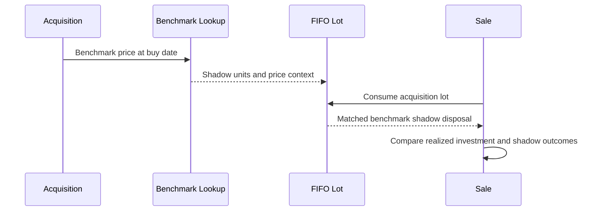

# Lot-aware benchmark attribution

I compare investment activity with a benchmark shadow portfolio that follows actual acquisition and disposal timing. This is more specific than multiplying a portfolio balance by an index percentage return.

## Implementation map

| Module | Selected implementation entry points |
|---|---|
| `backend/engines/analytics/pipeline/processor/benchmark.py` | `get_bm_price()` (L89) |
| `backend/engines/analytics/core/fifo.py` | `active_lots()` (L30), `buy()` (L34), `sell()` (L102), `get_closing_units()` (L223), `get_closing_shadow_units()` (L226), `get_terminal_value()` (L229), `get_shadow_terminal_value()` (L232) |
| `backend/engines/analytics/pipeline/processor/isin_processor.py` | `is_indian_rights_entitlement_isin()` (L32), `process()` (L84) |

## Execution model



## Shadow units on acquisition

An acquisition captures benchmark-price context and derives associated shadow units. The shadow position is tied to the underlying investment lot.

## Disposal alignment

When FIFO disposes part of a lot, the matching benchmark shadow exposure is also consumed, keeping the comparison aligned to investment cash-flow timing.

## Price availability

Benchmark history quality and date alignment affect shadow-unit construction and valuation. I do not assume that every instrument/date pair has a valid benchmark observation.

## Interpretation

The resulting benchmark comparison is a cash-flow-aligned counterfactual. It is not the same as a time-weighted return series or a universal performance guarantee.

## Implementation excerpts

The following short excerpts are copied from the actual implementation. I use the surrounding source module as the authority for complete branch behavior.

### `get_bm_price()` · `backend/engines/analytics/pipeline/processor/benchmark.py:89`

```python
    def get_bm_price(self, dt: date | datetime | str | None) -> float | None:
        if dt is None:
            return None
        dt_val = dt if isinstance(dt, date) and not isinstance(dt, datetime) else to_date_obj(dt)
        if dt_val is None or not self._dates:
            return None
        exact = self.bm_price_map.get(dt_val)
        if exact is not None:
            return exact
        idx = bisect_right(self._dates, dt_val) - 1
        if idx < 0:
            return None
        prior_date = self._dates[idx]
        if (dt_val - prior_date).days > self.max_staleness_days:
```

### `buy()` · `backend/engines/analytics/core/fifo.py:34`

```python
    def buy(
        self,
        buy_date: date,
        qty: float,
        price: float,
        shadow_qty: float,
        bm_price: float,
        price_local: float = 0.0,
        fx_rate_buy: float = 1.0,
        currency_id: str | None = None,
        bm_buy_local: float | None = None,
        purchase_id: str | None = None,
        lot_source_type: str = "PURCHASE",
        reconciliation_group_id: str | None = None,
```

## Boundaries and related specifications

I keep physical schemas in [the reference catalog](../reference/README.md), operational lineage in [Control Plane documentation](../control-plane/README.md), and ETL publication semantics in [Data Engineering](../data-engineering/README.md). I do not equate the existence of an algorithm with automated validation of every exceptional input.
