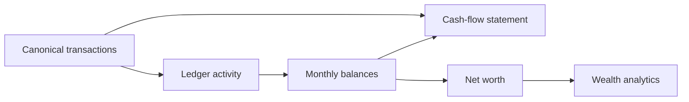
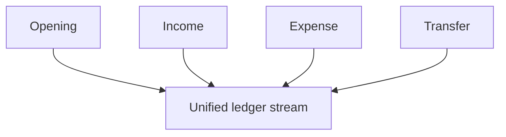
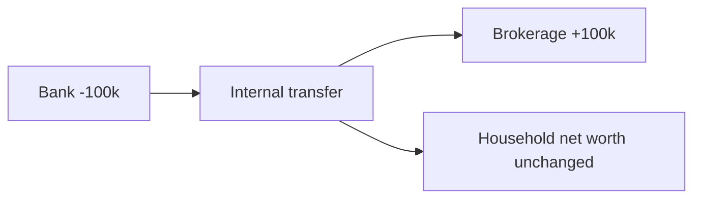
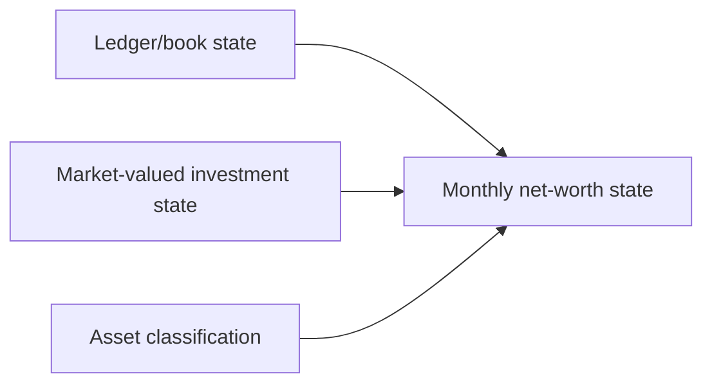

# Cashflow & Wealth

Household finance looks simple until one tries to answer three questions at once:

1. **What happened this month?**
2. **Where did the money move?**
3. **What is the household worth now?**

Those questions operate on different grains. I keep them separate and connect them through a monthly state transition rather than forcing everything into one “cash flow” number.



## Start with four evidence families

The household ledger consumes four canonical inputs:

```text
opening balances
income transactions
expense transactions
transfer transactions
```

They are not interchangeable.

### Opening balances

Opening balances establish state at the beginning of tracked history.

They are not income. They are not a transaction-created gain. They are the starting point from which later movement is reconstructed.

### Income

Income increases household resources, but income classification matters downstream.

The model distinguishes categories such as:

- active income;
- dividend income;
- interest income;
- non-cash income.

That matters because a non-cash financial gain should not automatically become available spending cash.

### Expense

Expenses reduce resources, but the model also distinguishes:

- core expenses;
- non-core expenses;
- cash expenses;
- non-cash P/L-like expenses.

Budget and FIRE models care about those distinctions differently.

### Transfers

Transfers move value between owned locations.

They can be operational, investing, financing, or internal according to asset metadata.

A transfer can change one account balance while leaving household net worth unchanged.

## `LedgerBuilder` is the state bridge

`domain/household/ledger.py` combines the canonical streams.

```python
# src/personal_finance_etl/domain/household/ledger.py
class LedgerBuilder:
    """Combines raw transaction streams into structured monthly ledger balances and activities."""

    def __init__(self, dfs: Mapping[str, pl.DataFrame | pl.LazyFrame], rules: FinancialRules):
        self.dfs = dfs
        self.rules = rules
```

The builder returns four important lazy structures:

```text
lf_exp_agg
lf_inc_agg
lf_activity
lf_balances
```

That separation is deliberate. Aggregated income/expense retain classification detail, while activity/balances model monthly state movement.

## The ledger normalizes activity before aggregating it

Opening, income, expense, and transfer streams are projected into a common representation with:

```text
ASSET_SUBCATEGORY_ID
AMOUNT
DATE
TYPE
```

plus semantic flags where relevant.

They are then concatenated into a unified ledger stream.



The important part is not the concat. It is that each source enters with preserved semantics.

## Monthly activity answers “what happened?”

`lf_activity` groups by:

```text
MONTH_START_DATE
MONTH_END_DATE
ASSET_SUBCATEGORY_ID
```

and calculates measures such as:

- cash income inflow;
- non-cash income inflow;
- total income inflow;
- core expense outflow;
- cash expense outflow;
- non-cash expense outflow;
- total expense outflow;
- net transfers;
- opening balance.

That grain is monthly activity by asset subcategory.

It is not yet household net worth.

## Balance reconstruction answers “what state follows?”

The ledger creates a signed `NET_AMOUNT` where expenses reduce state and other activity follows the canonical amount semantics.

Monthly balance reconstruction then carries activity through time by asset subcategory.

Conceptually:

```text
closing_balance(t)
    = opening_state
    + cumulative income
    - cumulative expense
    + cumulative transfers
```

The implementation has additional classification/market-value behavior, but this is the state transition being modeled.

## Why transfers cannot be folded into income/expense

Consider:

```text
Bank → Brokerage      ₹100,000
```

If treated as expense from bank and income to brokerage, household income/expense both inflate while wealth stays unchanged.

The transfer model instead preserves internal movement.



This becomes especially important when cash-flow activities classify transfers into operating/investing/financing contexts.

## Cash and non-cash activity are separate on purpose

The cash-flow model should answer liquidity questions. Wealth should answer economic-value questions.

A non-cash gain can affect wealth without increasing cash available to pay next month's rent.

Therefore the model carries both:

```text
Cash_Income_Inflow
Non_Cash_Income_Inflow
Cash_Expense_Outflow
Non_Cash_Expense_Outflow
```

rather than collapsing everything into one monthly net figure.

## The cash-flow statement reconciles cash-pool movement

`CashflowStatementBuilder` constructs a direct-method statement around assets flagged as `is_cash_pool`.

```python
# src/personal_finance_etl/domain/household/cashflow.py
class CashflowStatementBuilder:
    """Constructs the Cashflow_Statement presentation model.

    Direct Method cash flow statement that reconciles opening and closing
    balances of CASH_POOL assets.
    """
```

The builder combines:

- opening/closing cash balances;
- operating income;
- operating expenses;
- classified transfers;
- monthly cash/non-cash totals.

## Transfer counterparties determine cash-flow activity

Transfer destination metadata can classify movement as:

```text
OPERATING
INVESTING
FINANCING
INTERNAL_TRANSFER
```

The builder aggregates positive/negative transfer amounts into inflow/outflow measures for those classes.

This produces a cash-flow statement that is derived from owned-account movement instead of manually tagging every report row after the fact.

## Net cash movement is a reconciliation target

The cash-flow statement calculates operating, investing, financing, and internal-transfer net movement and compares that analytical movement with opening/closing cash-pool balances.

That reconciliation is more useful than a report that merely lists inflows and outflows because it exposes when classification or source coverage does not explain observed state movement.

## Income has more structure than “money received”

`IncomeStreamsBuilder` produces income-stream analytics using the canonical income classifications.

This allows downstream questions such as:

- how concentrated is active income?;
- how much income is dividend/interest driven?;
- what portion is non-cash?;
- how stable is the income base?;
- how much spending is supported by recurring/active income?

The exact metrics belong to their analytical output, but the important model decision is earlier: the canonical transaction carries enough semantics to make those questions possible.

## Budgeting is policy applied to canonical activity

`domain/household/budget.py` contains separate builders for spend analytics and budget forecasting.

Budget logic consumes real expense/income state plus `FinancialRules` policy.

That means:

```text
what happened?
    comes from canonical transactions

what target should I compare it with?
    comes from configured policy
```

Those authorities should not be merged.

## Budget-health scoring is derived, not observed

`domain/wealth/scoring.py` calculates health scores from analytical state.

That score is not a transaction fact. It is a measure derived from defined rules/weights.

This matters when presenting it: scores summarize the model; they do not replace underlying financial evidence.

## Net worth begins with the ledger, then changes valuation basis where justified

`NetWorthBuilder` receives:

- canonical/warehouse datasets;
- inflation calendar context;
- ledger results;
- default currency.

```python
# src/personal_finance_etl/domain/wealth/net_worth.py
class NetWorthBuilder:
    """Calculates monthly asset balances, market valuations, liabilities, and net worth."""

    def build(self) -> dict[str, pl.LazyFrame]:
        ...
        return {
            "lf_nw_summary": lf_nw_summary.drop("Is_Liquid"),
            "lf_monthly_totals": lf_monthly_totals,
        }
```

The output therefore separates asset-subcategory monthly detail from household-level monthly totals.

## Book state and market state meet at the wealth boundary

For many household assets, reconstructed ledger balance is the useful state.

For investments with valid market valuations, current market value is more relevant to economic net worth.

That produces a deliberate merge:



The merge does **not** rewrite the ledger. It chooses the appropriate valuation basis for wealth presentation.

## Net worth is a monthly state, not a transaction sum

At household level:

```text
Net Worth = Total Assets - Total Liabilities
```

But producing a meaningful monthly series also requires:

- aligned month calendars;
- opening/closing balances;
- market-value injection;
- liability classification;
- liquidity flags;
- investment values;
- inflation context.

The formula is the easy part. The grain and valuation authority are the engineering.

## Liquidity is not wealth

A household can have high net worth and poor liquidity.

The model therefore tracks liquidity-oriented state separately, including cash-pool assets and runway-style measures.

`NetWorthBuilder` computes a `Months_of_Runway` metric from closing balance relative to a trailing expense average where the denominator is positive.

That makes the difference between:

```text
wealthy
```

and:

```text
able to fund near-term obligations
```

visible in the model.

## Organic growth is different from contributions

A balance can increase because:

- new savings/contributions were added;
- market value increased;
- non-cash gains occurred;
- transfers moved money between owned assets.

Wealth analytics should distinguish these drivers where the evidence/model permits it.

Otherwise a savings metric can accidentally take credit for a market rally. Finance Twitter would approve. The ledger should not.

## Inflation adds real-value context, not historical rewriting

Inflation calendars are owned under `domain/fire/inflation.py` and feed wealth analysis.

Inflation-adjusted context answers a different question from nominal balance:

```text
nominal wealth:
    current currency amount

real wealth:
    purchasing-power-adjusted context
```

Both can be useful. Neither should silently replace the other.

## Investment contribution ratio connects household and portfolio models

Household savings and investment funding eventually connect to the investment engine.

That connection is analytical, not a collapse of domains.

The household side asks how much capital is being directed toward investment. The investment side asks what happened to capital after it entered investment instruments.

This boundary is where the next document becomes necessary.

## Portfolio-management analytics remain downstream

`InvestmentAnalyticsBuilder` in `domain/wealth/analytics.py` combines ISIN-level market/book values, allocation, drift, performance context, and harvesting priority.

```python
# src/personal_finance_etl/domain/wealth/analytics.py
class InvestmentAnalyticsBuilder:
    """Constructs p_Portfolio_Management_Analytics.

    Unifies Rebalancing (drift), Sector Allocation (weights), Performance Attribution (returns),
    and Tax Harvesting (unrealized losses) into a single cohesive ISIN-level table.
    """
```

Notice the ownership boundary: this is portfolio/wealth decision support built from canonical investment state. It does not own FIFO or realized gain calculation.

## Target allocation is policy, actual allocation is state

The builder can join configured target allocations onto actual portfolio values.

That creates:

```text
actual class weight
configured target weight
class drift
rebalance requirement
```

Again, observation/state and policy remain distinct.

## Tax-harvesting priority is a score, not Tax advice

The portfolio analytics layer can prioritize unrealized losses using a scoring formula.

That result is decision support. Tax methodology and statutory treatment remain separate concerns.

The model intentionally avoids turning one heuristic score into legal certainty.

## Household failure boundaries

Important failure/edge cases include:

### Missing required household datasets

Builders can return empty structures when required inputs are absent. Upstream contract/validation should make truly required absence visible rather than allowing a polished empty report to masquerade as a healthy household.

### Incomplete history

Opening balances are critical when transaction history begins after the economic life of an account.

Without them, cumulative activity cannot reconstruct the pre-history state.

### Internal movement

Transfers must not inflate income/expense.

### Non-cash activity

Non-cash P/L can affect wealth while remaining outside liquidity/cash-flow measures.

### Market-valued investments

Investment market state can override ledger-style book balance for wealth valuation without changing underlying household transaction evidence.

### Zero denominators

Runway, growth, ratios, and scores must handle zero/negative denominators deliberately.

## Worked monthly transition

Suppose a household begins a month with:

```text
cash                         200,000
investment market value    1,000,000
liability                    300,000
```

During the month:

```text
salary income                +150,000
cash expense                  -80,000
bank → brokerage transfer     -50,000 cash / +50,000 brokerage funding
market movement              +40,000 investment value
```

A useful model should conclude:

```text
income                      150,000
expense                      80,000
internal investment funding  50,000 transfer, not expense
cash closing                220,000
investment market value   1,090,000  # funding + market movement
liability                   300,000
net worth                 1,010,000
```

The exact portfolio bookkeeping depends on investment evidence, but the semantic point is stable: the same ₹50,000 must not be counted as both household consumption and new wealth.

## What Gold is allowed to do

Gold can reshape this state into decision-friendly marts:

- monthly cash-flow statement;
- budget/spend analytics;
- net-worth series;
- investment management analytics.

Gold should not invent new transaction classifications that contradict canonical household facts.

## The next question

Household wealth eventually depends on investment state, but investments need a richer evidence model: instrument identity, trade chronology, market prices, benchmarks, currency, and source-specific normalization.

That is the subject of [Investment Data Model](investment-data-model.md).

## Related specifications

- [Financial Model](financial-model.md)
- [Investment Data Model](investment-data-model.md)
- [Financial Rules Reference](../configuration/financial-rules-reference.md)
- [Data Model](../architecture/data-model.md)
