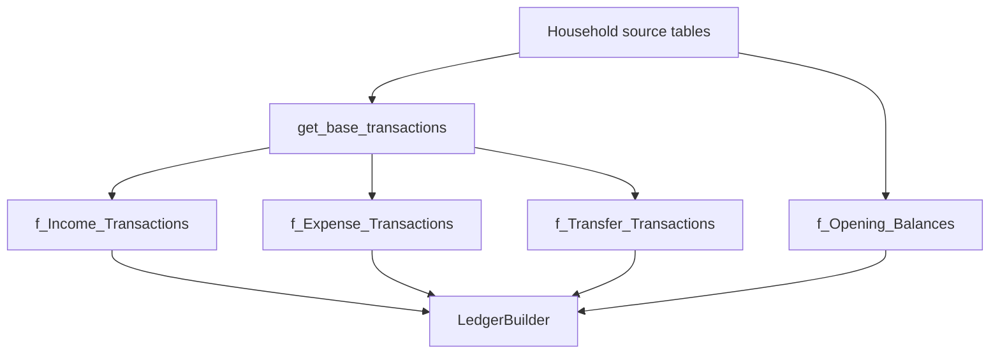
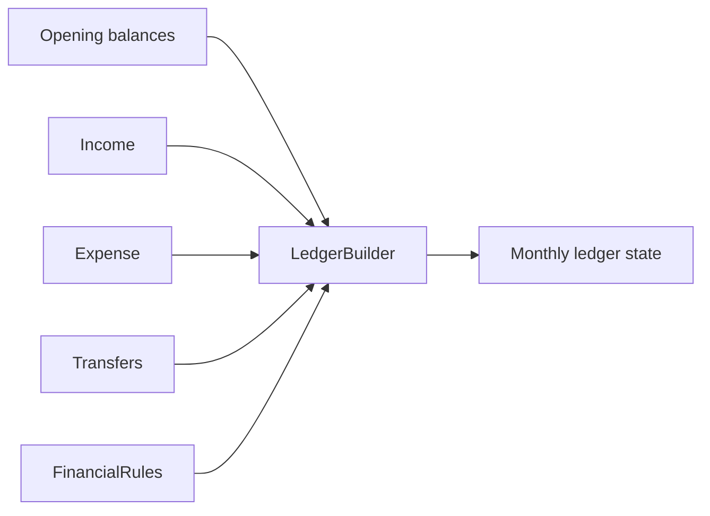
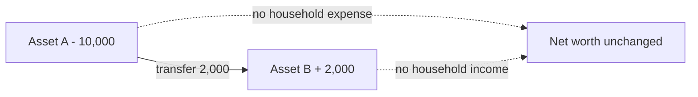
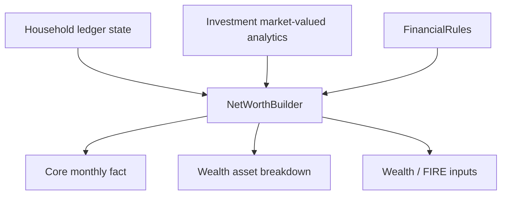
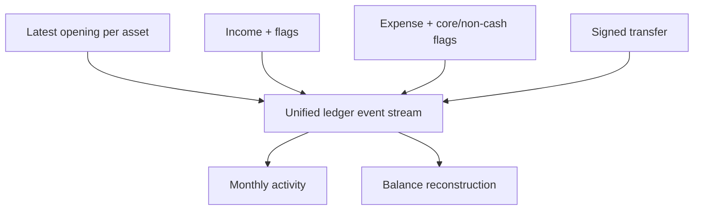
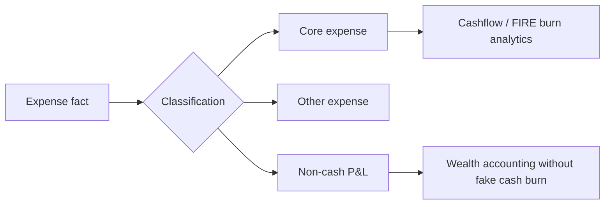
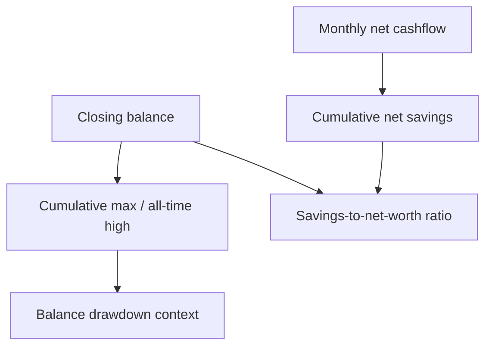
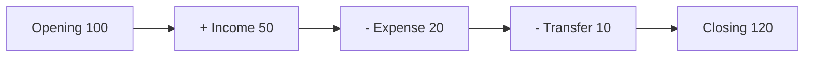

# Cashflow and Wealth

Household finance in Personal Finance ETL is reconstructed from transaction evidence into a monthly analytical state. The implementation deliberately separates ledger movement from balance-sheet valuation: household transactions explain how money moved, while investment analytics later contribute market-valued investment state. That prevents transaction cashflow from being mistaken for current asset value.

## Implementation map

```text
backend/transform/facts.py
backend/engines/presentation/core/ledger_builder.py
backend/engines/presentation/core/inflation_builder.py
backend/engines/presentation/core/net_worth_builder.py
backend/engines/presentation/modules/monthly_cashflow_summary.py
backend/engines/presentation/modules/cashflow_statement_builder.py
backend/engines/presentation/modules/spend_analytics.py
backend/engines/presentation/modules/income_streams.py
backend/engines/presentation/modules/budget_forecast.py
```

## Canonical household facts



### Income

`transform_f_income_transactions()` produces canonical income rows with mapped income category/subcategory semantics. Income represents economic inflow, not every positive account movement.

### Expense

`transform_f_expense_transactions()` produces canonical household outflow with expense category/subcategory semantics. Classification is later used by spending, budget and cashflow analytics.

### Transfer

`transform_f_transfer_transactions()` models movement between financial locations. The distinction matters because a transfer changes where wealth sits without inherently changing household wealth.

### Opening balances

`transform_f_opening_balances()` establishes the initial state from which transaction accumulation can reconstruct balances. Without an opening state, a perfectly correct transaction history can still produce the wrong absolute balance.

## Base normalization

The shared normalizer in `facts.py` maps source-specific columns before specialized facts are built. This creates a controlled boundary between messy household source shape and canonical analytical shape.

```python
def get_base_transactions(df_lazy: pl.LazyFrame, column_mapping: dict[str, str]) -> pl.LazyFrame:
    df_renamed = df_lazy.rename(column_mapping)
    raw_columns = set(df_renamed.collect_schema().names())
    required_columns = {"IS_DEL", "UID", "BASE_AMOUNT"}
    missing_columns = sorted(required_columns - raw_columns)
    if missing_columns:
        raise ValueError(f"INOUTCOME is missing required transaction columns: {missing_columns}")
```

The shared stage is intentionally structural. Financial meaning remains in the specialized transformations and configured mappings.

## Ledger reconstruction

`LedgerBuilder` consumes the canonical household facts and `FinancialRules`. Its output becomes the common monthly ledger state used by downstream presentation builders.



The ledger is therefore reconstructed analytical state. It is not another raw transaction table.

## Why transfers need their own semantics

Suppose cash moves from a bank account to an investment account. Treating the receiving leg as income would inflate earnings; treating the sending leg as expense would inflate consumption. The transfer fact exists so balance movement can be represented without inventing economic profit or loss.



## Net-worth construction

`NetWorthBuilder` sits downstream of the ledger and investment analytics. This is where book-oriented household state and market-oriented investment state meet.



This late integration is a useful boundary. A purchase transaction explains a cash movement and acquisition event; current market value comes from investment analytics. The model does not pretend acquisition cost and current value are the same thing just because both are denominated in currency.

## Inflation context

`InflationBuilder` prepares inflation context used by wealth/planning analytics. Inflation is a model input, not a retroactive mutation of canonical transaction evidence. Nominal facts remain nominal facts; inflation-adjusted measures are analytical derivatives.

## Monthly cashflow

At monthly grain, the presentation layer can derive concepts such as:

- income;
- expense;
- net cashflow;
- savings;
- cashflow efficiency;
- activity summaries;
- budget variance.

The exact Gold physical columns are defined in the Gold contract reference. The important semantic relationship is:

$$
	ext{Net Cashflow} = 	ext{Income} - 	ext{Expense}
$$

Transfers are not inserted into that equation as household income or consumption merely because they move cash.

## Wealth state

Conceptually:

$$
	ext{Net Worth}_t = \sum 	ext{Asset Value}_t - \sum 	ext{Liability Value}_t
$$

But the implementation's asset values can come from different evidence paths. Cash/balance-sheet assets may be ledger-reconstructed, while investments are market-valued through the Quant/presentation path. The formula is simple; the provenance is the interesting part.

## Presentation modules

The Wealth Presentation Engine delegates to focused builders rather than putting every household metric into one mega-function:

| Builder | Responsibility |
|---|---|
| `SpendAnalyticsBuilder` | spending/category analytics |
| `IncomeStreamsBuilder` | income stream analytics |
| `BudgetForecastBuilder` | budget/forecast comparison |
| `MonthlyCashflowSummaryBuilder` | monthly cashflow summaries |
| `CashflowStatementBuilder` | activity-oriented cashflow presentation |
| `WealthRiskAnalyticsBuilder` | wealth/FIRE/risk presentation |

This modularity keeps presentation concerns downstream of canonical facts. Gold can evolve without rewriting what an income transaction means.

## Grain boundaries

| State | Typical grain |
|---|---|
| Income/expense/transfer facts | transaction |
| Opening balance | asset/account opening observation |
| Ledger state | asset/account × period |
| Core wealth | month |
| Asset breakdown | month × asset grouping |
| Cashflow breakdown | month × category/group |

Reference remains authoritative for exact physical grain strings.

## Invariants

- Transfers preserve balance movement without becoming household earnings/consumption.
- Opening balances participate in absolute balance reconstruction.
- Canonical transaction facts are not overwritten by inflation-adjusted presentation measures.
- Investment market value enters wealth downstream of canonical household transactions.
- Gold presentation does not redefine canonical transaction semantics.

## Edge cases

### Incomplete history

A transaction history beginning after an account already held value requires an opening balance. Otherwise cumulative flow can be correct while ending balance is wrong.

### Internal movement

Transfers can create large gross flows with no change in household wealth. Analytics that ignore transaction type can therefore produce spectacularly confident nonsense. The dedicated transfer fact prevents that class of mistake.

### Market-valued investments

Investment wealth can move without any household transaction on that day. Net worth therefore cannot be reconstructed from household cashflow alone.

### Inflation

Inflation-adjusted measures are model-dependent analytical views. They should not be confused with the nominal amounts originally recorded.

## Failure and validation

Household transformations depend on configured column/category mappings. Missing required mappings or malformed canonical fields should fail during transformation/contract validation rather than quietly shifting rows into an undefined financial category. Downstream publication also verifies that registered outputs are present.

## Design trade-off

A single universal ledger could reduce table count, but it would push semantic branching into every downstream query. Personal Finance ETL instead pays the up-front cost of distinct income, expense, transfer and opening-balance facts so later financial logic can rely on stronger meaning. Fewer clever `CASE` statements, fewer opportunities for a transfer to cosplay as income.

## LedgerBuilder in detail

`LedgerBuilder.build()` first requires all four canonical household inputs. If any is absent, it returns an empty result rather than attempting a partial household ledger whose omissions would be hard to detect later.

Opening balances are reduced to the latest row per asset using `ZUTIME` and mapped into the common ledger shape:

```python
lf_open_agg = (
    lf_open.sort("ZUTIME")
    .group_by("ZASSETUID")
    .last()
    .select([
        pl.col("ZASSETUID").alias("ASSET_SUBCATEGORY_ID"),
        pl.col("ZAMOUNTACCOUNT").alias("AMOUNT"),
        pl.col("ZTXDATESTR").alias("DATE"),
    ])
)
```

Income, expense and transfer facts are then projected into the same event shape with a `TYPE` discriminator. This common ledger event stream is a downstream analytical representation; the separate canonical facts remain intact.



## Income semantics

Income transformation filters canonical base transactions where `TRANSACTION_TYPE == 0`. With rules and income subcategory hierarchy available, it derives:

- `Is_Active_Income`;
- `Is_Dividend_Income`;
- `Is_Interest_Income`;
- `Is_Non_Cash_Income`.

If the rules/hierarchy are unavailable, the implementation falls back to `False` flags rather than guessing categories.

These flags matter because gross income, cash income and non-cash income can answer different questions in wealth analytics.

## Expense semantics

Expense transformation filters `TRANSACTION_TYPE == 1` and can derive `Is_Core_Expense` from configured category/subcategory sets. `LedgerBuilder` also joins asset-subcategory metadata to identify `is_non_cash_pnl`, allowing non-cash expense/P&L effects to be separated from cash consumption.



## Transfer semantics and analysis date

Transfers are filtered from transaction types 3/4. The transformation resolves the asset hierarchy, labels the direction and creates signed `AMOUNT_PROPER`:

```python
pl.when(pl.col("TRANSFER_TYPE") == "Out")
.then(pl.col("BASE_AMOUNT") * -1)
.otherwise(pl.col("BASE_AMOUNT"))
.alias("AMOUNT_PROPER")
```

For transfers associated with the `Investments` asset group, `ADJUSTED_DATE_FOR_ANALYSIS` shifts the date by one month in the current implementation. This is a domain-specific analytical timing rule and should be treated as such, not generalized into universal transfer accounting.

## Monthly activity

The ledger event stream is aggregated into monthly activity fields such as income inflow, expense outflow, core expense, cash/non-cash components and net transfers. These measures then join the month × asset lattice used by `NetWorthBuilder`.

The lattice matters because months with no activity still need an explicit state if balances are to form a continuous time series.


## Balance reconstruction

`NetWorthBuilder` computes closing balance as a cumulative sum of monthly net changes over each asset subcategory:

```python
pl.col("MONTHLY_NET_CHANGE")
.cum_sum()
.over("ASSET_SUBCATEGORY_ID")
.alias("Closing_Balance")
```

Opening balance for a month is based on the prior closing balance plus the database opening-balance contribution.

This creates a stateful monthly series from event evidence.

## Cashflow formulas implemented downstream

The builder derives:

$$
\text{NetCashflowMonth} = \text{IncomeInflow} - \text{ExpenseOutflow} + \text{NetTransfers}
$$

and:

$$
\text{SurplusDeficitMonth} = \text{IncomeInflow} - \text{ExpenseOutflow}
$$

The difference is deliberate. Transfers affect an asset's balance path, while household surplus/deficit focuses on income versus expense.

## Organic growth

`Organic_Growth_Value` is calculated as:

$$
\text{ClosingBalance} - (\text{OpeningBalance} + \text{NetCashflowMonth})
$$

This isolates balance change not explained by recorded monthly cashflow, which can capture market/value effects depending on the asset context.

`Organic_Yield_%` then divides that value by opening balance when the opening balance is non-zero.

## Savings and drawdown context

The builder also calculates cumulative net savings and an all-time-high balance per asset. Those stateful measures support ratios and drawdown-style wealth analytics without recomputing the full history in every Gold query.



## Investment contribution ratio

When monthly surplus is positive, `Investment_Contribution_Pct` relates net transfers to the surplus. The denominator guard avoids division by non-positive surplus and returns zero in those cases. This is an analytical convention, not a claim that every transfer is an investment contribution in every possible source model.

## Cash versus non-cash

The implementation carries explicit non-cash flags because cashflow and wealth are not identical. A non-cash income/expense can change analytical profit/wealth without creating bank cash. FIRE burn-rate logic and liquidity analysis should not blindly consume non-cash P&L as if it were grocery spending.

## Asset liquidity

`NetWorthBuilder` brings `Is_Liquid` from asset-subcategory metadata into the month × asset state. Liquidity classification therefore belongs to asset semantics and can be used by runway/FIRE analytics downstream.

## Failure boundaries

- Missing one of the four canonical ledger inputs causes `LedgerBuilder` to return no ledger result.
- Missing asset dimension prevents `NetWorthBuilder` from constructing net-worth state.
- Missing category dimensions reduces available classification enrichment rather than fabricating hierarchy.
- Division metrics explicitly guard zero denominators.

These are intentionally different responses because not every missing input has the same financial severity.

## What Gold is allowed to do

Gold builders can aggregate, rank, compare and present the reconstructed monthly state. They should not reinterpret transfer direction, redefine core expense or alter canonical transaction amounts. Presentation can reshape truth; it should not quietly renegotiate it.

## Worked monthly state transition

For one asset subcategory, suppose the month begins at 100, receives 50 of cash income, records 20 of expense and transfers 10 outward. Ignoring other non-cash effects, the event-driven net change is 20:

$$
50 - 20 - 10 = 20
$$

The closing state becomes 120. The example is intentionally simple; the implementation generalizes the same state-transition idea across every asset and month while retaining separate cash/non-cash classifications.



The important point is not arithmetic difficulty. It is that every component retains its semantic type so downstream analytics can calculate both balance movement and household surplus correctly.

## Household classification and FIRE

Core-expense and active-income flags become especially useful downstream in planning. FIRE burn assumptions should be based on financially meaningful spending/income categories rather than every ledger movement. A transfer to an investment account is not burn; a non-cash P&L expense is not necessarily monthly cash consumption.

This is why classification belongs upstream of FIRE rather than inside the Monte Carlo simulator.

## Wealth versus liquidity

Net worth and liquid runway answer different questions. `Is_Liquid` allows the presentation layer to distinguish assets that contribute to total wealth from assets realistically available for near-term spending/runway analysis.

```text
net worth: broad balance-sheet value
liquid wealth: accessible subset used for liquidity/runway reasoning
```

A household can therefore be wealthy on paper and still have limited liquid runway. The model has enough structure to avoid pretending those are the same condition.

## Presentation grain discipline

Monthly Gold outputs aggregate canonical facts for BI use, but drill-down semantics remain anchored in Silver. If a monthly total appears surprising, the correct audit path is Gold -> monthly reconstructed state -> canonical household facts -> source evidence. Gold should never become the only surviving explanation of a number.

## Related specifications

- [Financial Model](financial-model.md)
- [Cashflow and Wealth](cashflow-and-wealth.md)
- [Investment Data Model](investment-data-model.md)
- [Investment Market Reconstruction](investment-market-reconstruction.md)
- [FIFO and Realized Events](fifo-and-realized-events.md)
- [Investment Reconciliation](investment-reconciliation.md)
- [Investment Performance and Risk](investment-performance-and-risk.md)
- [Multi-Currency and FX](multi-currency-and-fx.md)
- [Tax Methodology](tax-methodology.md)
- [FIRE Methodology](fire-methodology.md)
- [Data Model](../architecture/data-model.md)
- [Silver Data Contracts](../reference/silver-data-contracts.md)
