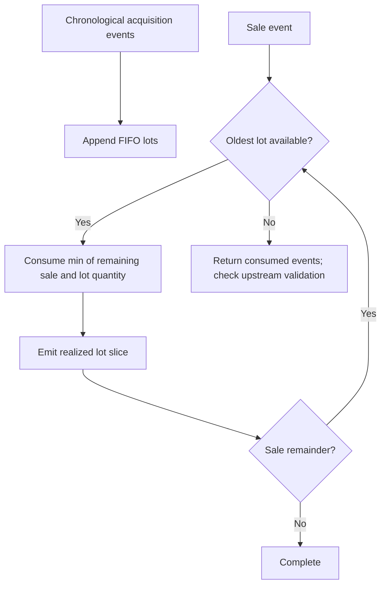

# FIFO lot accounting and disposal events

I model an instrument as an ordered queue of acquisition lots. Purchases create lots, sales consume the oldest available quantities, and the resulting disposal events preserve their lot-level provenance.

## Implementation map

| Module | Selected implementation entry points |
|---|---|
| `backend/engines/analytics/core/fifo.py` | `active_lots()` (L30), `buy()` (L34), `sell()` (L102), `get_closing_units()` (L223), `get_closing_shadow_units()` (L226), `get_terminal_value()` (L229), `get_shadow_terminal_value()` (L232) |
| `backend/engines/analytics/pipeline/processor/isin_processor.py` | `is_indian_rights_entitlement_isin()` (L32), `process()` (L84) |
| `backend/utils/models.py` | Internal functions and models |

## Execution model



## Lot construction

A purchase creates a TaxLot carrying acquisition date, quantity, price, currency context and optional benchmark shadow units. A purchase identifier or reconciliation group can determine the canonical lot identity.

## Disposal traversal

The sale method walks the active deque and consumes lots in order. A partial disposal reduces the active quantity instead of discarding the entire acquisition. Realized events are emitted for the consumed slices.

## Inventory sufficiency boundary

The method can terminate when the lot deque is exhausted even if some requested sale quantity remains. I do not treat the method itself as an unconditional oversell rejection gate; upstream validation must be examined separately.

## Zero-cost and reconciled inventory

Zero-cost/reconciliation lots have special treatment. They should not be described as ordinary broker-confirmed purchases with verified cost basis.

## Benchmark coupling

Lot disposal can also consume shadow benchmark units, preserving acquisition-time benchmark attribution rather than calculating benchmark return solely from portfolio totals.

## Implementation excerpts

The following short excerpts are copied from the actual implementation. I use the surrounding source module as the authority for complete branch behavior.

### `buy()` · `backend/engines/analytics/core/fifo.py:34`

```python
    def buy(
        self,
        buy_date: date,
        qty: float,
        price: float,
        shadow_qty: float,
        bm_price: float,
        price_local: float = 0.0,
        fx_rate_buy: float = 1.0,
        currency_id: str | None = None,
        bm_buy_local: float | None = None,
        purchase_id: str | None = None,
        lot_source_type: str = "PURCHASE",
        reconciliation_group_id: str | None = None,
```

### `sell()` · `backend/engines/analytics/core/fifo.py:102`

```python
    def sell(
        self,
        sell_date: date,
        qty: float,
        price: float,
        price_local: float = 0.0,
        fx_rate_sell: float = 1.0,
        sale_id: str | None = None,
    ) -> list[dict[str, Any]]:
        """Process a sale via FIFO and return the realized gain events."""
        rem = qty
        realized_events: list[dict[str, Any]] = []

        while rem > 0 and self._active_lots:
```

## Boundaries and related specifications

I keep physical schemas in [the reference catalog](../reference/README.md), operational lineage in [Control Plane documentation](../control-plane/README.md), and ETL publication semantics in [Data Engineering](../data-engineering/README.md). I do not equate the existence of an algorithm with automated validation of every exceptional input.
