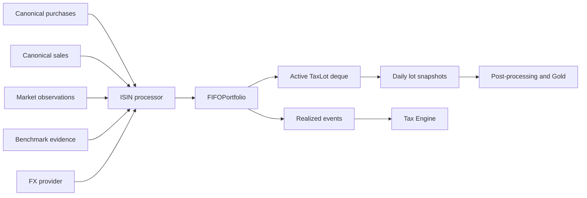
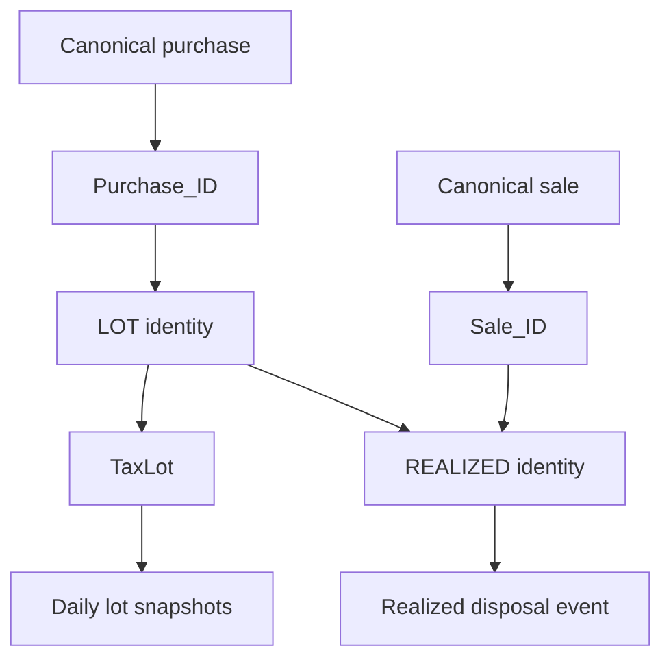
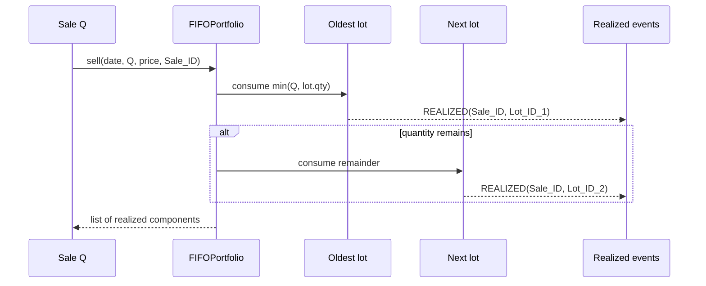
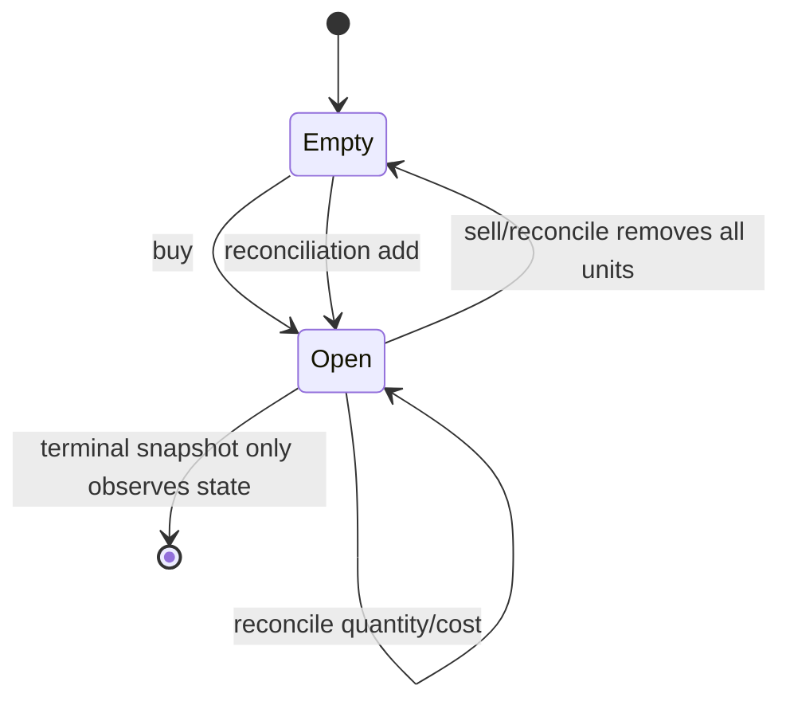
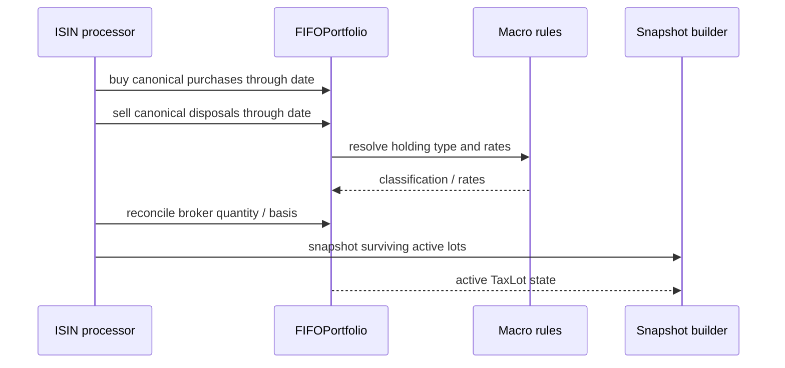
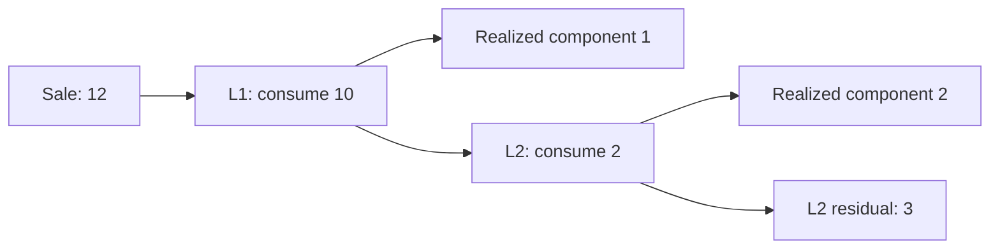
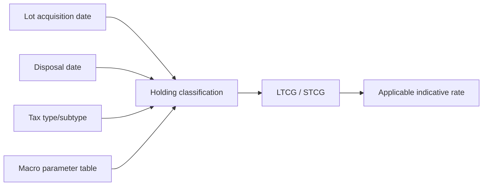
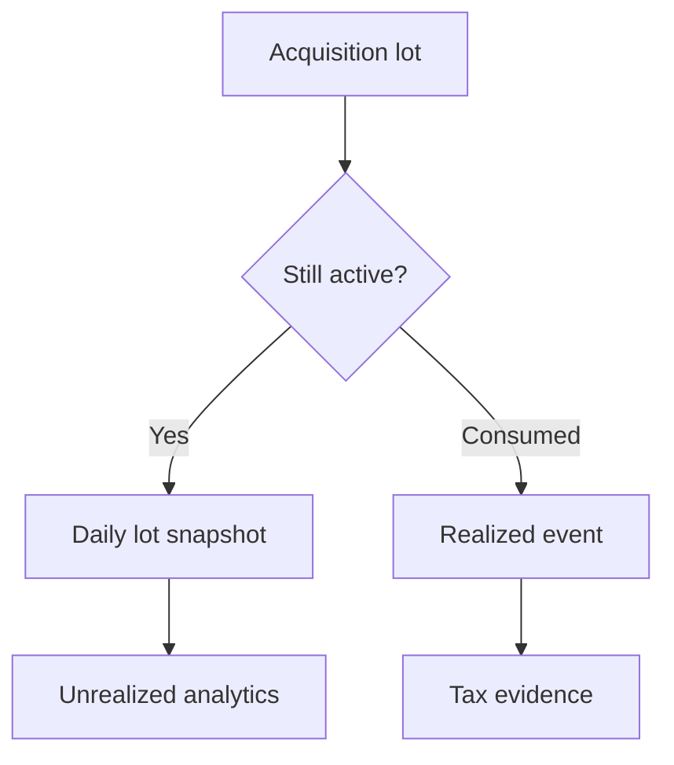
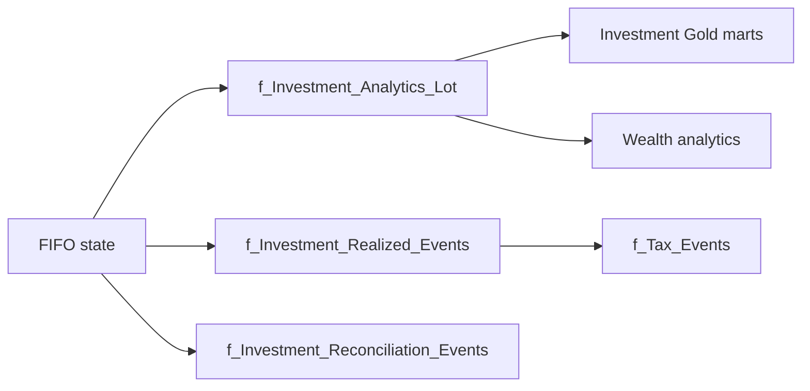

# FIFO and Realized Events

Personal Finance ETL treats acquisition lots as reconstructed financial state with explicit provenance. This specification traces the canonical FIFO state machine from purchase identity through lot mutation and realized disposal events, including holding-period classification, benchmark shadow state, foreign-currency attribution, indicative tax, and the boundaries the algorithm deliberately does not cross.

## Scope and authority

`FIFOPortfolio` in `backend/engines/analytics/core/fifo.py` is the canonical acquisition-lot state machine for one instrument. It consumes canonical purchase and sale evidence, maintains an ordered deque of active `TaxLot` objects, emits realized disposal events, and exposes the lot state used by daily analytics snapshots.

This is deliberately different from the transaction-derived US market reconstruction described in [Investment Market Reconstruction](investment-market-reconstruction.md). Market reconstruction answers *what historical position should be valued on a date?* FIFO answers *which acquisition lots remain, which lots were consumed by a disposal, and what financial consequences follow?*

The distinction matters because reconstructed market state is derived valuation evidence; FIFO state is the canonical basis for realized investment events. Collapsing the two would make a convenient diagram and a terrible audit trail.

## Execution position inside the Quant Engine



`InvestmentQuantEngine` creates per-ISIN workloads. The ISIN processor orders transactions and market dates, applies purchases and sales to `FIFOPortfolio`, reconciles state when broker observations are available, and asks the snapshot builder to materialize the surviving lots.

## The in-memory lot state

The core state is intentionally small: an ordered `deque[TaxLot]`. FIFO correctness comes from preserving acquisition order, not from maintaining a second relational mini-database inside the engine.

A `TaxLot` carries acquisition date, quantity, INR/reporting-currency price, local price, acquisition FX, currency, benchmark shadow quantity and price, purchase identity, deterministic lot identity, and `lot_source_type`. The last field is especially important: an observed purchase and a reconciliation-created synthetic lot can participate in the same future FIFO mechanics without pretending to have the same provenance.

## Creating deterministic lots

```python
if purchase_id:
    lot_fields = {
        "ISIN": self.isin,
        "Purchase_ID": purchase_id,
        "Quantity": qty,
        "Date": buy_date,
    }
    lot_id = generate_deterministic_id("LOT", lot_fields)
elif reconciliation_group_id is not None:
    lot_fields = {
        "ISIN": self.isin,
        "Event": lot_source_type,
        "Recon_Group": reconciliation_group_id,
    }
    lot_id = generate_deterministic_id("LOT", lot_fields)
```

Normal purchase lots inherit continuity from `Purchase_ID`. Reconciliation lots instead derive identity from a stable reconciliation operation identity. This avoids re-hashing raw floating-point quantities when the reconciliation group has already canonicalized the adjustment.

## Lot identity lineage



The lineage is compositional. A realized event does not need row order, a mutable sequence, or an autoincrement key to identify the economic event. Its identity is derived from the canonical sale and the consumed lot.

## FIFO sale algorithm

```python
while rem > 0 and self._active_lots:
    lot = self._active_lots[0]
    consumed = min(rem, lot.qty)
    ...
    if lot.qty <= rem + 1e-8:
        rem -= lot.qty
        self._active_lots.popleft()
    else:
        self._active_lots[0] = TaxLot(
            date=lot.date,
            qty=lot.qty - rem,
            ...
        )
        rem = 0
```

A disposal always starts at the oldest active lot. Full consumption removes that lot; partial consumption preserves the same `Lot_ID` and acquisition attributes while reducing quantity. The `1e-8` tolerance prevents harmless floating-point residue from creating phantom micro-lots.

## Multi-lot disposals



One sale can therefore produce multiple realized-event rows. That is intentional. A single broker disposal can cross acquisition dates, holding classifications, currencies/bases, or reconciliation-origin lots. Aggregating those components too early would destroy provenance.

## Holding-period classification

For every consumed lot, `sell()` delegates classification to `FYMacroParametersTable.get_holding_type(tax_type, tax_subtype, acquisition_date, disposal_date)`. The FIFO container does not hard-code one universal LTCG threshold.

The applicable threshold is therefore a function of the financial-year macro table and the instrument tax classification. This makes holding status a rule-governed financial interpretation rather than a structural property of the lot.

## Realized gain and loss

For a reporting-currency lot, realized gain/loss is:

$$G = (P_s - P_b) \times Q$$

where $P_s$ is disposal price, $P_b$ is lot acquisition price, and $Q$ is quantity consumed.

The realized event also stores disposed cost basis and sale proceeds separately. A negative $G$ remains a realized loss; it is not clamped away. The `is_loss` flag makes that state explicit for downstream consumers.

## Foreign-currency realized decomposition

For a foreign-currency lot, the engine keeps local-asset economics separate from FX translation. The implementation computes local asset P&L, translates that local asset P&L using disposal FX, and separately computes the FX movement on acquisition basis.

$$AssetPnL_{local} = (P_{s,local} - P_{b,local})Q$$

$$AssetPnL_{INR} = AssetPnL_{local} \times FX_s$$

$$FXPnL = P_{b,local}(FX_s-FX_b)Q$$

This is an attribution model, not an assertion that every rupee of total P&L can always be explained by two independently tradable legs. The purpose is to separate security movement from currency movement using the acquisition and disposal FX evidence retained by the lot.

## Realized-event contract

Each realized component includes `Realized_Event_ID`, `Sale_ID`, `Lot_ID`, `Purchase_ID`, ISIN, acquisition/disposal dates, financial year, disposed quantity, acquisition price, cost basis, sale price/proceeds, realized gain/loss, holding type, tax type/subtype, lot source, currency, asset/FX attribution, applied indicative rate, estimated tax, and benchmark shadow quantity sold.

The physical Silver schema is specified in [Silver Data Contracts](../reference/silver-data-contracts.md). This page owns the algorithm and financial semantics, not a second copy of the DDL.

## Realized-event identity

```python
realized_event_id = generate_deterministic_id(
    "REALIZED",
    {
        "Sale_ID": sale_id,
        "Lot_ID": lot.lot_id,
    },
)
```

This identity makes a realized component stable across complete analytical rebuilds as long as the canonical sale and consumed lot identities remain stable. The identity protocol itself is specified in [Deterministic Identity and Replay](../architecture/deterministic-identity-and-replay.md).

## Indicative tax at disposal

The FIFO engine resolves LTCG/STCG rates from the same macro table used by snapshot tax exposure. Positive realized gains receive an indicative estimate; losses produce zero estimated tax at this stage.

$$EstimatedTax = max(0,G) \times r_{holding}$$

This is not final statutory liability. The Tax Engine later converts realized evidence into canonical tax events and can mark reconciliation-origin evidence for review. Quant owns the economic realization; Tax owns tax-evidence normalization. Everybody gets one job. Nobody needs to become a surprise tax department.

## Benchmark shadow state

Every lot can carry `shadow_qty`, benchmark acquisition price, and local benchmark acquisition price. When a sale consumes a lot, the corresponding benchmark shadow quantity is consumed proportionally. This preserves comparable benchmark capital through the same economic holding interval instead of comparing the portfolio against an unrelated benchmark snapshot.

## Terminal state and average cost

`get_closing_units()` and `get_terminal_value()` expose current quantity and valuation. `get_average_cost()` computes quantity-weighted cost across surviving lots. Benchmark equivalents use the shadow quantities and benchmark acquisition prices.

These helpers are state views over the active deque. They do not alter provenance or collapse individual lots.

## Zero-cost and reconciliation-origin lots

Quantity reconciliation can create zero-cost synthetic lots. `sell()` explicitly detects non-positive acquisition price and avoids manufacturing a gain from an unknown basis. The realized event still preserves `Lot_Source_Type`, allowing downstream Tax logic to treat reconciliation-derived evidence differently from ordinary purchase evidence.

This is deliberately conservative. Unknown basis is not magically improved by multiplying it harder.

## State-machine view



## Invariants

The implementation relies on several invariants:

- active lots remain acquisition ordered;
- every normal lot has a deterministic `Lot_ID`;
- realized events reference both a sale and a consumed lot;
- partial consumption retains lot identity and acquisition attributes;
- quantity comparisons use small tolerances to avoid floating-point dust;
- reconciliation-origin lots remain distinguishable by source type;
- holding classification and tax rates come from macro rules rather than being hard-coded into FIFO;
- local and reporting-currency values are not silently interchanged.

## Failure and edge behavior

A sale can consume only the active lots available to the portfolio. The surrounding ISIN processor is responsible for supplying coherent transaction chronology and reconciling broker observations. Invalid/missing market and FX evidence is gated before snapshot publication by dedicated processors.

The FIFO class itself is intentionally narrow: it is a deterministic state machine, not the universal validator for every upstream source. That separation keeps financial mutation logic inspectable.

## What FIFO guarantees and what it does not

**Guarantees within the implemented model:** ordered lot consumption, stable lot/realized identities, explicit holding classification, preserved source provenance, local/INR attribution fields, and deterministic reconstruction from the same canonical evidence/rules.

**Does not guarantee:** broker certification of reconstructed lots, statutory tax liability, recovery of unknown historical cost basis, or equivalence between US market-reconstruction grouping and canonical acquisition lots.

## Source map

Primary implementation authorities:

- `backend/engines/analytics/core/fifo.py` — lot state, buy/sell, reconciliation.
- `backend/utils/models.py` — `TaxLot` model.
- `backend/engines/analytics/rules/macro.py` — holding thresholds and tax rates.
- `backend/engines/analytics/pipeline/processor/isin_processor.py` — transaction chronology and orchestration.
- `backend/engines/analytics/pipeline/processor/snapshot.py` — surviving-lot analytics.
- `backend/utils/identity.py` — deterministic `LOT` and `REALIZED` contracts.

## Transaction chronology and mutation order

Within an ISIN workload, transaction chronology is financially significant. Purchases create lots before later disposals can consume them; sales consume only state available at that point in time; reconciliation can then alter the surviving state when broker observations provide evidence that deterministic reconstruction and observed holdings diverge.



The order matters. Reconciliation performed before a historical sale would alter which reconstructed lots the sale consumes. The surrounding processor therefore owns chronology while `FIFOPortfolio` owns mutation semantics.

## Purchase mutation contract

A call to `buy()` appends one `TaxLot` to the right side of the active deque. It does not merge lots merely because price/date happen to match. That preserves the canonical purchase lineage required for later `Purchase_ID` and `Lot_ID` drill-through.

| Input | Meaning | State effect |
|---|---|---|
| `buy_date` | acquisition/reconstruction date | becomes lot date |
| `qty` | units introduced | increases closing units |
| `price` | reporting-currency unit basis | future realized/unrealized basis |
| `price_local` | local-currency basis | local performance basis |
| `fx_rate_buy` | acquisition FX | later FX attribution anchor |
| `shadow_qty` | benchmark-equivalent units | benchmark state |
| `purchase_id` | canonical purchase lineage | normal lot identity input |
| `lot_source_type` | purchase vs reconciliation | provenance |

The method deliberately does not decide whether the input purchase is valid source evidence. That validation belongs upstream. FIFO receives canonical financial facts and turns them into state.

## Full-disposal worked state transition

Assume active lots are ordered as:

```text
L1: 10 units @ 100
L2:  5 units @ 120
```

A sale of 10 units consumes `L1` completely. The active state becomes:

```text
L2: 5 units @ 120
```

The sale emits one realized component referencing `L1`. The lot disappears from active state, but its identity survives in the realized-event lineage. State removal is not provenance deletion.

## Partial-disposal worked state transition

For the same starting state, a sale of 4 units consumes part of `L1`:

```text
before: L1 = 10 units @ 100
sold:         4 units
remain: L1 =  6 units @ 100
```

`Lot_ID` remains unchanged. The lot is still the same acquisition lineage with a smaller surviving quantity. Creating a new lot identity for the residual would falsely imply a new acquisition event.

## Cross-lot disposal worked state transition

A sale of 12 units consumes all 10 units from `L1` and 2 units from `L2`:



Two realized rows are therefore correct even though the broker reports one sale. Each row has a different acquisition lineage and can have a different holding type or basis.

## Shadow benchmark consumption

Benchmark shadow quantity follows lot consumption. For a fully consumed lot, its shadow quantity is fully attributed to the disposal. For a partial sale, the implementation removes the proportional shadow quantity:

$$ShadowSold = ShadowQty \times \frac{QtySold}{LotQty}$$

This keeps benchmark capital aligned with the fraction of the actual lot that exited.

## Disposal-time macro lookup

Holding type and indicative rates are resolved at disposal time using the acquisition date, disposal date, tax type, and tax subtype. This allows macro parameters to vary across financial years without mutating the historical lot object itself.



## Realized-event field semantics

The realized event intentionally mixes lineage, economics, classification, and attribution because it is the canonical disposal evidence consumed by Tax.

| Field family | Examples | Purpose |
|---|---|---|
| Identity | `Realized_Event_ID`, `Sale_ID`, `Lot_ID`, `Purchase_ID` | deterministic lineage |
| Dates | acquisition, disposal, FY | temporal/tax context |
| Quantity | `Quantity_Disposed` | realized grain |
| Basis/proceeds | acquisition price, disposed basis, sale price, proceeds | economic realization |
| Gain | realized gain/loss, `is_loss` | outcome |
| Tax context | holding type, tax type/subtype, rate, estimate | indicative classification |
| Provenance | `Lot_Source_Type` | observed purchase vs reconciliation origin |
| Currency | currency ID, asset/FX P&L | multi-currency attribution |
| Benchmark | shadow quantity sold | comparative capital |

## Lot snapshots versus realized events

Lot snapshots and realized events are complementary facts:



A snapshot answers what remains and how it is performing. A realized event answers what exited and which acquisition basis produced that result.

## Deterministic rebuild behavior

Silver/Gold analytical layers rebuild from complete canonical Bronze state. FIFO therefore replays canonical transactions rather than loading yesterday's mutable lot deque. Stable purchase, sale, lot, and realized identities allow rebuilt facts to retain semantic continuity.

This is one reason deterministic identity is infrastructure rather than decoration: the warehouse can be rebuilt without every realized event waking up with a new name tag.

## Floating-point tolerance boundaries

Quantity mutation uses `1e-8` tolerance around exhaustion and reconciliation comparisons. This tolerance is intentionally applied to quantity-state mechanics, not as a universal financial rounding rule. Monetary outputs have their own rounding/publication behavior.

## Empty portfolio behavior

When all lots are consumed, closing units and terminal value return zero. Average cost returns zero when no units remain. The portfolio can later reopen through a new purchase or reconciliation add; the new lot receives its own deterministic identity.

## Reconciliation-origin disposal behavior

If a synthetic reconciliation lot is later sold, the realized event retains `Lot_Source_Type="RECONCILIATION"`. Because its basis may be unknown or reconstructed, downstream tax evidence can distinguish it from an ordinary purchase-backed lot. The sale is economically real; the acquisition lineage remains lower-confidence.

## Downstream consumer map



## Audit questions this model can answer

The model is designed so a developer can trace:

- which purchase lot generated a realized gain;
- which sale consumed that lot;
- whether the lot originated from observed purchase evidence or reconciliation;
- what holding classification applied at disposal;
- what local and FX components were calculated;
- which benchmark shadow capital exited with the lot;
- whether a future rebuild generates the same semantic identity.

## Edge-case matrix

| Condition | Implemented behavior |
|---|---|
| partial lot sale | residual retains lot identity |
| sale spans lots | one realized component per consumed lot |
| zero/unknown basis | P&L protected from fabricated basis result |
| foreign currency | local asset and FX components retained |
| reconciliation lot | source type preserved downstream |
| no active units | terminal/average helpers return zero semantics |
| tiny quantity residue | `1e-8` tolerance prevents phantom lots |
| changing FY rules | lookup occurs through macro table |

## Design trade-off: replay state instead of persisting mutable FIFO

Persisting an operational lot ledger would make incremental execution tempting, but it would also create another state store requiring migration, correction, and recovery semantics. The current architecture reconstructs lot state deterministically from canonical evidence during analytical rebuilds. At this workload scale, recomputation buys simpler correctness boundaries.

## Design trade-off: event decomposition instead of sale aggregation

Keeping one realized row per sale would be smaller. It would also erase acquisition-lot lineage when a sale crosses lots. The implementation chooses richer event grain because tax holding classification, basis, and provenance are lot-specific.

## Related specifications

- [Investment Data Model](investment-data-model.md)
- [Investment Market Reconstruction](investment-market-reconstruction.md)
- [Investment Reconciliation](investment-reconciliation.md)
- [Investment Performance and Risk](investment-performance-and-risk.md)
- [Multi-Currency and FX](multi-currency-and-fx.md)
- [Deterministic Identity and Replay](../architecture/deterministic-identity-and-replay.md)
- [Silver Data Contracts](../reference/silver-data-contracts.md)
