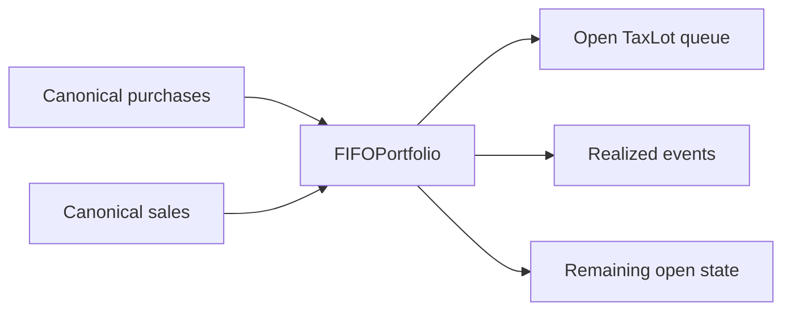
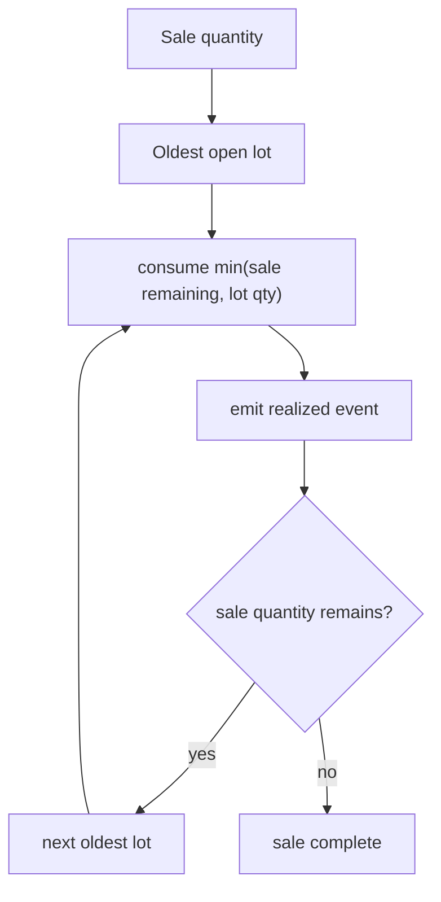
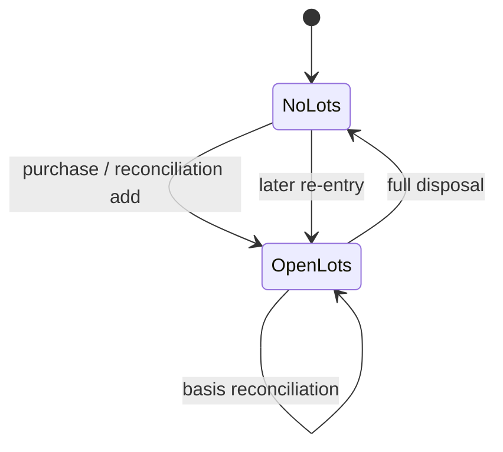

# FIFO & Realized Events

A sale is one row in a broker statement.

Economically, it can be several events at once.

A single disposal may consume:

- part of one acquisition lot;
- all of another;
- a reconciliation-origin lot;
- acquisition basis in one currency;
- sale proceeds in another reporting perspective;
- different holding-period classifications across consumed lots;
- different benchmark shadow quantities;
- different Tax outcomes.

If all of that is collapsed back into one aggregate row too early, the engine loses the ability to explain what actually happened.

This specification describes the stateful FIFO engine that preserves that lineage.



The engine is deliberately replay-oriented: open lots are reconstructed from canonical evidence rather than persisted as mutable operational state that must be continuously patched.

## Implementation authority

The primary implementation lives in:

```text
src/personal_finance_etl/domain/investments/lots/fifo.py
src/personal_finance_etl/domain/investments/lots/models.py
src/personal_finance_etl/domain/investments/lots/ordering.py
```

The public state owner is `FIFOPortfolio`.

Its responsibilities include:

- maintaining open acquisition lots;
- deterministic lot identity;
- FIFO disposal;
- realized gain/loss decomposition;
- foreign-currency attribution;
- holding-period classification;
- disposal-time Tax-rate lookup;
- benchmark shadow consumption;
- quantity/basis reconciliation mutation.

It does not own:

- inter-process scheduling;
- database persistence;
- presentation;
- external market/FX acquisition.

## Why this algorithm is stateful

A disposal cannot be calculated from the sale row alone.

It depends on the ordered history of prior acquisitions and prior disposals.

The core state is:

```python
class FIFOPortfolio:
    """Manages the FIFO tracking of a single instrument's lots."""

    def __init__(self, tax_type, tax_subtype, fy_table, default_currency_id, isin):
        self._active_lots: deque[TaxLot] = deque()
        self.tax_type = tax_type
        self.tax_subtype = tax_subtype
        self.fy_table = fy_table
        self.default_currency_id = default_currency_id
        self.isin = isin
```

That queue is the economic state machine.

A pure vectorized expression is not the right abstraction here because each sale changes the state seen by the next sale.

## Canonical chronology comes first

Purchases and sales are sorted through explicit ordering helpers before mutation.

Same-day event order is therefore deterministic.

```text
source order
    ≠
financial order
```

The engine should not depend on whichever row happened to appear first in a spreadsheet export.

## Lot creation

A purchase creates a `TaxLot` with:

- acquisition date;
- quantity;
- reporting/base price;
- local-currency price;
- acquisition FX;
- benchmark shadow state;
- purchase lineage;
- deterministic lot identity;
- lot source type.

The lot is not merely `(qty, price)`.

It is a compact unit of economic lineage.

## Deterministic lot identity

When a purchase ID exists, lot identity is derived from stable purchase lineage:

```python
lot_fields = {
    "ISIN": self.isin,
    "Purchase_ID": purchase_id,
    "Quantity": qty,
    "Date": buy_date,
}
lot_id = generate_deterministic_id("LOT", lot_fields)
```

For reconciliation-origin lots, the reconciliation group identity is used so harmless float representation differences do not perturb identity.

That decision is subtle and important.

A lot ID should represent the economic event, not the incidental binary formatting of `0.30000000000000004`.

## Lot source type is part of meaning

The lot records whether it came from:

```text
PURCHASE
RECONCILIATION
```

That provenance changes downstream interpretation.

A reconciliation-origin lot is not treated as equally certain acquisition evidence merely because it now occupies the same queue.

## Benchmark shadow state begins at acquisition

Each lot can carry:

```text
shadow_qty
benchmark buy price
benchmark local buy price
```

This creates a counterfactual economic state alongside the actual asset.

The benchmark is not retrospectively attached at sale time. It begins with the acquisition event.

That is how later active-return analysis can compare like-for-like capital deployment.

## The FIFO sale algorithm

A sale starts with requested disposal quantity `rem`.

The engine repeatedly consumes from the oldest open lot:

```python
while rem > 0 and self._active_lots:
    lot = self._active_lots[0]
    consumed = min(rem, lot.qty)
```

Then each consumed slice becomes its own realized event.



## Multi-lot disposal is event decomposition

Suppose a sale disposes 15 units while open lots are:

```text
Lot A: 10 units @ 100
Lot B: 10 units @ 120
```

The engine does **not** emit one synthetic disposal with blended cost 110.

It emits:

```text
Event 1: consume 10 from Lot A
Event 2: consume 5 from Lot B
```

That preserves:

- acquisition date;
- holding period;
- cost basis;
- benchmark state;
- FX basis;
- lot provenance.

## Holding-period classification happens per consumed lot

For each consumed slice, the engine asks the fiscal-year macro table for holding type:

```python
ht_sale = self.fy_table.get_holding_type(
    self.tax_type, self.tax_subtype, lbd or sell_date, sell_date
)
```

This means one broker sale can legitimately decompose into both LTCG and STCG realized events if it spans acquisitions with different holding durations.

Aggregating first would destroy that distinction.

## Realized gain/loss

For base-currency assets:

\[
G = (P_s - P_b) \times Q_d
\]

where:

- \(P_s\) is sale price;
- \(P_b\) is acquisition price;
- \(Q_d\) is disposed quantity.

The event stores:

```text
Disposed_Cost_Basis
Sale_Proceeds
Realized_Gain_Loss
```

The gain/loss is therefore reproducible from the event itself.

## Zero-cost reconciliation lots are deliberately special

If a lot has zero cost basis, the engine does not manufacture a gain from uncertain acquisition evidence.

```python
if lot.price <= 0:
    pnl = 0.0
    asset_pnl_local = 0.0
    asset_pnl = 0.0
    forex_pnl = 0.0
```

That is conservative by design.

The uncertainty remains visible through lot source provenance and later Tax-event handling.

A zero-cost reconciliation lot is not “free shares” in the economic sense.

It is a marker that the system had to repair quantity state without reliable acquisition-basis evidence.

## Foreign-currency realized decomposition

For foreign-currency assets, the engine separates asset-price and FX effects.

Local asset P&L:

\[
G_{asset,local} = (P_{s,local} - P_{b,local}) \times Q_d
\]

Translated asset P&L at disposal FX:

\[
G_{asset,base} = G_{asset,local} \times FX_s
\]

FX component on acquisition basis:

\[
G_{FX} = P_{b,local} \times (FX_s - FX_b) \times Q_d
\]

The realized event stores these separately:

```text
Asset_PnL_Local
Asset_PnL
Forex_PnL
```

This is intentionally more explicit than one opaque INR gain number.

## Realized-event identity

Each consumed lot slice receives deterministic identity:

```python
realized_event_id = generate_deterministic_id(
    "REALIZED",
    {
        "Sale_ID": sale_id,
        "Lot_ID": lot.lot_id,
    },
)
```

The pair `(Sale_ID, Lot_ID)` is the economic lineage.

This means replaying the same canonical transactions produces the same realized event identity.

## Why event grain matters

The realized-event grain is approximately:

```text
one sale × one consumed acquisition lot
```

not:

```text
one broker sale
```

That grain is the reason the system can later answer:

- which acquisition generated this gain;
- which holding period applied;
- which Tax rate was relevant;
- which benchmark quantity was consumed;
- whether the lot came from purchase or reconciliation.

## Disposal-time Tax-rate lookup

The engine resolves the applicable macro Tax rate at disposal time:

```python
_ltcg_rate, _stcg_rate = self.fy_table.get_tax_rates(
    self.tax_type, self.tax_subtype, lbd or sell_date, sell_date
)
_applied_rate = _ltcg_rate if ht_sale == "LTCG" else _stcg_rate
_estimated_tax = max(0.0, pnl) * _applied_rate if pnl > 0 else 0.0
```

This estimate is not the final statutory Tax liability.

It is event-level financial evidence used by downstream Tax logic.

Tax methodology later applies broader classification, exemption, residual-category, and `CHECK_REQUIRED` semantics.

## Loss events remain events

A negative realized result sets:

```text
is_loss = true
Estimated_Tax = 0
```

The loss is preserved as economic evidence.

It is not deleted because it produces no immediate estimated Tax.

## Benchmark shadow consumption follows physical lot consumption

The lot stores a benchmark shadow quantity representing what the same invested capital would have purchased in the benchmark.

When a lot is fully disposed, the corresponding shadow quantity is consumed.

When partially disposed, shadow quantity is reduced proportionally.

This keeps actual and counterfactual capital histories aligned.

## Full disposal mutation

If the sale consumes the entire lot:

```python
if lot.qty <= rem + 1e-8:
    rem -= lot.qty
    self._active_lots.popleft()
```

The small tolerance protects against floating-point residue.

The lot leaves open state completely.

## Partial disposal mutation

If only part of a lot is sold, the engine replaces the head lot with the remaining quantity while preserving identity and acquisition attributes.

That is important:

> a partial sale changes lot quantity, not lot identity.

The acquisition event remains the same economic origin.

## Worked example: partial disposal

Open lot:

```text
Lot_ID = L1
Acquired = 2024-01-10
Qty = 10
Price = 100
```

Sale:

```text
Qty = 4
Price = 150
```

Realized event:

```text
Quantity_Disposed = 4
Disposed_Cost_Basis = 400
Sale_Proceeds = 600
Realized_Gain_Loss = 200
Lot_ID = L1
```

Remaining lot:

```text
Lot_ID = L1
Qty = 6
Price = 100
```

The lot's economic origin did not change merely because its open quantity did.

## Worked example: cross-lot disposal

Open state:

```text
L1: 3 @ 100
L2: 5 @ 130
L3: 4 @ 90
```

Sale:

```text
6 @ 150
```

Consumption:

```text
L1: 3 consumed
L2: 3 consumed
L3: untouched
```

Realized events:

```text
E1 = Sale × L1
E2 = Sale × L2
```

Remaining:

```text
L2: 2 @ 130
L3: 4 @ 90
```

That is why realized-event grain cannot be one row per sale.

## State-machine view



The portfolio is intentionally ephemeral state reconstructed during the analytical run.

## Terminal quantity

Open physical quantity is:

\[
Q_{open} = \sum_i q_i
\]

The implementation exposes:

```python
def get_closing_units(self) -> float:
    return sum(lot.qty for lot in self._active_lots)
```

Benchmark shadow quantity is tracked separately.

## Average cost is derived from open lots

Average cost should come from remaining acquisition state, not from historical purchases that have already been disposed.

Conceptually:

\[
\bar{P}_{open} = \frac{\sum_i q_i P_i}{\sum_i q_i}
\]

where only active lots participate.

## Reconciliation can mutate open state without inventing a trade

The same `FIFOPortfolio` is the mutation target for reconciliation.

That design is deliberate:

- the FIFO queue remains the single owner of open lot state;
- reconciliation creates explicit adjustment events;
- downstream sales see the corrected open state.

No second hidden lot ledger is created.

## Reconciliation-origin lots and future disposal

A quantity-add reconciliation can introduce an open lot without reliable purchase basis.

Later disposal of that lot remains traceable because `Lot_Source_Type` survives into realized events.

Downstream Tax logic can therefore mark the uncertainty instead of pretending the event came from a normal acquisition.

## Deterministic rebuild behavior

Given the same:

- canonical purchase/sale evidence;
- canonical order;
- macro Tax rules;
- benchmark prices;
- FX observations;
- reconciliation evidence;

the engine reconstructs the same open lots and realized-event IDs.

That is the key advantage of replay state.

## Why open lots are not persisted as mutable authority

Persisting mutable open lots would create synchronization problems:

```text
transaction corrected
    ↓
which historical lots must be patched?
    ↓
which realized events must be reversed?
    ↓
which downstream snapshots are now stale?
```

Replay makes the answer simpler:

```text
correct evidence
    ↓
rebuild deterministic lot state
```

The cost is computation. The benefit is much cleaner provenance.

## Floating-point tolerance boundaries

The engine uses small quantity tolerance around depletion.

That tolerance is not permission to make financial identity fuzzy.

It exists to prevent floating-point residue such as:

```text
2.0000000000000004 - 2.0
```

from leaving a ghost lot.

Deterministic identities still rely on canonicalized fields rather than arbitrary approximate matching.

## Failure and edge behavior

### Sale with no active lots

No realized event can be created from non-existent acquisition state.

The surrounding application/reconciliation logic determines whether this reflects source incompleteness or another data-quality problem.

### Sale quantity exceeds open quantity

The FIFO loop can only consume available lots.

Any mismatch remains a reconciliation/data-quality concern rather than silently inventing negative holdings.

### Zero-cost lot

Preserved as uncertainty with zero P&L attribution in FIFO.

### Missing sale ID

Realized identity loses some lineage strength; canonical processing should normally provide deterministic sale identity.

### Foreign asset without valid FX

The pre-Quant FX gate should fail before the engine is allowed to produce materially wrong INR results.

## Invariants

The lot engine is designed around these invariants:

1. oldest eligible lot is consumed first;
2. open lot quantity never becomes intentionally negative;
3. partial disposal preserves lot identity;
4. realized event identity is deterministic;
5. each realized event points to exactly one consumed lot;
6. realized-event quantity equals consumed lot quantity slice;
7. benchmark shadow state is consumed consistently with physical state;
8. local and base-currency attributes remain distinct;
9. reconciliation-origin provenance survives later disposal;
10. macro Tax lookup is performed at disposal time.

## What FIFO guarantees

It guarantees deterministic acquisition-lot consumption under the configured order and evidence set.

It guarantees lot-level realized-event decomposition and remaining open state.

## What FIFO does not guarantee

It does not guarantee:

- source evidence is complete;
- reconciliation-origin basis is economically certain;
- estimated event Tax equals statutory liability;
- benchmark counterfactuals are actual holdings;
- external broker Tax-lot methodology is identical unless configured evidence/rules match.

## Audit questions this model can answer

- Which lot generated this realized gain?
- When was that lot acquired?
- How much of it was disposed?
- What basis was consumed?
- Was the lot purchase-origin or reconciliation-origin?
- What holding type applied?
- What local asset gain occurred?
- What FX effect occurred?
- What benchmark shadow quantity was consumed?
- What open lots remain after the sale?

That level of traceability is the reason the engine emits events instead of only aggregate P&L.

## Design trade-off: event decomposition instead of sale aggregation

More rows are produced.

That is intentional.

The alternative is fewer rows and weaker lineage.

For financial auditability, preserving the lot boundary is worth the additional data volume.

## Design trade-off: stateful Python instead of full vectorization

FIFO is path-dependent.

A sale mutates the state seen by the next sale.

The state machine is clearer in an explicit queue than in a dense vectorized workaround whose primary accomplishment would be winning a benchmark while losing explainability.

Fast wrong finance is still wrong finance, just with excellent throughput.

## Handoff: deterministic lot state can still disagree with observed broker state

The FIFO engine can be internally deterministic and still differ from an external holding observation.

That does not automatically mean the engine is wrong or the broker is wrong.

It means the two evidence paths disagree.

The system needs a first-class way to represent that disagreement without rewriting history.

That is the job of [Investment Reconciliation](investment-reconciliation.md).

## Related specifications

- [Investment Market Reconstruction](investment-market-reconstruction.md)
- [Investment Reconciliation](investment-reconciliation.md)
- [Investment Performance & Risk](investment-performance-and-risk.md)
- [Multi-Currency & FX](multi-currency-and-fx.md)
- [Tax Methodology](tax-methodology.md)
- [Deterministic Identity & Replay](../architecture/deterministic-identity-and-replay.md)
