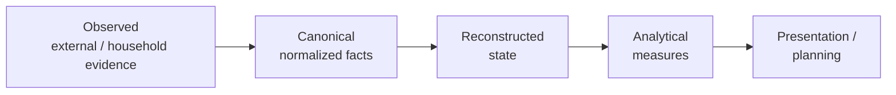
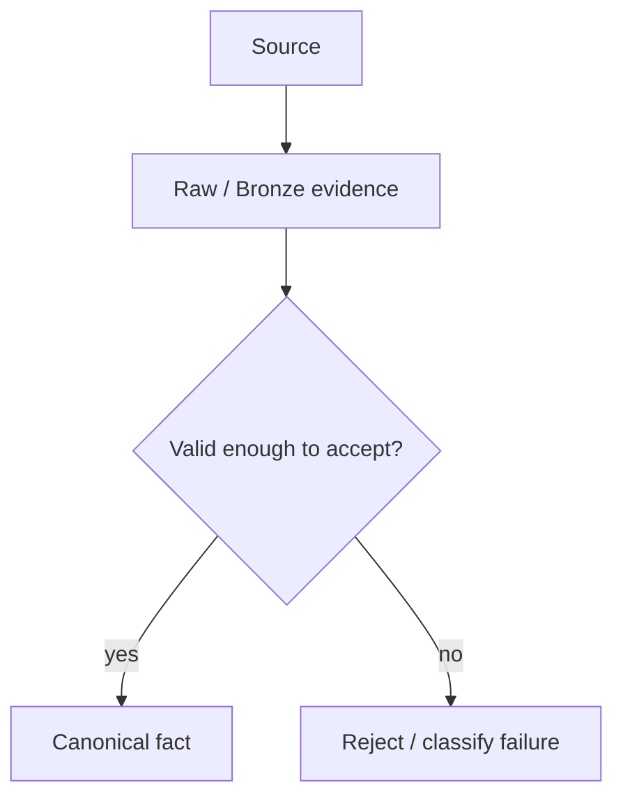
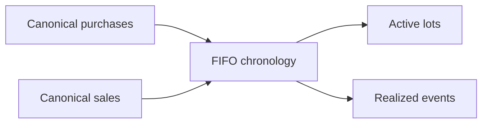
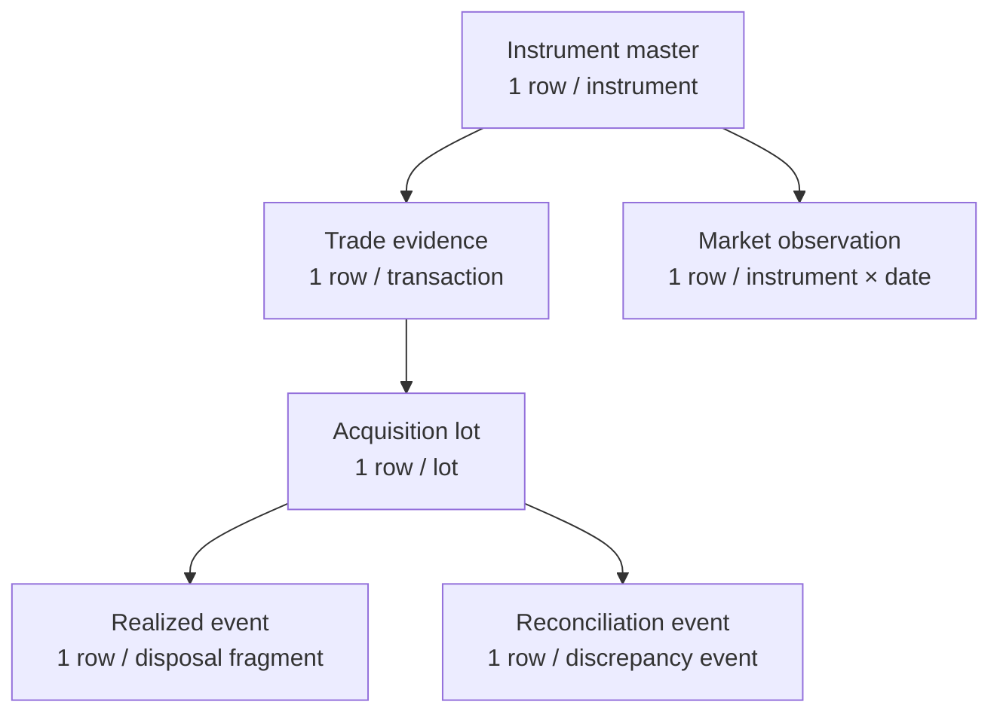
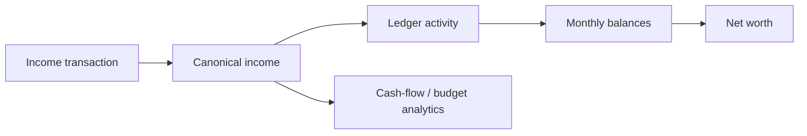

# Financial Model

A financial platform becomes much easier to reason about once every number has to answer two questions:

1. **What kind of truth am I?**
2. **Who is allowed to create me?**

I use that discipline throughout Personal Finance ETL. The result is not one monolithic “finance table.” It is a chain from evidence to canonical facts to reconstructed state to measures to presentation.



The sequence is simple. The semantics are not.

## 1. Observed evidence: what a source actually said

Observed evidence is the least interpreted layer of the financial model.

Examples include:

- household income, expense, transfer, and opening-balance records;
- broker purchase/sale exports;
- observed broker holdings where available;
- market closing prices;
- benchmark levels;
- FX observations;
- configuration inputs.

Observation does not imply completeness or correctness. It means the system preserves the source claim before replacing it with a model conclusion.



A malformed populated numeric is therefore not equivalent to a missing optional numeric. `domain/common/validation.py` treats that difference as an explicit source-quality concern.

```python
# src/personal_finance_etl/domain/common/validation.py
NULL_SENTINELS = ["null", "none", "nan", "-", "--", "n/a", "na"]

class FinancialSourceValidationError(ValueError):
    """Raised when a populated financial source value cannot be parsed safely."""
```

The key idea is that plausibility is not evidence quality. Turning an invalid value into zero may make a pipeline green while making the financial output less trustworthy.

## 2. Canonical facts: normalize meaning, not history

Canonicalization removes vendor/source representation differences while preserving economic meaning.

A broker can call quantity `Qty`, `Units`, or something much more creative. The canonical investment model wants `Quantity` with a known grain and meaning.

Likewise, household transactions are normalized into stable dimensions such as:

- date;
- account/asset identity;
- category;
- base amount;
- cash/non-cash semantics;
- income/expense classification.

Canonical facts should be reusable by multiple downstream models. If a transformation is specific to one chart, it probably does not belong here.

## 3. Reconstructed state: what follows from accepted facts

Reconstructed state is calculated, but it is not arbitrary.

Examples include:

- household monthly balances;
- active acquisition lots;
- realized disposal events;
- reconstructed daily holdings;
- reconciliation adjustments;
- monthly net worth;
- investment terminal state.

The distinction between fact and reconstruction is crucial.

A purchase transaction says an acquisition occurred. It does **not** by itself say which lot remains open after three later sales. FIFO reconstruction produces that state.



## 4. Analytical measures: questions asked of state

Measures answer questions about facts/state:

- XIRR;
- CAGR;
- benchmark-relative performance;
- unrealized/realized P/L;
- FX attribution;
- savings rate;
- liquidity/runway;
- budget-health scores;
- Tax estimates.

Measures should carry validity semantics where a result can be unavailable or not computable.

`0.0` is a financial value. “Not computable” is a state. Those are not synonyms.

## 5. Presentation and planning: decision surfaces

Gold marts, Power BI, CLI/Desktop summaries, and FIRE scenarios live downstream of the model.

Presentation may aggregate or reshape canonical state. It should not silently redefine the underlying financial semantics.

Planning goes one step further: it introduces assumptions about the future.

That creates a separate epistemic category:

```text
historical evidence        != reconstructed history
reconstructed history      != analytical measure
analytical measure         != forecast
forecast                   != stochastic scenario
```

## Household ontology: activity, balances, wealth

The household model separates **activity** from **state**.

Activity includes:

```text
income
expense
transfer
```

State includes:

```text
opening balance
closing balance
market-adjusted asset value
liability value
net worth
```

Transfers deserve their own semantics because they move value between owned accounts without necessarily creating income or expense.

If I transfer ₹100,000 from bank to brokerage, household wealth did not increase by ₹100,000. The money changed location. Calling that income would make savings analytics absolutely shredded and completely wrong.

## Canonical household flags are part of the model

Household source transformations produce classifications used downstream, including concepts such as:

- active income;
- dividend income;
- interest income;
- non-cash income;
- core expense;
- cash-pool membership;
- non-cash P/L;
- cash-flow activity type.

These flags are semantic contracts because cash-flow, budget, FIRE, and wealth models use them differently.

## Investment ontology: instrument, trade, market, lot, event

Investments require more distinct grains:



The data model deliberately does not force these into one universal “investment row.” Different economic concepts deserve different grains.

## The investment contract layer makes the vocabulary explicit

`domain/investments/contracts.py` contains the in-memory typed vocabulary used across the investment engine.

```python
# src/personal_finance_etl/domain/investments/contracts.py
class LotAction(StrEnum):
    BUY = "BUY"
    SELL = "SELL"
    SPLIT = "SPLIT"
    BONUS = "BONUS"
    DIVIDEND_REINVEST = "DIVIDEND_REINVEST"
    RECONCILIATION = "RECONCILIATION"
```

A lot action is not a random string scattered through the pipeline. It is a finite domain vocabulary.

The same module separates master metadata, trades, cashflows, terminal values, realized events, reconciliation events, metrics, lots, snapshots, and per-instrument processing results.

That separation is not ceremony. It makes chronology and ownership reviewable.

## Identity is a financial contract

Deterministic identity is centralized under `domain/common/identity.py`.

```python
# src/personal_finance_etl/domain/common/identity.py
def generate_deterministic_id(namespace: str, fields: Mapping[str, object]) -> str:
    ordered = _ordered_identity_fields(namespace, fields)
    normalized = [(key, canonicalize_value(value)) for key, value in ordered]
    payload = json.dumps([namespace, "v2", normalized], separators=(",", ":"), ensure_ascii=False)
    return hashlib.sha256(payload.encode("utf-8")).hexdigest()[:32]
```

Identity is therefore defined by:

- namespace;
- ordered identity fields;
- canonical value normalization;
- serialization protocol;
- hash/truncation.

Changing those is a data-contract change even if no monetary formula changes.

## Time has several meanings

Finance uses multiple dates:

- transaction date;
- acquisition date;
- disposal date;
- valuation date;
- reconciliation date;
- month start/end;
- financial year;
- simulation horizon date.

A date column should therefore describe which clock it belongs to.

Chronology matters especially for FIFO and market reconstruction. Monthly household analytics can often aggregate activity by month while still preserving transaction-level evidence upstream.

## Currency is not decoration

A multi-currency investment can simultaneously have:

```text
transaction price in local currency
book value in local currency
book value in INR/base currency
market value in local currency
market value in INR/base currency
asset P/L
forex P/L
```

Collapsing these to `Value` destroys attribution.

The model instead preserves local/base values and later decomposes performance into asset and FX effects.

## Book state versus market state

Household balances and investment cost bases answer a different question from market value.

```text
book / reconstructed balance:
    what amount follows from recorded activity?

market value:
    what is the position worth under current/observed market prices?
```

Net worth uses market values where the financial model has a valid market-valued representation. It does not rewrite ledger history to achieve that presentation.

## Realization is an event boundary

Unrealized P/L belongs to open state.

Realized P/L exists when a disposal consumes acquisition basis.

That is why the investment model creates explicit realized-event records rather than simply subtracting two portfolio snapshots.

A realized event can retain:

- acquisition date;
- disposal date;
- quantity disposed;
- disposed cost basis;
- proceeds;
- realized gain/loss;
- holding classification;
- currency/FX attribution;
- estimated Tax context;
- lineage back to sale, purchase, and lot identifiers.

That structure becomes critical later for Tax methodology.

## Reconciliation is a financial fact, not an embarrassment

Reconstruction can disagree with an independent broker observation.

The system does not erase that disagreement.

`ReconciliationEventDict` preserves both sides:

```python
# src/personal_finance_etl/domain/investments/contracts.py
class ReconciliationEventDict(TypedDict, total=False):
    Reconstructed_Quantity: float
    Observed_Quantity: float
    Broker_Quantity: float
    Delta_Quantity: float
    Quantity_Adjustment: float
    Reconstructed_Cost_Basis: float | None
    Observed_Cost_Basis: float | None
    Delta_Cost_Basis: float | None
```

The discrepancy itself becomes evidence about model-vs-observation convergence.

## Tax is downstream of financial events

The Tax domain consumes Tax-relevant events and classifications. It does not become the source of FIFO realization.

This preserves a useful authority chain:

```text
trades
→ lots / realized financial events
→ Tax classification
→ indicative Tax estimates
→ Tax presentation
```

The Tax engine therefore does not need to independently reinvent investment chronology.

## Planning is downstream of present-state finance

FIRE and Monte Carlo consume present financial state plus assumptions.

They do not change historical truth.

A simulation result is reproducible under its model/input fingerprints, but stochastic output remains modeled uncertainty.

That distinction prevents a common analytical category error: treating a percentile path as if it were an account balance that already exists.

## Financial rules are semantic configuration

`FinancialRules` separates policy from mechanics.

Household rules define classifications and budget behavior. Investment rules define portfolio policy. Tax rules define configured assumptions. FIRE rules define future-model assumptions.

The code can therefore answer:

> Which policy produced this result?

without embedding the answer inside twenty separate modules.

## Failure philosophy: reject ambiguity before it compounds

Financial failure handling follows a few strong rules:

1. malformed required evidence fails early;
2. missing/invalid/zero remain distinguishable;
3. incomplete provider evidence is not silently complete;
4. observed/reconstructed disagreement is modeled explicitly;
5. unsupported Tax certainty is not claimed;
6. stochastic outputs are not described as deterministic truth.

The objective is not to make every run succeed. It is to avoid producing believable nonsense.

## Analytical lineage example: salary to net worth



The income remains a transaction fact. The balance is reconstructed state. Net worth is a monthly valuation/aggregation. Budget metrics are measures.

## Analytical lineage example: investment sale to Tax evidence


Each step adds meaning without pretending to be the earlier step.

## What the model deliberately does not claim

It does not claim that:

- reconstructed holdings are independently broker-certified;
- indicative Tax estimates are statutory Tax liability;
- one database table is authoritative for all finance;
- all missing financial data can be safely defaulted;
- stochastic FIRE outputs predict the future;
- reconciliation disagreement should be hidden.

Those limitations are part of the model, not documentation disclaimers stapled on afterward.

## The next question

Once the truth categories are clear, household finance becomes the simplest place to watch the model operate end-to-end: transactions become monthly activity, monthly activity becomes balances, and balances become wealth state.

That is the subject of [Cashflow & Wealth](cashflow-and-wealth.md).

## Related specifications

- [Cashflow & Wealth](cashflow-and-wealth.md)
- [Investment Data Model](investment-data-model.md)
- [Deterministic Identity & Replay](../architecture/deterministic-identity-and-replay.md)
- [Financial Rules Reference](../configuration/financial-rules-reference.md)
