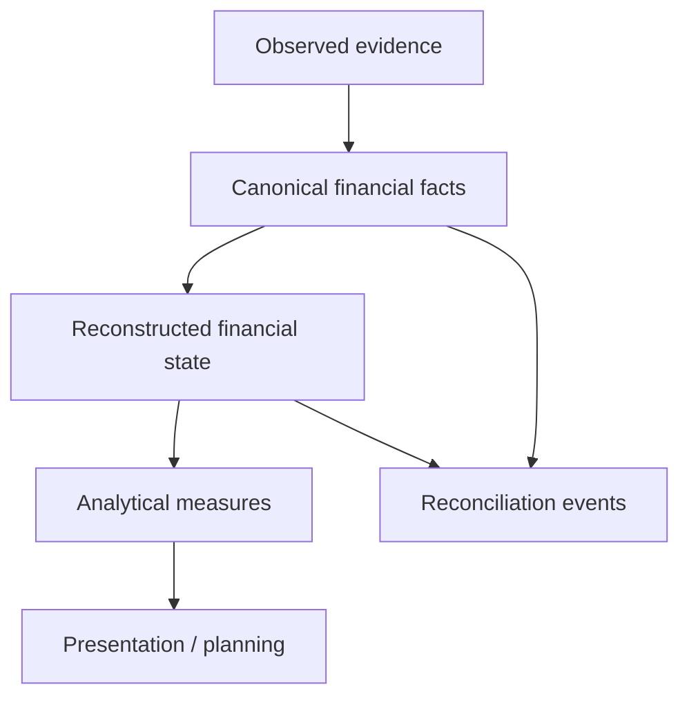
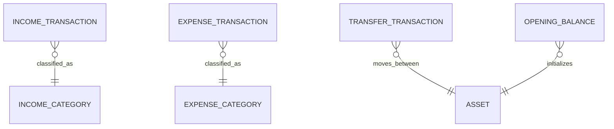
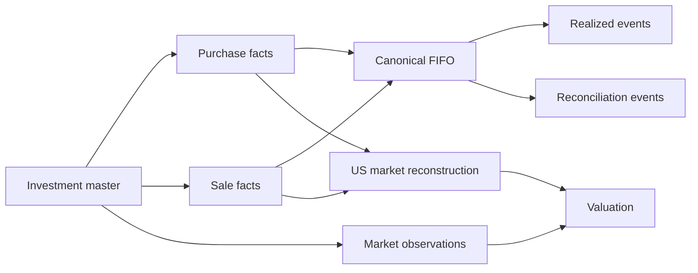
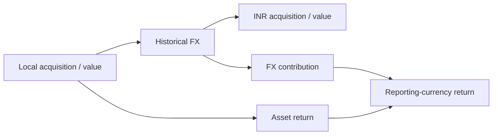
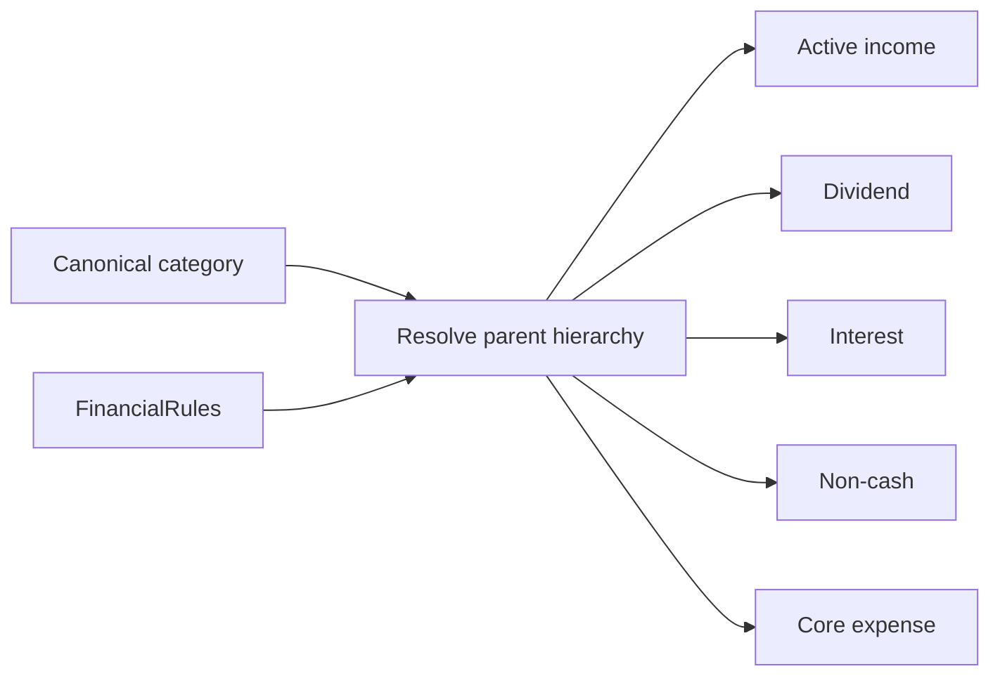
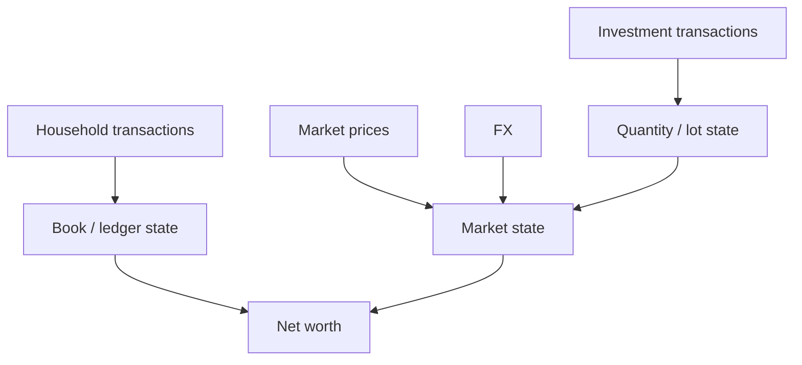
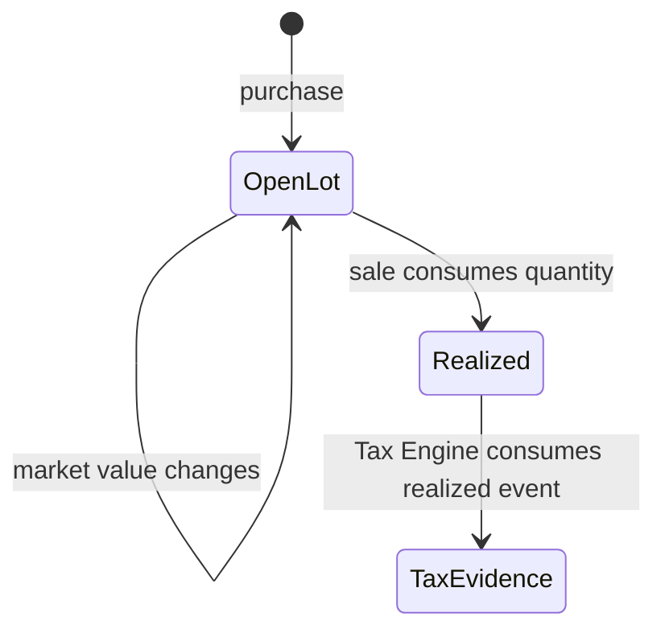
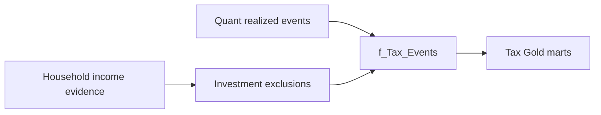
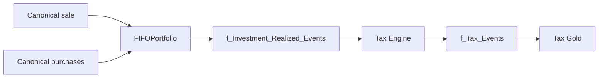
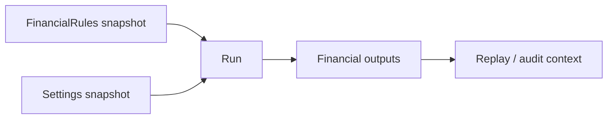

# Financial Model

Personal Finance ETL models personal finance as a lineage of evidence and state transitions rather than as a single giant ledger. Household cashflow, investment evidence, market reconstruction, canonical FIFO, tax preparation and stochastic planning deliberately have different authorities. That separation is the core financial design: a number can be mathematically correct and still be semantically wrong if it is presented as the wrong kind of fact.

## Scope and source authorities

Primary implementation anchors:

```text
backend/transform/facts.py
backend/transform/investments.py
backend/transform/currency_transformer.py
backend/transform/us_stocks_transformer.py
backend/engines/analytics/
backend/engines/tax/
backend/engines/presentation/
backend/config/financial_rules.py
```

The physical Silver and Gold schemas are specified in Reference. This page owns the logical financial ontology and subsystem authority.

## The five levels of financial truth



### 1. Observed evidence

Observed evidence enters from household databases, broker exports, market files, currency histories, mappings and configured rules. Observation describes provenance, not correctness. A broker row can still require normalization, mapping, deduplication or reconciliation.

### 2. Canonical facts

Canonical facts are stable normalized records such as income transactions, expense transactions, transfers, opening balances, purchases, sales and market observations. Their job is to remove source-specific shape before financial engines reason about them.

### 3. Reconstructed state

Some financially useful state is not supplied directly. Historical US holdings are reconstructed from transactions; FIFO acquisition lots are reconstructed from purchase/sale evidence. These are deterministic derivatives of evidence, not new observations.

### 4. Analytical measures

Return, XIRR, benchmark comparison, risk, realized/unrealized gain, FX attribution, net worth and cashflow efficiency are calculations over canonical or reconstructed state.

### 5. Presentation and planning

Gold marts and FIRE simulations consume the analytical model. A Monte Carlo percentile is intentionally farther from source evidence than a purchase transaction. That is fine, provided the lineage remains explicit.

## Household financial ontology

Household finance starts from four canonical fact families:



Income and expense facts describe economic inflow/outflow. Transfers describe movement between balance-sheet locations and must not automatically become income or expense. Opening balances establish the starting state required to reconstruct balances before the transaction history.

This distinction prevents a transfer from being counted as household earnings merely because cash arrived in one account. Money changing pockets is not magically a salary.

## Canonical transaction normalization

`backend/transform/facts.py` centralizes common transaction cleanup through `get_base_transactions()`. Source columns are mapped to canonical names, dates and amounts are normalized, and category/subcategory relationships are prepared before fact-specific logic executes.

The specialized producers are:

```python
def transform_f_income_transactions(...):
    ...

def transform_f_expense_transactions(...):
    ...

def transform_f_transfer_transactions(...):
    ...

def transform_f_opening_balances(...):
    ...
```

The functions share infrastructure but preserve distinct financial semantics. That is preferable to one generic transaction fact whose meaning depends on a mysterious `Type` column three joins later.

## Investment financial ontology



The investment model deliberately separates:

- instrument identity and classification;
- transaction evidence;
- market observations;
- reconstructed historical holdings;
- canonical acquisition lots;
- realized disposals;
- reconciliation events.

The distinction between historical US holdings reconstruction and canonical FIFO is especially important. Both process transactions, but they answer different questions. The former creates a daily market-state spine for valuation. The latter owns acquisition-lot provenance and disposal realization.

## Identity as a financial contract

Purchases and sales receive deterministic IDs in `backend/transform/investments.py`. Those identities become upstream anchors for lots and realized events.

```python
def _compute_purchase_id(row: dict[str, Any]) -> str:
    return make_id(
        "PURCHASE",
        ISIN=row.get("ISIN"),
        Date=row.get("Date"),
        Price=row.get("Price"),
        Quantity=row.get("Quantity"),
        CURRENCY_ID=row.get("CURRENCY_ID"),
    )
```

The exact serialization protocol belongs to Deterministic Identity and Replay. Financially, the important property is continuity: downstream lot/event identities do not depend on incidental DataFrame row order.

## Currency model

Investment economics are modeled in both local/instrument currency and INR reporting currency where applicable. The system does not treat currency translation as decorative formatting. Historical FX participates in acquisition basis, valuation and return attribution.



This is why a foreign asset can appreciate locally while producing a different INR outcome. Conflating those effects would erase economically meaningful information.

## Financial rules as semantic configuration

`FinancialRules` does not merely hold UI preferences. It controls financial interpretation including classifications, investment mappings, tax exclusions, macro assumptions and FIRE model parameters. Rules therefore participate in reproducibility and should be treated as model inputs.

## Authority matrix

| Financial question | Authority |
|---|---|
| What source artifact was observed? | Control Plane/source evidence |
| What canonical household transaction occurred? | Silver household facts |
| What canonical investment purchase/sale occurred? | Silver investment facts |
| What was reconstructed US historical market state? | US market transformer |
| Which acquisition lot funded a disposal? | Quant `FIFOPortfolio` |
| What realized investment event occurred? | Quant realized events |
| Why does reconstructed investment state differ from observation? | Quant reconciliation events |
| What tax-preparation evidence exists? | Tax Engine |
| What is current analytical wealth/cashflow state? | Presentation Engine / Gold |
| What does a stochastic future distribution look like? | FIRE simulation |

## Invariants

1. Observed evidence and reconstructed state must remain distinguishable.
2. Transfers must not silently become income/expense.
3. Canonical purchase/sale identities must be deterministic for equivalent financial evidence.
4. Quant owns canonical FIFO and realized investment gains.
5. Historical market reconstruction must not be described as broker-certified holdings evidence.
6. Tax estimates remain indicative, not statutory liability.
7. Currency translation must preserve the distinction between local economics and INR reporting.
8. Stochastic planning output must not be confused with deterministic financial reconstruction.

## Failure philosophy

The finance layer generally prefers explicit failure over silently manufacturing financial state when critical inputs are invalid. Examples include stale US prices, invalid FX observations and missing contract outputs. Where approximation is accepted, the approximation is surfaced through fields such as price age/imputation or evidence status rather than being hidden.

## Trade-offs

The model carries more tables and more explicit state than a single-ledger design. That complexity buys clearer ownership, deterministic reconstruction, reconciliation provenance and the ability to distinguish accounting movement from market economics. For this workload, semantic clarity is worth a few extra joins.

## Canonical household classification flags

The household model carries analytical classification into canonical facts instead of repeatedly re-deriving it in every Gold builder. Income classification can mark active income, dividends, interest and non-cash income from configured category/subcategory sets. Expense classification can mark core expenses. The rules are applied after category hierarchy resolution, so either a configured parent category or a configured subcategory can drive the flag.

```python
active_cat = [uid.upper() for uid in rules.income.active.category_ids]
active_sub = [uid.upper() for uid in rules.income.active.sub_category_ids]
...
pl.when(
    pl.col("CATEGORY_ID").str.to_uppercase().is_in(active_sub)
    | pl.col("PARENT_ID").str.to_uppercase().is_in(active_cat)
).then(True).otherwise(False).alias("Is_Active_Income")
```

This is a semantic contract: later analytics consume an explicit classification rather than embedding private copies of category logic.



## Financial time

The model contains several notions of time that must not be casually collapsed:

| Time concept | Meaning |
|---|---|
| transaction date | when household/investment evidence is effective |
| valuation date | date for which market state is calculated |
| observation date | date on which a price/FX observation actually exists |
| acquisition date | start of lot holding period |
| disposal date | realization date |
| financial year | tax/macro classification period |
| month start/end | presentation and wealth aggregation boundaries |

The US market transformer makes observation time visible because a valuation on a weekend may legitimately use Friday's observation. FIFO uses acquisition/disposal dates for holding-period classification. Wealth builders aggregate to calendar-month state. Same `Date` datatype, very different semantics.

## Book state versus market state

Household ledger reconstruction is primarily a book-state problem. Investment valuation is a market-state problem. The two meet in wealth analytics but should not be merged prematurely.



An investment purchase can reduce cash and increase investment exposure on the same economic day. Household cashflow records the movement; Quant/market analytics determine the investment's current value. This avoids deriving market wealth from historical cash paid.

## Realization boundary

A market-value change is not automatically realized income. The Quant Engine creates realized events only when disposal consumes acquisition lots. This boundary matters downstream for tax evidence.



Unrealized appreciation can affect wealth without becoming a realized disposal event. That is an elementary finance distinction, but encoding it structurally prevents a surprisingly non-elementary class of reporting bugs.

## Reconciliation as a first-class financial fact

Reconciliation does not mutate history invisibly. When reconstructed investment quantity or basis disagrees with an accepted observation, Quant can create explicit reconciliation evidence and synthetic/adjusted lot state. The model therefore distinguishes:

```text
observed state
reconstructed state
reconciliation event
post-reconciliation state
```

This is intentionally more verbose than simply overwriting quantity. Financial systems tend to become very confident once the evidence of their own corrections has been deleted.

## Tax boundary

Tax is downstream of canonical household income and Quant realized events. The Tax Engine does not independently rebuild investment FIFO. FinancialRules contains investment-related exclusion lists so household ledger categories already represented by Quant gains can be omitted from the tax ledger path and avoid double counting.



`f_Tax_Events` is therefore a normalized tax-preparation evidence layer, not a declaration that the application has calculated final statutory liability.

## Planning boundary

FIRE consumes current financial state and configured stochastic assumptions. It is intentionally downstream from deterministic accounting/reconstruction.

```text
financial evidence -> deterministic state -> planning inputs -> stochastic paths
```

A Monte Carlo result is not allowed to flow backward and alter historical financial facts. The future can be simulated; the past does not get a rewrite because one random path looked nicer.

## Data quality semantics

The model uses several strategies depending on what missingness means:

- missing optional classification can become a conservative default flag;
- missing critical valuation price/FX can fail;
- a non-trading-day price may be backward-filled within an accepted staleness window;
- a reconciliation discrepancy becomes explicit evidence;
- an unavailable optional presentation input can cause a builder to return an empty result rather than invent data.

The important principle is that `null`, zero, unavailable, imputed and reconciled are not synonyms.

## Producer/consumer boundaries

| Producer | Produces | Principal consumers |
|---|---|---|
| household transformations | canonical household facts | presentation, tax |
| investment transformations | canonical investment facts | market reconstruction, Quant |
| currency pipeline | canonical FX | reconstruction, Quant |
| US market transformer | reconstructed historical market state | Quant/analytics |
| Quant | lots, realized events, reconciliation, analytics | tax, presentation |
| Tax Engine | tax events and tax Gold | presentation/BI |
| Presentation Engine | wealth/cashflow/investment Gold | BI/decision use |

This ownership map is more important than package layout. Moving a Python file should not change which subsystem is financially authoritative.

## What this model deliberately does not claim

- A reconstructed holding is not an independently observed broker holding.
- An indicative tax estimate is not final statutory liability.
- A Gold aggregation is not more authoritative than its canonical evidence merely because it is easier to chart.
- A stochastic percentile is not a deterministic forecast.
- INR translation does not erase local-currency economics.
- Reconciliation does not prove which upstream source was objectively correct; it records how the system resolved the accepted state difference.

## Analytical lineage examples

### Household salary to wealth


At no point does the Gold layer need to rediscover whether the source row was active income if that classification has already been made canonically.

### Investment sale to tax evidence



This lineage is intentionally longer than `sale amount × tax rate`. The extra stages preserve acquisition provenance, holding period, realized gain and tax evidence quality.

## Financial sign conventions

Sign is part of a contract, not presentation decoration. Transfer transformation explicitly creates a signed `AMOUNT_PROPER`; tax credits can retain negative household-ledger conventions; local and INR P&L fields preserve economic direction. Downstream consumers should use documented field semantics rather than normalize every negative number into an absolute value for visual convenience.

## Configuration provenance

Because `FinancialRules` and runtime settings materially affect classification and planning, the Control Plane snapshots them per run. That connects the finance model back to reproducibility: a historical result is interpreted in the context of the rules that produced it, not whatever configuration happens to be on disk today.



## Model review checklist

When adding a new financial concept, the implementation should answer five questions before a new column appears in Gold:

1. What evidence supports the concept?
2. Is it canonical, reconstructed, reconciled, estimated or stochastic?
3. What is its grain and deterministic identity, if any?
4. Which subsystem owns the calculation?
5. What failure or missing-data behavior is financially honest?

If those questions cannot be answered, the model is not ready for another metric, no matter how attractive the dashboard card would look.

## Related specifications

- [Financial Model](financial-model.md)
- [Cashflow and Wealth](cashflow-and-wealth.md)
- [Investment Data Model](investment-data-model.md)
- [Investment Market Reconstruction](investment-market-reconstruction.md)
- [FIFO and Realized Events](fifo-and-realized-events.md)
- [Investment Reconciliation](investment-reconciliation.md)
- [Investment Performance and Risk](investment-performance-and-risk.md)
- [Multi-Currency and FX](multi-currency-and-fx.md)
- [Tax Methodology](tax-methodology.md)
- [FIRE Methodology](fire-methodology.md)
- [Data Model](../architecture/data-model.md)
- [Silver Data Contracts](../reference/silver-data-contracts.md)
