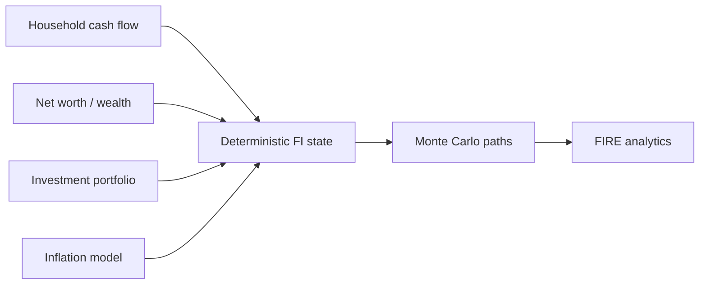
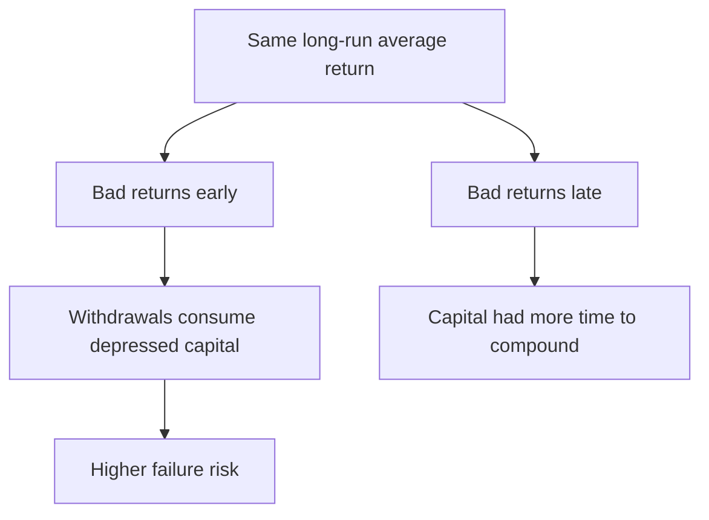

# FIRE Methodology

Financial Independence modeling begins exactly where historical reconstruction stops.

The current balance sheet is evidence-backed. The future is not.

That sounds obvious, but it is the most important methodological boundary in this document.

> **FIRE outputs are model results conditioned on current state and configured assumptions. They are not forecasts with guaranteed outcomes.**

The implementation therefore separates two layers:

```text
deterministic FI state
    ↓
stochastic future-path simulation
```

The first tells me where I stand. The second stress-tests where I might go.

---

## 1. FIRE is downstream of the financial system

FIRE does not invent its own opening wealth, spending, savings, inflation, or portfolio values.

It consumes state produced by the household, wealth, investment, and inflation domains.



This ownership matters because FIRE should not quietly recalculate financial history with a different definition of net worth.

---

## 2. Application orchestration remains outside the model

`WealthService` coordinates the full wealth presentation DAG.

It invokes:

```text
InflationBuilder
LedgerBuilder
NetWorthBuilder
SpendAnalyticsBuilder
IncomeStreamsBuilder
BudgetForecastBuilder
InvestmentAnalyticsBuilder
WealthRiskAnalyticsBuilder
MonthlyCashflowSummaryBuilder
CashflowStatementBuilder
```

The FIRE-specific financial logic lives in `domain.fire`.

The application layer owns ordering and failure propagation.

One particularly important guard is inflation computation failure:

```python
cpi_res = inflation_res.get("cpi_result")
if cpi_res and cpi_res.status == CalculationStatus.COMPUTATION_ERROR:
    raise RuntimeError(
        f"Inflation computation failed: {cpi_res.reason}. "
        "Aborting presentation DAG to prevent corrupted downstream FIRE state."
    )
```

A failed inflation model is not converted into “close enough, probably 6%.”

That is the right kind of boring.

---

## 3. Deterministic FIRE begins with current financial state

`WealthRiskAnalyticsBuilder` consumes monthly wealth/cash-flow state and investment portfolio values.

Its inputs include:

```text
Total_Net_Worth
Total_Net_Worth_Market
Total_Income
Total_Cash_Income
Total_Core_Expense
Total_Expense
INFLATION_YOY_PCT
CPI_INDEX
Liquid_Assets_Market
```

It also derives:

```text
Net_Savings = Cash_Income - Core_Expense
Net_Savings_Total = Cash_Income - Total_Expense
```

The distinction between core and total expense lets deterministic FI metrics answer both a core-lifestyle and total-spend question.

---

## 4. After-tax market wealth is an analytical adjustment, not liquidation truth

When investment market value exceeds book value, the deterministic builder applies the configured equity LTCG rate to the unrealized portfolio gain for its after-tax wealth proxy.

Conceptually:

\[
NW_{after\ tax}
=
NW_{market}
-
\max(0, V_{portfolio} - B_{portfolio}) \times t
\]

The source implements the same idea with Polars:

```python
pl.when(pl.col("Port_Market_Value") > pl.col("Port_Book_Value"))
.then(
    pl.col("Total_Net_Worth_Market")
    - (
        (pl.col("Port_Market_Value") - pl.col("Port_Book_Value"))
        * self._tax_rate
    )
)
.otherwise(pl.col("Total_Net_Worth_Market"))
.alias("Total_Net_Worth_Market_Af_Tax")
```

This is intentionally an analytical proxy.

It is not a full liquidation-Tax engine across every asset class and holding-period rule.

---

## 5. Spending and savings are smoothed before planning

The builder computes rolling spending/savings features:

```text
Trailing 3M average spend
Trailing 6M average spend
Trailing 12M average spend
Trailing 12M spend
Trailing 6M / 12M average savings
Trailing 12M savings
```

A planning system should not let one unusually expensive month redefine lifetime FI needs.

Rolling windows make current behavior more stable while still remaining responsive to regime changes in household spending.

---

## 6. Current FI target

The configured `swr_multiplier` is used as a target multiple.

\[
TargetFI = Trailing12MSpend \times SWRMultiplier
\]

If the multiplier is 25, the implied withdrawal rate is 4%.

The implementation keeps both core-spend and total-spend variants:

```text
Target_FI_Today
Target_FI_Today_Total
```

This avoids pretending “essential independence” and “current total lifestyle independence” are the same target.

---

## 7. Current FI coverage

Coverage compares after-tax market wealth with the current FI target.

\[
FICoverage = \frac{AfterTaxMarketNetWorth}{TargetFI}
\]

The implementation uses `safe_divide()` instead of allowing zero denominators to produce mathematically decorative infinity.

A coverage of 1.0 means current modeled wealth equals the target under current spending assumptions.

It does not mean the future is guaranteed.

---

## 8. Linear runway

A simple runway metric compares after-tax market wealth with recent spending.

\[
RunwayMonths = \frac{AfterTaxMarketNetWorth}{Trailing3MAvgSpend}
\]

This is intentionally linear.

It ignores future returns, inflation dynamics, sequence risk, and spending changes.

That makes it useful precisely because it is simple. It is a stress indicator, not a retirement simulation.

---

## 9. Coast FI

Coast FI asks whether current wealth could compound to the target over a configured horizon without future contributions.

The model uses a configured real return and number of years.

Conceptually:

\[
CoastFIToday = \frac{FutureFITarget}{(1+r_{real})^n}
\]

The exact target semantics remain tied to the current deterministic FI policy.

Coast FI is useful as a **capital sufficiency** lens, not as a statement that future savings are irrelevant in real life.

---

## 10. Lean FI

Lean FI scales the primary FI target by a configured ratio.

\[
LeanFI = TargetFI \times LeanRatio
\]

This makes the alternative lifestyle target explicit instead of hiding a “reduced spend assumption” inside a chart.

Policy belongs in `FinancialRules`; methodology belongs here.

---

## 11. Inflation is built as a continuous monthly series

`InflationBuilder` creates a monthly calendar, performs a backward as-of join to macro inflation parameters, applies configured fallback inflation when required, and compounds a CPI-like index.

```python
lf_inflation = (
    lf_months.sort("MONTH_START_DATE")
    .join_asof(
        lf_macro.sort("FY_Start_Date"),
        left_on="MONTH_START_DATE",
        right_on="FY_Start_Date",
        strategy="backward",
    )
    .with_columns(
        pl.col("Inflation_Rate")
        .fill_null(self.rules.assumptions.macro.fallback_inflation_rate)
        .alias("INFLATION_YOY_PCT")
    )
)
```

The important temporal rule is backward-looking policy assignment.

Future macro values are not allowed to leak backwards into earlier months.

---

## 12. CPI validity is typed

The latest CPI extraction returns a typed `CpiResult` with statuses such as:

```text
VALID
NO_OBSERVATION
INVALID_INPUT
COMPUTATION_ERROR
```

That is better than returning `NaN` and hoping downstream FIRE math understands the emotional context.

The application aborts on computation error because corrupted inflation contaminates every downstream real-value interpretation.

---

## 13. Deterministic state hands off to a stochastic model

The deterministic builder constructs a feature vector containing values such as:

```text
After-tax market net worth
Trailing savings
Trailing spending
Current FI target
Inflation
Age in months
Deterministic monthly seed
```

Then Polars passes each monthly feature row into the Monte Carlo batch engine.

This is a deliberate materialization/computation boundary: the high-level pipeline stays columnar, while the stateful simulation kernel runs in NumPy/Numba-oriented numerical code.

---

## 14. Reproducible randomness

The root seed is not used directly for every month.

`domain/fire/reproducibility.py` derives a deterministic offset from SHA-256 and combines it with year/month.

```python
def derive_monthly_seed(root_seed: str, year: int, month: int) -> int:
    offset = derive_simulation_seed_offset(root_seed)
    return year * 12 + month + offset
```

So the same root seed and evaluation month produce the same local seed.

That gives the stochastic layer a reproducible envelope without pretending Monte Carlo is deterministic financial reconstruction.

---

## 15. Why reproducibility matters

A simulation result can change for at least four legitimate reasons:

```text
financial input changed
policy changed
model changed
random seed changed
```

If seed derivation is uncontrolled, it becomes impossible to tell the fourth reason from the first three.

Reproducible seed derivation removes one source of unexplained drift.

The Configuration documentation separately describes how rules/settings and simulation inputs are fingerprinted.

---

## 16. The return process is not one Gaussian draw

The simulation engine deliberately models multiple sources of path risk.

The batch wrapper extracts:

```text
expected real return
fat-tail multiplier
annual volatility
expense drag
jump probability
jump magnitude
Markov regime parameters
human-capital shock parameters
glide-path parameters
Guyton-Klinger parameters
inflation dynamics
```

The monthly return mean is adjusted for expense drag and expected jump drag before simulation.

This is not a claim that the model predicts markets. It is an attempt to stress wealth under a richer set of plausible path dynamics than a single constant-return assumption.

---

## 17. Fat-tail adjustment

The configured volatility is multiplied by a fat-tail factor before monthly scaling.

Conceptually:

\[
\sigma_m = \frac{\sigma_{annual} \times FatTailMultiplier}{\sqrt{12}}
\]

This widens return dispersion relative to a plain Gaussian assumption.

It is a modeling choice, not an empirical theorem.

---

## 18. Markov market regimes

The model supports distinct market regimes with a configured transition matrix and state-specific parameters.

A path can therefore move among states such as:

```text
bull
bear
stagnation
```

The important modeling idea is persistence.

Bad months need not be independent coin flips. A bear regime can remain a bear regime with configured transition probability.

---

## 19. Jump diffusion

Jump risk introduces discrete adverse return shocks with configured annual probability and magnitude.

The model separately adjusts expected return for jump drag and simulates jump events along paths.

This is useful for sequence-risk testing because a severe drawdown early in retirement is economically different from the same average return arriving smoothly.

---

## 20. Human-capital shocks

The simulation can model temporary savings/income disruption through configured human-capital shock probability, duration range, and benefit coverage.

That extends FIRE beyond “portfolio returns only.”

For an accumulation-stage household, employment/savings interruption can matter as much as short-term portfolio volatility.

---

## 21. Glide path

The model can alter equity/debt allocation as the FI date approaches and after FI.

Configured parameters include:

```text
base equity weight
FI-target equity weight
derisk start horizon
post-FI re-risk horizon
debt real return
debt volatility
```

This turns allocation into a path-dependent policy rather than a single static percentage.

---

## 22. Dynamic debt drawdown

The model can prefer debt drawdown under configured conditions rather than liquidating assets uniformly.

That behavior is part of the withdrawal policy, not an investment-return assumption.

Keeping these dimensions separate makes sensitivity analysis more interpretable.

---

## 23. Guyton-Klinger style spending adjustments

The simulation includes configurable withdrawal guardrails with upper/lower thresholds and lifestyle cut/raise multipliers.

Conceptually:

```text
portfolio stress worsens
    → spending can be cut

portfolio strength improves
    → spending can be raised within policy
```

This allows the model to represent adaptive retirement behavior rather than assuming a perfectly rigid real withdrawal path.

---

## 24. Inflation is stochastic inside future paths

Historical/current inflation establishes the starting state.

The future simulation can then evolve inflation using configured mean reversion, volatility, maximum inflation cap, and minimum deflation floor.

This distinction is essential:

```text
observed / policy-assigned historical inflation
≠
stochastic future inflation path
```

One is reconstruction. The other is modeling.

---

## 25. Accumulation and post-FI are different regimes

The simulation path changes behavior once FI is reached.

Before FI, the central questions involve:

- savings;
- compounding;
- income disruption;
- evolving target;
- asset allocation.

After FI, the central questions become:

- withdrawals;
- sequence risk;
- inflation;
- guardrails;
- portfolio survival.

One model spans both stages, but it does not pretend they have identical cash-flow mechanics.

---

## 26. Sequence-of-returns risk

Two paths can have the same long-run CAGR and radically different retirement outcomes.

Why?

Because withdrawals make return order matter.



This is why FIRE cannot be reduced to:

\[
FutureValue = PV(1+r)^n
\]

That formula is useful. It is not enough.

---

## 27. Success probability

Monte Carlo success probability is the share of simulated paths satisfying the implemented survival/FI criteria.

It should be interpreted as:

> **model-conditioned success frequency under the configured assumptions**

not:

> “the universe says I have an 87.4% chance of retiring successfully.”

The decimal precision may be real. The metaphysical certainty is not.

---

## 28. Percentile semantics

FIRE outputs include percentiles such as conservative/base/optimistic months-to-FI or wealth trajectories.

Direction matters.

For a “months to FI” metric:

```text
higher = worse / slower
```

For terminal wealth:

```text
higher = better / richer
```

Percentile labels therefore must be interpreted in the context of the metric direction, not by assuming P90 always means “good.”

---

## 29. Simulation provenance

A meaningful FIRE result should be traceable to:

```text
financial inputs
rules snapshot
model assumptions
seed/root seed
simulation inputs
result fingerprint / provenance
```

The Control Plane stores simulation-run provenance separately from ordinary ETL history.

That is appropriate because a simulation can be rerun under the same source evidence but different assumptions.

---

## 30. Numerical kernel exception

The Monte Carlo kernel is intentionally a large, cohesive Numba numerical unit.

This is one of the places where “make every function tiny” would damage the implementation.

The kernel has high local complexity because it evolves path state under interacting rules.

The engineering control is not arbitrary decomposition. It is:

- typed/configured inputs;
- a narrow wrapper;
- deterministic seed derivation;
- tested outputs/invariants;
- documented model assumptions.

Complexity should earn its existence. Here, it does.

---

## 31. FIRE guarantees

The FIRE layer guarantees reproducible **methodology** under the same inputs, rules, model implementation, and seed envelope.

It provides:

- deterministic FI metrics from current state;
- explicit configured assumptions;
- reproducible seed derivation;
- stochastic path simulation;
- percentile and probability outputs;
- model/input/result provenance;
- explicit separation between observed state and modeled future state.

---

## 32. FIRE does not guarantee the future

The model does not know:

- future market returns;
- future inflation;
- future employment;
- future spending preferences;
- future Tax law;
- future asset allocation decisions;
- future life events.

Those uncertainties are exactly why a distribution is more honest than a single-point forecast.

A sophisticated model can widen the questions I ask. It cannot abolish uncertainty with enough NumPy.

---

## 33. From FIRE to methodology language

Tax and FIRE now give us two very different calculation worlds:

```text
Tax
    evidence → classification → indicative estimate

FIRE
    current state → assumptions → stochastic distribution
```

Both still depend on a shared vocabulary:

```text
What does null mean?
When is zero a valid result?
When is a rate undefined?
Which metrics can be aggregated?
What grain does a metric live at?
```

That shared vocabulary is the final Finance specification: [Metrics & Methodology](metrics-and-methodology.md).

## Related specifications

- [Cash Flow & Wealth](cashflow-and-wealth.md)
- [Financial Rules Reference](../configuration/financial-rules-reference.md)
- [FIRE & Simulation Reference](../configuration/fire-and-simulation-reference.md)
- [Metrics & Methodology](metrics-and-methodology.md)
- [Deterministic Identity & Replay](../architecture/deterministic-identity-and-replay.md)
