# FIRE Methodology

Personal Finance ETL models financial independence as a combination of observed household economics, market-valued wealth, deterministic planning ratios and a configuration-driven stochastic simulation. The model is deliberately richer than a single return assumption, while remaining explicit about the fact that simulation output is conditional planning evidence, not a forecast guarantee.


## Scope and model boundary

The FIRE subsystem converts observed historical financial state into **planning metrics and stochastic future-state distributions**. It is downstream of household cashflow, market-valued net worth and investment analytics. It does not alter canonical financial evidence.

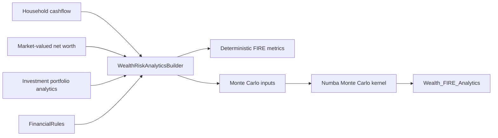

The distinction matters: FIFO reconstruction asks what happened; FIRE simulation asks what might happen. Deterministic financial history and stochastic planning should never be documented as the same kind of reproducibility.


## Execution ownership

`WealthRiskAnalyticsBuilder` in `backend/engines/presentation/modules/wealth_risk_analytics.py` prepares monthly planning inputs, deterministic FIRE metrics and the batch Monte Carlo call. `get_monte_carlo_fire_batch()` adapts Polars struct batches into NumPy arrays. `_run_mc_simulations_numba()` owns the simulation kernel.

The builder receives `root_seed`, which the presentation engine supplies from run context. Month-specific integer seeds are derived from calendar month plus a CRC32 of that root seed.

```python
(
    pl.col("_temp_year") * 12
    + pl.col("_temp_month")
    + (zlib.crc32(self.root_seed.encode("utf-8")) % 1_000_000)
)
.cast(pl.Int32)
.alias("Seed_Int")
```

Same month + same run context therefore reuses the same seed path. Different runs are intentionally not forced onto identical stochastic paths.


## Financial inputs

The monthly FIRE base includes market-valued net worth, cash income, core and total expenses, inflation/CPI, liquid assets and investment portfolio values. When investment portfolio analytics are available, the builder adjusts market net worth for an indicative tax drag on positive investment appreciation using the configured equity LTCG rate.

The simulation inputs are then built from trailing spending and savings measures rather than a single arbitrary month.

| Input family | Examples |
|---|---|
| wealth | `Total_Net_Worth_Market_Af_Tax` |
| savings | trailing 12M average total savings |
| burn | trailing 12M average total spend |
| target | current FI target |
| inflation | current YoY inflation |
| demographic | age in months |
| stochastic context | month/run-derived seed |

This design ties forward planning to the same monthly financial model used elsewhere in Gold.


## Deterministic FIRE layer

Before Monte Carlo, the builder computes deterministic planning metrics.

For a configured FI multiplier $m$ and trailing annual spend $S$:

$$
\text{Target FI Today} = S \times m
$$

Coverage is:

$$
\text{FI Coverage} = \frac{\text{After-tax Market Net Worth}}{\text{Target FI Today}}
$$

Linear runway is:

$$
\text{Runway Months} = \frac{\text{After-tax Market Net Worth}}{\text{Trailing Monthly Spend}}
$$

The builder also computes FI gap, Coast-FI target, Lean-FI target, withdrawal rate if retired now, required savings rate and linear months-to-FI estimates.

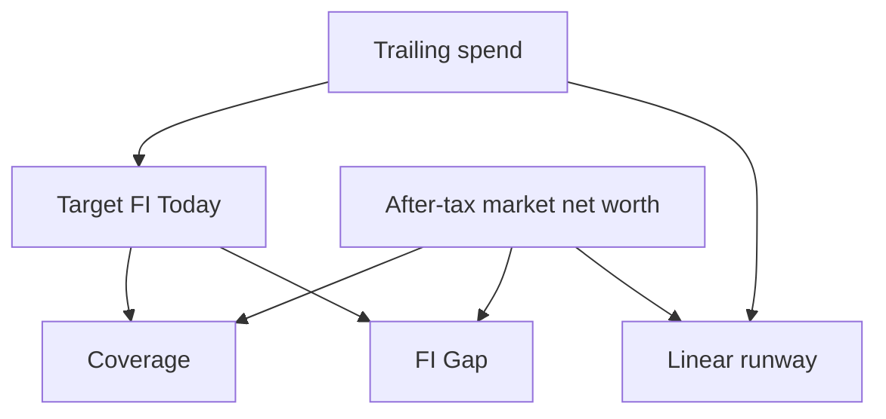


## Monte Carlo parameter surface

The stochastic model is configuration-driven through `FinancialRules.assumptions.monte_carlo` and related FIRE/CMA assumptions. The parameter surface includes:

- iterations and maximum horizon;
- annual volatility and CMA expected real return;
- fat-tail multiplier;
- Markov regime transition matrix and state parameters;
- human-capital shock probability/duration/coverage;
- glide-path de-risking and post-FI re-risking;
- equity/debt weights and debt return/volatility;
- dynamic debt-first drawdown behavior;
- jump probability and magnitude;
- expense-ratio drag;
- Guyton-Klinger thresholds and lifestyle adjustments;
- inflation mean reversion, volatility, cap and floor;
- sequence-of-returns diagnostic window;
- desired target age/lifespan horizon.

The simulation is therefore not “normal returns plus spending.” That ship sailed several configuration classes ago.


## Return process and fat-tail adjustment

The batch adapter derives monthly volatility from annual volatility and the configured fat-tail multiplier:

$$
\sigma_m = \frac{\sigma_a \times f_{tail}}{\sqrt{12}}
$$

The baseline monthly mean is derived from expected real return after expense drag and expected jump loss:

$$
\mu_m = (1+r_{real}-d-p_jJ)^{1/12}-1
$$

where $d$ is expense drag, $p_j$ annual jump probability and $J$ jump magnitude.

This is not a claim that markets literally follow this exact process. It is the implemented planning model, with assumptions made explicit and configurable.


## Markov market regimes

The simulation supports three configured market states: bull, bear and stagnation. A transition matrix controls movement between regimes; each state supplies its own return/volatility characteristics.

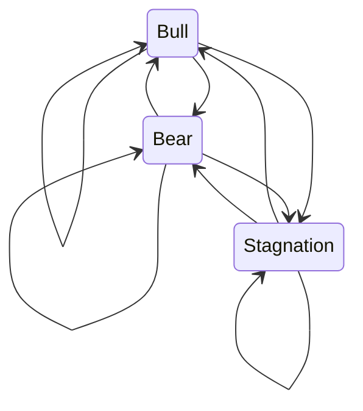

The purpose is to introduce serial market-state structure that a single stationary return distribution cannot express. Transition probabilities remain assumptions, not forecasts.


## Jump diffusion

Jump-diffusion parameters add discrete tail events on top of ordinary monthly market movement. The model receives annual jump probability and jump magnitude, and the expected-return baseline is adjusted for expected jump loss.

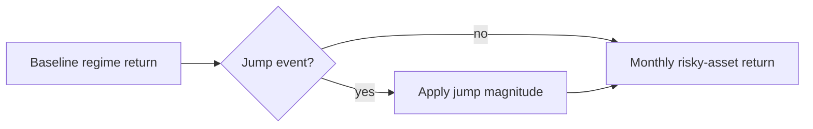

This provides a configurable stress mechanism for discontinuous losses rather than expecting a volatility scalar to carry every tail-risk story by itself.


## Human-capital shocks

Human-capital risk models temporary savings/income disruption. Configuration supplies shock probability, minimum/maximum duration and unemployment-benefit coverage.

A shock can therefore alter the contribution path even when the portfolio itself behaves normally.

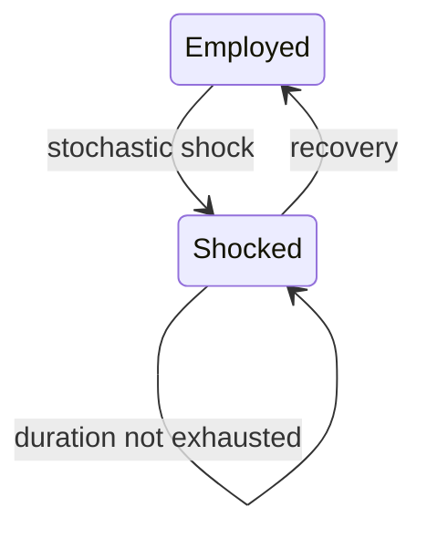

This is a meaningful FIRE distinction: portfolio risk is not the only risk to a savings plan. A model that assumes contributions arrive forever with Swiss-train punctuality is tidy, but life did not sign that SLA.


## Glide path and debt sleeve

The model supports a configurable equity glide path around FI. Parameters define when pre-FI de-risking begins, target equity weight at FI, post-FI re-risk duration, base equity weight, debt real return/volatility and optional debt-first drawdown behavior.

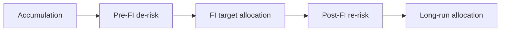

This allows sequence-risk management to be represented explicitly rather than assuming one static asset allocation throughout accumulation and retirement.


## Guyton-Klinger withdrawal behavior

Post-FI withdrawals can respond to portfolio conditions using configured Guyton-Klinger thresholds. The model includes upper/lower withdrawal thresholds plus lifestyle cut and raise multipliers.

Conceptually:

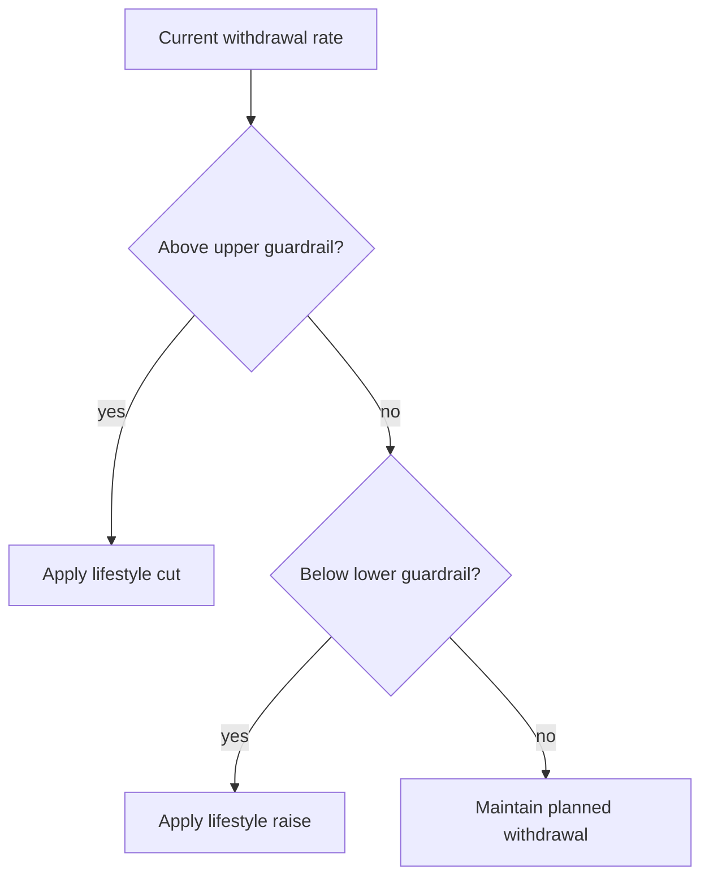

The implementation therefore does not require a perfectly rigid real withdrawal path after FI.


## Inflation process

Inflation is modeled dynamically with mean reversion, annual volatility, an upper cap and a deflation floor. Current observed inflation enters the simulation state rather than being discarded in favor of one eternal constant.

The planning implication is important: nominal future FI targets and spending paths are stochastic because inflation itself moves.

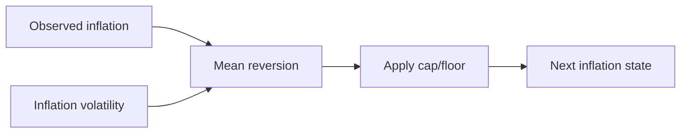


## Simulation lifecycle

For each monthly observation, the Polars batch adapter converts financial inputs to NumPy arrays, constructs `np.random.default_rng(seed)` generators, and calls the Numba kernel across configured iterations and horizon.

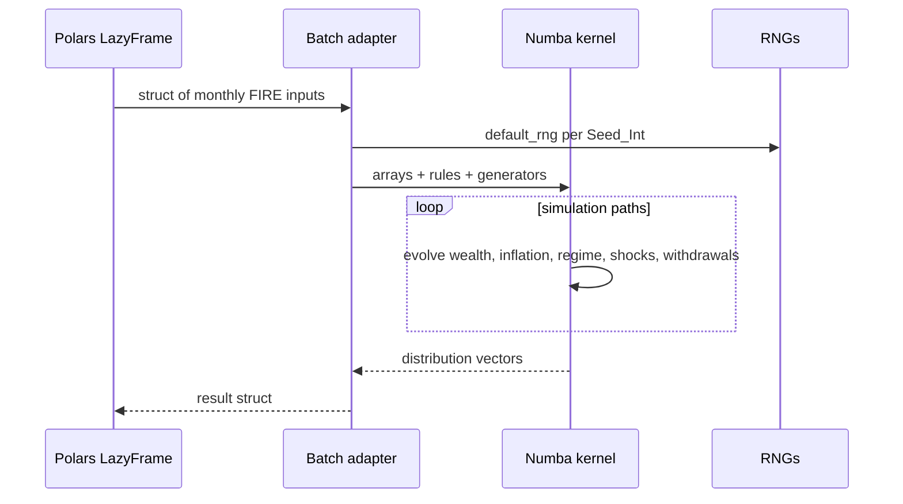

The kernel tracks both reaching FI and post-FI survival behavior, plus separate stress/runway trajectories and diagnostics.


## Published Monte Carlo outputs

The current Gold-facing result struct publishes eight headline metrics:

- `Months_To_FI_Conservative_P90`
- `Months_To_FI_Base_P50`
- `Months_To_FI_Aggressive_P10`
- `Probability_Of_Success_Pct`
- `Target_FI_Future_Nominal_P50`
- `Runway_Months_Stressed_P10`
- `Runway_Months_Base_P50`
- `Terminal_Wealth_Nominal_P50`

Percentile naming is intentionally directional. For months-to-FI, higher months are worse, so P90 is conservative. P10 is aggressive. Median P50 is the base case.


## Internal diagnostics beyond Gold

The Numba core computes a wider result vector than the current Gold contract exposes. Internal outputs include additional runway percentiles, real terminal wealth percentiles, maximum drawdown, expected lost savings, peak inflation, sequence-of-returns CAGR and average withdrawal behavior.

This distinction matters:

```text
model capability != current presentation contract
```

Documentation should not infer that a metric is absent from the model merely because Gold does not publish it today. Conversely, an internal diagnostic should not be advertised as a stable public contract until the registry actually publishes it.


## Sequence-of-returns risk

The simulation tracks an explicit sequence-of-returns diagnostic window. Sequence risk matters because identical long-run average returns can produce very different retirement outcomes when losses occur near the beginning of withdrawals.

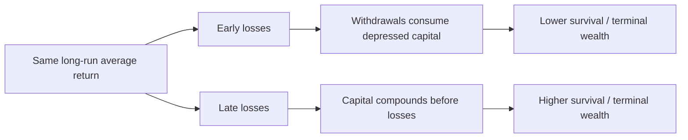

The model therefore evaluates path ordering, not only endpoint CAGR.


## Run-specific stochastic provenance

The stochastic seed is tied to run context. The broader application also records simulation provenance in the Control Plane, including root seed, iterations, horizon, input date, settings/rules snapshots, fingerprints, implementation version, status and result fingerprint.

The reproducibility contract is therefore:

> a recorded simulation can be replayed from its saved context under a compatible implementation/runtime.

It is **not**:

> every independent run must generate the same Monte Carlo paths forever.

That second rule would turn randomness into a decorative constant and defeat the point of run-specific simulation.


## Failure and edge behavior

Important edge semantics include:

- safe division is used for coverage/runway ratios;
- FI gaps are floored at zero;
- insufficient trailing history naturally produces incomplete rolling metrics;
- missing investment portfolio analytics bypass the after-tax investment adjustment rather than fabricating it;
- stochastic output is conditional on configured assumptions, not a probability statement about objective reality;
- model horizons are bounded by configured maximum months and target lifespan;
- percentile outputs summarize simulated paths and should not be interpreted as guarantees.

The FIRE layer is a planning model, not a prophecy API.


## Implementation map

| Responsibility | Source authority |
|---|---|
| monthly FIRE model | `backend/engines/presentation/modules/wealth_risk_analytics.py` |
| Monte Carlo batch adapter | `backend/engines/presentation/helpers/fire_mc_sim.py` |
| Numba simulation kernel | same `fire_mc_sim.py` |
| assumptions | `backend/config/financial_rules.py` |
| simulation provenance | Control Plane run repository/schema |
| Gold physical contract | `backend/load/schema/` + registry |

Configuration field-by-field details belong in [FIRE and Simulation Reference](../configuration/fire-and-simulation-reference.md).


## State evolution inside a simulation path

Each stochastic path evolves multiple coupled states rather than only portfolio wealth. At minimum the simulation has to carry financial wealth, inflation, market regime, contribution capacity, FI status and withdrawal behavior through time.

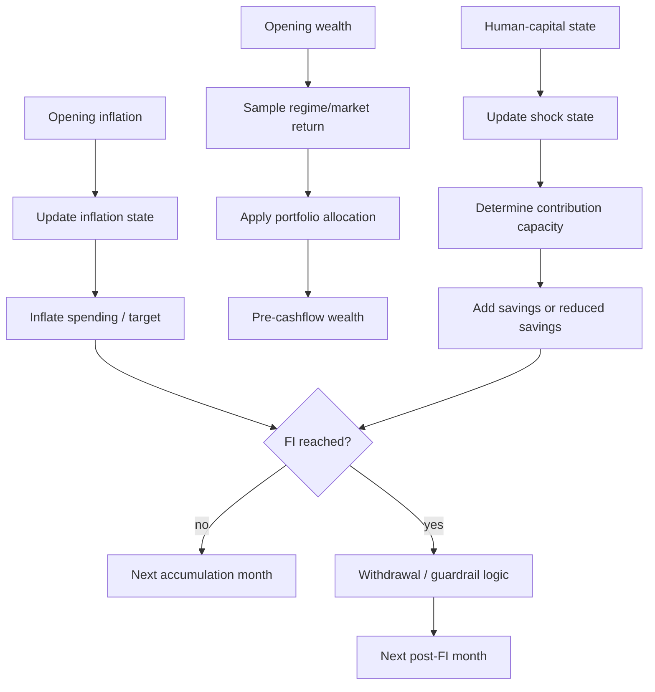

The coupling is the point. Inflation changes spending, human-capital shocks change savings, market regimes change returns, and the glide path changes the return exposure applied to wealth.

## Accumulation versus post-FI phases

The model has two economically different phases.

### Accumulation

Before FI, savings contributions and market returns work together toward the target. Human-capital shocks can reduce contribution capacity. The glide path can begin de-risking as FI approaches.

### Post-FI

After FI, the model must test whether wealth survives withdrawals through the remaining horizon. Withdrawal guardrails, inflation, allocation and sequence risk become more important than the simple question of first hitting the target.

A path that reaches FI and then fails rapidly is not equivalent to a path that sustains the plan. `Probability_Of_Success_Pct` therefore carries a different meaning from `Months_To_FI_Base_P50`.

## Target evolution

The current FI target starts from trailing spend and the configured multiplier. In stochastic simulation, future nominal requirements evolve with inflation. This produces `Target_FI_Future_Nominal_P50`, which is intentionally not the same number as today's target.

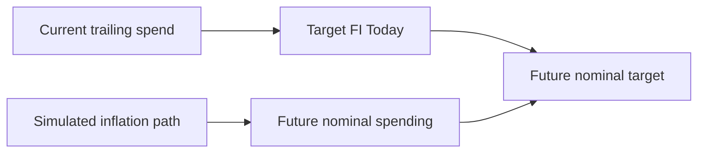

A nominal future target rising over time is not model failure. It is what happens when purchasing-power requirements are translated into future currency units.

## Runway stress trajectory

The simulation kernel tracks runway separately from the main FI path. This is useful because “how long can current resources sustain spending under stress?” is not the same question as “when will the portfolio reach FI?”

The published fields include stressed P10 and base P50 runway months. Lower stressed percentiles represent downside liquidity resilience.

## Probability of success

`Probability_Of_Success_Pct` is the fraction of configured simulation paths satisfying the model's success condition over the relevant horizon. It is conditional on:

- current financial inputs;
- configured return/CMA assumptions;
- volatility and tail assumptions;
- regime transitions;
- inflation process;
- human-capital shocks;
- glide path;
- withdrawal rules;
- simulation horizon and iterations.

Changing those assumptions changes the probability. The percentage is therefore a model output, not an empirical frequency promised by the universe.

## Percentile semantics

| Metric | Adverse direction | Conservative view |
|---|---|---|
| months to FI | higher | P90 |
| runway months | lower | P10 |
| terminal wealth | lower | low percentile |
| peak inflation | higher | high percentile |
| max drawdown | more negative / larger loss | downside tail |

Percentiles only become meaningful after defining which direction represents risk.

## Deterministic seed derivation versus replay envelope

The monthly seed integer is an execution mechanism. The broader replay envelope is an operational-provenance mechanism. They should not be conflated.

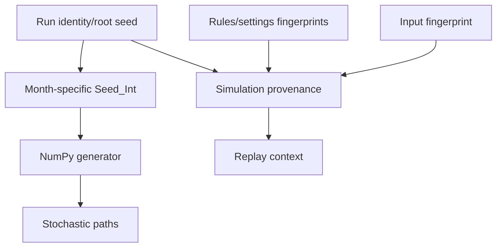

Replaying a simulation requires more than remembering one integer. It requires compatible model code and the financial/configuration context that integer was applied to.

## Numerical and runtime considerations

The simulation uses NumPy random generators and a Numba-compiled kernel for throughput. Reproducibility claims are therefore intentionally scoped to a compatible implementation/runtime. Numerical-library or PRNG changes can matter even when application-level fingerprints match.

The documentation does not promise eternal bitwise identity across arbitrary future environments. That would be a heroic guarantee for a Monte Carlo engine and a fairly unnecessary one.

## Configuration sensitivity

FIRE output is sensitive to assumptions. Important examples:

| Parameter | Typical effect when increased, all else equal |
|---|---|
| expected real return | generally faster FI / higher terminal wealth |
| volatility | wider outcome distribution and more sequence risk |
| inflation | higher nominal spending/target pressure |
| savings | faster accumulation |
| spending | larger FI target and withdrawal burden |
| jump probability/magnitude | heavier downside tail |
| human-capital shock frequency | weaker contribution paths |
| FI equity target | changes return/risk near FI |

These are directional intuitions, not guaranteed monotonic relationships in every nonlinear path.

## Model limitations

The implementation is sophisticated, but its assumptions remain abstractions. It does not claim to model every asset class, every tax-law evolution, every labor-market state, every behavioral response or every macroeconomic dependency. Markov states and jump processes are configurable approximations, not hidden claims that markets have three literal moods stored in a database.

The model is most useful as a consistent scenario engine anchored to the application's actual financial state.

## Audit workflow

A FIRE result should be auditable through:

1. the monthly financial input row;
2. the applicable `FinancialRules` snapshot;
3. CMA/macro assumptions;
4. root seed and derived month seed;
5. model implementation version/fingerprint;
6. simulation result fingerprint;
7. published Gold row.

This turns stochastic planning from an opaque chart into a recorded computational experiment.

## Related specifications

- [Cashflow and Wealth](cashflow-and-wealth.md)
- [Metrics and Methodology](metrics-and-methodology.md)
- [Deterministic Identity and Replay](../architecture/deterministic-identity-and-replay.md)
- [FIRE and Simulation Reference](../configuration/fire-and-simulation-reference.md)
- [Gold Data Contracts](../reference/gold-data-contracts.md)
