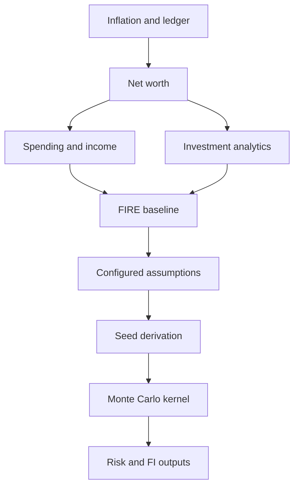

# FIRE simulations and reproducibility

I combine a wealth and spending baseline with configured financial assumptions to derive financial-independence targets and stochastic projections. I keep deterministic identity, seeded simulation, and environmental reproducibility separate.

## Implementation map

| Module | Selected implementation entry points |
|---|---|
| `backend/engines/presentation/modules/wealth_risk_analytics.py` | `build()` (L40) |
| `backend/engines/presentation/helpers/fire_mc_sim.py` | `get_monte_carlo_fire_batch()` (L456), `monte_carlo_fire_batch()` (L459) |
| `backend/engines/presentation/helpers/forecasting.py` | `calculate_budget_forecast()` (L4) |
| `backend/utils/reproducibility.py` | `generate_contract_registry_fingerprint()` (L9), `generate_reproducibility_envelope()` (L19), `get_standard_prng()` (L49), `assert_simulation_replay()` (L62) |

## Execution model



## Dependency graph

The wealth engine builds inflation and ledger inputs before net worth, spending, income streams and risk analytics. FIRE depends on the availability and shape of upstream outputs.

## After-tax wealth assumption

One after-tax market-net-worth estimate applies a configured LTCG rate to positive aggregate appreciation. This is a simplified estimate, not a lot-by-lot hypothetical liquidation tax.

## Simulation seeds

The simulation code uses explicit NumPy randomness and a Numba kernel. Seed derivation includes the simulation month and a CRC32-derived component.

## Missing portfolio branch

The audited builder defines its after-tax net-worth column when portfolio analytics are available but references it later even when the alternative branch does not define it. This is a known source-level edge-case risk, not a tested universal failure.

## Reproducibility limits

A fixed seed supports controlled repeatability under matching inputs and environment. It does not alone establish identical outputs across dependency versions, machines, or numerical backends.

## Implementation excerpts

The following short excerpts are copied from the actual implementation. I use the surrounding source module as the authority for complete branch behavior.

### `build()` · `backend/engines/presentation/modules/wealth_risk_analytics.py:40`

```python
    def build(self) -> dict[str, pl.LazyFrame]:
        lf_monthly_totals = self.base_lf["lf_monthly_totals"]

        lf_fire_base = (
            lf_monthly_totals.select(
                [
                    "MONTH_START_DATE",
                    "MONTH_END_DATE",
                    "Total_Net_Worth",
                    "Total_Net_Worth_Market",
                    "Total_Income",
                    "Total_Cash_Income",
                    "Total_Core_Expense",
                    "Total_Expense",
```

### `get_monte_carlo_fire_batch()` · `backend/engines/presentation/helpers/fire_mc_sim.py:456`

```python
def get_monte_carlo_fire_batch(
    rules: FinancialRules, cma_real_return: float, cma_fat_tail: float
) -> Callable[..., pl.Series]:
    def monte_carlo_fire_batch(s: pl.Series, **kwargs: Any) -> pl.Series:
        df = s.struct.unnest()
        pv = df["Total_Net_Worth_Market_Af_Tax"].to_numpy().astype(float)
        pmt = df["Trailing_12M_Avg_Total_Savings"].to_numpy().astype(float)
        fv = df["Target_FI_Today_Total"].to_numpy().astype(float)
        burn = df["Trailing_12M_Avg_Total_Spend"].to_numpy().astype(float)

        inf_rates = df["INFLATION_YOY_PCT"].to_numpy().astype(float)
        seed_ints = df["Seed_Int"].to_numpy().astype(np.int32)

        swr = rules.assumptions.fire.swr_multiplier
```

## Boundaries and related specifications

I keep physical schemas in [the reference catalog](../reference/README.md), operational lineage in [Control Plane documentation](../control-plane/README.md), and ETL publication semantics in [Data Engineering](../data-engineering/README.md). I do not equate the existence of an algorithm with automated validation of every exceptional input.
