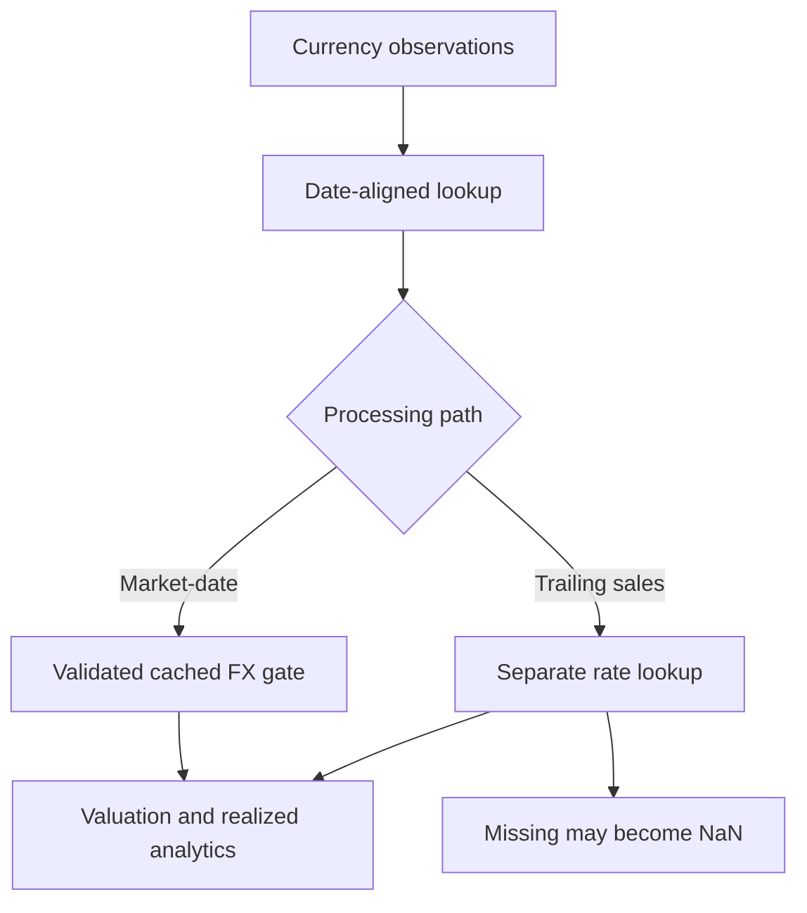

# Foreign-exchange handling and valuation

I preserve a distinction between market data ingestion, date-specific FX lookup, acquisition/disposal conversion, and the valuation outputs consumed by analytics.

## Implementation map

| Module | Selected implementation entry points |
|---|---|
| `backend/engines/analytics/pipeline/processor/fx_gate.py` | `validate()` (L33) |
| `backend/engines/analytics/pipeline/processor/isin_processor.py` | `is_indian_rights_entitlement_isin()` (L32), `process()` (L84) |
| `backend/transform/currency_transformer.py` | `transform_currency_fx_rates()` (L6) |

## Execution model



## FX source versus usage

Currency histories are ingested and transformed upstream. The financial engine then resolves rates for specific transaction and valuation dates.

## Validation differences

The audited market-date path uses an FX gate that rejects invalid rates. A trailing-sales path resolves rates separately and can substitute NaN for missing values. I do not describe a single uniform fallback guarantee.

## Local and reporting currencies

Lots carry currency and local-price context. Conversions must be interpreted with the rate direction used by the implementation, not a generic assumed multiplication rule.

## Missing observations

A missing market-date rate is not proof that a zero return or zero gain occurred. I keep missing-data handling explicit and trace its effect on outputs.

## Implementation excerpts

The following short excerpts are copied from the actual implementation. I use the surrounding source module as the authority for complete branch behavior.

### `validate()` · `backend/engines/analytics/pipeline/processor/fx_gate.py:33`

```python
    def validate(self, isin: str, master_row: dict[str, Any], first_p_date: date) -> None:
        """Raise if FX data is unavailable for *isin*.

        Parameters
        ----------
        isin:
            The instrument identifier (used in error messages).
        master_row:
            Master-data dict for this ISIN; must contain ``CURRENCY_ID``.
        first_p_date:
            Date of the earliest purchase.  Used as the spot-check date.

        Raises
        ------
```

### `is_indian_rights_entitlement_isin()` · `backend/engines/analytics/pipeline/processor/isin_processor.py:32`

```python
def is_indian_rights_entitlement_isin(isin: str | None) -> bool:
    """Return whether an Indian ISIN matches the observed RE code pattern.

    The ``20`` substring is a candidate classifier (Python slice [7:9]), not
    proof of an expiry event. Transaction-level checks are still required.
    """
    if not isin:
        return False

    normalized = isin.strip().upper()
    return len(normalized) == 12 and normalized.startswith("INE") and normalized[7:9] == "20"
```

## Boundaries and related specifications

I keep physical schemas in [the reference catalog](../reference/README.md), operational lineage in [Control Plane documentation](../control-plane/README.md), and ETL publication semantics in [Data Engineering](../data-engineering/README.md). I do not equate the existence of an algorithm with automated validation of every exceptional input.
