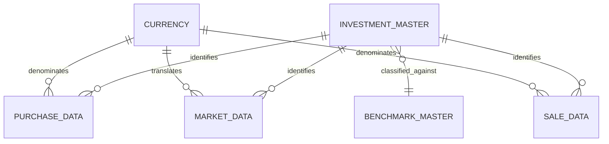
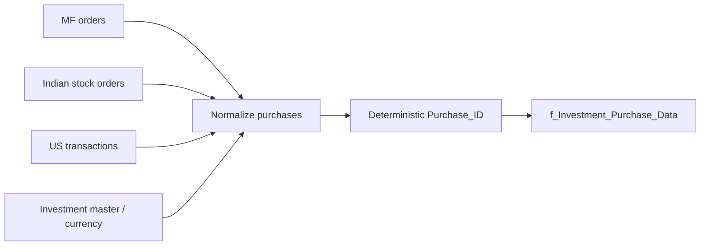
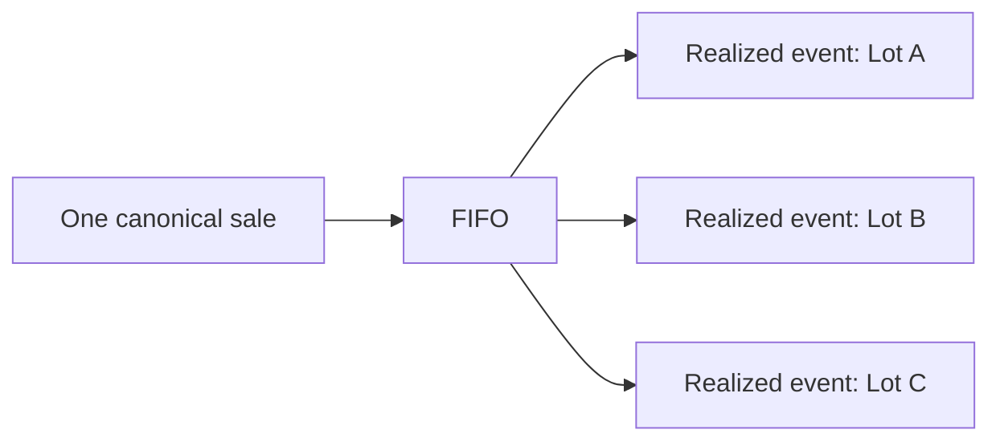
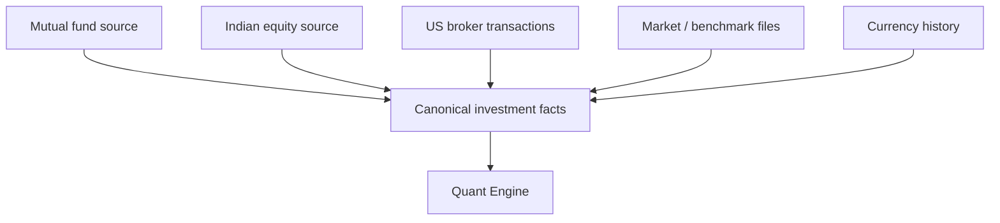
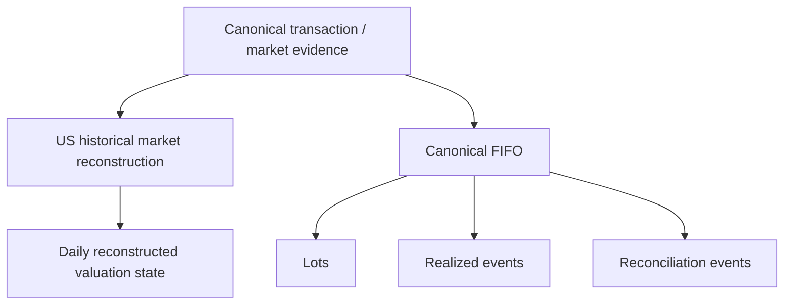
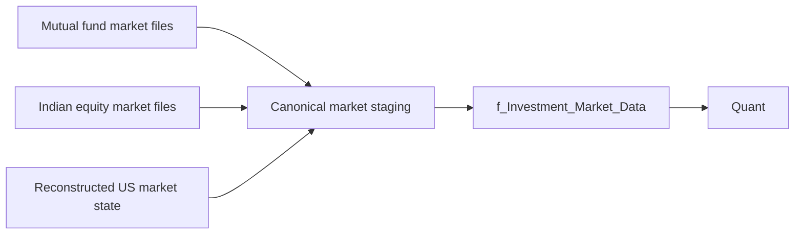
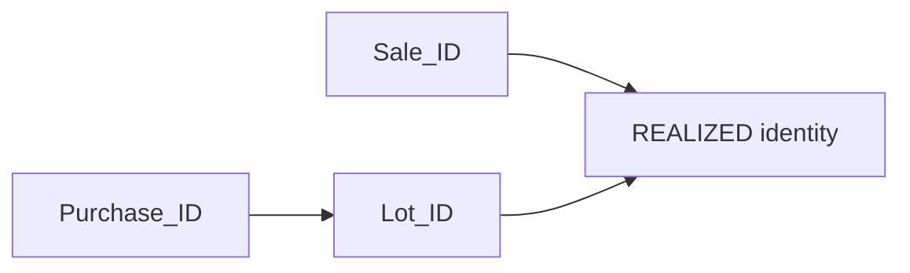
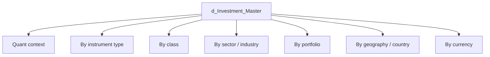
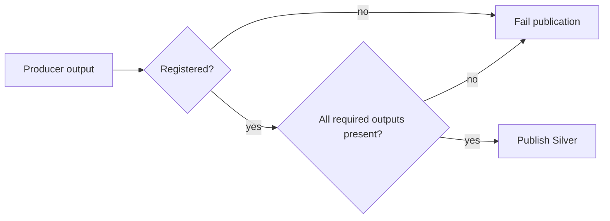
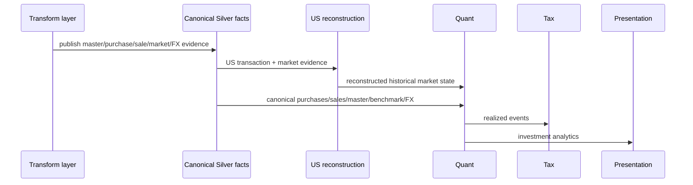

# Investment Data Model

The investment model separates instrument identity, transaction evidence, market observations, benchmark evidence, currency context and reconstructed analytical state. This page specifies the canonical evidence boundary that feeds both historical market reconstruction and the Quant Engine. FIFO mechanics themselves live in the dedicated FIFO specification.

## Implementation map

```text
backend/transform/investments.py
backend/transform/mutual_funds.py
backend/transform/stocks.py
backend/transform/us_stocks.py
backend/transform/us_stocks_transformer.py
backend/transform/benchmark_transformer.py
backend/pipeline/currency_pipeline.py
backend/load/schema/silver.py
backend/load/registry.py
backend/utils/identity.py
```

## Canonical investment contracts



The core Silver investment contracts include:

- `d_Investment_Master`;
- `d_Investment_Benchmark_Master`;
- `d_Macro_Parameters`;
- `f_Investment_Market_Data`;
- `f_Investment_Purchase_Data`;
- `f_Investment_Sale_Data`;
- `f_Investment_Benchmark_Data`;
- `f_Currency_FX_Rates`.

Quant later adds lot, realized-event and reconciliation contracts. Those are reconstructed state, not source-normalization outputs.

## Instrument master

`get_d_investment_master()` consolidates instrument metadata into the canonical master. The master supplies the classification context needed by market, transaction, Quant and presentation logic.

Instrument attributes can include:

- ISIN/instrument identity;
- name;
- instrument type/subtype;
- asset class;
- sector/industry;
- geography/country;
- portfolio grouping;
- currency;
- benchmark mapping;
- tax-related classification inputs.

The exact columns are specified by the Silver DDL reference.

## Purchase evidence

`get_f_tf_investment_purchase_data()` creates canonical purchase facts. Source-specific orders are normalized into a common transaction grain before Quant sees them.



### Deterministic purchase identity

The producer computes `Purchase_ID` from financial fields rather than row position:

```python
def _compute_purchase_id(row: dict[str, Any]) -> str:
    return make_id(
        "PURCHASE",
        ISIN=row.get("ISIN"),
        Date=row.get("Date"),
        Price=row.get("Price"),
        Quantity=row.get("Quantity"),
        CURRENCY_ID=row.get("CURRENCY_ID"),
    )
```

This ID is later part of lot identity. Changing incidental file order should not create a new economic purchase.

## Sale evidence

`get_f_tf_investment_sale_data()` performs the corresponding normalization for disposals.

```python
def _compute_sale_id(row: dict[str, Any]) -> str:
    return make_id(
        "SALE",
        ISIN=row.get("ISIN"),
        Date=row.get("Date"),
        Sell_Price=row.get("Sell_Price"),
        Quantity=row.get("Quantity"),
        CURRENCY_ID=row.get("CURRENCY_ID"),
    )
```

A canonical sale is still evidence of disposal, not yet a realized-lot event. A single sale can consume multiple acquisition lots, so realized-event grain is downstream and finer.



## Market observations

`transform_stg_investment_market_data()` standardizes market observations from the supported investment sources. Market data provides valuation evidence; it does not define acquisition history.

The distinction matters:

```text
transaction evidence -> how position quantity/basis changed
market evidence      -> what the position can be valued at on a date
```

Mixing those roles would make missing prices mutate ownership history, which is exactly the sort of financial haunted house the architecture avoids.

## Benchmark evidence

Benchmark master/history contracts provide comparison context. Benchmark data is downstream analytical evidence, not a replacement for instrument market data. Quant can maintain benchmark shadow state so portfolio performance can be compared against an appropriate reference path.

## Currency evidence

`f_Currency_FX_Rates` supplies date/currency observations used to translate local-currency investment economics into INR. Currency is part of canonical transaction identity for purchases/sales, because otherwise economically different transactions could collide under one ID.

## Source families and normalization

The application supports multiple investment source families with different native shapes. The normalization boundary deliberately occurs before Quant:



Quant therefore reasons about canonical purchases, sales and market state instead of carrying broker-specific parsing branches through FIFO logic.

## Grain model

| Contract | Financial grain |
|---|---|
| Investment master | one canonical instrument |
| Purchase data | one canonical acquisition transaction |
| Sale data | one canonical disposal transaction |
| Market data | instrument × valuation date/observation |
| Benchmark data | benchmark × date |
| FX rates | currency × date |
| Analytics lot | reconstructed acquisition lot state |
| Realized event | sale × consumed lot |
| Reconciliation event | explicit reconciliation mutation/event |

Exact registry grain strings remain in Reference.

## Evidence versus reconstructed state



US reconstruction and FIFO can both consume purchases/sales, but they do not share authority. US reconstruction needs daily quantity/value state. FIFO needs acquisition-lot lineage. The first may group remaining quantity by acquisition price for market-state reconstruction without becoming the canonical lot ledger.

## Null and missing-data semantics

Missing financial evidence is not universally replaced with zero. A missing price, missing FX observation and zero quantity have different meanings. Transformations therefore validate required valuation inputs and fail where an economically meaningful value cannot be established under the accepted rules.

## Invariants

- Canonical purchase and sale facts precede FIFO.
- `Purchase_ID` and `Sale_ID` are deterministic financial identities.
- Market observations value positions; they do not create acquisition lots.
- Currency is part of the investment evidence model, not a final-report formatting choice.
- Benchmark evidence is separate from instrument evidence.
- Reconstructed US holdings are not broker-observed daily holdings.
- Realized-event grain can be finer than sale grain.

## Extension boundary

Adding another broker/source should normally terminate at the canonical investment contracts. New source quirks belong in extraction/normalization, not in canonical FIFO. That boundary is what makes the Quant Engine reusable across source families.

## Trade-off

The model stores several forms of investment state instead of one all-purpose positions table. The extra structure is intentional: transaction identity, daily valuation, acquisition-lot provenance and reconciliation are different questions. One table could answer all of them only by becoming a very creative liar.

## Canonical market-data normalization

`transform_stg_investment_market_data()` is the common staging boundary for investment market observations. It standardizes source-specific market data into the canonical fields expected by Quant and downstream publication. The point of the stage is not to calculate every investment metric; it is to make market evidence comparable before the analytical engine starts.



## Reference construction

`get_purchase_reference()` and `get_sale_reference()` prepare source transaction references before the canonical purchase/sale facts are built. This allows multiple source families to converge on the same financial contract while keeping extraction quirks upstream.

The design is intentionally layered:

```text
source row
  -> source-specific normalization
  -> purchase/sale reference
  -> canonical fact
  -> deterministic identity
  -> Quant reconstruction
```

Each step narrows ambiguity. By the time FIFO executes, it should not need to know which broker column once contained the transaction price.

## Purchase identity collision semantics

The current `PURCHASE` identity contract uses ISIN, date, price, quantity and currency. That makes equivalent canonical financial fields produce the same ID. It also means two economically distinct purchases with exactly the same identity fields are indistinguishable to that identity protocol unless another contract field differentiates them upstream.

That is not something documentation should hide. Deterministic identity is a contract with chosen fields, not metaphysical proof of transaction uniqueness.

The same principle applies to `SALE`.

## Transaction-to-lot lineage

Purchase IDs become inputs to deterministic lot identities. Sale IDs combine with consumed lot IDs to create realized-event identities.



This lineage allows a realized disposal component to point back to both the disposal evidence and acquisition state that produced it.

## Investment master as semantic join hub

The master is not merely a lookup table for display names. It is the semantic join hub through which instrument classification reaches analytics and presentation. Depending on the configured/source fields, classifications support grouping by instrument type, subtype, class, sector, industry, portfolio, geography, country and currency.



These classifications should be treated as dimensions over canonical instruments, not re-derived from free-form names in Gold.

## Macro parameters

`d_Macro_Parameters` carries financial-year/macro inputs used by investment analytics, including holding-period/tax interpretation. This keeps time-varying financial rules out of hard-coded FIFO branches.

The resulting dependency is:

```text
transaction dates + instrument tax classification + macro parameters
    -> holding-period classification
    -> STCG/LTCG code
    -> realized-event tax context
```

## Benchmark master and history

Benchmark evidence is split into master/mapping semantics and dated benchmark observations. Quant can therefore select a benchmark appropriate to an instrument and construct comparison analytics without treating the benchmark as if it were another owned holding.

## Currency as a dimension and time series

`d_Currency` describes currency identity; `f_Currency_FX_Rates` provides dated observations. A foreign instrument therefore joins two different concepts:

```text
what currency is this instrument denominated in?
what was the relevant FX observation on this date?
```

The first is dimensional. The second is temporal evidence.

## Multi-geography source semantics

Indian mutual funds, Indian equities and US equities have different source characteristics. The canonical model deliberately converges them before Quant while preserving the fields required for local-currency and INR analytics.

| Source family | Typical distinctive concern | Canonical destination |
|---|---|---|
| mutual funds | ISIN mapping, NAV/order sources | common purchase/sale/market facts |
| Indian equities | exchange/broker market/order data | common purchase/sale/market facts |
| US equities | transaction-led holdings reconstruction, FX | common investment/market facts |

The goal is not to erase source differences. It is to stop those differences from infecting every downstream algorithm.

## Publication contract

The ETL pipeline validates engine-produced tables against the Data Contract Registry before Silver publication. Canonical investment outputs therefore have both financial semantics and a registry-backed physical publication contract.



This is especially useful for finance because silently dropping a realized/reconciliation table would otherwise leave downstream dashboards looking healthy while financial lineage disappeared.

## Canonical evidence boundaries

### What purchases prove

A purchase fact proves that canonical source evidence represents an acquisition transaction under the current normalization rules. It does not by itself prove current holdings quantity.

### What sales prove

A sale fact proves disposal evidence. It does not by itself specify which acquisition lot was disposed; FIFO supplies that lineage.

### What market data proves

A market row supplies/reconstructs valuation state for a date. It does not prove transaction history.

### What the master proves

The master supplies canonical instrument metadata/classification. It does not prove market value or ownership.

Keeping those contracts narrow is a feature. Wide semantic claims are easy to write and painful to reconcile.

## Failure boundaries

- missing instrument mappings can prevent canonical master/transaction joins;
- malformed transaction fields can prevent deterministic identity generation;
- invalid currency context can block foreign-currency analytics;
- missing market evidence can block valuation while leaving transaction evidence intact;
- registry mismatch blocks publication rather than silently publishing an undocumented shape.

A failure in valuation does not retroactively erase a valid purchase. The model's separation lets the failing layer be identified precisely.

## Downstream contract handoff



This handoff diagram is the investment model in one view: normalization first, specialized reconstruction second, canonical Quant third, tax/presentation later.

## Related specifications

- [Financial Model](financial-model.md)
- [Cashflow and Wealth](cashflow-and-wealth.md)
- [Investment Data Model](investment-data-model.md)
- [Investment Market Reconstruction](investment-market-reconstruction.md)
- [FIFO and Realized Events](fifo-and-realized-events.md)
- [Investment Reconciliation](investment-reconciliation.md)
- [Investment Performance and Risk](investment-performance-and-risk.md)
- [Multi-Currency and FX](multi-currency-and-fx.md)
- [Tax Methodology](tax-methodology.md)
- [FIRE Methodology](fire-methodology.md)
- [Data Model](../architecture/data-model.md)
- [Silver Data Contracts](../reference/silver-data-contracts.md)
