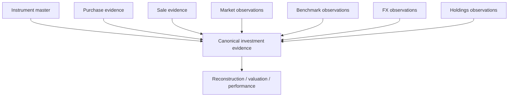
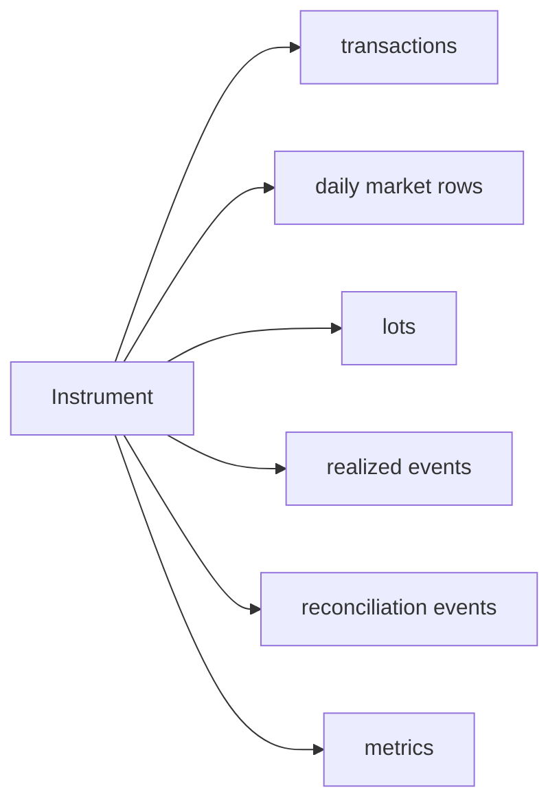
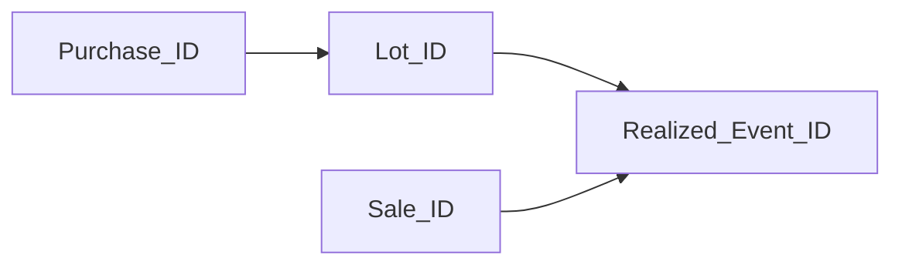
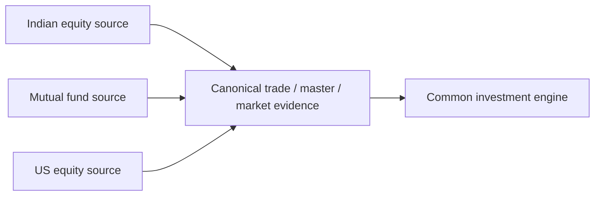
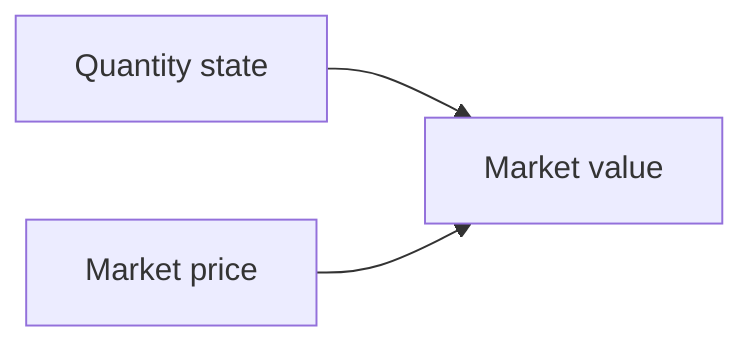

# Investment Data Model

The investment engine cannot start with FIFO, XIRR, or Tax.

It starts much earlier with a simpler question:

> **What evidence do I actually have for an instrument, and what does each piece of evidence prove?**

A purchase proves that an acquisition event was recorded. A market close proves a price observation for a date. An instrument master proves metadata. A broker holdings observation proves what the broker reported at that observation point. None of them alone proves the entire investment history.

This document defines that evidence model.



## Instrument identity is the join hub

The canonical investment master is organized around ISIN where available/appropriate in the current model.

`IsinMasterRecord` carries metadata such as:

```python
# src/personal_finance_etl/domain/investments/contracts.py
class IsinMasterRecord(TypedDict, total=False):
    ISIN: str
    NAME: str
    SYMBOL: str
    CURRENCY_ID: str | None
    BENCHMARK_ID: str | None
    TAX_TYPE: str
    TAX_SUBTYPE: str
    INSTRUMENT_CLASS: str
    INSTRUMENT_SUBTYPE: str
    INSTRUMENT_TYPE: str
```

The master is not merely display metadata. Currency, benchmark, Tax classification, geography, class, sector, and instrument type affect downstream valuation and analytics.

## One instrument can participate in many grains



That is why “one investment table” would be a poor abstraction.

## Canonical trade evidence

`TradeRecord` defines the normalized trade vocabulary.

```python
# src/personal_finance_etl/domain/investments/contracts.py
class TradeRecord(TypedDict, total=False):
    ISIN: Required[str]
    Date: Required[dt.date]
    Quantity: Required[float]
    Price: float | None
    Value: float | None
    Price_Local: float | None
    Value_Local: float | None
    Purchase_ID: str | None
    Sale_ID: str | None
```

The contract can also carry sale-specific, closing-price, local/base-value, residual, and Tax-context fields where applicable.

The key invariants are semantic:

```text
trade date is chronological evidence
quantity is transaction quantity
purchase/sale identity is deterministic where created
local/base values are not interchangeable
```

## Purchases prove acquisition evidence, not surviving lots

A canonical purchase tells the engine:

```text
instrument
acquisition date
quantity
price/value
currency context
purchase identity
```

It does **not** tell the engine how much of that quantity remains after later disposals.

That state belongs to FIFO/reconstruction.

The Pydantic `Purchase` model makes the transaction record explicit:

```python
# src/personal_finance_etl/domain/investments/contracts.py
class Purchase(BaseModel):
    isin: str = Field(alias="ISIN")
    date: dt.date = Field(alias="Date")
    quantity: float = Field(alias="Quantity")
    price: float = Field(alias="Price")
    value: float | None = Field(default=None, alias="Value")
    price_local: float | None = Field(default=None, alias="Price_Local")
    currency_id: str | None = Field(default=None, alias="CURRENCY_ID")
    purchase_id: str | None = Field(default=None, alias="Purchase_ID")
```

The model tolerates source/canonical alias forms through Pydantic configuration while exposing stable domain semantics.

## Sales prove disposal evidence, not realized basis by themselves

A sale records a disposal instruction/event.

Realized cost basis depends on which acquisition lots are consumed according to the configured/implemented lot chronology.

Therefore:

```text
Sale_Value - some average purchase value
```

is not automatically the authoritative realized gain.

The FIFO engine must consume lots and produce explicit realized-event fragments.

## Purchase and sale identities are lineage anchors

Transaction identities allow later records to point back to the evidence that produced them.

A realized event can carry:

```text
Sale_ID
Lot_ID
Purchase_ID
```

That creates a trace:



This is more useful than a realized P/L number that cannot explain which acquisition history it consumed.

## Identity collision semantics must be explicit

Deterministic identity assumes the namespace fields distinguish economically distinct records.

If two source records have identical identity fields but represent distinct real-world events, the namespace contract is insufficient.

That is not a hashing problem. It is a grain/identity-model problem.

The correct fix is to revisit identity inputs, not lengthen the hash and hope economics becomes unique.

## Source families normalize into one canonical model

The project supports multiple investment source families, including Indian equities, mutual funds, and US equities.

Source transforms live under:

```text
src/personal_finance_etl/domain/investments/transforms/
├── indian_equity.py
├── mutual_funds.py
└── us_equity.py
```

Each source family has different physical evidence, but downstream financial algorithms should consume stable canonical semantics.



That boundary prevents broker/source quirks from becoming FIFO policy.

## Indian equity normalization

`indian_equity.py` provides transformations for:

- market data;
- market-data reference;
- base stock transactions;
- staged stock trades;
- stock master reference.

The source adapter can therefore understand vendor-specific shape while the canonical engine sees stable investment semantics.

## Mutual-fund normalization

`mutual_funds.py` similarly creates:

- staged MF market data;
- market-data reference;
- base transactions;
- staged trades;
- master reference.

Mutual funds can differ from exchange-traded equities in evidence shape, but the canonical model still needs instrument identity, chronology, quantity/value, and valuation context.

## US equity normalization

US equity ingestion has its own transaction/master transformations and later participates in market-state reconstruction where direct historical holdings evidence may not exist at the same grain as required analytics.

That is why the documentation describes reconstructed US historical state honestly rather than calling every historical row “broker holdings.”

Reconstruction methodology belongs in the next investment-engine page, not in the source contract.

## Market observations prove prices, not positions

A market row answers:

```text
What market value/price was observed for this instrument/date?
```

It does not tell the engine how many units the household owned.

Ownership state comes from transactions/reconstruction/observations.

Valuation combines the two.



Keeping quantity and price authorities separate is one of the most important investment-model boundaries.

## Benchmark evidence is a parallel market series

Benchmarks provide a comparison state for performance attribution.

An instrument can carry `BENCHMARK_ID` in master metadata. Benchmark history then provides the observed/reference series used to construct shadow or comparative performance.

Benchmark state should not be mixed with asset state merely because both have dates and prices.

## Currency is both a dimension and a time series

Investment currency has at least two roles:

### Dimension

Which currency does the instrument/trade use?

### Time series

What FX rate applied on a given financial date?

That produces separate semantics for:

```text
Price_Local
Value_Local
base/INR values
FX rate
FX contribution
```

The multi-currency methodology page later explains how those pieces become attribution.

## A `TaxLot` is reconstructed state, not raw evidence

The investment contracts define immutable in-memory lot state:

```python
# src/personal_finance_etl/domain/investments/contracts.py
@dataclass(frozen=True, slots=True)
class TaxLot:
    date: dt.date | None
    qty: float
    price: float
    bm_buy: float | None
    shadow_qty: float
    price_local: float = 0.0
    fx_rate_buy: float = 1.0
    currency_id: str | None = None
    purchase_id: str | None = None
    lot_id: str | None = None
    lot_source_type: str = "PURCHASE"
```

The type intentionally combines financial and lineage state needed by chronological processing.

But its existence does not mean a source delivered “lots.” The engine reconstructed them.

## Lot actions form a finite event vocabulary

Lots can be affected by actions such as:

```text
BUY
SELL
SPLIT
BONUS
DIVIDEND_REINVEST
RECONCILIATION
```

Those actions explain why investment history is better modeled as chronology than as one current-state table.

## Realized events are disposal fragments

A sale can consume more than one acquisition lot.

Therefore one sale may produce multiple realized-event rows, each retaining acquisition lineage and cost basis.

The natural realized-event grain is closer to:

```text
one disposal × consumed acquisition fragment
```

than simply “one row per sale.”

That detail matters for holding-period classification, Tax evidence, and auditability.

## Reconciliation events preserve disagreement

The current model supports quantity and cost-basis adjustment types:

```python
# src/personal_finance_etl/domain/investments/contracts.py
class ReconciliationAdjustmentType(StrEnum):
    QUANTITY_ADD = "QUANTITY_ADD"
    QUANTITY_REMOVE = "QUANTITY_REMOVE"
    COST_BASIS_ADJUSTMENT = "COST_BASIS_ADJUSTMENT"
```

Reconciliation events retain reconstructed, observed/broker, delta, and adjustment values.

That means later analytics can distinguish:

```text
position created by recorded purchase
position created/adjusted because observation disagreed
```

Those are financially different provenance stories.

## Cashflows and terminal values are separate contracts

Performance calculations need cash-flow chronology and terminal valuation state.

The contract layer therefore defines separate cashflow and terminal-value structures rather than overloading trade rows.

This helps XIRR and benchmark logic consume the right economic events.

## Market spine records are reconstruction inputs/state

`MarketSpineRecord` carries fields such as:

```text
Date
ISIN
CURRENCY_ID
Quantity
Buy_Value_Local
Buy_Value_INR
Buy_Price_Local
Buy_Price_INR
```

This is a valuation/reconstruction grain, not the original transaction grain.

The distinction becomes especially important for reconstructed daily US holdings.

## Instrument metrics are downstream

`InstrumentMetricsRecord` includes:

- CAGR and validity;
- XIRR and validity;
- benchmark equivalents;
- after-Tax XIRR;
- active return;
- drawdown;
- local-currency equivalents;
- FX XIRR impact.

Those measures depend on the evidence/reconstruction model defined here. They are not part of the canonical trade evidence itself.

## Missing-data semantics

Investment data has several dangerous missing cases:

### Missing price

May prevent valuation or require explicit fallback logic.

### Missing FX

May prevent base-currency valuation/attribution.

### Missing benchmark

May prevent comparative measures while leaving asset return valid.

### Missing purchase basis

Can affect realization and Tax interpretation.

### Missing observed holdings

Does not mean reconstructed quantity is zero.

Each absence must be interpreted at the owning algorithm boundary.

## Canonical publication boundary

The warehouse persists canonical investment facts and later analytical outputs under explicit data contracts.

The investment domain should not depend on table location for its financial meaning.

Conceptually:

```text
source-specific shape
    ↓
canonical investment fact
    ↓
reconstruction / valuation
    ↓
warehouse publication
```

not:

```text
table name
    ↓
therefore meaning
```

## The downstream handoff

Once canonical investment evidence exists, the next set of questions becomes algorithmic:

- how do I reconstruct daily market state?;
- how do sales consume acquisition lots?;
- what if broker observation disagrees with reconstruction?;
- how do I calculate performance and benchmark attribution?;
- how do local currency and INR/base currency effects separate?;

Those questions belong to the deeper investment-engine specifications.

The immediate next page is [Investment Market Reconstruction](investment-market-reconstruction.md).

## Related specifications

- [Financial Model](financial-model.md)
- [Investment Market Reconstruction](investment-market-reconstruction.md)
- [FIFO & Realized Events](fifo-and-realized-events.md)
- [Investment Reconciliation](investment-reconciliation.md)
- [Multi-Currency & FX](multi-currency-and-fx.md)
- [Identity & Grain Contracts](../reference/identity-and-grain-contracts.md)
