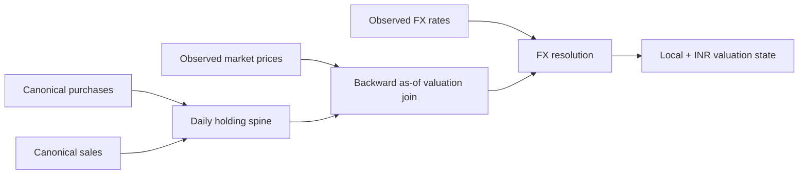
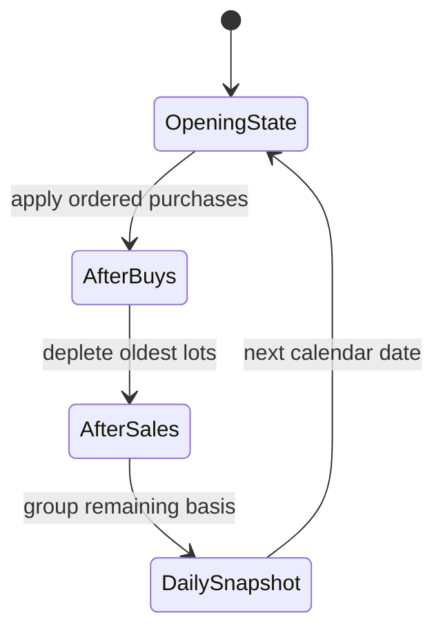
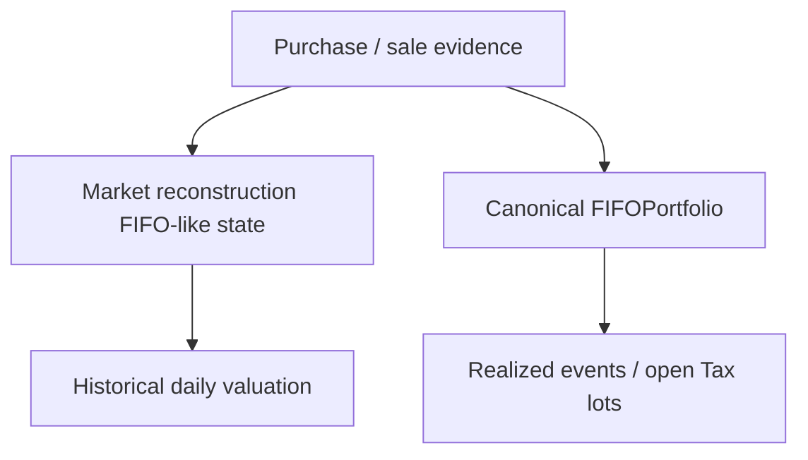
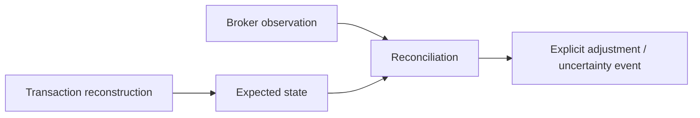

# Investment Market Reconstruction

A market-price table is not yet a market state.

For an investment engine, a valuation date only becomes meaningful when the application can answer four questions together:

1. **What quantity was economically open on that date?**
2. **Which acquisition basis still belonged to that open quantity?**
3. **Which market observation was actually available by that date?**
4. **Which FX observation was valid for the same economic instant?**

This specification explains how I reconstruct that state, especially for US equities where historical broker holdings are not always available as a complete daily series.

The reconstruction is deliberately conservative. It never treats a later quote as if it existed earlier, never invents a missing FX rate, and never lets a stale market observation quietly masquerade as current value.



The result is **reconstructed analytical state**, not a claim that a broker independently certified every historical daily holding.

## Implementation authority

The core implementation lives in:

```text
src/personal_finance_etl/domain/investments/valuation/market_state.py
```

The module owns:

- the continuous US market-state spine;
- FIFO-like daily quantity reconstruction;
- backward as-of price selection;
- a bounded seven-day price staleness rule;
- FX translation;
- local and INR valuation/P&L fields.

It explicitly does **not** own:

- Yahoo Finance acquisition;
- FX API acquisition;
- warehouse persistence;
- canonical Tax-lot accounting.

That separation matters because market reconstruction answers **“what did the position look like on this date?”**, while canonical lot accounting answers **“which economic acquisition lots are still open, and what happens when they are disposed?”**

## Why a reconstruction layer exists

A daily valuation series needs a daily position state.

For some source families, broker statements already expose sufficiently direct holdings evidence. For US equities, the available evidence can be more transaction-centric. The engine therefore reconstructs a daily state from purchases and sales, then combines that state with market observations.

The resulting hierarchy is:

```text
transaction evidence
    ↓
reconstructed daily quantity + acquisition basis
    ↓
causally valid market observation
    ↓
causally valid FX observation
    ↓
valuation state
```

This is not a cosmetic staging step. It protects temporal causality.

## Inputs and their authority

The function signature makes the required evidence explicit:

```python
# src/personal_finance_etl/domain/investments/valuation/market_state.py

def transform_us_market_data(
    df_bronze_prices_lazy: pl.LazyFrame,
    df_purchase_lazy: pl.LazyFrame,
    df_sale_lazy: pl.LazyFrame,
    df_fx_lazy: pl.LazyFrame,
    global_start_date: date,
    global_end_date: date,
) -> pl.LazyFrame:
```

Each input has a different meaning:

| Input | Meaning | Authority |
| --- | --- | --- |
| purchases | canonical acquisition events | economic transaction evidence |
| sales | canonical disposal events | economic transaction evidence |
| Bronze prices | observed market quotes | market evidence |
| FX series | observed/continuous currency conversion | currency evidence |
| date bounds | requested analytical horizon | application context |

None of these inputs can substitute for another.

A later observed holding cannot retroactively create an earlier trade. A later quote cannot value an earlier date. An FX rate cannot be inferred from a stock price.

## The first materialization boundary is intentional

The reconstruction starts by collecting purchase and sale frames:

```python
# Materialization Boundary: STATEFUL_ALGORITHM_BOUNDARY
# Materialize purchase and sale transactions to resolve active US ticker universe and date boundaries
df_purchase = df_purchase_lazy.collect()
df_sale = df_sale_lazy.collect()
```

This is one of the legitimate eager boundaries in the codebase.

The reason is not convenience. The algorithm that follows maintains mutable lot state over chronological dates. That is fundamentally stateful.

Keeping a `LazyFrame` around a Python `deque` would not make the algorithm more “Polars-native”; it would merely hide the point at which lazy relational execution stops being the correct model.

## Active instrument resolution

The reconstruction only considers US-stock purchases:

```python
us_purchases = df_purchase.filter(pl.col("__file_category__") == "US Stocks")
if us_purchases.is_empty():
    return pl.DataFrame(schema=EMPTY_US_MARKET_SCHEMA).lazy()

active_isins = us_purchases["ISIN"].unique().to_list()
```

This gives the algorithm a bounded instrument universe.

An instrument with no canonical US purchase evidence is not introduced merely because a price provider knows its ticker.

That is an important causal rule:

> **market availability does not create ownership.**

## Step 1: normalize transaction chronology

Purchases and sales are projected into the fields required by the state machine and sorted by instrument/date.

The code then groups events into:

```text
ISIN
    → date
        → ordered transaction events
```

Canonical ordering helpers are reused:

```text
domain/investments/lots/ordering.py
```

This ensures that same-day event order is not left to arbitrary source ordering.

### Why same-day order matters

If a purchase and sale occur on the same day, state depends on which event is applied first.

Canonical ordering therefore belongs to financial determinism, not just tidy sorting.

## Step 2: construct the daily holdings spine

For each active ISIN, the algorithm walks one calendar day at a time from the requested global start to end date.

It maintains an in-memory queue of simplified acquisition lots:

```python
@dataclasses.dataclass
class Lot:
    """Internal lot state tracking quantity and unit costs in local and base currency."""

    qty: float
    price_local: float
    price_inr: float
```

These lots are intentionally narrower than canonical Tax lots.

They exist only to reconstruct daily open quantity and acquisition basis for valuation.

## Daily state transition

Each date applies:

```text
opening lots
    ↓
that day's purchases
    ↓
that day's sales
    ↓
remaining lots
    ↓
valuation rows for the date
```

Purchases append new state.

Sales consume the oldest open state first.



This produces a continuous state even when the market itself is closed on a date.

That distinction becomes important later: **holding state can exist on a day with no fresh market quote.**

## Step 3: group acquisition state by price

The daily spine groups remaining lots by `(price_local, price_inr)` before emitting records.

The purpose is analytical granularity compatibility with the main lot-level market data shape.

For each group:

\[
\text{Buy Value Local} = Q \times P_{buy,local}
\]

\[
\text{Buy Value INR} = Q \times P_{buy,INR}
\]

The output therefore retains acquisition context rather than collapsing each instrument/date into one blended row too early.

## Reconstruction FIFO is not canonical FIFO

This point is important enough to repeat.

The daily market spine uses FIFO-like depletion to recover open position state.

The canonical `FIFOPortfolio` later owns:

- deterministic lot identity;
- holding-period classification;
- realized-event decomposition;
- benchmark shadow lots;
- Tax-rate lookup;
- reconciliation mutation.

The reconstruction spine does **not** replace that engine.



The algorithms share chronological consumption logic because the economics require it, but their contracts are different.

## Step 4: validate observed prices before using them

The source does not simply filter invalid quotes away and hope the remainder is enough.

It first identifies non-positive or non-finite quotes that are not explicitly marked as closure gaps:

```python
invalid_source_prices = (
    df_bronze_prices_lazy.filter(
        pl.col("Closing_Price_Local").is_not_null()
        & (~pl.col("Closing_Price_Local").is_finite() | (pl.col("Closing_Price_Local") <= 0))
        & ~pl.col("Is_Closure_Gap").fill_null(False)
    )
    .select(["ISIN", "Date", "Closing_Price_Local"])
    .limit(10)
    .collect()
)
```

That diagnostic materialization is deliberate.

Invalid populated evidence is not the same as missing market data during a closure.

### Closure gap versus invalid quote

| State | Interpretation |
| --- | --- |
| no quote because market closed | expected observational gap |
| null quote marked closure gap | allowed evidence gap |
| zero quote not marked gap | malformed evidence |
| negative/non-finite quote | malformed evidence |

The engine fails on malformed populated evidence because silently accepting it would create financially plausible but false valuations.

## Step 5: backward as-of price selection

Historical prices are resolved using a **backward** temporal join.

Conceptually:

\[
P_t = P_{s^*}
\]

where:

\[
s^* = \max\{s \mid s \le t\}
\]

The selected source quote must therefore come from the valuation date or an earlier date.

Never from the future.

### Why backward fill is allowed but backward-looking future fill is not

Weekend example:

```text
Friday quote = 100
Saturday valuation
Sunday valuation
Monday quote = 103
```

Saturday and Sunday may use Friday's quote, subject to staleness policy.

They may **not** use Monday's quote.

That would leak future information into historical state.

## The observation date remains part of the calculation

The implementation deliberately retains the source observation date long enough to measure quote age.

This is important because a value without observation age can look current when it is not.

```text
valuation date = 2026-10-10
price observation = 2026-10-03
price = 100
```

The price value alone does not tell the whole story.

The age does.

## Seven-day staleness gate

The market reconstruction enforces:

```python
max_price_staleness_days = 7
```

The policy is intentionally bounded.

A recent prior quote can bridge weekends or short market closures.

An ancient quote cannot be carried indefinitely simply because it is the latest thing available.

### Interpretation

If:

\[
\Delta t = t_{valuation} - t_{price\_observation}
\]

then the quote is accepted only when:

\[
0 \le \Delta t \le 7
\]

subject to the implementation's explicit closure/imputation semantics.

This protects valuation continuity without pretending stale evidence is fresh.

## Temporal leakage threat model

The reconstruction explicitly guards against three leakage paths:

### Future price leakage

A quote after the valuation date must never flow backward.

### Future transaction leakage

A later purchase/sale must not alter an earlier holding state.

### Future FX leakage

A later currency rate must not translate an earlier valuation.

These are not academic concerns. Any one of them can make backtested performance look cleaner than the information actually available at the time.

## Step 6: resolve FX only after local state exists

Local valuation remains conceptually prior to reporting-currency translation.

For a foreign-currency instrument:

\[
\text{Closing Value}_{local} = Q_t \times P_{t,local}
\]

Then:

\[
\text{Closing Value}_{INR} = \text{Closing Value}_{local} \times FX_t
\]

The same separation applies to acquisition basis.

This lets the system later distinguish asset return from currency translation.

## Local acquisition value

For each reconstructed open-lot group:

\[
B_{local} = Q \times P_{buy,local}
\]

This is the economic basis in the instrument's own currency.

## INR acquisition value

The engine also retains the original INR/base acquisition basis:

\[
B_{INR} = Q \times P_{buy,INR}
\]

That distinction matters because today's FX rate should not rewrite yesterday's acquisition basis.

## Local market value

At valuation date `t`:

\[
V_{local,t} = Q_t \times P_{local,t}
\]

## Reporting-currency market value

\[
V_{INR,t} = V_{local,t} \times FX_t
\]

## Local asset P&L

\[
PnL_{asset,local} = V_{local,t} - B_{local}
\]

## Reporting-currency P&L

\[
PnL_{total,INR} = V_{INR,t} - B_{INR}
\]

These quantities are deliberately not collapsed into one opaque “gain”.

## Acquisition-price groups preserve explanatory power

Grouping open state by acquisition price means downstream analytics can still answer:

- which basis groups remain open;
- which positions are above/below their acquisition level;
- how current value relates to historical basis.

Prematurely averaging everything into one row would lose that explanatory power.

## Closed-position behavior

Once all reconstructed lots are depleted, the instrument no longer emits open-position rows for later dates.

Market quotes can continue to exist after the position closes.

Again:

> **market availability does not imply ownership.**

## Re-entry behavior

If an instrument is fully closed and later purchased again, new acquisition state begins from the later purchase.

The reconstructed daily history therefore reflects separate holding episodes naturally.

No synthetic continuity is invented across a zero-position interval.

## Relationship to reconciliation

Market reconstruction explains expected position state from transaction evidence.

Reconciliation compares reconstructed state with independent broker-observed holdings/basis.



If the two disagree, the correct response is not to rewrite history until the difference disappears.

The difference itself is evidence.

## Relationship to benchmark state

Benchmark comparison uses a separate shadow economic state.

The market spine supplies instrument valuation context; benchmark logic maintains the counterfactual benchmark units/value required for active-return analysis.

The two should never be confused as if the benchmark were an actual holding.

## Relationship to performance analytics

Performance consumes valuation state after:

- holdings have been reconstructed;
- price age has been validated;
- FX has been resolved;
- current local and INR values are known.

This is why performance sits downstream of market-state reconstruction in the documentation narrative.

## Observability fields

The output schema retains source/provenance context such as:

```text
Data_Provider
Extraction_Time
Requested_Start
Requested_End
Is_Closure_Gap
Is_Imputed
```

Those fields make it possible to inspect **how** a value was obtained, not merely the final number.

## Failure modes

### Missing `CURRENCY_ID`

The reconstruction refuses to proceed for a US instrument without currency identity.

### Invalid populated market quote

Fails validation.

### No valid quote within staleness policy

The valuation cannot be treated as valid current state.

### Missing/invalid FX

Foreign-currency valuation is not silently converted at identity FX.

### Sales exceeding reconstructed open quantity

The simplified spine depletes available state; canonical economic disposal integrity belongs to the canonical FIFO engine, where the lot contract is richer.

## Invariants

The reconstruction is designed to preserve:

1. no ownership before purchase;
2. no sale effect before sale date;
3. no future quote leakage;
4. bounded quote age;
5. local and INR basis remain distinct;
6. open quantity never comes from market data;
7. market evidence never creates a transaction;
8. closed positions stop emitting open-state rows;
9. missing/invalid evidence remains visible rather than becoming zero.

## What this model guarantees

It guarantees a deterministic reconstruction from the same canonical transactions, price evidence, FX evidence, date horizon, and ordering rules.

It provides a causally ordered valuation spine suitable for downstream analytics.

## What this model does not guarantee

It does not claim:

- every historical daily holding was independently broker-certified;
- a stale quote is equivalent to a fresh observation;
- provider data is economically perfect;
- reconstructed market state replaces canonical Tax lots;
- market reconstruction can resolve transaction evidence that never existed.

## Design trade-off: daily reconstruction instead of persisted mutable history

The daily spine is rebuilt from evidence rather than treated as manually maintained state.

Benefits:

- deterministic replay;
- no mutable historical position table to keep synchronized;
- changes in corrected source evidence can propagate naturally.

Cost:

- reconstruction work must be repeated;
- historical state quality depends directly on source completeness and temporal joins.

That is a trade I prefer because the evidence remains primary.

## Design trade-off: bounded forward carry instead of interpolation

The engine carries the last known quote only backward-as-of and only within a bounded age.

It does not interpolate an imagined market price between observations.

That keeps the distinction clear between:

```text
observed
carried recent observation
invented estimate
```

The first two are allowed under explicit semantics. The third is not part of this valuation contract.

## Testing implications

High-value tests include:

- purchase before first quote;
- weekend/holiday forward carry;
- quote older than seven days;
- invalid non-closure price;
- full close then re-entry;
- same-day purchase/sale ordering;
- foreign currency with valid FX;
- foreign currency with missing FX;
- local and INR basis preservation;
- no future price leakage.

## Audit questions this page should let me answer

- Why did this instrument have this quantity on this date?
- Which acquisitions contributed to that open state?
- Which market observation was selected?
- How old was that observation?
- Was the quote imputed or closure-related?
- Which FX rate translated the local value?
- Is the value observed, carried, or reconstructed?
- Could any later information have leaked backward?

If those questions cannot be answered, the valuation spine is not sufficiently explainable.

## Handoff: state is reconstructed, but economic ownership still needs lot identity

At this point the engine knows what the historical position looked like and how to value it.

It still needs a stronger contract for disposals:

- which specific acquisition lot was consumed;
- how long it was held;
- what gain/loss was realized;
- which benchmark shadow state belongs to that lot;
- how the event remains deterministic across replay.

That is the job of [FIFO & Realized Events](fifo-and-realized-events.md).

## Related specifications

- [Investment Data Model](investment-data-model.md)
- [FIFO & Realized Events](fifo-and-realized-events.md)
- [Investment Reconciliation](investment-reconciliation.md)
- [Investment Performance & Risk](investment-performance-and-risk.md)
- [Multi-Currency & FX](multi-currency-and-fx.md)
- [Deterministic Identity & Replay](../architecture/deterministic-identity-and-replay.md)
