# Investment Market Reconstruction

Historical market reconstruction exists because the US broker source does not provide a reliable daily holdings history equivalent to the available transaction evidence. Personal Finance ETL therefore reconstructs historical US position state from canonical transactions and historical market/FX observations. The result is derived financial state for valuation and analytics, not independent broker-certified holdings evidence.

This distinction is non-negotiable: reconstruction can be deterministic and useful without pretending it was observed.

## Implementation authority

The primary implementation is:

```text
backend/transform/us_stocks_transformer.py::transform_us_market_data
```

with upstream evidence from canonical purchase/sale transformations and historical US price/currency sources. Canonical FIFO remains owned by `backend/engines/analytics/core/fifo.py`; this transformer does not replace it.

## Why reconstruction is necessary

A daily valuation series requires daily position quantity and a valid market observation. When a broker supplies transactions but not reliable downloadable daily holdings, there are two choices:

1. abandon historical position analytics; or
2. reconstruct state from the evidence that does exist.

The implementation chooses reconstruction and makes the derivation explicit.

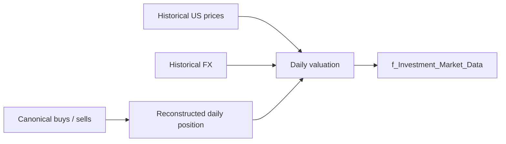

## Inputs

The transformer consumes the evidence required to establish:

- canonical US purchases;
- canonical US sales;
- instrument identity;
- historical price observations;
- historical FX observations;
- the date range over which position state must be reconstructed.

The exact function signature should remain the code authority, but the semantic inputs above define the financial contract.

## Step 1: transaction events

Purchases add quantity; sales remove quantity. The transformer converts transaction evidence into a dated position-change stream.

Conceptually:

$$
\Delta Q_t = Q_{buy,t} - Q_{sell,t}
$$

The outstanding quantity at date $t$ is the cumulative state after applying transaction events through that date.

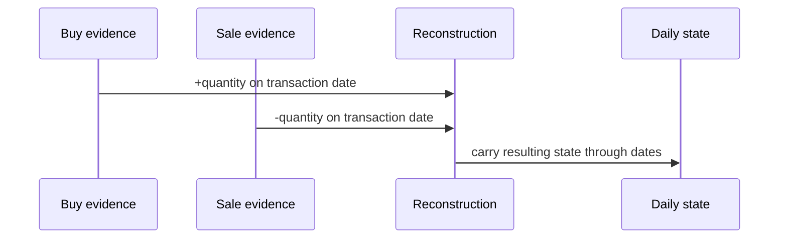

## Step 2: holdings spine

The implementation maintains remaining quantities using transaction chronology so the daily market state can retain acquisition-price context. This is FIFO-like state for valuation reconstruction, but it is deliberately not the canonical acquisition-lot ledger.

Why not? Because the Quant Engine already owns lot identities, realized events, holding-period classification and reconciliation. Duplicating canonical lot authority here would create two answers to “which lot was sold?”, which is one answer too many.

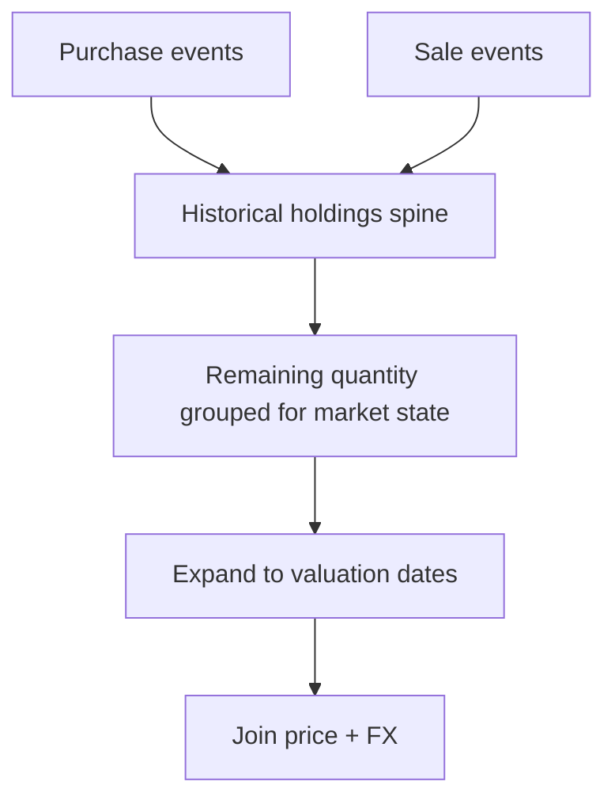

## Step 3: daily date expansion

Transaction events occur sparsely; valuation is needed at daily analytical dates. The reconstructed state is therefore carried across the relevant date domain until the next transaction changes quantity.

A date with no transaction is not a date with zero holdings. It is a date where the previous position state continues.

## Step 4: historical price selection

Historical US price observations are joined using backward as-of semantics. The valuation date may consume an observation from the same day or an earlier day, but never a later day.

```python
df_spine = (
    df_spine.join_asof(
        df_prices,
        on="Date",
        by="ISIN",
        strategy="backward",
    )
    .sort(["ISIN", "Date"])
    .with_columns(
        (pl.col("Date") - pl.col("Price_Observation_Date"))
        .dt.total_days()
        .alias("Price_Age_Days")
    )
)
```

The exact surrounding expression can evolve, but the semantic guarantee is stable: **no future price is used to value the past**.

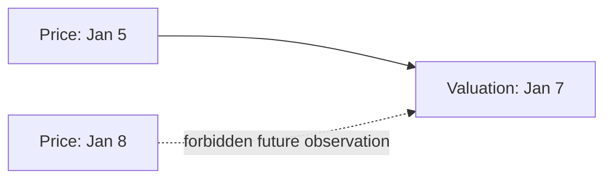

## Price provenance

The reconstructed market state retains fields including:

- `Price_Observation_Date`;
- `Price_Age_Days`;
- `Is_Imputed`.

Those fields make the difference between valuation date and source observation date visible. An imputed value is therefore not silently dressed up as a same-day quote.

## Seven-day staleness gate

Backward filling is bounded. The implementation enforces a maximum accepted price age of **7 calendar days**.

Conceptually:

$$
	ext{PriceAgeDays} = 	ext{ValuationDate} - 	ext{PriceObservationDate}
$$

with:

$$
0 \leq 	ext{PriceAgeDays} \leq 7
$$

for accepted reconstructed valuations.

A stale price beyond the accepted window is not quietly stretched forward because “close enough” becomes very expensive once it enters return analytics.

## Step 5: FX selection

Foreign-currency valuation requires historical FX. FX observations follow the same causal principle: the valuation path must not use future FX to translate past values.

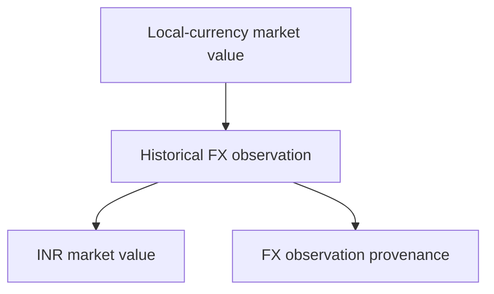

Invalid, missing, non-finite or non-positive FX observations fail validation rather than manufacturing a translated value.

## Step 6: valuation

At a high level:

$$
	ext{MarketValue}_{local,t} = Q_t 	imes P_t
$$

For a foreign-currency position:

$$
	ext{MarketValue}_{INR,t} = 	ext{MarketValue}_{local,t} 	imes FX_t
$$

The exact FX quote orientation is governed by the canonical currency pipeline. Documentation should follow the implemented field semantics rather than assume every external feed quotes the same direction.

## Acquisition context

The reconstructed state can retain acquisition-price context so local/INR acquisition value can be compared with current market value. This supports performance analytics without granting the market transformer ownership of canonical FIFO lots.

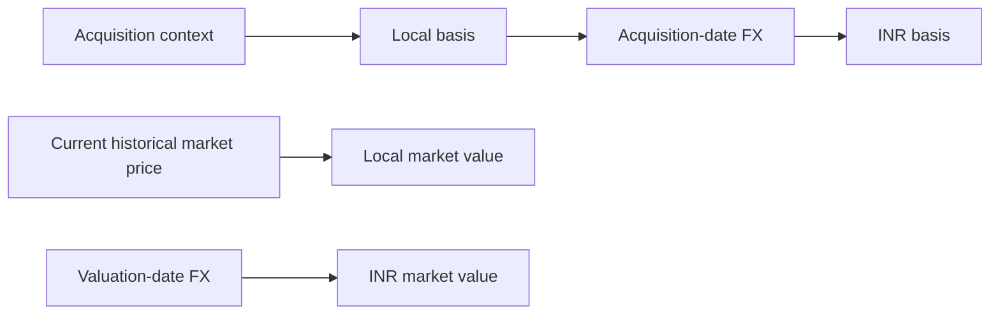

## Reconstruction versus canonical FIFO

| Concern | Market reconstruction | Quant FIFO |
|---|---|---|
| Purpose | daily historical holdings/valuation state | acquisition-lot and disposal authority |
| Grain | reconstructed daily market state | lot / realized event |
| Uses transactions | yes | yes |
| Owns `Lot_ID` | no | yes |
| Owns realized disposal events | no | yes |
| Owns reconciliation mutations | no | yes |
| Broker-certified daily holdings | no | no claim |

The shared input does not imply shared authority. Two functions can read the same purchase without becoming co-owners of its financial meaning.

## Causality guarantees

The reconstruction path is designed around temporal causality:

1. a transaction affects state on/after its effective date;
2. a historical valuation cannot use a future price;
3. a historical translation cannot use a future FX observation;
4. stale price observations beyond the accepted window fail;
5. observation dates remain available for provenance.

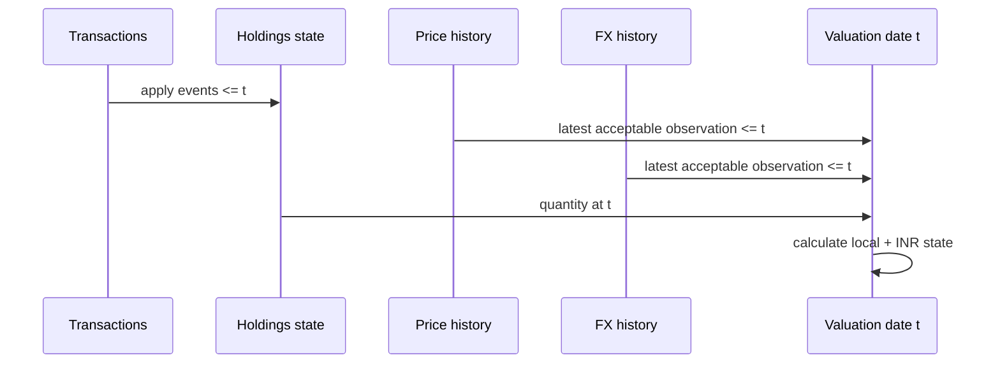

## Failure modes

### Missing price

If no acceptable historical price can be established, valuation cannot be produced honestly. The path fails rather than substituting an arbitrary future/latest quote.

### Stale price

A backward observation older than seven calendar days breaches the accepted staleness contract.

### Invalid FX

Missing, non-finite or non-positive FX invalidates translated valuation.

### Transaction inconsistency

A transaction stream that implies impossible quantity state is a financial-data problem, not something the market transformer should disguise with a clamp-to-zero. Canonical reconciliation belongs downstream in Quant where provenance can be recorded.

## Edge cases

### Weekends and holidays

Backward price selection allows a valuation date to use the latest acceptable prior observation, which is necessary across non-trading days. `Price_Age_Days` keeps that substitution visible.

### Long market closure or missing feed

The seven-day gate bounds how far the system is willing to carry an observation. Beyond that, the correct result is a validation problem, not increasingly fictional certainty.

### Position closes

Once transaction state reaches zero, future valuation state should not continue carrying an economic position merely because old prices remain available. Quantity state controls whether a holding exists.

### Re-entry

A later purchase can create a new outstanding position after a prior position was fully sold. Transaction chronology, not stale prior market state, establishes that new state.

## Downstream consumers

The reconstructed market data feeds canonical market/Quant analytics, which then produce valuation, performance and presentation outputs. It should be read as a reconstructed evidence-backed market state, not as a broker statement in disguise.

## Invariants

- transaction chronology controls quantity state;
- valuation never uses future price observations;
- FX translation never intentionally uses future observations;
- price observation provenance is retained;
- accepted price age is bounded;
- reconstructed holdings do not become canonical FIFO lots;
- canonical realized events remain Quant-owned.

## Trade-offs

Reconstruction is more complex than ingesting a broker daily-holdings file, but the latter is not reliably available for this source. The implementation chooses transparent deterministic reconstruction over pretending the missing evidence exists. It also avoids overloading the reconstruction with canonical lot responsibilities already owned by Quant. One reconstruction engine doing two jobs would look simpler right up until the two definitions of FIFO disagree.

## Source chronology and event ordering

Reconstruction depends on deterministic transaction chronology. Purchases and sales are applied in date order so outstanding quantity reflects only events effective by the valuation date. When multiple events share a date, the implementation's ordering and canonical source shape become part of the reconstruction behavior; this is one reason canonical transaction normalization happens before the transformer.

A daily state is therefore a fold over transaction history:

$$
Q_t = Q_{t-1} + Q_{buy,t} - Q_{sell,t}
$$

subject to the transformer's handling of remaining acquisition-price groups.

## Why acquisition-price groups exist here

The transformer can retain remaining quantities grouped by acquisition price because historical market analytics may need acquisition-value context. That grouping is a valuation convenience, not the canonical lot identity protocol.

Canonical Quant lots additionally carry deterministic `Lot_ID`, transaction lineage, realization behavior, holding-period classification and reconciliation state. The market transformer deliberately stops short of those responsibilities.

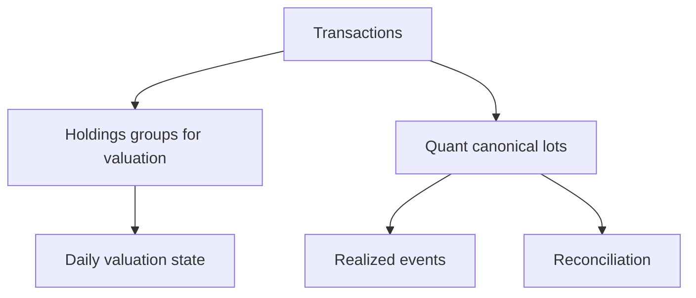

## Observation age is part of financial meaning

Consider a Sunday valuation using Friday's closing price. The numeric price may be perfectly acceptable, but the source observation is two days old. Retaining `Price_Observation_Date` and `Price_Age_Days` lets downstream users distinguish:

```text
valuation date = Sunday
price observation = Friday
price age = 2 days
imputed = true
```

Without those fields, the same number would look indistinguishable from a Sunday market observation that never existed.

## Price-age validation sequence

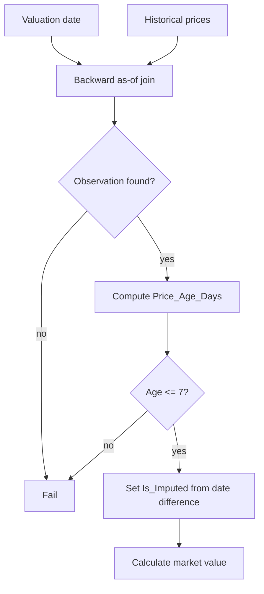

The staleness rule converts what could have been an implicit data-quality assumption into an explicit validation contract.

## FX validation sequence

FX has its own validity requirements. A numerically present observation can still be unusable if it is non-finite or non-positive.

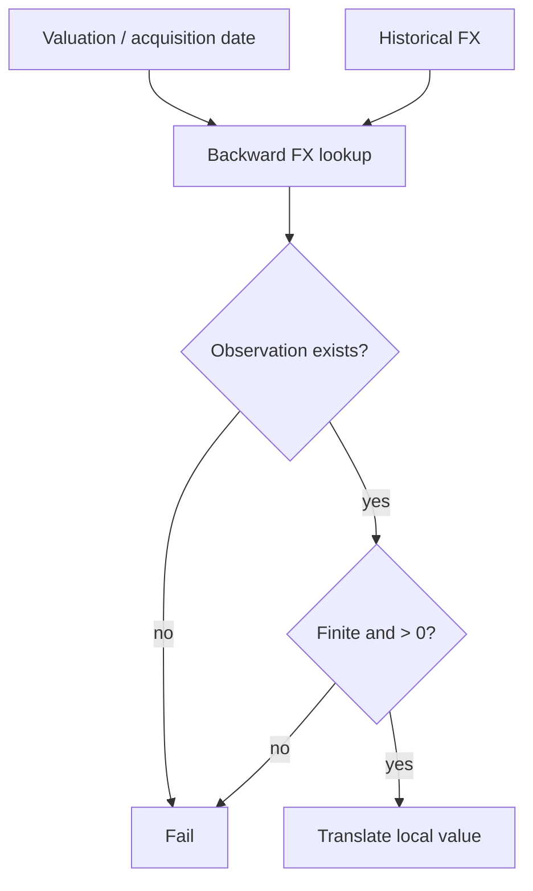

This matters because replacing invalid FX with `1.0` would produce a very tidy number and a very fictional INR portfolio.

## Local acquisition value

For remaining reconstructed quantity associated with an acquisition price:

$$
\text{AcquisitionValue}_{local} = Q_{remaining} \times P_{acquisition}
$$

Historical acquisition-date FX can then translate that basis to INR, while valuation-date FX translates market value. Using different dates is essential for separating asset and currency effects later.

## Local market value

For valuation date $t$:

$$
\text{MarketValue}_{local,t} = Q_t \times P_{market,t}
$$

The quantity comes from transaction reconstruction; the price comes from the latest acceptable causal observation.

## Reporting-currency value

The INR translation uses the relevant historical FX observation for the valuation date:

$$
\text{MarketValue}_{INR,t} = \text{MarketValue}_{local,t} \times FX_t
$$

The Multi-Currency and FX specification owns the precise attribution formulas. This page owns how the required dated evidence is selected and validated.

## Temporal leakage threat model

Historical analytics are particularly vulnerable to accidental look-ahead. Three common leakage paths are explicitly avoided here:

1. using the next available market price when the current date has none;
2. using the latest/current FX rate for all history;
3. reconstructing quantity with transactions that occur after the valuation date.

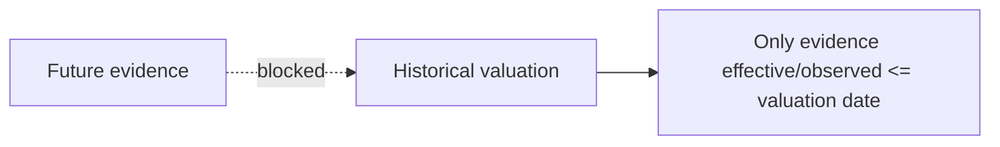

The rule is intentionally boring: the past only gets to know what the past could know.

## Weekend/holiday example

Assume:

```text
Friday: price observation = 100
Saturday: no market observation
Sunday: no market observation
Monday: price observation = 103
```

For Sunday, backward as-of selection yields Friday's `100`, `Price_Age_Days = 2`, and `Is_Imputed = true`. Monday's `103` cannot leak backward into Sunday.

This is a small example, but the same rule protects long historical series from systematic look-ahead bias.

## Missing-price example

If an instrument has reconstructed quantity on a date but no prior acceptable price observation, the system cannot honestly calculate market value. Transaction evidence remains valid; valuation state fails. The architecture's separation of evidence from valuation makes that partial failure intelligible.

## Closed-position behavior

A zero outstanding quantity terminates economic exposure. Price history can continue indefinitely, but a price observation alone cannot resurrect a sold position.

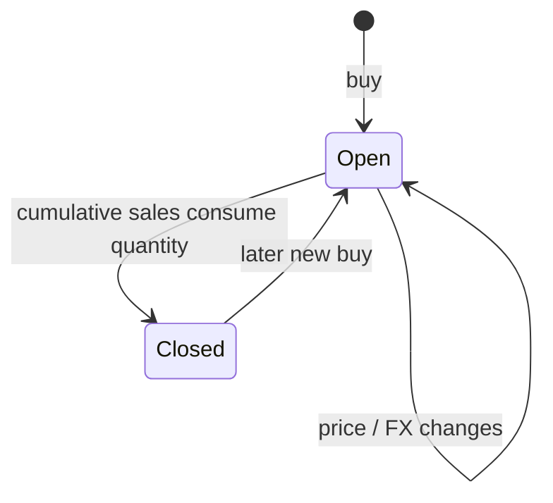

This state machine is quantity-driven. Market observations enrich an existing position; they do not create ownership.

## Re-entry behavior

When a position is fully closed and later purchased again, reconstruction begins a new period of exposure from the later transaction evidence. Canonical FIFO will separately create new deterministic lot state for the new acquisition.

## Relationship to reconciliation

Market reconstruction should not silently manufacture quantity to match an external holdings observation. Quantity/basis discrepancy resolution belongs to Quant reconciliation, where an event can preserve the fact that reconstructed and observed state differed.

That division keeps this transformer deterministic with respect to transaction evidence and prevents valuation logic from becoming an undocumented correction engine.

## Relationship to performance analytics

The reconstructed series supplies daily quantity, price and translated value context. Performance analytics can then calculate returns over a causally valid historical state. The reconstruction itself should not own XIRR, portfolio weights or tax classification; those are downstream responsibilities.

## Relationship to benchmarks

Benchmark history is independent market evidence. A reconstructed holding can be compared with a benchmark downstream, but benchmark prices never substitute for missing instrument prices in this reconstruction path.

## Validation matrix

| Condition | Accepted? | Behavior |
|---|---:|---|
| same-day price | yes | direct observation |
| prior price within 7 days | yes | backward-filled, provenance retained |
| future price only | no | not used |
| prior price older than 7 days | no | validation failure |
| valid historical FX | yes | translate value |
| missing/non-finite/non-positive FX | no | validation failure |
| price exists but quantity is zero | no holding value | position remains closed |
| transaction exists but price unavailable | transaction remains evidence | valuation fails |

## Observability fields

`Price_Observation_Date`, `Price_Age_Days` and `Is_Imputed` are more than debugging fields. They are financial data-quality metadata. They allow a downstream analyst to distinguish exact market observations from bounded carry-forward valuation.

## Non-guarantees

The reconstruction does not guarantee:

- independent broker confirmation of every daily quantity;
- canonical tax-lot grain;
- perfect valuation on dates where the market evidence is absent;
- that every accepted prior price is economically ideal, only that it satisfies the implemented causality/staleness contract;
- that transaction evidence itself is error-free.

Those limits are why reconciliation and provenance exist elsewhere in the architecture.

## Testing implications

High-value tests for this subsystem should cover at least:

- buy-only position accumulation;
- partial and full sales;
- close and re-entry;
- weekend backward fill;
- future-price rejection;
- >7-day stale price rejection;
- missing FX;
- non-positive FX;
- local versus INR valuation;
- no accidental lot-authority leakage into the market transformer.

The current repository's broader QA program should distinguish these executable cases from documentation claims; specifying a test is not the same thing as having run it.

## Related specifications

- [Financial Model](financial-model.md)
- [Cashflow and Wealth](cashflow-and-wealth.md)
- [Investment Data Model](investment-data-model.md)
- [Investment Market Reconstruction](investment-market-reconstruction.md)
- [FIFO and Realized Events](fifo-and-realized-events.md)
- [Investment Reconciliation](investment-reconciliation.md)
- [Investment Performance and Risk](investment-performance-and-risk.md)
- [Multi-Currency and FX](multi-currency-and-fx.md)
- [Tax Methodology](tax-methodology.md)
- [FIRE Methodology](fire-methodology.md)
- [Data Model](../architecture/data-model.md)
- [Silver Data Contracts](../reference/silver-data-contracts.md)
