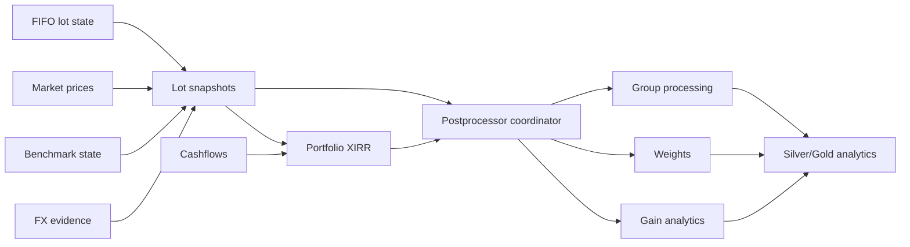
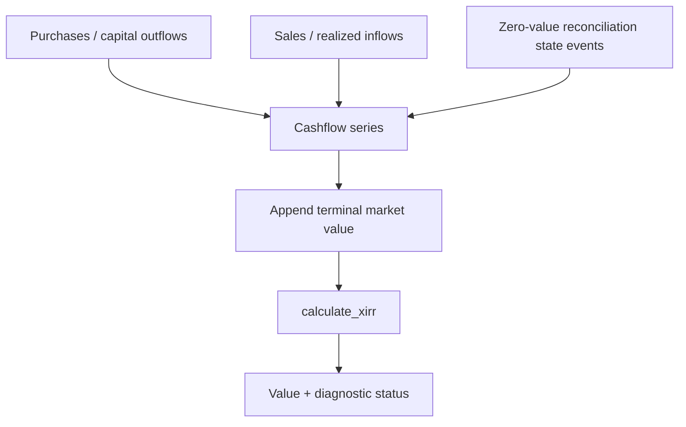
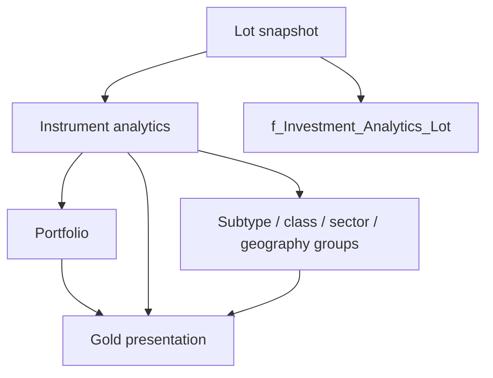
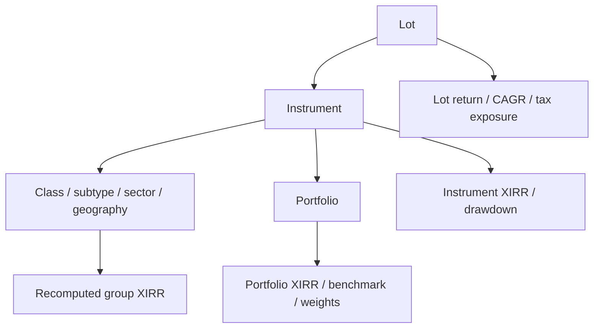
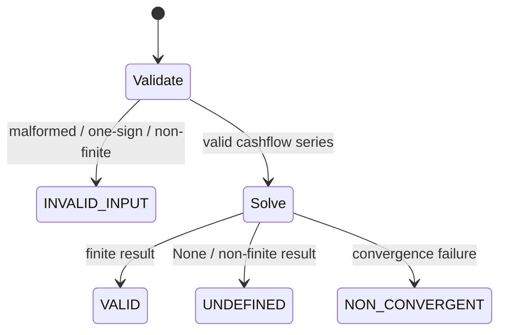
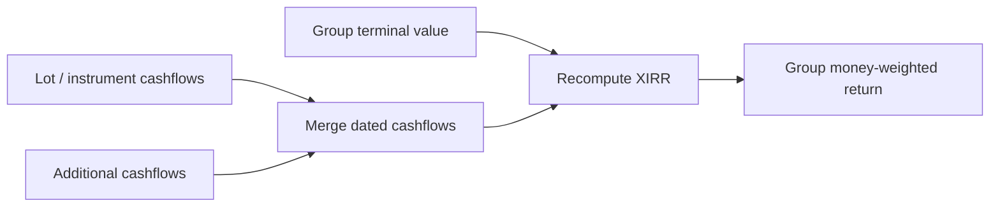

# Investment Performance and Risk

Personal Finance ETL derives investment performance only after canonical transactions have been reconstructed into auditable lot state. This specification covers lot and instrument returns, CAGR, typed XIRR, benchmark shadow performance, active return, drawdown, tax-if-sold exposure, aggregation, null semantics, and the boundaries between deterministic measurement and financial interpretation.

## Scope and ownership

Investment performance is produced after canonical transactions have been reconstructed into lot state. The analytics layer combines surviving FIFO lots, market prices, benchmark shadow state, cashflows, tax exposure, and FX evidence into lot-, instrument-, group-, and portfolio-level measures.

This page owns return/risk semantics and post-processing. It does not redefine FIFO, reconciliation, or physical table DDL.

## Analytics pipeline



## Lot return and CAGR

For each active lot, absolute return is based on acquisition and current market price:

$$R_{lot}=\frac{P_t-P_0}{P_0}$$

CAGR is calculated as:

$$CAGR=\left(\frac{V_t}{V_0}\right)^{365/d}-1$$

`calculate_cagr()` returns typed `CagrResult(value, status, message)`: `INVALID_INPUT` (`value=None`) for non-positive or non-finite prices, `UNDEFINED` (`value=None`) for zero or negative holding periods, and `VALID` (`value: float`) for valid inputs. It never uses `0.0` as a sentinel for missing or invalid data, preserving true zero-return performance observations.

## Instrument CAGR

Instrument CAGR uses quantity-weighted holding age across surviving lots and the FIFO portfolio average cost. Benchmark CAGR uses the corresponding benchmark shadow average cost. This is a state-based annualized measure and is distinct from money-weighted XIRR.

## Why CAGR and XIRR both exist

CAGR describes annualized change between a basis and terminal value. XIRR is money-weighted and incorporates irregular cashflow timing. With multiple purchases, sales, or reconciliation cashflows, the two answer different questions. Treating them as interchangeable would be mathematically tidy and financially wrong.

## Typed XIRR contract

```python
if not has_negative or not has_positive:
    return XirrResult(None, "INVALID_INPUT", "Cashflows must have both outflows and inflows")
...
result = xirr(dates, amounts)
if result is None:
    return XirrResult(None, "UNDEFINED", "Solver returned None")
...
return XirrResult(value, "VALID")
```

The engine returns a typed `XirrResult`, not a bare float. Statuses include `VALID`, `INVALID_INPUT`, `UNDEFINED`, and `NON_CONVERGENT`. A failed solver is therefore not silently converted to a genuine `0%` return.

## XIRR cashflow model



## Portfolio XIRR

`PortfolioXIRRCalculator` incrementally accumulates dated cashflows and appends each as-of-date terminal value. It calculates portfolio, after-tax, benchmark, local-currency, and benchmark-local XIRRs from parallel cashflow series.

## Invalid evidence propagation

```python
amount = _numeric_value(cf.get("amount"))
...
# Preserve invalid/missing evidence as NaN so XIRR returns a diagnostic null.
port_amounts.append(amount if amount is not None else float("nan"))
```

This is an important reliability choice. Missing or invalid cashflow evidence is deliberately allowed to poison the calculation into a diagnostic null rather than being replaced with zero and quietly changing the economics.

## After-tax XIRR

The ISIN processor computes a terminal value after deducting indicative tax-if-sold from active lots. That terminal value feeds a separate XIRR. It is an analytical after-tax scenario, not a statutory filing calculation. The tax assumptions come from macro rules and current holding classification.

## Benchmark comparison

Each lot maintains benchmark shadow state. The analytics layer computes benchmark CAGR and XIRR over economically aligned cashflows, then derives active return where both portfolio and benchmark metrics are valid.

$$ActiveReturn = XIRR_{portfolio} - XIRR_{benchmark}$$

Local-currency active return is calculated separately when local benchmark evidence exists.

## FX XIRR impact

Portfolio XIRR is calculated in reporting currency and local currency. Where both are valid:

$$FX\ XIRR\ Impact = XIRR_{reporting} - XIRR_{local}$$

This is a money-weighted attribution view. It complements, rather than replaces, the P&L attribution described in [Multi-Currency and FX](multi-currency-and-fx.md).

## Unrealized gains and losses

At snapshot time, each lot computes reporting-currency P&L from current market price and acquisition basis. Positive and negative amounts are split into unrealized gain/loss fields and further classified into LTCG/STCG buckets according to current holding status.

## Tax-if-sold exposure

The snapshot resolves applicable LTCG/STCG rates from macro parameters. Positive unrealized gains produce indicative tax-if-sold. Eligible Indian listed-equity LTCG can consume remaining exemption before tax is estimated. Foreign equity and other asset classes do not inherit that exemption by accident.

## Maximum drawdown

The Quant pipeline maintains price/value history and exposes `Max_Drawdown` as a downside-risk measure. Drawdown is conceptually the decline from a prior running peak:

$$DD_t = \frac{V_t}{\max_{u\le t}V_u}-1$$

The reported maximum drawdown is the most negative observed drawdown over the evaluated history. It is path-dependent, unlike terminal return.

## Lot alpha and outperforming-lot ratio

Lot alpha is implemented as lot CAGR minus benchmark lot CAGR. The snapshot builder counts lots with positive alpha and assigns an `Outperforming_Lot_Ratio` across the instrument snapshot. This is a simple interpretability measure, not a statistical alpha regression.

## Portfolio and group aggregation

Post-processing aggregates analytics at portfolio and arbitrary group levels such as class/subtype. Critically, it does not take the first lot XIRR and call it portfolio XIRR. Group/portfolio XIRR is recalculated from grouped cashflows and terminal values using the same XIRR calculator.

## Why XIRR is recomputed at group level

Money-weighted returns are not additive and generally cannot be averaged across lots. The postprocessor therefore reconstructs the relevant grouped cashflow stream. This avoids a deceptively easy but financially invalid aggregation shortcut.

## Weights and contribution

Portfolio weights are derived from current close values at the relevant aggregation level. Contribution-style measures can then relate return/P&L to economic exposure. Weighting is performed after instrument analytics so that individual lot state remains available for drill-through.

## Status and null semantics

A missing metric is not automatically zero. XIRR has explicit diagnostic status; active return requires both portfolio and benchmark returns; FX impact requires both reporting and local XIRR; benchmark measures require benchmark evidence. The model uses nullability to represent unavailable financial meaning rather than cosmetically filling dashboards.

## Risk boundaries

The engine contains concrete risk/diagnostic measures such as drawdown, benchmark lagging, tax exposure, sequence of lot performance, and currency attribution. Documentation should not resurrect retired generic ratios merely because they sound quant-y. If a metric is not implemented, the docs do not get to cosplay it.

## Output hierarchy



## Failure behavior

Invalid XIRR inputs produce diagnostic statuses. Invalid FX can block foreign-currency processing before publication. Missing benchmark evidence leaves benchmark-dependent metrics unavailable rather than synthesizing a benchmark. Invariant violations such as a missing `Lot_ID` raise rather than publishing anonymous lot analytics.

## Guarantees and limitations

The analytics layer guarantees implementation-consistent calculations from canonical evidence, explicit null/status behavior, lot-level drill-through, and recomputed money-weighted returns at aggregation levels.

It does not guarantee future investment performance, statistical significance of alpha-like measures, statutory after-tax outcomes, or that every metric is meaningful for every instrument/date.

## Source map

Primary implementation authorities:

- `backend/engines/analytics/core/math.py` — CAGR/XIRR primitives.
- `pipeline/processor/isin_processor.py` — instrument analytics and cashflows.
- `pipeline/processor/snapshot.py` — lot snapshot metrics.
- `pipeline/postprocessor/xirr.py` — portfolio XIRR.
- `pipeline/postprocessor/coordinator.py` — aggregation coordination.
- `pipeline/postprocessor/group_processor.py` — grouped metrics.
- `pipeline/postprocessor/weights.py`, `gains.py`, `analytics.py` — post-processing measures.

## Measurement hierarchy

Performance exists at several grains, and each grain answers a different question.



The system preserves lot-level facts before aggregation so higher-level outputs remain explainable.

## Snapshot grain

`f_Investment_Analytics_Lot` is fundamentally a date × instrument × lot analytical fact. A surviving acquisition lot can therefore appear across many closing dates. This is a state-over-time table, not a transaction ledger.

The grain allows a single acquisition lot to accumulate age, cross an LTCG threshold, change market value, change benchmark comparison, and change FX attribution without losing its identity.

## Weighted holding age

Instrument CAGR uses quantity-weighted holding duration across active lots. This differs from simply using the oldest acquisition date or average calendar date. The weight reflects how much current position each lot contributes.

## XIRR validity model

`calculate_xirr()` validates:

- equal date and amount counts;
- at least two cashflows;
- finite numeric amounts;
- valid dates;
- at least one negative and one positive cashflow;
- finite solver output.

The result carries both value and status. That lets presentation distinguish “not computable” from “computed return is exactly zero.”

## XIRR status state machine



## Terminal-value construction

For an as-of date, money-weighted return appends current terminal value to historical cashflows. Portfolio calculation repeats this for each closing date, producing a time series of XIRR rather than one timeless number.

The same pattern is used for:

- portfolio terminal value;
- after-tax terminal value;
- benchmark shadow terminal value;
- local-currency terminal value;
- benchmark local terminal value.

## After-tax terminal value mechanics

For each active lot, the engine estimates current tax-if-sold based on holding classification and applicable macro rates. The after-tax terminal value is current value less those indicative taxes. It then uses the same historical cashflows with this alternative terminal value to compute after-tax XIRR.

This is scenario analytics. It is not a tax return calculation.

## LTCG transition analytics

Each lot snapshot records age, holding type, threshold days, and `Days_To_LTCG`. The analytics layer can therefore show not only current tax classification but proximity to a classification boundary.

That is particularly useful for planning because tax exposure is a state transition, not merely a static label.

## Unrealized tax buckets

Positive and negative P&L are separated into:

- unrealized LTCG;
- unrealized STCG;
- unrealized LTCL;
- unrealized STCL;
- total unrealized gain;
- total unrealized loss.

Losses are not netted away prematurely because later tax methodology can require classification-aware treatment.

## Eligible LTCG exemption behavior

The snapshot implementation deducts remaining eligible LTCG exemption before calculating tax-if-sold for qualifying Indian listed equity. The exemption is not applied universally to foreign equity or unrelated asset classes.

This is exactly the sort of rule that should live in implementation-backed documentation rather than a generic sentence saying “tax aware.”

## Benchmark shadow economics

Benchmark comparison is constructed from shadow quantities/cashflows tied to actual capital timing. This avoids comparing a money-weighted portfolio return against a benchmark return that assumes one lump-sum investment on an unrelated date.

## Active return semantics

Active return is only emitted when both portfolio and benchmark XIRRs are available. Missing benchmark evidence produces missing active return rather than treating the benchmark as zero.

The same principle applies to local active return.

## Drawdown interpretation

Maximum drawdown captures path risk. Two investments can have identical terminal CAGR and radically different drawdown histories. The metric therefore complements return rather than ranking as “another return number.”

## Lagging benchmark flag

`Is_Lagging_Benchmark` is computed only when both instrument and benchmark XIRRs are valid. It is a comparative diagnostic, not a prediction or recommendation.

## Lot alpha semantics

`Lot_Alpha = Lot_CAGR - Lot_BM_CAGR` is intentionally simple. It should not be described as CAPM alpha, factor alpha, or risk-adjusted excess return. The name represents CAGR spread against the lot-aligned benchmark shadow state.

## Outperforming-lot ratio

The snapshot builder counts lots whose lot alpha is positive and divides by active lot count. The resulting ratio describes breadth of outperformance across lots, which can differ from aggregate portfolio outperformance.

## Money-weighted aggregation rule



XIRR is recomputed, not averaged. This is a hard financial correctness rule.

## Group processor

`group_processor.py` applies the same portfolio XIRR calculator at arbitrary grouping levels. That keeps class/subtype analytics consistent with portfolio methodology instead of introducing a second formula for convenience.

## Postprocessor coordinator

The coordinator joins instrument analytics with portfolio XIRR, gain analytics, group outputs, and weights. It also aggregates fields such as `Forex_PnL` and derives contribution-style ratios where denominators are meaningful.

## Weight semantics

Weights describe current economic exposure based on close value. They are not transaction allocation percentages and should not be confused with target portfolio weights from configuration.

## Local versus reporting performance

For foreign assets, the analytics model exposes both local and reporting-currency CAGR/XIRR. The difference is economically meaningful because security selection and currency movement can push in opposite directions.

## Risk and uncertainty matrix

| Measure | What it captures | What it does not capture |
|---|---|---|
| CAGR | annualized state change | irregular cashflow timing |
| XIRR | money-weighted return | statistical uncertainty |
| Max drawdown | peak-to-trough path loss | probability of recurrence |
| Active return | portfolio vs benchmark spread | factor attribution |
| Tax-if-sold | indicative current exposure | final statutory liability |
| FX impact | currency contribution | hedging strategy |
| Outperforming-lot ratio | breadth across lots | magnitude of outperformance |

## Null semantics are financial semantics

A null benchmark return means benchmark evidence is unavailable or computation is invalid. A zero benchmark return means a valid calculation produced zero. Those are different facts. The same distinction applies to XIRR, FX impact, active return, and local metrics.

## Publication invariants

- lot analytics require deterministic `Lot_ID`;
- XIRR failure remains diagnostic rather than becoming zero;
- benchmark-dependent metrics require benchmark evidence;
- FX-dependent metrics require valid FX evidence;
- group XIRR is recomputed from grouped cashflows;
- tax exposure remains indicative;
- retired metrics are not documented as if they still exist.

## Analytical reproducibility

Given the same canonical transactions, market/benchmark/FX evidence, macro rules, and implementation, deterministic Quant metrics rebuild consistently. This is separate from stochastic FIRE replay, which has seed/provenance semantics described elsewhere.

## Worked interpretation example

A foreign equity can show:

```text
Local CAGR            +12%
Reporting CAGR         +7%
Benchmark local CAGR   +9%
Local active spread    +3%
FX effect              negative
```

The correct interpretation is not “the stock returned 7%.” The security outperformed locally while currency translation reduced the reporting-currency outcome. The data model preserves enough dimensions to say that explicitly.

## Design trade-off: rich lot fact

The lot snapshot is wide. The alternative would be multiple narrowly normalized analytical facts requiring repeated joins for every portfolio view. The implementation chooses a rich analytical fact because lot-level finance questions frequently combine basis, holding age, benchmark, tax, and FX semantics.

## Design trade-off: fail visible instead of fill zero

Typed XIRR status and null propagation can make dashboards slightly less tidy. That is preferable to publishing plausible but false zeros. Financial analytics should optimize for meaning before cosmetics.

## Related specifications

- [Investment Data Model](investment-data-model.md)
- [Investment Market Reconstruction](investment-market-reconstruction.md)
- [FIFO and Realized Events](fifo-and-realized-events.md)
- [Investment Reconciliation](investment-reconciliation.md)
- [Multi-Currency and FX](multi-currency-and-fx.md)
- [Metrics and Methodology](metrics-and-methodology.md)
- [Silver Data Contracts](../reference/silver-data-contracts.md)
