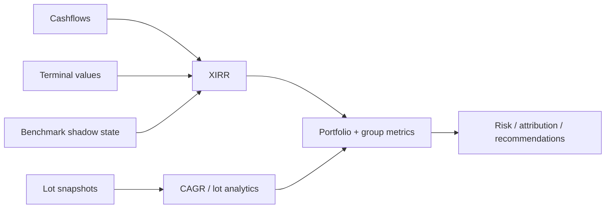

# Investment Performance & Risk

A portfolio can be profitable and still have poor performance.

A portfolio can also show an attractive return while hiding:

- irregular cash-flow timing;
- stale market observations;
- Tax drag;
- FX translation effects;
- benchmark underperformance;
- drawdown risk;
- invalid or non-computable metrics.

So the investment engine does not publish one magic percentage called `Return` and call it a day.

It builds a layered performance model from reconstructed position state, realized events, terminal values, and benchmark counterfactuals.



The central rule is simple:

> **invalid evidence must not become a convincing zero.**

That rule shapes the entire analytics contract.

## Implementation authority

Performance logic is intentionally decomposed across:

```text
src/personal_finance_etl/domain/investments/performance/returns.py
src/personal_finance_etl/domain/investments/performance/xirr.py
src/personal_finance_etl/domain/investments/performance/attribution.py
src/personal_finance_etl/domain/investments/portfolio/analytics.py
src/personal_finance_etl/domain/investments/portfolio/aggregation.py
src/personal_finance_etl/domain/investments/portfolio/snapshots.py
```

Application-level post-processing lives under:

```text
src/personal_finance_etl/application/investments/aggregation_service.py
```

The decomposition is meaningful:

- return solvers own return math;
- snapshots own lot-level current state;
- attribution owns realized/Tax-related interpretation;
- portfolio analytics owns cross-date analytics such as drawdown;
- aggregation reuses the same calculations at portfolio/group levels;
- application code coordinates the sequence.

## Measurement starts from the right question

Different metrics answer different questions.

| Metric | Question |
| --- | --- |
| absolute P&L | how many currency units did I gain/lose? |
| CAGR | what annualized growth corresponds to start/end value over time? |
| XIRR | what money-weighted return explains irregular dated cash flows? |
| active return | how did I perform versus the shadow benchmark? |
| FX impact | how much did currency translation change money-weighted return? |
| max drawdown | how severe was the worst peak-to-trough decline? |
| after-tax XIRR | what does return look like after estimated terminal Tax drag? |

No single one can safely stand in for all the others.

## CAGR has an explicit validity contract

The implementation does not return a bare float unconditionally.

```python
# src/personal_finance_etl/domain/investments/performance/returns.py

if not math.isfinite(start_value) or not math.isfinite(end_value):
    return CagrResult(
        value=None,
        status=CalculationStatus.INVALID_INPUT,
        reason="Non-finite input values in CAGR calculation",
    )
if start_value <= 0:
    return CagrResult(
        value=None,
        status=CalculationStatus.INVALID_INPUT,
        reason=f"Start value must be positive, got {start_value}",
    )
```

This matters because:

```text
0.0% valid CAGR
```

and:

```text
CAGR cannot be computed
```

are not the same financial statement.

## CAGR formula

For positive start/end values and positive holding duration:

\[
CAGR = \left(\frac{V_{end}}{V_{start}}\right)^{365/d} - 1
\]

where:

- \(d\) is calendar days;
- \(V_{start} > 0\);
- \(V_{end} > 0\).

The status model distinguishes:

```text
VALID
INVALID_INPUT
UNDEFINED
COMPUTATION_ERROR
```

The exact vocabulary comes from the shared calculation contracts.

## Why CAGR is useful but insufficient

CAGR assumes a start value, end value, and duration.

It does not naturally capture multiple contributions, withdrawals, dividends, or staged investments.

That is where XIRR becomes the more appropriate money-weighted measure.

## XIRR is a dated cash-flow equation

The solver finds \(r\) such that:

\[
\sum_{i=0}^{n}\frac{C_i}{(1+r)^{(d_i-d_0)/365}} = 0
\]

with negative investment outflows and positive inflows/terminal value.

The engine delegates numerical solving to `pyxirr`, but owns the validation semantics around it.

## XIRR validity is explicit

The pure solver rejects:

- mismatched dates/amount counts;
- fewer than two dated flows;
- NaN/infinite/non-numeric cash flows;
- missing/invalid dates;
- all-positive flows;
- all-negative flows.

```python
has_negative = any(a < 0 for a in amounts)
has_positive = any(a > 0 for a in amounts)
if not has_negative or not has_positive:
    return XirrResult(None, "INVALID_INPUT", "Cashflows must have both outflows and inflows")
```

Again, the engine refuses to turn “not a valid XIRR problem” into `0.0%`.

## Solver outcomes remain typed

Possible states include:

```text
VALID
INVALID_INPUT
UNDEFINED
NON_CONVERGENT
```

That status is financial metadata.

A non-convergent return is not an investment with zero return.

## Portfolio XIRR adds terminal state

For each evaluation date, portfolio XIRR combines all cash flows observed up to that date with the current terminal value.

Conceptually:

```text
historical dated cashflows
    +
terminal mark-to-market value at date t
    ↓
XIRR as of t
```

The calculator does this repeatedly across the analytical date series, producing a running performance history.

## Cashflow normalization is strict

Portfolio cash flows are normalized to real `date` objects once.

Invalid/missing dates raise an error rather than being silently skipped into a misleading return series.

This is a good example of the broader project rule:

> **if a field is required to establish financial chronology, malformed populated evidence is an error, not a suggestion.**

## Invalid amounts remain invalid through XIRR

When a required amount is not numeric, the portfolio calculator stores `NaN` into the solver vector so the pure XIRR contract returns diagnostic null.

It deliberately does not coerce malformed evidence to zero.

That preserves the difference between:

```text
no economic cashflow
```

and:

```text
cashflow evidence is invalid
```

## The terminal-value family

Portfolio performance can be computed from multiple terminal perspectives:

```text
val
shadow_val
after_tax_val
val_local
shadow_val_local
```

That produces multiple related but distinct return series.

## Portfolio XIRR

Uses reporting/base-currency cash flows and current portfolio value.

## Benchmark XIRR

Uses benchmark-shadow cash flows and shadow terminal value.

This represents the money-weighted counterfactual return from deploying equivalent capital into the benchmark.

## Active return

At the portfolio level:

\[
ActiveReturn = XIRR_{portfolio} - XIRR_{benchmark}
\]

The code only computes this difference when both values exist.

A missing benchmark return does not become zero alpha.

## Local XIRR

For foreign-currency assets, the engine can compute money-weighted return in local instrument currency.

This removes reporting-currency translation from the return perspective.

## FX XIRR impact

Conceptually:

\[
FXImpact = XIRR_{base} - XIRR_{local}
\]

This is not a pure algebraic decomposition of every path interaction, but it is an intuitive money-weighted diagnostic of reporting-currency effect.

The deeper currency semantics are specified in [Multi-Currency & FX](multi-currency-and-fx.md).

## After-tax XIRR

The engine can replace the ordinary terminal value with an estimated after-tax terminal value.

That produces:

```text
Portfolio_After_Tax_XIRR
```

The result is an analytical perspective, not statutory Tax liability.

Its quality depends on the Tax-if-sold estimates embedded in lot snapshots.

## Lot snapshots are the bridge from state to analytics

`SnapshotGenerator` turns open lot state into dated analytical records.

The snapshot includes dimensions such as:

```text
acquisition date
holding age
holding type
current quantity
cost basis
current value
unrealized gain/loss
Tax-if-sold attributes
benchmark attributes
FX attribution
```

The lot remains the natural grain for many investment analytics because acquisition-specific meaning has not yet been averaged away.

## Weighted holding age

At aggregated levels, holding age should respect economic weight rather than row count.

A one-unit recent lot should not influence portfolio age as much as a large old position merely because each occupies one row.

Weighting should follow the intended measure, commonly current value or another explicit economic basis.

## Unrealized gain/loss

For an open lot:

\[
UnrealizedPnL = V_{current} - B_{open}
\]

The engine retains Tax/holding classifications so unrealized state can be split into relevant buckets rather than one undifferentiated number.

## Tax-if-sold exposure

Open lots can carry an estimated Tax exposure based on current unrealized gains and applicable macro rates.

This supports after-tax wealth/performance analysis.

It remains an **estimate under configured rules**, not a filing result.

## LTCG transition analytics

The snapshot layer can expose:

```text
Holding_Type
Days_To_LTCG
```

This lets the application identify positions approaching a long-term holding threshold.

The metric is not only descriptive. It becomes input to harvesting/step-up recommendations.

## Harvesting recommendations are rule-driven

The recommendation calculator can produce states such as:

```text
HARVEST_LOSS
HARVEST_LTCG_EXEMPT
WAIT_FOR_LTCG
HOLD
```

It considers:

- unrealized loss;
- holding type;
- configured wait threshold;
- asset/Tax subtype exclusions;
- exemption context.

This is planning guidance, not statutory Tax advice.

## Maximum drawdown

Portfolio drawdown is calculated from a return path rather than simply comparing first/last values.

The implementation builds a cumulative return series and running peak.

Conceptually:

\[
DD_t = \frac{C_t - Peak_t}{Peak_t}
\]

with:

\[
Peak_t = \max_{s \le t} C_s
\]

Maximum drawdown is the minimum/most negative drawdown observed over the series.

## Net injections matter for daily-return construction

A portfolio value increase caused by fresh capital is not investment performance.

The analytics code adjusts daily return for net injection before compounding.

That prevents contributions from being mistaken for alpha.

## Group-level performance reuses portfolio logic

`GroupProcessor` deliberately calls the same `PortfolioXIRRCalculator` and analytics calculator for arbitrary groups.

```python
# src/personal_finance_etl/domain/investments/portfolio/aggregation.py

df_group = self.xirr_calc.calculate(unique_dates, cashflows, terminals)
df_group = self.analytics_calc.calculate(df_group, unique_dates, terminals, cashflows)
```

This is an important design choice.

Asset-class or geography return is not calculated with a cheaper approximation merely because it is a subgroup.

## Why XIRR is recomputed at group level

Money-weighted return is not safely additive or averageable.

In general:

\[
XIRR(A \cup B) \ne w_A XIRR(A) + w_B XIRR(B)
\]

The correct group result requires that group's own cash flows and terminal value.

The engine therefore recomputes rather than averaging instrument returns.

## Portfolio weights

Instrument-level portfolio weight:

\[
w_{instrument} = \frac{V_{instrument}}{V_{portfolio}}
\]

Lot-level weight:

\[
w_{lot} = \frac{V_{lot}}{V_{portfolio}}
\]

These weights support contribution/context, but they should not be used to manufacture group XIRR by weighted average.

## Benchmark shadow economics

Benchmark state follows the capital deployment history of the actual investment.

At acquisition, equivalent benchmark units are created.

At disposal/reconciliation, corresponding shadow state is consumed or adjusted.

This creates a counterfactual that is economically aligned with the portfolio's timing.

## Active return semantics

The benchmark is not a generic market index series pasted beside portfolio value.

It represents:

> what would have happened if equivalent dated capital flows had been deployed into the benchmark under the shadow-state rules.

That is why benchmark XIRR is meaningful as a money-weighted comparator.

## Lot alpha

At lot level, performance can be compared against its corresponding benchmark state.

This can support metrics such as:

```text
lot alpha
outperforming-lot ratio
```

Those diagnostics answer distributional questions that portfolio XIRR alone cannot.

A portfolio can outperform overall while many lots underperform, or vice versa depending on capital weights and timing.

## Risk boundaries

The investment engine intentionally does not publish every academic risk metric available in finance textbooks.

Risk measures are useful when they are interpretable for the actual data and decision context.

The current model emphasizes metrics such as drawdown and benchmark-relative outcomes that fit the reconstructed daily state.

More metrics do not automatically mean more insight. Sometimes they mean more decimals competing for emotional authority.

## Null semantics are financial semantics

The performance layer distinguishes:

```text
zero
missing
invalid
undefined
non-convergent
```

These states affect interpretation.

Examples:

- valid XIRR of `0.0` means flat money-weighted return;
- `None` with invalid status means the return problem itself was invalid;
- undefined CAGR may mean zero/negative duration;
- missing benchmark result means active return is unavailable.

Do not fill all of these with zero for chart convenience.

## Risk and uncertainty matrix

| Condition | Correct interpretation |
| --- | --- |
| stale but allowed price | valuation uses carried recent observation |
| price outside staleness policy | valuation invalid/unavailable |
| reconciliation-origin lot | acquisition certainty reduced |
| invalid XIRR cash flows | XIRR unavailable, not 0% |
| benchmark unavailable | active return unavailable |
| Tax-if-sold estimate | analytical estimate, not statutory liability |
| foreign asset | local and reporting returns may diverge |

## Publication hierarchy

Performance can exist at multiple grains:

```text
lot
instrument
asset class/subtype
sector/industry
geography/currency
whole portfolio
```

The correct aggregation rule depends on the metric.

### Additive values

Examples:

```text
market value
cost basis
P&L
```

can often be summed across a compatible grain.

### Non-additive values

Examples:

```text
XIRR
CAGR
max drawdown
ratios
```

must be recomputed or otherwise handled according to their own semantics.

## Analytical reproducibility

Given the same:

- canonical cash flows;
- terminal states;
- benchmark state;
- FX state;
- financial rules;
- evaluation dates;

the deterministic performance outputs should reproduce.

Stochastic FIRE simulations are a different reproducibility contract and are documented separately.

## Failure behavior

The performance layer prefers visible invalidity over plausible fabrication.

That means:

- bad cash-flow dates can raise;
- invalid numerical inputs produce typed invalid results;
- solver non-convergence remains non-convergence;
- unavailable terminal value produces unavailable return;
- missing benchmark prevents active-return calculation.

## Worked interpretation example

Suppose a foreign-currency instrument shows:

```text
Local XIRR = 10%
Base-currency XIRR = 15%
Benchmark XIRR = 12%
After-tax XIRR = 13%
Max drawdown = -18%
```

A reasonable interpretation is:

- the asset itself earned approximately 10% money-weighted in local currency;
- reporting-currency movement improved the observed base-currency return;
- the portfolio beat its benchmark counterfactual by about 3 percentage points on the same return perspective;
- estimated Tax drag reduced terminal money-weighted return;
- path risk included an 18% peak-to-trough drawdown.

That is much richer than “return = 15%.”

## Design trade-off: rich lot fact instead of early aggregation

Keeping lot-level snapshots produces more data.

It also preserves:

- acquisition-specific holding period;
- basis;
- Tax status;
- benchmark state;
- FX state;
- reconciliation provenance.

Those are exactly the attributes later analytics need.

## Design trade-off: fail visible instead of fill zero

Charts are easier when every metric is numeric.

Financial interpretation is safer when invalid metrics stay invalid.

The engine chooses the second.

## Handoff: performance still needs a currency lens

At this point the engine can calculate money-weighted returns, benchmark-relative outcomes, drawdown, Tax drag, and group metrics.

For foreign assets, one question remains unavoidable:

> **How much of the result came from the asset, and how much came from the currency translation?**

That is the job of [Multi-Currency & FX](multi-currency-and-fx.md).

## Related specifications

- [Investment Market Reconstruction](investment-market-reconstruction.md)
- [FIFO & Realized Events](fifo-and-realized-events.md)
- [Investment Reconciliation](investment-reconciliation.md)
- [Multi-Currency & FX](multi-currency-and-fx.md)
- [Metrics & Methodology](metrics-and-methodology.md)
- [Tax Methodology](tax-methodology.md)
