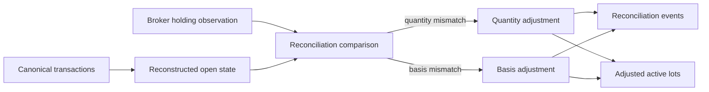
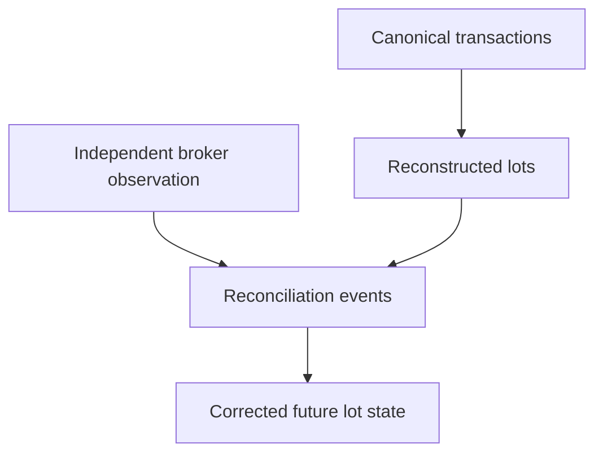

# Investment Reconciliation

A deterministic model can still disagree with observed reality.

That is not a bug in the idea of determinism. It is the exact situation reconciliation exists to expose.

The investment engine reconstructs expected open quantity and basis from canonical transaction evidence. Broker snapshots provide an independent observation of position state. When those two paths disagree materially, the system does not quietly edit history until the numbers look friendly.

It emits explicit reconciliation evidence and mutates the active lot state in a controlled, traceable way.



Reconciliation is therefore not “fixing the data.”

It is **recording disagreement between two evidence paths and defining how the model continues afterward**.

## Implementation authority

The high-level comparison logic lives in:

```text
src/personal_finance_etl/domain/investments/reconciliation/engine.py
```

The actual state mutation is delegated to:

```text
src/personal_finance_etl/domain/investments/lots/fifo.py
```

The event vocabulary and record models live in:

```text
src/personal_finance_etl/domain/investments/reconciliation/models.py
src/personal_finance_etl/domain/investments/contracts.py
```

This separation is deliberate:

- reconciliation decides whether an observed discrepancy is meaningful;
- the FIFO portfolio remains the single owner of open lot state;
- reconciliation events preserve the explanation of the correction.

## Where reconciliation sits in the investment lifecycle

Reconciliation runs after transaction-driven state has been reconstructed and broker holding evidence is available.

```text
purchases + sales
    ↓
FIFO open state
    ↓
independent broker observation
    ↓
reconciliation comparison
    ↓
explicit adjustment event(s)
    ↓
corrected open state
    ↓
future FIFO / snapshots / performance / Tax evidence
```

This position in the pipeline matters.

Reconciliation is downstream of transaction reconstruction but upstream of later financial interpretation.

## Two independent questions

The engine separates:

1. **Does reconstructed quantity match observed broker quantity?**
2. **Given the quantity, does reconstructed cost basis match observed broker basis?**

Those are different problems and produce different event semantics.

## Quantity tolerance

The comparison uses:

```python
QUANTITY_TOLERANCE: float = 1e-8
```

A quantity discrepancy is meaningful only when:

\[
|Q_{broker} - Q_{reconstructed}| > 10^{-8}
\]

The tolerance exists to absorb floating-point residue, not economically meaningful share differences.

## Cost-basis tolerance

Basis comparison uses:

```python
COST_BASIS_TOLERANCE: float = 0.01
```

The relevant comparison is average unit cost:

\[
P_{broker,avg} = \frac{B_{broker}}{Q}
\]

and reconciliation occurs when:

\[
|P_{reconstructed,avg} - P_{broker,avg}| > 0.01
\]

subject to positive open quantity and positive reconstructed basis.

## Missing broker evidence is not a discrepancy

The engine explicitly treats absent broker quantity/basis as **no reconciliation evidence**, not as zero.

That distinction prevents missing observations from being interpreted as a full liquidation.

## Quantity-add reconciliation

If broker quantity is higher than reconstructed quantity:

\[
\Delta Q = Q_{broker} - Q_{reconstructed} > 0
\]

The system needs to restore state continuity without inventing a historical purchase it cannot prove.

The implementation creates a deterministic reconciliation group identity:

```python
_recon_gid = generate_deterministic_id(
    "RECON_LOT_GROUP",
    {
        "ISIN": self.isin,
        "Reconciliation_Date": m_date,
        "Adjustment_Type": "QUANTITY_ADD",
        "Quantity": round(diff, 8),
    },
)
```

Then it adds a reconciliation-origin lot.

## Why identity quantity is rounded but financial quantity is not rewritten

The deterministic ID uses quantity rounded to the same tolerance as the comparison.

The financial mutation retains the actual quantity difference.

This protects identity stability from harmless floating-point representation differences while preserving the economic adjustment itself.

That is a good example of identity semantics and financial semantics being related but not identical.

## The synthetic lot has zero cost by design

A quantity-add reconciliation creates:

```text
quantity = observed difference
cost basis = 0
lot source = RECONCILIATION
```

The zero basis does **not** mean the economic acquisition cost was truly zero.

It means:

> the system knows quantity is missing from reconstructed state, but does not have enough trusted transaction evidence to invent an acquisition basis.

That uncertainty must survive downstream.

## No invented economic cash flow

The quantity-add path appends a dummy cash flow:

```python
cf.append({"date": m_date, "amount": 0.0})
```

This is important.

Reconciliation restores position state without fabricating invested capital.

The event can affect holdings continuity without pretending a real purchase occurred on the reconciliation date.

## Quantity-add event semantics

The event records:

```text
Broker_Quantity
Reconstructed_Quantity
Quantity_Adjustment
Lot_ID
Purchase_ID
Adjustment_Type = QUANTITY_ADD
Reason = Broker quantity mismatch
```

The new lot ID makes future disposal traceable back to this correction.

## Quantity-remove reconciliation

If broker quantity is lower than reconstructed quantity:

\[
\Delta Q = Q_{reconstructed} - Q_{broker} > 0
\]

The engine removes units from the oldest open lots.

```python
while diff > 0 and self._active_lots:
    lot = self._active_lots[0]
    if lot.qty <= diff + 1e-8:
        removed = lot.qty
        diff -= lot.qty
        self._active_lots.popleft()
```

A partial removal reduces the head lot while preserving its identity and other acquisition attributes.

## Why quantity removal uses oldest lots

The system reuses FIFO ordering because the active lot queue already represents canonical disposal precedence.

That keeps later state internally consistent with the same lot-ordering model used for real sales.

The event remains a reconciliation adjustment, not a realized sale.

## Quantity removal is not realized P&L

A broker-observed lower quantity does not automatically prove an economic disposal price.

Therefore reconciliation removal does not invent sale proceeds or realized gains.

This protects the boundary between:

```text
observed state difference
```

and:

```text
proven economic transaction
```

## Shadow benchmark state follows quantity mutation

When quantity is partially removed, benchmark shadow quantity is reduced proportionally.

That keeps the counterfactual benchmark state aligned with the adjusted physical position.

Otherwise later active-return calculations could compare mismatched actual and shadow capital histories.

## Cost-basis reconciliation

Quantity can match while broker-reported basis differs from reconstructed basis.

The engine first computes:

\[
P_{target} = \frac{B_{broker}}{Q_{open}}
\]

and current reconstructed average cost:

\[
P_{current} = \frac{\sum_i Q_i P_i}{\sum_i Q_i}
\]

If the difference exceeds tolerance, all active lots are scaled proportionally.

## Basis scaling ratio

The base/reporting-currency scale factor is:

\[
r = \frac{P_{target}}{P_{current}}
\]

Each active lot receives:

\[
P_i' = P_i \times r
\]

This preserves relative basis distribution across lots while matching the broker aggregate basis.

## Why proportional scaling instead of replacing every lot with one average

Flattening all lots into one average would destroy:

- acquisition identity;
- acquisition date;
- future holding-period classification;
- lot-level realized-event lineage;
- benchmark state.

Proportional scaling changes the uncertain attribute that needs correction while preserving the rest of the lot model.

## Local-currency basis is reconciled separately where available

If broker local-currency basis exists, the engine computes a separate local average and scale ratio.

Conceptually:

\[
r_{local} = \frac{P_{target,local}}{P_{current,local}}
\]

Then:

\[
P_{i,local}' = P_{i,local} \times r_{local}
\]

This prevents INR/base-currency correction from accidentally becoming the local-currency economic basis.

## Lot identity survives cost-basis adjustment

The implementation deliberately preserves:

```text
lot_id
purchase_id
acquisition date
quantity
lot source type
```

while updating price attributes.

That reflects the semantics correctly:

> the system is correcting what it believes about basis, not claiming a different acquisition event occurred.

## Cost-basis event grain

One aggregate broker basis mismatch can create one event **per active lot** because each lot's basis is mutated.

The event stores:

```text
Original_Unit_Cost
Adjusted_Unit_Cost
Cost_Basis_Adjustment
Lot_ID
Purchase_ID
```

This makes the mutation auditable at the same grain as the state it changed.

## Worked basis example

Suppose open lots are:

```text
L1: 5 units @ 100
L2: 5 units @ 120
```

Current basis:

\[
B = 5(100) + 5(120) = 1100
\]

Current average:

\[
1100 / 10 = 110
\]

Broker basis says:

```text
1200 total
10 units
```

Target average:

\[
120
\]

Scale ratio:

\[
120 / 110 = 1.090909...
\]

Adjusted lots become approximately:

```text
L1: 5 @ 109.09
L2: 5 @ 130.91
```

Total basis now equals the observed 1200 while lot identity/date remain intact.

## Reconciliation event families

The key adjustment types are:

```text
QUANTITY_ADD
QUANTITY_REMOVE
COST_BASIS_ADJUSTMENT
```

They represent different uncertainty and must not be collapsed into one generic “reconciled” flag.

## Reconciliation is an uncertainty boundary

This is one of the most important financial semantics in the investment engine.

A reconciliation event says:

> **the model had one state, an independent observation provided another, and the system explicitly adjusted the future model from this point.**

It does not prove which historical source was wrong.

That is why reconciliation evidence deserves first-class lineage.

## Relationship to canonical transactions

Canonical purchases/sales remain the primary economic events.

Reconciliation does not rewrite them.

Instead it adds a separate correction layer.



## Relationship to market reconstruction

Market reconstruction creates expected position history from transactions.

Reconciliation consumes an independent holding observation and repairs the canonical open-lot state used by Quant processing.

The two mechanisms should agree where evidence is complete, but they are not the same contract.

## Relationship to future FIFO

Once reconciliation mutates the active lot queue, future sales consume that corrected state.

Therefore a later realized event can inherit:

```text
Lot_Source_Type = RECONCILIATION
```

This preserves the fact that some acquisition lineage is uncertain.

## Relationship to Tax evidence

Reconciliation-origin disposals require caution.

Downstream Tax logic can mark them `CHECK_REQUIRED` rather than treating zero/adjusted basis as statutory certainty.

This is exactly why uncertainty is preserved rather than hidden.

## Relationship to performance

Reconciliation can affect:

- open quantity;
- open basis;
- unrealized P&L;
- benchmark shadow state;
- future cash-flow/terminal state;
- eventual realized events.

Performance therefore consumes reconciled state, but should retain enough provenance to explain why that state differs from pure transaction replay.

## No-op cases

Reconciliation does nothing when:

- broker quantity is missing;
- quantity difference is within tolerance;
- broker basis is missing;
- no open units exist for basis reconciliation;
- current reconstructed average basis is non-positive;
- basis difference is within tolerance.

No event is emitted merely to prove the function ran.

## Failure cases

### Broker quantity materially higher

Quantity-add event + reconciliation-origin lot.

### Broker quantity materially lower

Oldest open quantity is removed through explicit events.

### Basis mismatch with valid open state

Proportional basis adjustment events.

### Broker observation inconsistent beyond available lot state

The mutation can only act on existing lots; unresolved inconsistencies remain a data-quality concern rather than generating negative lots.

## Operational invariants

1. canonical transactions are never silently rewritten;
2. missing broker evidence is not interpreted as zero;
3. quantity adjustments use explicit event types;
4. reconciliation additions have explicit reconciliation provenance;
5. no fake purchase cash flow is created for quantity repair;
6. cost-basis adjustment preserves lot identity;
7. local and base basis can be reconciled separately;
8. future FIFO sees the adjusted state;
9. uncertainty survives into downstream Tax interpretation;
10. tolerances are explicit and narrow.

## Audit workflow

Given a discrepancy, I should be able to trace:

```text
broker observation
    ↓
reconstructed pre-adjustment state
    ↓
comparison tolerance
    ↓
adjustment type
    ↓
lot(s) affected
    ↓
post-adjustment state
    ↓
future realized/performance consequences
```

That is the difference between reconciliation and “making the totals match.”

## Design trade-off: explicit correction facts

A simpler implementation could directly overwrite open quantity/basis.

That would be shorter.

It would also erase the most interesting question:

> why did the state change?

The explicit event model costs rows and code, but preserves causality.

## Design trade-off: correct future state without fabricating past certainty

Reconciliation is intentionally asymmetric.

It updates the model so future analytics reflect observed state, while keeping the historical uncertainty visible.

That is more honest than manufacturing a backdated purchase or sale simply to make the ledger prettier.

## Handoff: once state is coherent, performance can finally be measured

After market state reconstruction, FIFO accounting, and reconciliation, the engine has a coherent state model:

- open positions;
- acquisition lineage;
- realized events;
- corrected quantity/basis;
- benchmark shadow state;
- local/base currency context.

Only then does it make sense to ask:

> **How well did the capital actually perform?**

That is the job of [Investment Performance & Risk](investment-performance-and-risk.md).

## Related specifications

- [FIFO & Realized Events](fifo-and-realized-events.md)
- [Investment Market Reconstruction](investment-market-reconstruction.md)
- [Investment Performance & Risk](investment-performance-and-risk.md)
- [Multi-Currency & FX](multi-currency-and-fx.md)
- [Tax Methodology](tax-methodology.md)
- [Deterministic Identity & Replay](../architecture/deterministic-identity-and-replay.md)
