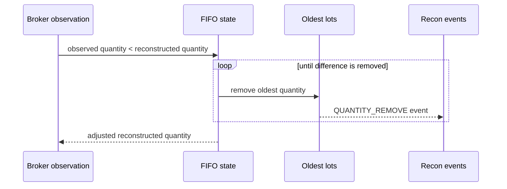
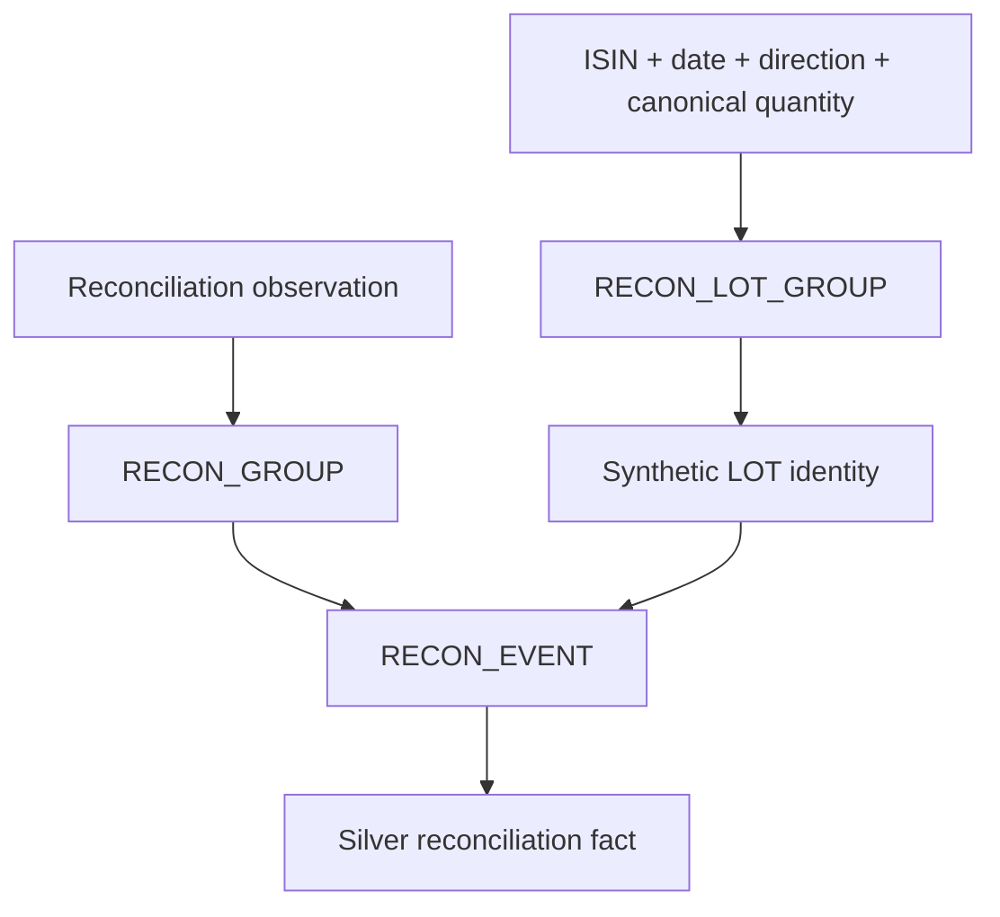
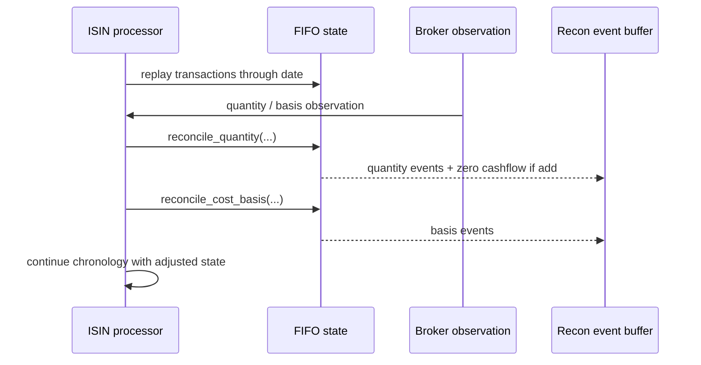
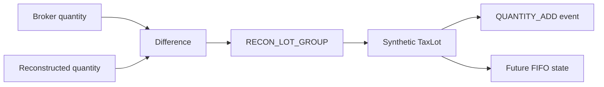
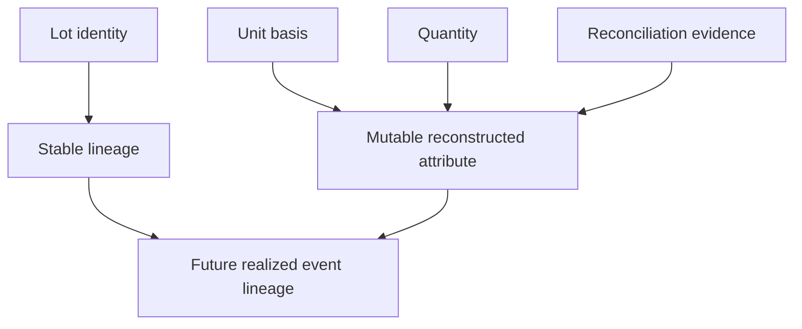
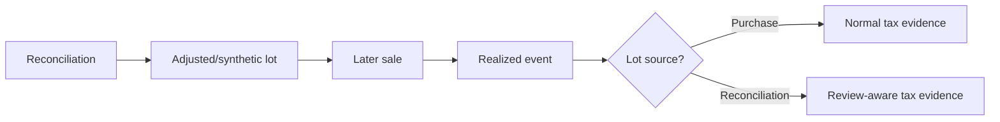

# Investment Reconciliation

Personal Finance ETL treats disagreement between reconstructed investment state and broker-observed state as financial evidence, not an inconvenience to overwrite. This specification explains quantity and cost-basis reconciliation, synthetic lot provenance, deterministic reconciliation identities, future FIFO effects, and the limits of what reconciliation can legitimately claim.

## Scope and purpose

Reconciliation exists because deterministic reconstruction and broker-observed state can disagree. Personal Finance ETL does not hide that disagreement by overwriting source transactions. It records an explicit adjustment event and mutates the reconstructed lot state needed for future analytics.

Two independent discrepancies are modeled: **quantity** and **cost basis**. They are not interchangeable. A portfolio can have the correct number of units and the wrong acquisition basis, or the wrong number of units with no trustworthy basis for the missing quantity.

## Where reconciliation sits


## Quantity comparison tolerance

`reconcile_quantity()` compares broker quantity to reconstructed closing units using a `1e-8` tolerance. The same scale is used when canonicalizing the quantity of an add operation for reconciliation identity. This keeps harmless floating-point representation differences from becoming financial events.

## Quantity additions

```python
if m_qty > current_units + 1e-8:
    diff = m_qty - current_units
    _recon_gid = generate_deterministic_id(
        "RECON_LOT_GROUP",
        {
            "ISIN": self.isin,
            "Reconciliation_Date": m_date,
            "Adjustment_Type": "QUANTITY_ADD",
            "Quantity": round(diff, 8),
        },
    )
```

An observed excess creates a stable reconciliation operation identity. FIFO then creates a zero-cost synthetic lot with `lot_source_type="RECONCILIATION"`. The lot is real reconstructed state, but it is not rewritten as an observed purchase.

## Why the synthetic lot has zero cost

The quantity observation proves units exist; it does not necessarily prove their historical acquisition basis. Assigning a guessed cost would manufacture evidence. The synthetic lot therefore enters at zero cost until separate cost-basis evidence can reconcile it.

A zero-cost reconciliation lot can later participate in FIFO. Its source type remains visible so downstream tax preparation can treat it as review-required evidence.

## Quantity removals

When broker quantity is below reconstructed quantity, the difference is removed from the oldest active lots, using the same FIFO orientation as disposals. Full lots are popped; partial removal reduces quantity and benchmark shadow quantity proportionally.

Unlike an actual sale, quantity reconciliation does **not** create realized sale proceeds or realized gains. It is an adjustment to reconstructed state, not an invented market transaction.

## Quantity removal flow



## Reconciliation cashflow behavior

Quantity additions return a dummy cashflow with amount `0.0`. This allows the surrounding analytics chronology to recognize the state change without pretending that unknown units required a known cash investment. Quantity removals likewise do not invent disposal cash proceeds.

## Cost-basis reconciliation

`reconcile_cost_basis()` runs only when units remain and broker cost-basis evidence exists. It compares broker target average cost with reconstructed average cost. A difference greater than `0.01`, with a positive reconstructed average, triggers proportional rescaling of every active lot.

## Cost-basis scaling algorithm

```python
target_avg = float(m_buy_val) / current_units
our_avg = self.get_average_cost()

if abs(our_avg - target_avg) > 0.01 and our_avg > 0:
    r = target_avg / our_avg
    ...
    new_price = lot.price * r
    new_price_local = lot.price_local * r_local if lot.price_local else 0.0
```

The proportional ratio preserves relative differences among active lots while bringing aggregate reconstructed basis to the observed target. If a local-currency broker basis is available, a separate local ratio is computed.

## Why lot identity survives cost-basis adjustment

Cost-basis reconciliation changes the reconstructed financial attributes of an existing lot, not its historical identity. The `Lot_ID`, purchase reference, date, quantity, benchmark fields, currency, and source type remain unchanged while unit cost is adjusted.

This is a subtle but important model choice: **identity describes the lot lineage; reconciliation describes a later correction to reconstructed state**.

## Event grain

Quantity-add can create one event for the synthetic lot. Quantity-remove can create multiple events when the correction spans multiple lots. Cost-basis reconciliation creates one event per active lot whose basis is scaled.

The Silver reconciliation fact therefore has event/affected-lot grain, not one-row-per-broker-observation grain.

## Event semantics

Reconciliation events preserve the date, adjustment type, reason, affected lot and purchase identities, broker and reconstructed quantities, quantity adjustment, broker and reconstructed cost basis, cost-basis adjustment, and original/adjusted unit cost.

The event record is evidence *about the correction*. The mutated lot state is the reconstructed state *after the correction*. Keeping both prevents the classic “the number changed somehow” problem.

## Deterministic reconciliation identities



The exact namespace field orders are specified in [Identity and Grain Contracts](../reference/identity-and-grain-contracts.md). The key design principle is that reconciliation operations have stable identities independent of mutable row order.

## Observed evidence versus reconstructed correction

A reconciliation event does not upgrade reconstructed state into broker-certified transaction history. The model retains three separate ideas:

1. canonical purchase/sale evidence;
2. broker-observed quantity/cost-basis state;
3. reconstructed adjustments required to make future analytical state consistent.

That separation is why reconciliation is auditable instead of becoming an invisible `UPDATE lots SET ...` with good intentions.

## Effect on future FIFO

After reconciliation, future sales consume the adjusted active-lot deque. Quantity-add synthetic lots can eventually be sold; quantity removals reduce what remains; cost-basis changes affect future realized gain calculations. This is why reconciliation provenance must survive alongside lot state: later realized events can inherit consequences from an earlier correction.

## Tax consequences

Reconciliation-origin lots carry `Lot_Source_Type="RECONCILIATION"`. Realized events preserve that source. The Tax Engine can therefore distinguish ordinary purchase-backed realization from events whose acquisition basis or quantity lineage required reconstruction and mark evidence quality accordingly.

Reconciliation is not a tax loophole generator. It is provenance for uncertainty.

## Multi-currency cost-basis reconciliation

When broker local-currency cost basis is available, the engine computes a separate local average and scaling ratio. Reporting-currency and local-currency lot prices can therefore be reconciled coherently rather than assuming one ratio is always sufficient across currency translation.

## Failure and no-op cases

Reconciliation is a no-op when broker quantity is missing, when quantity falls within tolerance, when cost basis is missing, when there are no active units, or when the cost-basis difference is within the implemented threshold. The algorithm does not fabricate adjustments merely to guarantee an event row.

## Guarantees and limitations

**Guarantees:** discrepancies are explicit; quantity and cost basis are separate; synthetic provenance survives; future FIFO uses adjusted state; deterministic operation identities are available.

**Limitations:** reconciliation cannot recover unknown historical trades; zero-cost synthetic lots do not imply true zero acquisition cost; broker state itself can be wrong; proportional cost rescaling is a reconstruction strategy rather than proof of historical per-lot basis.

## Source map

Primary implementation authorities:

- `backend/engines/analytics/core/fifo.py` — quantity and cost-basis mutation.
- `backend/engines/analytics/pipeline/processor/isin_processor.py` — timing and orchestration.
- `backend/utils/identity.py` — reconciliation namespaces.
- `backend/load/schema/silver.py` — physical reconciliation fact schema.
- `backend/engines/tax/base_events.py` — downstream treatment of reconciliation-origin realization.

## Reconciliation trigger chronology

Reconciliation is evaluated against the reconstructed state available on the broker observation date. It is not a periodic bulk overwrite performed after the entire history has been processed.



That chronology is what makes reconciliation consequential: later disposals consume the corrected reconstructed state.

## Quantity-add state mutation in detail

When broker quantity exceeds reconstructed quantity, the engine computes `diff = broker - reconstructed`. A deterministic `RECON_LOT_GROUP` identifies the adjustment operation. `buy()` then creates a synthetic lot at the reconciliation date.

The synthetic lot uses:

- quantity equal to the observed difference;
- reporting/local cost initially zero;
- zero benchmark shadow quantity;
- source type `RECONCILIATION`;
- deterministic lot identity derived from the reconciliation group.

This is intentionally conservative. The observation proves quantity, not acquisition history.

## Quantity-add lineage



## Quantity-remove mutation in detail

A negative discrepancy removes quantity from the oldest reconstructed lots. The algorithm mirrors FIFO ordering for state reduction but does not call `sell()`. That difference is fundamental: reconciliation removal has no observed sale price or proceeds, so generating realized gain would fabricate a disposal.

If the difference spans lots, each affected lot produces its own reconciliation event. Partial removal preserves the lot identity and reduces its benchmark shadow quantity proportionally.

## Why quantity removal uses oldest lots

A broker quantity observation tells the engine *how many* units remain, not which historical acquisition lots disappeared. Removing oldest lots is a deterministic reconstruction policy consistent with FIFO orientation. It should not be read as broker evidence that those specific lots were transferred or otherwise removed.

That distinction belongs in the documentation because deterministic does not mean historically omniscient.

## Cost-basis trigger conditions

Cost-basis reconciliation requires:

1. a non-empty broker cost-basis value;
2. positive reconstructed closing units;
3. positive reconstructed average cost;
4. absolute difference between reconstructed and target average cost greater than `0.01`.

If these conditions are not met, no basis mutation occurs.

## Proportional scaling rationale

Suppose surviving lots have different original unit costs. The engine computes:

$$r = \frac{TargetAverageCost}{ReconstructedAverageCost}$$

and scales every active lot price by $r$.

This preserves relative lot structure while forcing the aggregate basis toward broker evidence. It is a reconstruction method, not proof that each historical lot was actually adjusted by that ratio.

## Local-currency basis scaling

When local broker basis is present, a separate local ratio is derived:

$$r_{local} = \frac{TargetAverageCost_{local}}{ReconstructedAverageCost_{local}}$$

The reporting and local basis can therefore converge to their respective observations without assuming exchange-rate history can be reconstructed from one aggregate ratio.

## Cost-basis event grain

Each active lot receives its own `COST_BASIS_ADJUSTMENT` event because each lot's original and adjusted unit costs differ. Aggregate broker and reconstructed basis are repeated as observation context, while `Cost_Basis_Adjustment` records the lot-level monetary change.

## Before/after example

Consider two surviving lots:

```text
L1: 10 @ 100
L2: 10 @ 200
reconstructed average = 150
broker target average = 165
```

The scaling ratio is `165 / 150 = 1.10`:

```text
L1 adjusted basis = 110
L2 adjusted basis = 220
new average       = 165
```

The relative basis structure survives while aggregate state reconciles.

## Identity versus mutable financial attributes



Changing basis does not create a new acquisition identity. The lot's lineage remains stable while reconstructed attributes are corrected.

## Reconciliation event contract families

| Family | Key fields |
|---|---|
| identity | reconciliation event/group, lot, purchase, ISIN |
| timing | reconciliation date |
| classification | adjustment type, reason |
| quantity | broker, reconstructed, adjustment |
| basis | broker basis, reconstructed basis, adjustment |
| unit cost | original and adjusted |
| provenance | lot source and linked identities |

## Relationship to canonical transactions

Reconciliation never edits canonical purchase or sale facts. Those facts remain the normalized representation of source transaction evidence. The adjustment lives downstream in reconstructed state.

This separation is critical for auditability: a developer can compare what the source said with what reconstruction later needed to do.

## Relationship to market reconstruction

US market reconstruction can derive historical quantity state from transaction evidence for valuation. Quant reconciliation has a different purpose: it compares canonical FIFO state against available broker-observed holdings/basis and records corrections. The two should not be merged merely because both mention quantities.

## Relationship to realized events

Reconciliation itself is not realization. However, it changes future lots. A later sale of an adjusted or synthetic lot can therefore produce a realized event whose economics depend on reconciliation. `Lot_Source_Type` and lot identity provide the bridge between those facts.

## Relationship to tax evidence



The Tax Engine does not need to guess why a basis is unusual; provenance travels with the lot.

## No invented economic cashflow

A quantity-add operation emits a zero-value dummy cashflow for chronology. This is not a claim that the units were free. It means the engine has evidence of state but lacks evidence of the corresponding historical cash movement.

That difference is subtle and financially important.

## Reconciliation as an uncertainty boundary

The presence of a reconciliation event is itself information. It tells downstream consumers that canonical transaction replay alone was insufficient to match observed state. Hiding that fact would make aggregate outputs look cleaner while making the model less trustworthy.

## Operational invariants

- canonical transaction rows remain unchanged;
- quantity and basis discrepancies are modeled independently;
- quantity additions create provenance-marked synthetic lots;
- quantity removals do not invent sale proceeds;
- basis adjustments retain lot identity;
- each affected lot can be traced through an event;
- tolerance prevents noise from becoming financial history;
- future FIFO uses the reconciled state.

## Edge-case matrix

| Condition | Result |
|---|---|
| missing broker quantity | quantity reconciliation skipped |
| quantity within tolerance | no event |
| broker quantity higher | synthetic lot + add event |
| broker quantity lower | oldest reconstructed lots reduced |
| missing broker basis | basis reconciliation skipped |
| no active units | basis reconciliation skipped |
| basis within threshold | no event |
| local basis available | local ratio reconciled separately |

## Audit workflow

A reconciliation investigation can proceed from the Silver event to the affected `Lot_ID`, back to `Purchase_ID` where one exists, forward to later realized events, and sideways to the broker observation date. That graph is much more useful than a single `reconciled=true` flag.

## Design trade-off: explicit correction facts

The architecture pays a storage and conceptual cost for reconciliation events. The benefit is that corrections become inspectable and downstream systems can treat them differently. In financial systems, invisible convenience mutations age badly.

## Related specifications

- [Investment Data Model](investment-data-model.md)
- [Investment Market Reconstruction](investment-market-reconstruction.md)
- [FIFO and Realized Events](fifo-and-realized-events.md)
- [Multi-Currency and FX](multi-currency-and-fx.md)
- [Tax Methodology](tax-methodology.md)
- [Identity and Grain Contracts](../reference/identity-and-grain-contracts.md)
