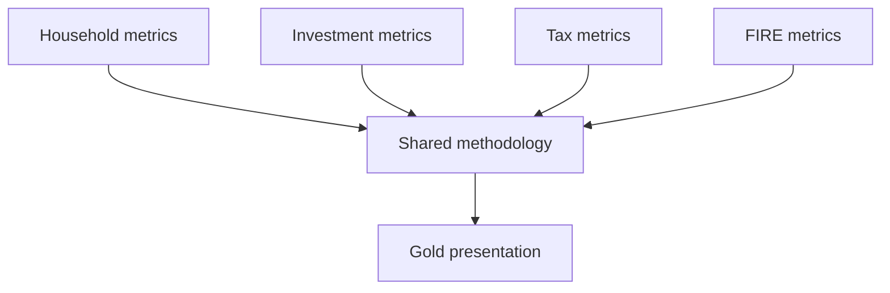
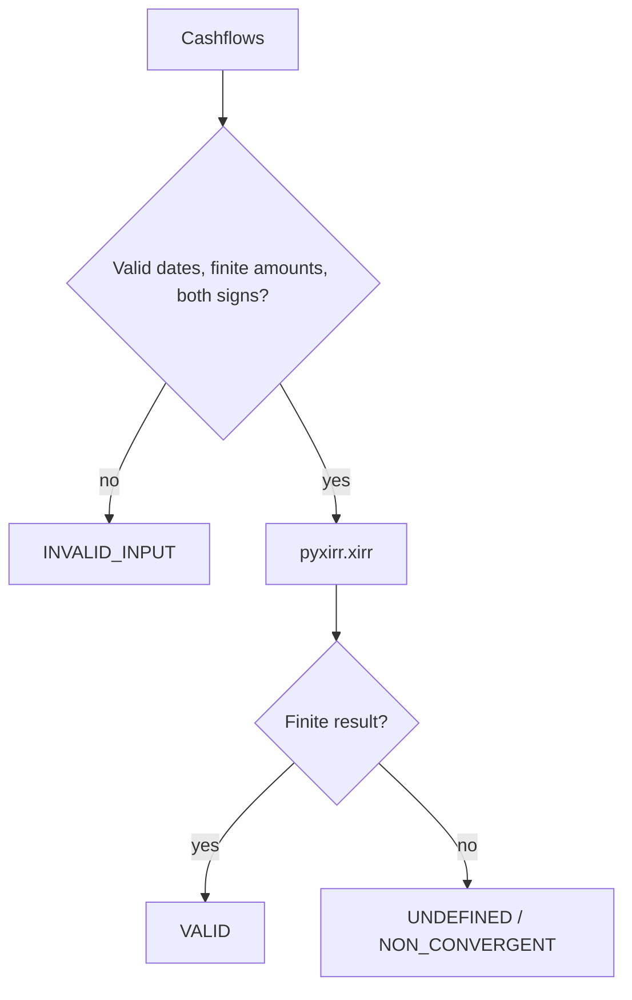
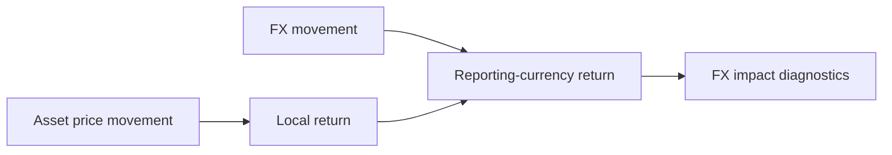
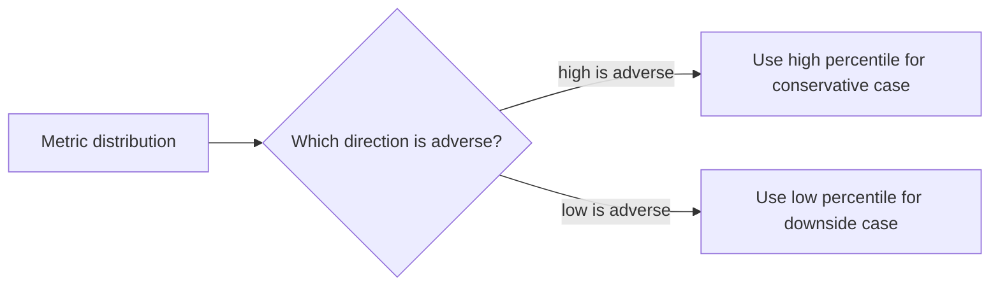
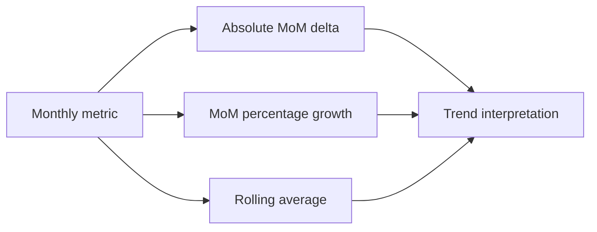
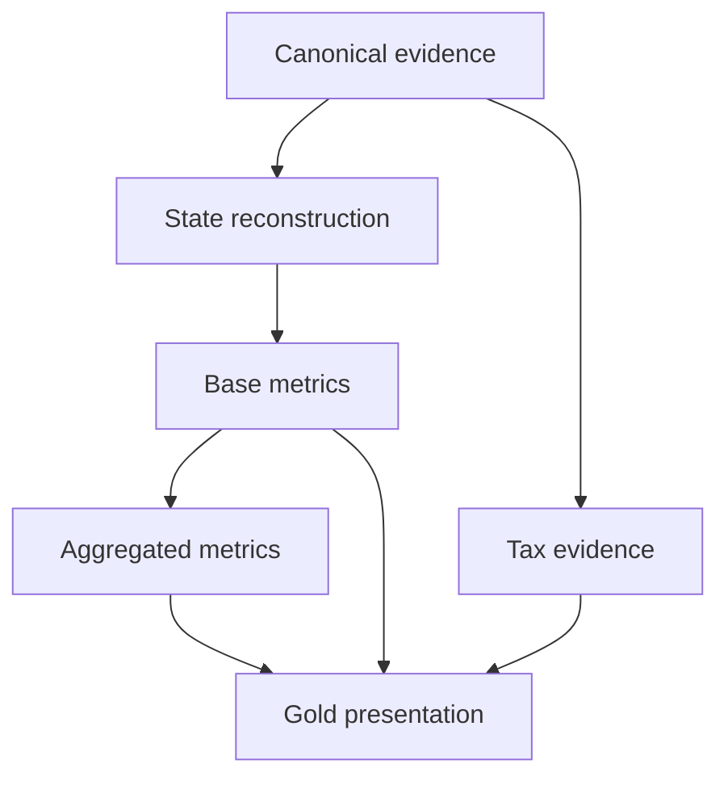

# Metrics and Methodology

Personal Finance ETL uses a broad quantitative vocabulary across household finance, investment reconstruction, tax evidence and FIRE planning. This specification defines the formulas, grains and failure semantics behind those metrics so that a familiar label such as “return,” “runway,” or “tax” cannot quietly change meaning between layers.


## Purpose and metric ownership

This specification defines the quantitative vocabulary used across household finance, investment analytics, tax presentation and FIRE. It does not replace subsystem documents. Instead, it answers a narrower question: **what exactly does a metric mean, at what grain is it valid, and what failure semantics does the implementation use?**



The same word can be dangerous at different grains. “Return” can mean lot CAGR, money-weighted XIRR, benchmark-relative return or FX contribution. This page keeps those concepts from becoming metric soup.


## CAGR

The core implementation in `backend/engines/analytics/core/math.py` defines annualized CAGR as:

$$
\text{CAGR} = \left(\frac{V_1}{V_0}
ight)^{365/d}-1
$$

where $V_0>0$, $V_1>0$ and $d>0$ calendar days.

```python
if start_value <= 0 or end_value <= 0 or days <= 0:
    return 0.0
try:
    return float(((end_value / start_value) ** (365.0 / days)) - 1)
except OverflowError:
    return float("nan")
```

Degenerate non-positive inputs return `0.0`; arithmetic overflow returns `NaN` so pathological values remain visible rather than being clamped into plausible fiction.


## XIRR

XIRR is the money-weighted return for irregular cashflows. The implementation delegates solving to `pyxirr` but wraps the result in a typed `XirrResult`.

A valid XIRR requires at least two cashflows, valid dates, finite numeric amounts, and at least one positive and one negative amount.

Statuses are:

| Status | Meaning |
|---|---|
| `VALID` | solver returned a finite rate |
| `INVALID_INPUT` | cashflow set cannot define the problem |
| `UNDEFINED` | solver returned no finite solution |
| `NON_CONVERGENT` | iterative solver failed to converge |



A failed XIRR is **not 0%**. Zero is a real financial result; failure is missing/invalid evidence. The code preserves that distinction.


## Why portfolio XIRR is recomputed

Money-weighted returns are not additive and should not be averaged across lots or instruments. The post-processing pipeline reconstructs the portfolio/group cashflow stream and runs the same XIRR calculator again at the target aggregation grain.

$$
\text{Portfolio XIRR} \neq \sum_i w_i \cdot \text{XIRR}_i
$$

in general.

This is one of the system's most important aggregation rules. Taking `.first()` or an arithmetic mean of lot XIRRs would produce a tidy number with weak financial meaning, which is exactly the sort of tidy number this project has learned to distrust.


## Realized and unrealized gain

Realized gain belongs to disposal evidence and is generated by FIFO lot consumption. Unrealized gain belongs to still-open state at a valuation date.

For a consumed quantity $q$ in local currency:

$$
\text{Realized Asset PnL}_{local}=(P_s-P_b)q
$$

Unrealized gain is conceptually:

$$
\text{Unrealized Gain}=\text{Current Market Value}-\text{Remaining Acquisition Basis}
$$

Realized and unrealized amounts should never be merged merely because both are “gain.” One has crossed a disposal boundary; the other has not.


## FX attribution

Foreign investments distinguish asset economics from reporting-currency translation. Local-currency return measures the instrument; INR return includes currency movement.

Attribution fields include local asset P&L and FX P&L. XIRR similarly exposes local XIRR and reporting-currency XIRR, with `FX_XIRR_Impact` representing their difference.



Detailed attribution algebra and temporal FX semantics are specified in [Multi-Currency and FX](multi-currency-and-fx.md).


## Maximum drawdown

Drawdown measures decline from a prior peak rather than return from acquisition cost. Household net worth uses:

$$
\text{Drawdown From Peak}=\frac{V_t-V_{peak}}{V_{peak}}
$$

when the peak is positive.

Investment analytics also compute portfolio maximum drawdown over the valuation path. Drawdown is path-dependent: two portfolios with identical start/end values can have radically different drawdown histories.


## Savings rate and investment rate

Monthly cashflow defines gross surplus as cash income minus total expense, then computes:

$$
\text{Savings Rate}=\frac{\text{Gross Surplus}}{\text{Total Cash Income}}
$$

and:

$$
\text{Investment Rate}=\frac{\text{Net Investment Flow}}{\text{Total Cash Income}}
$$

where net investment flow is deployed capital minus redeemed capital.

These ratios answer different questions. Savings measures retained cashflow capacity; investment rate measures how much cashflow is being directed into investment activity.


## Liquidity and runway

Household liquidity metrics compare liquid market-valued assets with spending rates. Examples include:

$$
\text{Liquidity Ratio Months}=\frac{\text{Liquid Assets Market}}{\text{Trailing 3M Average Expense}}
$$

and asset-subcategory runway:

$$
\text{Months of Runway}=\frac{\text{Closing Balance}}{\text{3M Average Expense}}
$$

FIRE additionally computes linear runway from after-tax market net worth and trailing spend, while Monte Carlo produces stochastic runway percentiles. These are related but not interchangeable.


## Net-worth growth and real growth

Monthly cashflow presentation computes nominal year-over-year market net-worth growth and an inflation-adjusted form:

$$
1+r_{real}=\frac{1+r_{nominal}}{1+\pi}
$$

so:

$$
r_{real}=\frac{1+r_{nominal}}{1+\pi}-1
$$

The FIRE builder also computes a 3-year real net-worth CAGR using inflation-adjusted wealth history. “Real” therefore means inflation-adjusted purchasing-power growth, not merely “after fees.”


## Debt and emergency-fund ratios

Household presentation includes ratios such as:

$$
\text{Debt-to-Asset Ratio}=\frac{\text{Total Liabilities}}{\text{Total Assets Market}}
$$

and:

$$
\text{Emergency Fund Coverage}=\frac{\text{Liquid Assets Market}}{\text{12M Average Core Expense}}
$$

These metrics deliberately use market-valued assets where the implementation has them. Book balances and market values answer different questions and should not be swapped casually.


## FI target and coverage

For trailing annual spend $S$ and configured FI multiplier $m$:

$$
\text{Target FI Today}=S\times m
$$

Coverage is:

$$
\text{FI Coverage}=\frac{\text{After-tax Market Net Worth}}{\text{Target FI Today}}
$$

The FIRE layer maintains both core-spend and total-spend variants internally before selecting presentation fields. This distinction lets the model express lean/core financial independence separately from a broader lifestyle burn.


## Coast FI and Lean FI

Coast FI discounts the future FI target back using the configured real return over the configured coast horizon:

$$
\text{Coast FI Today}=\frac{\text{Target FI Today}}{(1+r_{real})^n}
$$

Lean FI applies a configured ratio:

$$
\text{Lean FI Today}=\text{Target FI Today}\times \lambda
$$

These are planning constructs, not accounting balances. They live downstream of canonical wealth state.


## Withdrawal rate

The immediate retirement withdrawal rate is:

$$
\text{Withdrawal Rate Now}=\frac{\text{Trailing Annual Spend}}{\text{After-tax Market Net Worth}}
$$

The Monte Carlo model can subsequently vary withdrawals through Guyton-Klinger guardrails. The point-in-time ratio and simulated dynamic withdrawal policy are therefore separate metrics.


## Percentiles and directionality

Monte Carlo percentiles must be interpreted according to metric direction.

For months-to-FI, **larger is worse**, so P90 is conservative and P10 aggressive. For terminal wealth, **larger is better**, so downside analysis typically focuses on lower percentiles.



A percentile label without directionality is not enough methodology.


## Indicative tax metrics

Tax estimates are evidence-linked indicative values, not statutory liability. Investment realization generally applies a configured rate only to positive realized gain. Tax Gold then aggregates canonical tax events.

The methodology rule is simple: **never promote an indicative estimate into a stronger legal claim merely because it has two decimal places.** Precision of representation is not certainty of interpretation.


## Null, zero and NaN semantics

The project uses all three states deliberately.

- **zero** can be a valid financial result;
- **null/None** can mean unavailable or undefined evidence;
- **NaN** can preserve pathological arithmetic conditions so they remain detectable.

Examples include typed XIRR failures returning no value, CAGR returning zero for degenerate non-positive inputs, and overflow returning NaN. Downstream aggregation must preserve these semantics rather than blanket-filling every missing number with zero.


## Metric grain

A metric is only meaningful with its grain.

| Metric | Typical grain |
|---|---|
| lot CAGR | acquisition lot × valuation date |
| ISIN XIRR | instrument × valuation date |
| portfolio XIRR | portfolio × valuation date |
| realized P&L | sale × consumed lot |
| savings rate | month |
| FI coverage | month |
| tax estimate | tax event or annual aggregate depending table |
| Monte Carlo probability | monthly simulation input state |

The Reference layer owns exact physical grains; this table highlights why formulas cannot be copied between levels without checking aggregation semantics.


## Implementation map

| Metric family | Main implementation |
|---|---|
| CAGR/XIRR primitives | `backend/engines/analytics/core/math.py` |
| portfolio/group XIRR | analytics post-processing `xirr.py` / group processor |
| investment drawdown | analytics post-processing `analytics.py` |
| household net worth/runway | presentation `net_worth_builder.py` |
| cashflow ratios | `monthly_cashflow_summary.py` |
| FIRE ratios and simulation | `wealth_risk_analytics.py` + `fire_mc_sim.py` |
| tax estimates | Quant realization + Tax Engine |

Metrics remain owned by their producer; this page standardizes interpretation.


## Organic growth and balance growth

Household net worth distinguishes savings-driven balance change from organic asset growth. `Organic_Growth_Value` isolates change not explained by net savings, while `Organic_Yield_%` scales that amount by opening balance when the opening balance is non-zero.

Monthly balance growth is:

$$
\text{MoM Balance Growth}=\frac{\text{Closing Balance}-\text{Opening Balance}}{\text{Opening Balance}}
$$

when opening balance is non-zero.

This distinction matters because a rising balance can result from fresh contributions, investment/asset appreciation, or both.

## Savings-to-net-worth ratio

The net-worth model computes cumulative savings relative to closing balance when closing balance is positive:

$$
\text{Savings-to-NW Ratio}=\frac{\text{Cumulative Net Savings}}{\text{Closing Balance}}
$$

It is a decomposition aid, not a performance return. Treating it as return would mix cash contribution and asset appreciation into one misleading percentage.

## Active and passive income shares

Monthly cashflow presentation divides income composition by total cash income:

$$
\text{Active Income Share}=\frac{\text{Active Income}}{\text{Total Cash Income}}
$$

$$
\text{Passive Income Share}=\frac{\text{Passive Income}}{\text{Total Cash Income}}
$$

The underlying active/passive classification comes from canonical income semantics and rules. These ratios therefore depend on classification quality upstream.

## Core and non-core expense shares

Expense composition similarly distinguishes core and non-core spending:

$$
\text{Core Expense Share}=\frac{\text{Core Expense}}{\text{Total Expense}}
$$

$$
\text{Non-core Expense Share}=\frac{\text{Non-core Expense}}{\text{Total Expense}}
$$

These are composition measures. They should not be confused with budget variance or spending growth.

## Month-over-month deltas and growth

The presentation layer exposes absolute month-over-month deltas for income, expense and investment flow, plus percentage growth for selected measures. Absolute delta and percentage growth serve different purposes, particularly when the previous period is close to zero.

Rolling averages are then used to reduce single-month noise. Examples include trailing three-month income, expense, investment flow, savings rate and investment rate.



## Benchmark-relative investment metrics

Investment analytics preserve benchmark returns alongside portfolio returns. Relevant measures include benchmark CAGR/XIRR and active return differences. Benchmark comparison is only meaningful when benchmark evidence is aligned to the same economic period and currency semantics.

A benchmark is a comparison path, not an alternative source of truth for the portfolio's own cashflows.

## After-tax XIRR

The Quant post-processing layer can construct after-tax cashflows and solve a separate after-tax XIRR. This is not obtained by subtracting a tax rate from pre-tax XIRR. Money-weighted return must be solved again from the modified cashflow stream.

```text
After-tax XIRR = XIRR(after-tax cashflows)
not
Pre-tax XIRR - tax rate
```

The same aggregation rule applies at portfolio/group grain: rebuild the relevant cashflow stream, then solve.

## Tax-if-sold exposure

Open-lot analytics can estimate LTCG/STCG tax exposure if the position were sold at the valuation date. This is a hypothetical exposure metric, not a realized tax event. Realized tax evidence appears only after an actual disposal crosses the FIFO realization boundary.

This distinction keeps “what would happen if sold” separate from “what happened.”

## Investment allocation weights

Portfolio weights are based on the relevant current-value denominator. Weighting is a presentation/aggregation operation; it does not change lot identity, cost basis or realized-event lineage.

When denominators are zero or unavailable, safe division semantics apply rather than inventing infinite or nonsensical weights.

## Inflation-adjusted methodology

Real growth calculations use multiplicative inflation adjustment rather than simple subtraction:

$$
1+r_{real}=\frac{1+r_{nominal}}{1+\pi}
$$

For small rates, subtraction is an approximation. The implementation uses the multiplicative relationship where documented in the presentation layer.

## Safe division

Presentation modules frequently use a shared `safe_divide` expression for financial ratios. This avoids raw divide-by-zero behavior and centralizes ratio semantics. A ratio whose denominator is unavailable or zero should not explode into infinity and then wander into Power BI pretending everything is fine.

## Rolling-window semantics

Rolling measures depend on available historical observations. A 12-month trailing measure early in the dataset does not possess twelve months of evidence merely because the column name contains `12M`. Consumers should respect warm-up periods and null/incomplete history semantics.

## Metric lineage



The safest way to audit a metric is to walk this lineage backward until reaching the canonical evidence and the exact producer that owns the formula.

## Aggregation rules

Different metric families aggregate differently:

| Metric family | Correct aggregation idea |
|---|---|
| currency amounts | often sum, subject to grain/currency |
| ratios | usually recompute from aggregated numerator/denominator |
| XIRR | reconstruct cashflows and solve again |
| CAGR | recompute from appropriate opening/closing values and duration |
| maximum drawdown | recompute from aggregated value path |
| percentile | compute from distribution, do not average percentile labels |
| deterministic identities | never aggregate; preserve lineage |

“Just average the percentages” is not a methodology. It is how financial dashboards develop folklore.

## Interpretation hierarchy

When two metrics appear inconsistent, check in this order:

1. Are they at the same grain?
2. Are they using book or market value?
3. Are they local-currency or INR/reporting-currency?
4. Are they realized or unrealized?
5. Are they pre-tax, after-tax, or hypothetical tax exposure?
6. Are they point-in-time, trailing-window, or lifetime measures?
7. Are null/failure states being preserved?

Most apparent contradictions disappear once the semantic axes are aligned.

## Methodology guarantees and limits

The metric layer aims for deterministic formulas over deterministic inputs, explicit missing-data semantics and financially valid aggregation. It does not guarantee that every metric is suitable for every decision, nor that a mathematically valid metric is economically meaningful outside its documented grain.

Formulas are tools. Grain and provenance decide whether the tool is being used on the right problem.

## Related specifications

- [Investment Performance and Risk](investment-performance-and-risk.md)
- [Multi-Currency and FX](multi-currency-and-fx.md)
- [Tax Methodology](tax-methodology.md)
- [FIRE Methodology](fire-methodology.md)
- [Cashflow and Wealth](cashflow-and-wealth.md)
- [Gold Data Contracts](../reference/gold-data-contracts.md)
