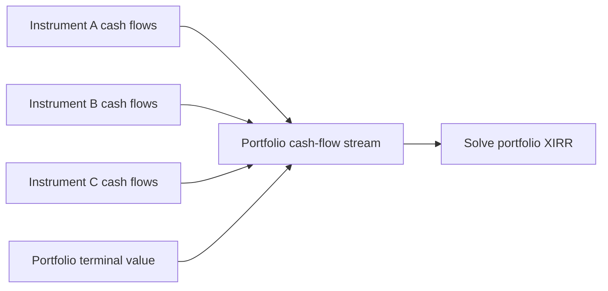
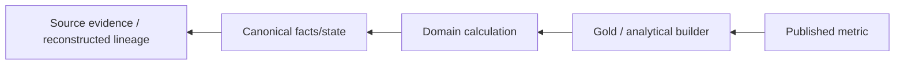

# Metrics & Methodology

A financial metric is not just a formula.

It also has:

```text
a grain
a time basis
a currency basis
a validity state
an aggregation rule
a provenance path
an interpretation boundary
```

Ignore any one of those and a perfectly correct equation can still produce a misleading dashboard.

This document is the semantic dictionary for the project’s major analytical metrics.

It closes the Finance documentation by answering one final question:

> **When I see a number, what exactly am I allowed to believe about it?**

---

## 1. Metric ownership follows financial meaning

Metrics are calculated where their meaning lives.

```text
investment returns
    domain.investments.performance

portfolio aggregation
    domain.investments.portfolio

wealth / allocation analytics
    domain.wealth

household ratios
    domain.household

FIRE metrics
    domain.fire

Tax evidence estimates
    domain.tax
```

Gold tables publish metrics. They should not secretly invent the underlying formula.

---

## 2. Five questions before trusting a metric

For any metric, ask:

1. **What is the grain?**
2. **What evidence feeds it?**
3. **What currency/time basis does it use?**
4. **What does missing/invalid mean?**
5. **Can I aggregate it?**

If those answers are unclear, the metric is not fully specified.

---

## 3. Calculation status is part of the value

The codebase increasingly returns typed calculation results rather than bare floats.

For XIRR, statuses include:

```text
VALID
INVALID_INPUT
UNDEFINED
NON_CONVERGENT
```

For other calculations the shared status vocabulary also includes states such as:

```text
MISSING_INPUT
NO_OBSERVATION
COMPUTATION_ERROR
```

This is a major semantic improvement over using `NaN` as a universal shrug emoji.

---

## 4. CAGR

Compound Annual Growth Rate annualizes the ratio between a starting and ending value over a holding period.

\[
CAGR = \left(\frac{V_1}{V_0}\right)^{365/d} - 1
\]

where:

- \(V_0\) = start value;
- \(V_1\) = end value;
- \(d\) = holding days.

The implementation in `domain/investments/performance/returns.py` validates the inputs explicitly.

```python
if start_value <= 0:
    return CagrResult(
        value=None,
        status=CalculationStatus.INVALID_INPUT,
        reason=f"Start value must be positive, got {start_value}",
    )
if days <= 0:
    return CagrResult(
        value=None,
        status=CalculationStatus.UNDEFINED,
        reason=f"Holding duration must be positive days, got {days}",
    )
```

A genuine 0% CAGR is therefore distinguishable from an invalid calculation.

That sounds small until a dashboard starts treating every failure as “flat performance.”

---

## 5. CAGR grain and interpretation

CAGR is appropriate when the economic question is:

> what constant annualized growth rate would connect this start value to this end value?

It does **not** account for irregular interim cash flows.

That is why portfolio performance with contributions/withdrawals needs XIRR instead.

---

## 6. XIRR

XIRR solves for \(r\) such that dated cash flows have zero net present value:

\[
\sum_{i=0}^{n}
\frac{CF_i}{(1+r)^{(d_i-d_0)/365}}
= 0
\]

The implementation requires:

- at least two dated cash flows;
- matching date/amount counts;
- finite numeric amounts;
- valid dates;
- at least one positive and one negative cash flow.

```python
has_negative = any(a < 0 for a in amounts)
has_positive = any(a > 0 for a in amounts)
if not has_negative or not has_positive:
    return XirrResult(None, "INVALID_INPUT", "Cashflows must have both outflows and inflows")
```

If the solver does not converge, that is a distinct state from invalid input.

---

## 7. Portfolio XIRR is recomputed, not averaged

Instrument-level XIRRs are non-additive.

You cannot calculate portfolio XIRR by weighting instrument XIRRs and summing them.

The correct portfolio measure rebuilds the portfolio cash-flow stream and solves one IRR equation over that stream plus terminal value.



This is why `PortfolioXIRRCalculator` exists separately from per-instrument return metrics.

---

## 8. Benchmark XIRR follows shadow cash flows

Benchmark-relative performance uses the same economic contribution/distribution timing applied to a benchmark shadow state.

That makes benchmark XIRR comparable to the investor’s own cash-flow experience.

A benchmark CAGR from first date to last date would answer a different question.

---

## 9. Local and reporting-currency XIRR

For foreign investments, the project can distinguish:

```text
Local_XIRR
Port_XIRR / reporting-currency XIRR
```

Local XIRR reflects asset performance in local currency.

Reporting-currency XIRR includes the effect of FX conversion on acquisition, distributions, disposals, and terminal value.

Their difference is useful as an FX-impact lens, but it should not be overinterpreted as a unique additive attribution decomposition in every path-dependent case.

---

## 10. Realized gain/loss

Realized gain/loss comes from FIFO disposal events.

At consumed-lot grain:

\[
RealizedGain = DisposalProceedsAllocated - AcquisitionBasisAllocated
\]

The exact basis can include currency conversion and other canonical acquisition semantics defined by the investment engine.

Tax consumes this realized-event evidence rather than recomputing it.

---

## 11. Unrealized gain/loss

Unrealized gain compares current market value with remaining acquisition/book basis.

\[
UnrealizedGain = CurrentMarketValue - RemainingBasis
\]

It is state, not an event.

That distinction matters because unrealized gain can disappear tomorrow without any transaction, while a realized disposal event remains historical evidence.

---

## 12. FX attribution

A useful conceptual decomposition for foreign positions is:

```text
local asset economics
+
FX translation economics
=
reporting-currency outcome
```

The implementation preserves local and INR/base values separately so the system can compare them.

However, path-dependent cash flows mean a single additive “FX contribution” number may not always have a unique mathematical decomposition.

The methodology therefore prefers transparent parallel metrics over fake precision.

---

## 13. Maximum drawdown

Maximum drawdown measures the largest peak-to-trough decline over a value series.

For value \(V_t\), define running peak:

\[
P_t = \max_{s \le t} V_s
\]

Drawdown:

\[
DD_t = \frac{V_t}{P_t} - 1
\]

Maximum drawdown is the minimum observed \(DD_t\).

The metric is path-dependent and therefore cannot be reconstructed from start/end values alone.

---

## 14. Savings rate

Savings rate should state both numerator and denominator.

A common household definition in this project derives from cash income and core/total spending:

\[
Savings = CashIncome - Spend
\]

\[
SavingsRate = \frac{Savings}{CashIncome}
\]

Core-spend and total-spend variants answer different lifestyle questions.

The denominator is protected with safe division semantics.

---

## 15. Investment rate

Investment rate measures how much relevant income/cash flow is directed into investment activity under the implemented household classification model.

Like savings rate, it must not be interpreted without its denominator and period grain.

A monthly rate and trailing-12-month rate are not interchangeable.

---

## 16. Liquidity and runway

Liquidity metrics compare liquid financial resources with spending needs.

A linear runway example is:

\[
RunwayMonths = \frac{LiquidOrAfterTaxAssets}{AverageMonthlySpend}
\]

This answers:

> how long could current resources cover current spending under a no-growth linear assumption?

It does not model market returns or inflation. That is what the FIRE simulation is for.

---

## 17. Net-worth growth

Nominal net-worth growth compares wealth across time.

But wealth changes for several reasons:

```text
new savings
asset appreciation
liability repayment
market/FX movement
reclassification
```

A percentage change in net worth should therefore not automatically be interpreted as investment performance.

Different metrics own different questions.

---

## 18. Real net-worth growth

Inflation-adjusted wealth metrics use the CPI index produced by the inflation domain.

Conceptually:

\[
RealValue_t = NominalValue_t \times \frac{CPI_{base}}{CPI_t}
\]

The exact base/index convention should remain consistent within the published series.

Real growth asks whether purchasing-power wealth increased, not merely nominal currency value.

---

## 19. Debt ratios

Debt metrics compare liabilities with relevant income, assets, or net worth depending on the question.

Examples can include:

```text
debt / income
debt / assets
debt / net worth
```

These are different controls.

A ratio is meaningless if its denominator is not documented.

---

## 20. Emergency-fund coverage

Emergency-fund coverage compares liquid emergency resources with recent core spending.

Conceptually:

\[
EmergencyMonths = \frac{EmergencyAssets}{MonthlyCoreSpend}
\]

This is deliberately closer to a liquidity metric than a net-worth metric.

A house can make net worth look excellent while remaining unhelpful when rent is due tomorrow.

---

## 21. FI target

The deterministic FI target is derived from trailing spend and the configured target multiple:

\[
FITarget = TrailingAnnualSpend \times SWRMultiplier
\]

The name `swr_multiplier` is important: the configuration stores the multiple, not necessarily the raw withdrawal-rate percentage.

For example:

```text
25× spend ↔ 4% implied withdrawal rate
```

---

## 22. FI coverage

\[
FICoverage = \frac{AfterTaxMarketNetWorth}{FITarget}
\]

Coverage is a deterministic snapshot under current policy.

It is not a Monte Carlo success probability.

Those metrics answer different questions and must never be presented as substitutes.

---

## 23. Coast FI

Coast FI discounts a future FI target back using configured real growth assumptions.

The result answers:

> how much capital would need to exist today, under the configured real return and horizon, for compounding alone to reach the target?

It is sensitive to both the return assumption and horizon.

---

## 24. Lean FI

Lean FI applies a configured reduced-lifestyle ratio to the primary target.

This is a scenario target, not a separate observed financial state.

That makes the policy input part of the metric provenance.

---

## 25. Withdrawal rate

Withdrawal rate is the inverse framing of a target multiple.

\[
WithdrawalRate = \frac{AnnualSpend}{InvestableWealth}
\]

A current withdrawal rate can be calculated deterministically.

Whether that rate survives future market/inflation paths is a stochastic question.

Again: deterministic metric ≠ success probability.

---

## 26. Percentiles

For simulated metric distribution \(X\), percentile \(P_q\) is the value below which proportion \(q\) of simulated observations fall.

But interpretation depends on directionality.

For wealth:

```text
higher percentile → higher wealth outcome
```

For months-to-FI:

```text
higher percentile → slower outcome
```

Do not label a percentile “optimistic” or “conservative” without checking which direction is economically favorable.

---

## 27. Monte Carlo success probability

\[
P(success) = \frac{\# successful\ simulated\ paths}{\# total\ paths}
\]

This is conditional on:

```text
financial inputs
model assumptions
policy rules
simulation design
seed envelope
```

It is not a frequentist estimate of some objective universal retirement probability outside the model.

---

## 28. Indicative Tax metrics

Tax-related metrics preserve the distinction between:

```text
Amount_INR
Applied_Rate
Estimated_Tax
Tax_Status
```

An event with `CHECK_REQUIRED` should not be silently aggregated into a presentation that implies every estimate is equally reliable.

Review state is part of the metric semantics.

---

## 29. Null, zero, NaN, and invalid are different

This project deliberately avoids using one sentinel for every bad/absent state.

### Zero

A valid economic value equal to zero.

### Null / None

No valid value is available under the contract.

### NaN

A floating representation that is cleaned before BI publication where appropriate.

### Invalid / undefined status

The calculation was attempted or assessed but the mathematical contract was not satisfied.

These states must not be collapsed casually.

---

## 30. Safe division

Ratio calculations use safe division semantics.

The general rule is:

```text
valid non-zero denominator
    → calculate ratio

zero/missing/invalid denominator
    → null / explicit unavailable state
```

Returning infinity may be mathematically legal in some contexts and analytically useless in most dashboards.

---

## 31. Rolling-window semantics

Rolling metrics should state:

```text
window length
frequency
direction
minimum observations
measure being averaged/summed
```

Examples in wealth/FIRE include 3M, 6M, and 12M averages/sums.

A trailing-12-month spend metric is not the same as calendar-year spending.

---

## 32. Month-over-month change

For value \(X_t\):

\[
MoMChange = X_t - X_{t-1}
\]

Percentage change:

\[
MoMGrowth = \frac{X_t - X_{t-1}}{X_{t-1}}
\]

The usual denominator-validity rules apply.

A percentage growth rate should not be emitted when the previous value is zero/invalid unless the contract explicitly defines such behavior.

---

## 33. Organic growth vs balance growth

A useful wealth distinction is between:

```text
balance growth
    total change in balance

organic growth
    change attributable to underlying economics after separating contributions/flows where modeled
```

This distinction helps prevent contributions from being mistaken for investment performance.

The exact decomposition depends on the owning domain and available lineage.

---

## 34. Savings-to-net-worth ratio

\[
SavingsToNW = \frac{Savings}{NetWorth}
\]

This ratio describes the relative contribution of current savings to accumulated wealth.

Its interpretation changes materially as net worth grows, so it should be viewed as a contextual household metric rather than a universal target.

---

## 35. Active and passive income shares

Income-share metrics divide classified income groups by total relevant income.

The classification comes from canonical household dimensions.

The metric therefore inherits the quality of those classifications.

A beautiful pie chart cannot rescue an ambiguous source category.

---

## 36. Core and non-core expense shares

Expense-share metrics separate core spending from discretionary/non-core spending under configured household classifications.

These shares feed:

- budget analysis;
- savings analysis;
- FI target construction;
- scenario interpretation.

Because the FI target may use core or total spending, the classification has downstream planning consequences.

---

## 37. Allocation weights

For component market value \(V_i\) and total portfolio value \(V\):

\[
Weight_i = \frac{V_i}{V}
\]

Weights live at a point-in-time portfolio grain.

Summing the same instrument weight across dates is not meaningful.

Time is a dimension, not a free aggregation button.

---

## 38. Benchmark-relative metrics

Active return can be represented as the difference between portfolio and benchmark return measures when both are valid and comparable:

\[
ActiveReturn = PortfolioReturn - BenchmarkReturn
\]

But both sides must share compatible cash-flow timing, currency basis, and evaluation horizon.

Subtracting unrelated return definitions creates a number, not necessarily a metric.

---

## 39. After-tax XIRR

After-tax return uses cash flows/terminal values adjusted under the implemented Tax proxy/evidence model.

It should therefore be interpreted as:

> return under the project’s implemented after-tax assumptions

not:

> guaranteed realized statutory after-tax return under every future filing circumstance.

The provenance of the Tax assumptions matters.

---

## 40. Tax-if-sold exposure

A Tax-if-sold metric estimates potential Tax exposure on unrealized gains under configured assumptions.

It is scenario analysis.

It is not an event because no disposal occurred.

Keeping event and exposure separate prevents hypothetical Tax from contaminating realized history.

---

## 41. Metric grain

A metric is only meaningful at its declared grain.

Examples:

```text
instrument × date
portfolio × date
household × month
Tax event
financial year × Tax head
simulation evaluation month
```

The same column name at two grains can represent different analytical objects.

Documentation and contracts should say which one.

---

## 42. Additive, semi-additive, non-additive

### Additive

Can be summed across the relevant dimensions.

Examples often include transaction amounts within compatible grain/currency.

### Semi-additive

Can be aggregated across some dimensions but not others.

Point-in-time balances are a classic example: sum across accounts, but not across months.

### Non-additive

Ratios and return metrics such as XIRR/CAGR generally cannot be summed.

```text
SUM(XIRR)
```

is not a portfolio-performance methodology. It is a cry for help from the semantic layer.

---

## 43. Aggregation rules belong with the metric

For every published metric, downstream BI should know whether to use:

```text
SUM
MAX/MIN
LAST observation
weighted aggregation
recomputation
no aggregation
```

Where recomputation is financially required, publish enough underlying data or a correctly aggregated result rather than expecting BI to infer the method.

---

## 44. Metric lineage

A metric should be traceable through:



For stochastic metrics the lineage adds:

```text
rules + model + seed + simulation inputs
```

For indicative Tax metrics it adds:

```text
Tax policy + status / review reason
```

That lineage determines how much confidence a reader should place in the number.

---

## 45. Interpretation hierarchy

When reading the system, I use this order:

1. **Evidence quality**
2. **Metric validity status**
3. **Grain**
4. **Currency/time basis**
5. **Formula**
6. **Aggregation rule**
7. **Presentation**

The formula is intentionally not first.

A perfect formula applied to the wrong grain is still wrong.

---

## 46. Methodology guarantees

The metric layer aims to guarantee:

- explicit formulas/semantics;
- deterministic outputs for deterministic inputs;
- explicit invalid/undefined states where implemented;
- consistent grain/currency interpretation;
- separation between observed, reconstructed, estimated, and simulated values;
- honest aggregation rules;
- traceable provenance.

---

## 47. Methodology limits

No metric can eliminate the limitations of its inputs.

A return can be mathematically valid while source evidence is incomplete.

A simulation can be reproducible while its assumptions are wrong about the future.

A Tax estimate can be internally consistent while remaining outside statutory completeness.

The correct response is not to hide these limitations. It is to encode enough provenance and status that the user can see them.

---

## 48. The Finance corpus closes where interpretation begins

The Finance documentation now forms one continuous chain:

```text
financial truth model
→ household cash flow / wealth
→ investment evidence
→ market reconstruction
→ FIFO
→ reconciliation
→ performance
→ FX
→ Tax
→ FIRE
→ metric interpretation
```

That is the point of the entire layer.

The application does not merely calculate financial numbers.

It preserves the path from **evidence → financial meaning → derived state → analytical interpretation**.

And when the system does not know enough to produce a valid number, the correct output is sometimes not `0.0`.

Sometimes the most financially honest number is **no number at all**.

## Related specifications

- [Investment Performance & Risk](investment-performance-and-risk.md)
- [Multi-Currency & FX](multi-currency-and-fx.md)
- [Tax Methodology](tax-methodology.md)
- [FIRE Methodology](fire-methodology.md)
- [Financial Model](financial-model.md)
- [Gold Data Contracts](../reference/gold-data-contracts.md)
