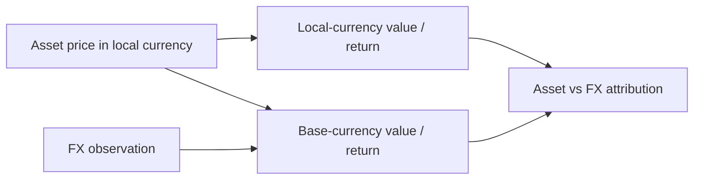
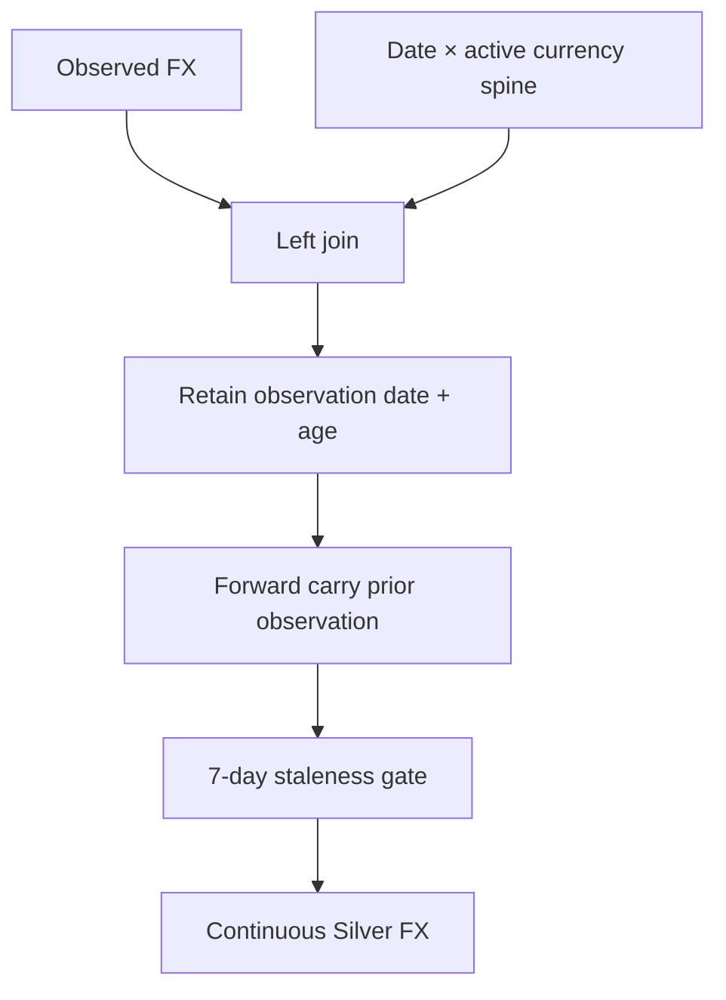

# Multi-Currency & FX

A foreign investment has at least two economically valid stories at the same time.

One story lives in the instrument's own currency:

> **Did the asset itself become more or less valuable?**

The other lives in the reporting/base currency:

> **What did that investment actually do to my wealth after currency translation?**

Those stories can diverge materially.

A US equity can rise in USD while falling in INR terms, or vice versa. If the engine keeps only one translated value, it loses the ability to explain why.

This specification describes how I preserve both perspectives and how FX evidence is validated before it is allowed into Quant analytics.



The key rule is:

> **FX is financial evidence, not a formatting conversion.**

## Implementation authority

FX responsibility is deliberately split.

### Market-domain FX evidence

```text
src/personal_finance_etl/domain/market/fx.py
```

Owns:

- point-in-time FX observations;
- continuous daily FX series;
- staleness policy;
- point-in-time lookup;
- missing-rate semantics.

### Investment FX validation

```text
src/personal_finance_etl/domain/investments/valuation/fx.py
```

Owns:

- pre-Quant foreign-currency FX availability checks;
- fail-closed behavior when a provider/rate is unavailable.

### Investment snapshots and attribution

```text
src/personal_finance_etl/domain/investments/portfolio/snapshots.py
src/personal_finance_etl/domain/investments/lots/fifo.py
src/personal_finance_etl/domain/investments/performance/xirr.py
```

Own:

- acquisition FX;
- snapshot FX;
- local/base values;
- realized/unrealized FX attribution;
- local XIRR;
- FX XIRR impact.

No single module is allowed to quietly redefine currency semantics.

## Currency identity comes from master data

Each instrument carries a `CURRENCY_ID`.

The configured default/reporting currency is resolved from financial rules.

That means currency is part of the instrument contract, not inferred from ticker spelling or exchange name during analytics.

## Base-currency assets use identity FX

If the instrument currency is the configured default currency, conversion is trivial:

\[
FX = 1
\]

This is a true identity because local and reporting currency are the same.

The same `1.0` is **not** safe as a fallback for foreign instruments.

## Foreign instruments fail closed when FX infrastructure is missing

`FXValidationGate` checks the instrument before Quant processing.

```python
# src/personal_finance_etl/domain/investments/valuation/fx.py

if not is_foreign:
    return  # Base-currency instruments never need FX validation

if not self.fx_provider:
    raise FXProviderMissingError(
        f"ISIN={isin} is denominated in {instrument_currency} but no FX provider "
        "is configured. Cannot compute INR values — refusing to proceed with "
        "identity FX_Rate=1.0."
    )
```

This is one of the most important currency safety guarantees in the engine.

A missing FX provider does not turn USD into INR at parity because that would make the numbers look beautifully complete and financially absurd.

## Spot validation before Quant

The gate also checks whether the provider can supply a valid rate for the first purchase date.

A rate is rejected when it is:

```text
missing
non-finite
zero
negative
```

The purpose is to detect broken FX coverage before deeper processing creates translated values.

## FX observations are first-class records

The market domain defines:

```python
@dataclass(frozen=True)
class FXObservation:
    rate: float | None
    currency: str
    observation_date: date
    is_interpolated: bool = False
```

Missing rate is represented explicitly.

`as_float()` defaults missing rates to `NaN`, not `1.0` or `0.0`.

That design makes missing currency evidence propagate visibly instead of producing plausible wealth values.

## Continuous FX series is causally constructed

The Silver FX series begins with a daily date spine crossed with active currencies.

Observed FX is then joined onto that spine.

Missing dates can carry the latest prior observation forward only under bounded staleness rules.



## Invalid populated FX is an error

Before forward filling, the transform detects non-positive or non-finite observed rates that are not closure gaps.

That distinguishes:

```text
expected absence
```

from:

```text
bad populated evidence
```

The second is rejected.

## Forward fill is backward-looking only

For valuation date \(t\), a carried rate must come from an observation date \(s\) such that:

\[
s \le t
\]

A future FX observation may never flow backward into historical state.

This protects historical return analysis from temporal leakage.

## Seven-day continuous-series staleness gate

The Silver FX transformation enforces:

```python
max_fx_staleness_days = 7
```

The latest prior rate can bridge weekends and short market closures, but it cannot be carried indefinitely.

The transform retains:

```text
FX_Observation_Date
FX_Age_Days
First_Observation_Date
Is_Imputed
```

until the staleness decision has been made.

## Why observation age belongs in the financial model

Suppose:

```text
valuation date = 10 October
FX rate = 83.20
```

That value is not fully interpretable without knowing whether 83.20 was observed:

```text
10 October
9 October
2 October
```

The same numeric rate can represent very different evidence quality.

## Point-in-time provider fallback is separately bounded

`FXRateProvider` stores rates in an in-memory map for fast lookup.

Exact date is attempted first.

If unavailable, the provider searches backward up to 30 days:

```python
for i in range(1, 31):
    fallback_date = d - timedelta(days=i)
    rate = self.fx_map.get((fallback_date, currency_id))
    if rate is not None:
        return rate
```

This lookup behavior is broader than the Silver continuous-series publication gate.

That distinction is worth understanding:

- the **published continuous FX series** enforces a strict seven-day staleness contract;
- the **point lookup provider** can search farther back for specific analytical lookups;
- the pre-Quant validation still rejects unavailable/non-positive results.

The consumer must know which contract it is using.

## Acquisition-time currency state

A foreign-currency purchase records both:

```text
price_local
fx_rate_buy
price/base value
currency_id
```

This freezes the acquisition perspective needed for later attribution.

Today's FX rate must not be allowed to rewrite yesterday's acquisition basis.

## Snapshot-time currency state

At a later valuation date, the engine resolves:

```text
market_price_local
current FX rate
close value local
close value base
```

The pair of acquisition and current currency states is what allows decomposition.

## Local acquisition value

\[
B_{local} = Q \times P_{buy,local}
\]

## Base acquisition value

Using acquisition FX:

\[
B_{base} = B_{local} \times FX_{buy}
\]

In practice, canonical purchase evidence can already carry base-currency value. That observed/canonical basis remains authoritative for the lot.

## Local current value

\[
V_{local} = Q \times P_{market,local}
\]

## Base current value

\[
V_{base} = V_{local} \times FX_{snap}
\]

## Local asset P&L

\[
PnL_{local} = V_{local} - B_{local}
\]

This answers the pure asset-price question in local currency.

## Total reporting-currency P&L

\[
PnL_{base} = V_{base} - B_{base}
\]

This answers what happened to wealth in the reporting currency.

## FX attribution

The engine preserves explicit asset and FX fields rather than reporting only total P&L.

For realized events, FIFO uses:

\[
AssetPnL_{local} = (P_{sell,local} - P_{buy,local})Q
\]

\[
AssetPnL_{base} = AssetPnL_{local} \times FX_{sell}
\]

\[
ForexPnL = P_{buy,local}(FX_{sell}-FX_{buy})Q
\]

The snapshot layer similarly exposes fields such as:

```text
Buy_Value_Local
Close_Value_Local
Asset_PnL
Forex_PnL
Forex_Contribution_Pct
Absolute_Return_Local
Asset_Return_Pct
Forex_Return_Pct
Blended_FX_Buy_Rate
FX_Rate_Buy
FX_Rate_Snap
Currency_Appreciation_Pct
```

That makes the currency effect inspectable instead of implied.

## Interaction-term caveat

A simple asset-plus-FX attribution can have interaction effects depending on the exact decomposition formula.

For example:

\[
V_{base}=P_{local}\times FX
\]

Changing both price and FX simultaneously means total change is multiplicative, not perfectly separable into two independent additive changes without choosing an attribution convention.

Therefore fields such as `Asset_PnL` and `Forex_PnL` should be read under the implementation's stated decomposition, not as a universal mathematical uniqueness claim.

The important design choice is transparency: the model exposes the perspectives rather than hiding them in one total.

## Blended acquisition FX

For an open lot or aggregated position, acquisition FX can be represented through the historical relationship between local and base acquisition basis.

Conceptually:

\[
FX_{buy,blended} = \frac{B_{base}}{B_{local}}
\]

when local basis is positive.

This provides an intuitive historical conversion anchor for open-state analytics.

## Currency appreciation diagnostic

A simple currency movement diagnostic is:

\[
CurrencyAppreciation = \frac{FX_{snap}}{FX_{buy}} - 1
\]

Positive/negative interpretation depends on the quotation convention represented by the stored FX rate.

The application avoids inferring economic direction from ISO names alone; it uses the configured currency contract.

## Local absolute return

\[
R_{local} = \frac{V_{local}-B_{local}}{B_{local}}
\]

when basis is valid and positive.

This isolates asset movement from reporting-currency translation.

## Base absolute return

\[
R_{base} = \frac{V_{base}-B_{base}}{B_{base}}
\]

The difference between the two is an intuitive currency-effect diagnostic, though the exact P&L interaction decomposition remains multiplicative.

## Local CAGR

The same CAGR function can be applied using local acquisition/current values.

This lets the engine answer:

> how fast did the asset compound in its own currency?

before asking how reporting-currency wealth compounded.

## Local XIRR

Portfolio XIRR maintains separate local cash-flow vectors:

```text
amount_local
terminal value local
benchmark amount local
benchmark terminal local
```

Then it computes:

```text
XIRR_Local
BM_XIRR_Local
Active_Return_Local
```

This is a stronger currency lens than comparing only start/end FX rates because it respects irregular cash-flow timing.

## FX XIRR impact

The engine defines:

\[
FX\_XIRR\_Impact = XIRR_{base} - XIRR_{local}
\]

when both are valid.

This is a money-weighted diagnostic of how reporting-currency translation changed the investor's experienced return.

## Benchmark currency treatment

Benchmark shadow state also carries local/base perspectives where applicable.

That allows active return to be evaluated in:

```text
reporting currency
local currency
```

The distinction matters because benchmark-relative performance can look different after FX translation.

## Realized versus unrealized attribution

### Realized

Uses actual sale date, sale local price, and sale FX.

### Unrealized

Uses current snapshot date, current local market price, and current FX.

The acquisition side remains anchored to the lot's original local price/FX.

This preserves temporal causality.

## Reconciliation and currency

Cost-basis reconciliation can carry both:

```text
broker base-currency basis
broker local-currency basis
```

When local basis is available, the FIFO engine computes a separate local scaling ratio.

That prevents a base-currency correction from corrupting local asset economics.

## Tax and FX boundary

FX attribution and Tax classification interact, but they are not the same concern.

The investment engine produces realized events with local/base/FX components and event-level estimated rates.

The Tax engine later decides statutory/informational classification under configured Tax rules.

A currency translation result should not quietly become a statutory Tax rule simply because both appear on the same disposal event.

## Domestic instruments follow an identity path

For default-currency assets:

```text
FX_Rate_Buy = 1
FX_Rate_Snap = 1
local value = base value
Forex_PnL = 0
```

This keeps the schema consistent across domestic and foreign assets without inventing currency effects where none exist.

## Missing/invalid FX is not zero

The FX model distinguishes:

```text
missing
invalid
stale
identity/base-currency
valid observed
valid carried observation
```

These states must not collapse into one number.

In particular:

```text
missing foreign FX ≠ 1.0
```

That single inequality prevents a spectacular class of silent wealth distortion.

## Temporal leakage threat model

The currency layer protects against:

### Future FX leakage

A later rate cannot value an earlier date.

### Unlimited stale carry

Old observations cannot be treated as current indefinitely.

### Acquisition-basis rewrite

Current FX cannot rewrite historical acquisition cost.

### Provider absence masked by identity

Foreign assets cannot proceed as if local currency equals base currency.

## Weekend and closure behavior

Weekends commonly have no fresh FX observation.

A prior valid observation may carry forward under the staleness policy.

The resulting row remains marked as imputed/carried so data lineage stays visible.

## Currency-field interpretation

| Field family | Meaning |
| --- | --- |
| `*_Local` | instrument/native currency perspective |
| base value without suffix | configured reporting/base currency perspective |
| `FX_Rate_Buy` | acquisition-time conversion context |
| `FX_Rate_Snap` | current snapshot conversion context |
| `Forex_PnL` | currency-attribution component under engine convention |
| `FX_XIRR_Impact` | money-weighted base minus local return diagnostic |
| `Currency_Appreciation_Pct` | change in FX rate from acquisition to snapshot |

The suffixes are financial semantics, not naming decoration.

## Edge-case matrix

| Case | Expected behavior |
| --- | --- |
| domestic/base-currency asset | identity FX path |
| foreign asset, provider missing | fail before Quant |
| foreign asset, first-purchase rate missing | fail validation |
| weekend | bounded backward carry |
| long FX gap | fail staleness gate |
| zero/negative observed FX | invalid evidence error |
| current FX valid, acquisition FX missing | attribution incomplete/invalid |
| reconciliation basis available only in base currency | local correction cannot be invented |

## Audit questions

The model should let me answer:

- What currency is this instrument actually denominated in?
- What FX rate was used at acquisition?
- What FX rate was used at valuation/disposal?
- Were those rates observed or carried?
- How old was the carried observation?
- What was local asset P&L?
- What was reporting-currency P&L?
- What currency effect was attributed?
- What was local XIRR versus base XIRR?
- Did reconciliation alter basis in both currency perspectives?

## Guarantees

The currency model guarantees, under valid evidence:

- base-currency instruments use identity FX;
- foreign instruments require FX evidence;
- local and base values remain distinct;
- acquisition and current FX remain temporally separate;
- continuous Silver FX rejects stale/malformed evidence beyond policy;
- return analytics can preserve both local and reporting-currency perspectives.

## Limitations / non-guarantees

It does not guarantee:

- external FX provider observations are economically perfect;
- every attribution decomposition is mathematically unique;
- FX-related investment analytics equal statutory Tax FX treatment;
- a 30-day point-provider fallback implies a 30-day continuous-series validity window;
- historical missing FX can be safely estimated from future rates.

## Design trade-off: explicit duplicate perspectives

Publishing both local and base values creates more columns.

That duplication is intentional.

A “cleaner” schema with one generic `Value` field would force downstream consumers to infer currency meaning from context.

In financial systems, context-dependent units are a bug farm with excellent branding.

## Design trade-off: attribution instead of one opaque P&L

One total P&L is simpler.

It is also insufficient for a multi-currency portfolio.

The explicit asset/FX perspectives make it possible to explain whether an investment thesis worked even when currency movement dominated the reporting-currency outcome.

## The investment-engine narrative closes here

The investment chain is now complete:

```text
transaction + market evidence
    ↓
historical market state reconstruction
    ↓
canonical FIFO lots and realized events
    ↓
reconciliation against independent observations
    ↓
performance / risk / benchmark analytics
    ↓
local vs reporting-currency interpretation
```

The next Finance batch can therefore move to a different question:

> **How do these investment and household facts become Tax evidence, FIRE assumptions, and published methodology?**

## Related specifications

- [Investment Market Reconstruction](investment-market-reconstruction.md)
- [FIFO & Realized Events](fifo-and-realized-events.md)
- [Investment Reconciliation](investment-reconciliation.md)
- [Investment Performance & Risk](investment-performance-and-risk.md)
- [Tax Methodology](tax-methodology.md)
- [Metrics & Methodology](metrics-and-methodology.md)
- [Financial Rules Reference](../configuration/financial-rules-reference.md)
