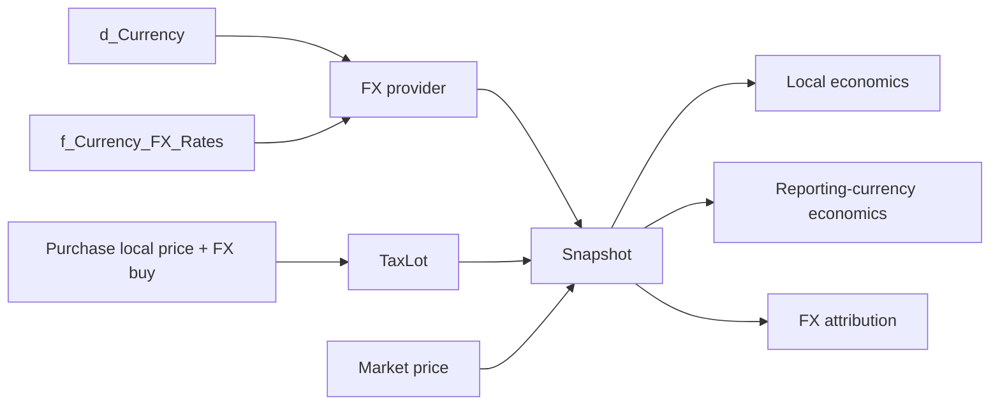
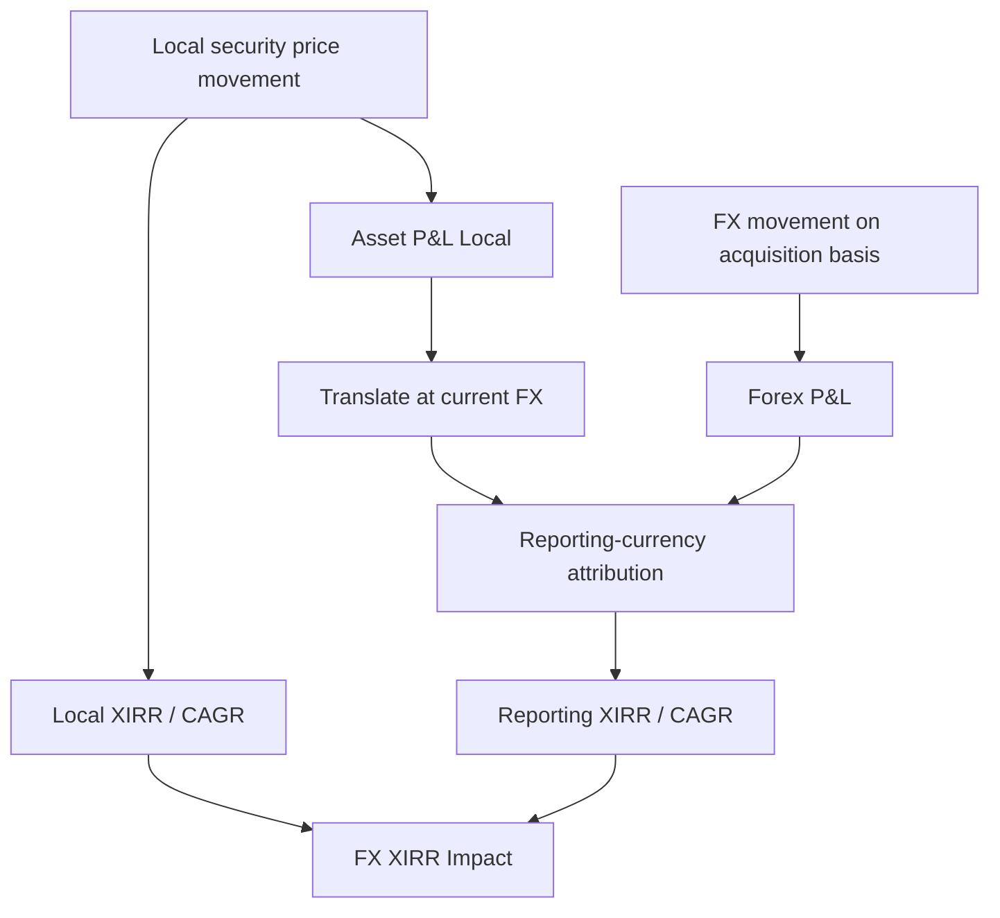
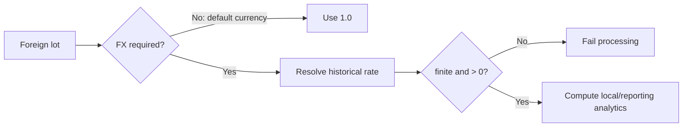
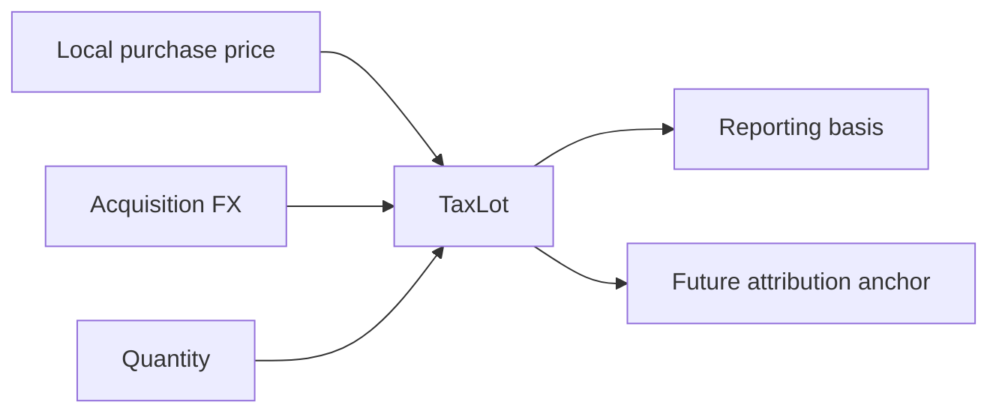
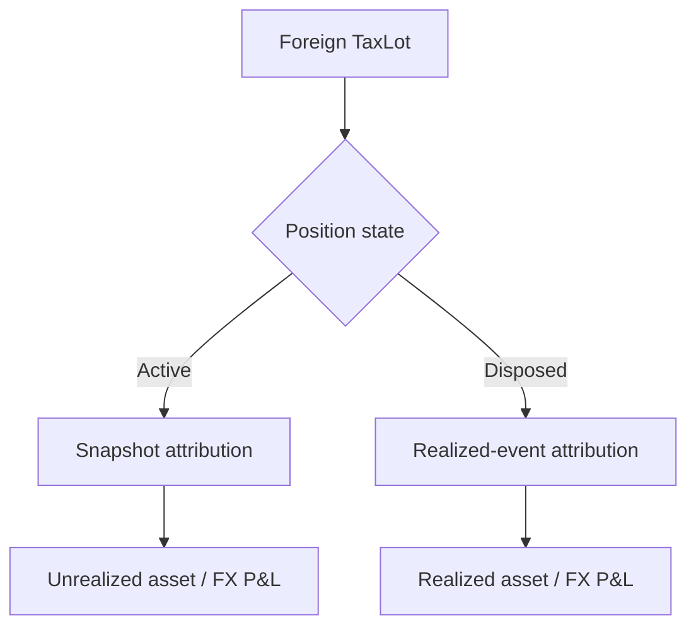
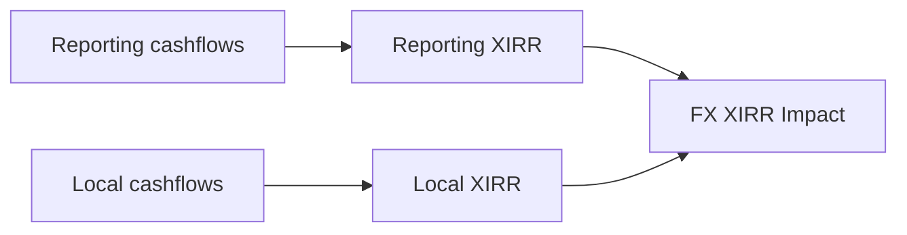
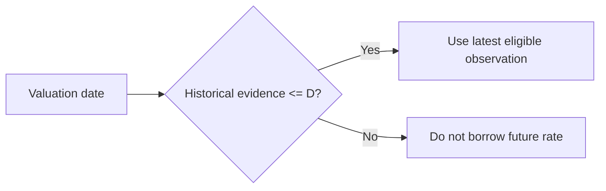

# Multi-Currency and FX

Personal Finance ETL models foreign investments in both their economic currency and the reporting currency. This specification explains historical FX evidence, acquisition and snapshot FX state, local versus reporting valuation, realized and unrealized FX attribution, local CAGR/XIRR, benchmark currency treatment, failure gates, and the limits of what attribution can claim.

## Scope

Multi-currency analytics separates three things that are easy to accidentally blend together: the instrument's local-currency economics, FX translation into the reporting currency, and the combined reporting-currency result. Personal Finance ETL retains acquisition FX and local prices at lot level so those components can be reconstructed rather than inferred from a single final INR value.

## Currency authority

`d_Currency` defines currency semantics and `f_Currency_FX_Rates` provides historical rates. Investment lots retain `Currency_ID`, acquisition local price and acquisition FX. Snapshot processing requests date-appropriate FX through the FX provider. The default/reporting currency behaves as a 1.0 conversion path.

## Currency data flow



## Temporal causality

Historical FX selection must not borrow future observations. The market-reconstruction pipeline and Quant FX provider use date-aware historical evidence so a past valuation is not translated using a rate that had not occurred yet. The detailed source-reconstruction gates are specified in [Investment Market Reconstruction](investment-market-reconstruction.md).

## Acquisition state

For foreign-currency lots, the state retains:

- reporting-currency acquisition price;
- local-currency acquisition price;
- acquisition FX rate;
- currency identity;
- benchmark local acquisition price where available.

That retained acquisition state is what makes later attribution possible.

## Snapshot FX resolution

```python
if (
    lot.currency_id
    and lot.currency_id != getattr(self.rules, "DEFAULT_CURRENCY_ID", "INR_INR")
    and fx_provider
):
    fx_rate_snap = fx_provider.get_rate(m_date, lot.currency_id)
    m_price_local = m_price / fx_rate_snap if fx_rate_snap > 0 else m_price
else:
    fx_rate_snap = 1.0
```

Foreign lots resolve current FX for the snapshot date. Reporting-currency market price is converted back to local market price for local-return measurement. Default-currency lots use the identity conversion path.

## Local asset P&L

Local asset P&L isolates security-price movement in the instrument currency:

$$AssetPnL_{local}=(P_{t,local}-P_{0,local})Q$$

This is the cleanest view of whether the underlying security appreciated before currency translation.

## Translated asset P&L

The local asset P&L is translated using snapshot FX:

$$AssetPnL_{reporting}=AssetPnL_{local}\times FX_t$$

This represents the reporting-currency value of the security-price movement measured at the current conversion rate.

## FX P&L

The implementation attributes FX movement on acquisition basis as:

$$FXPnL=P_{0,local}(FX_t-FX_0)Q$$

where $FX_0$ is lot acquisition FX and $FX_t$ is snapshot/disposal FX. This isolates currency movement applied to the original local acquisition basis.

## Realized FX attribution

The same decomposition is applied when FIFO consumes a foreign-currency lot on sale. Realized events therefore carry `Asset_PnL_Local`, translated `Asset_PnL`, and `Forex_PnL` alongside total realized gain/loss and the consumed lot identity.

## Snapshot implementation

```python
asset_pnl_local = (m_price_local - lot.price_local) * lot.qty
asset_pnl = asset_pnl_local * fx_rate_snap
forex_pnl = lot.price_local * (fx_rate_snap - lot.fx_rate_buy) * lot.qty
...
asset_return_pct = asset_pnl / buy_val_lot if buy_val_lot != 0 else 0.0
forex_return_pct = forex_pnl / buy_val_lot if buy_val_lot != 0 else 0.0
```

## Return attribution

The snapshot exposes both asset-return and FX-return percentages relative to reporting-currency acquisition value. It also stores `Forex_Contribution_Pct = Forex_PnL / P&L` where total P&L is non-zero. These are diagnostic decompositions; they should not be interpreted as independent portfolio weights.

## Currency appreciation

The implementation derives a blended acquisition FX rate from reporting/local acquisition values and compares current FX against it:

$$CurrencyAppreciation=\frac{FX_t}{FX_{buy,blended}}-1$$

This expresses movement of the foreign currency relative to the reporting currency over the lot's acquisition-to-snapshot interval.

## Local and reporting values

Lot snapshots retain both `Buy_Value_Local` / `Close_Value_Local` and reporting-currency `Buy_Value` / `Close_Value`. This avoids a common modeling trap where a column named simply `value` silently changes currency depending on geography.

## Local CAGR

`Lot_CAGR_Local` annualizes local acquisition price to local current market price. Reporting-currency `Lot_CAGR` includes the combined effect of asset and currency movement. Comparing the two provides a time-normalized view of FX impact at lot level.

## Local XIRR

Cashflows are maintained in reporting and local currency for money-weighted returns. `PortfolioXIRRCalculator` computes `Portfolio_XIRR` and `XIRR_Local` separately, then derives:

$$FX\ XIRR\ Impact=XIRR_{reporting}-XIRR_{local}$$

Unlike simple P&L attribution, this measure incorporates the timing of cashflows.

## Benchmark local currency

Benchmark shadow cashflows and terminal values can also carry local-currency representations. The engine therefore exposes `BM_XIRR_Local` and local active return when evidence is available. Benchmark comparison is not forced through reporting currency if local comparison is meaningful.

## Attribution layers



## Default-currency behavior

For default-currency instruments, local and reporting values collapse to the same economics: FX rates are `1.0`, `Forex_PnL` is zero, local CAGR equals reporting CAGR, and currency appreciation is zero. The model therefore remains structurally consistent without inventing a special schema for domestic assets.

## Missing and invalid FX

Foreign-currency processing depends on valid FX evidence. Dedicated FX gates reject missing, non-finite, or invalid rates rather than allowing a foreign position to silently fall back to `1.0`. The identity path is reserved for the actual default currency.

## FX gate architecture



## Cost-basis reconciliation across currencies

Cost-basis reconciliation can scale reporting-currency and local-currency basis separately when broker local basis is available. This prevents a reporting-currency correction from automatically implying the same proportional correction to local acquisition economics.

## Financial interpretation

A foreign investment can gain locally while losing in reporting currency, lose locally while gaining because of FX, or have both components reinforce each other. The schema keeps those possibilities observable. “US stock return” is therefore not one number unless the currency perspective is specified.

## Guarantees and limitations

**Guarantees:** explicit currency identity, retained acquisition FX, local/reporting values, no intentional future-FX leakage, separate asset/FX attribution, and local/reporting money-weighted metrics where evidence supports them.

**Limitations:** attribution is model-based; it does not represent hedging instruments unless modeled separately; missing historical FX cannot be inferred safely; reporting-currency tax treatment can differ from economic attribution.

## Source map

Primary implementation authorities:

- `backend/transform/currency.py` and currency transforms — canonical FX evidence.
- `backend/engines/analytics/pipeline/processor/fx_gate.py` — FX validation/gating.
- `backend/engines/analytics/core/fifo.py` — realized FX attribution.
- `backend/engines/analytics/pipeline/processor/snapshot.py` — unrealized/local analytics.
- `backend/engines/analytics/pipeline/postprocessor/xirr.py` — local/reporting XIRR.
- `backend/engines/analytics/pipeline/postprocessor/coordinator.py` — aggregated FX metrics.

## Currency perspectives

Every foreign investment can be viewed through at least two economic lenses:

1. **local currency**, which isolates the security's own market movement;
2. **reporting currency**, which combines security movement and FX translation.

Personal Finance ETL stores both because neither is universally “the real return.” They answer different questions.

## Acquisition-time currency state

At purchase, canonical investment evidence carries enough information for the Quant lot to retain local acquisition price and acquisition FX. Reporting-currency basis is therefore not the only surviving number.



## Snapshot-time currency state

At each closing date, the engine resolves current FX and derives local market price from reporting-currency market price where necessary. Both local and reporting close values are then retained in the analytical lot snapshot.

## P&L decomposition algebra

Let:

- $P_0$ be local acquisition price;
- $P_t$ be local current price;
- $F_0$ be acquisition FX;
- $F_t$ be current FX;
- $Q$ be quantity.

Local security movement is:

$$A_{local}=(P_t-P_0)Q$$

Translated asset component is:

$$A_{reporting}=A_{local}F_t$$

FX component on original basis is:

$$C=P_0(F_t-F_0)Q$$

The implementation exposes these components alongside total reporting P&L rather than forcing users to reverse-engineer them from end values.

## Interaction term caveat

Currency and asset prices move simultaneously. Attribution formulas partition economic movement according to the implemented convention. They should not be described as unique mathematical truth independent of attribution method. The documentation therefore names the implemented components rather than claiming a universal decomposition theorem.

## Realized versus unrealized attribution



Both paths use the lot's acquisition currency state, preserving consistency across holding and disposal.

## Buy value and close value

The lot snapshot retains:

```text
Buy_Value
Close_Value
Buy_Value_Local
Close_Value_Local
```

The paired fields make currency perspective explicit in the schema. A consumer should never need to infer currency from geography or instrument name.

## Blended acquisition FX

For analytics, blended acquisition FX can be derived from reporting and local acquisition values:

$$F_{buy,blended}=\frac{BuyValue_{reporting}}{BuyValue_{local}}$$

This becomes the comparison base for currency appreciation diagnostics.

## Currency appreciation diagnostic

`Currency_Appreciation_Pct` expresses how current FX differs from the blended acquisition FX. Positive/negative interpretation depends on the quote convention represented by the canonical FX rates, so consumers should use the currency master rather than assuming all pairs are quoted identically by name.

## FX contribution to P&L

`Forex_Contribution_Pct` divides FX P&L by total P&L when total P&L is non-zero. The metric can be large or counterintuitive when asset and FX components offset each other. It is therefore diagnostic, not a portfolio weight.

## Local absolute return

`Absolute_Return_Local` uses local prices and excludes reporting-currency translation. Comparing it with reporting absolute return isolates how much the currency perspective changes the observed result.

## Local CAGR

Local CAGR uses local acquisition/current price over holding age. Reporting CAGR uses reporting basis/current price. Their difference is not labeled as a precise additive FX CAGR because compounded returns do not decompose linearly in all cases.

## Money-weighted currency attribution

XIRR is computed from parallel reporting and local cashflow streams. This is stronger than merely converting the final terminal value because purchase/sale timing matters.



## Benchmark currency treatment

Benchmark shadow state can carry both reporting and local values. This allows local active return to compare portfolio and benchmark before reporting-currency translation, while reporting active return includes the currency perspective represented in each series.

## Acquisition FX on realized events

When a lot is sold, `fx_rate_sell` is compared with the lot's retained `fx_rate_buy`. The realized event therefore does not need to rediscover acquisition FX from an external table after the fact.

That is a useful lineage property: the lot carries the conversion context that shaped its basis.

## FX provider responsibility

The FX provider is responsible for returning a date-appropriate rate for a currency. The processor/fx gate is responsible for validating whether foreign-currency processing can proceed. FIFO and snapshot logic consume valid rates; they are not expected to implement source discovery.

## Fail-closed foreign-currency behavior

For foreign assets, missing or invalid FX should stop the affected processing path rather than silently treating one foreign unit as one reporting-currency unit. A `1.0` rate is semantically valid only for the default-currency identity path.

## Temporal leakage threat model

A future FX rate used in a past valuation would contaminate historical analytics. The same threat exists for market prices. The pipeline therefore treats temporal causality as a correctness constraint, not merely a data-cleaning preference.



## Weekends and market closures

Historical valuation can legitimately use an earlier observation when no same-day market/FX observation exists, subject to the relevant staleness rules. “Not observed today” is different from “use tomorrow's rate because it is convenient.”

## Domestic asset identity path

For default-currency assets:

```text
FX_Rate_Buy  = 1
FX_Rate_Snap = 1
Forex_PnL    = 0
Currency_Appreciation = 0
local value  = reporting value
```

This keeps one analytical schema across domestic and foreign assets.

## Reconciliation and FX

Cost-basis reconciliation can receive both reporting and local broker basis. When local basis is present, local lot costs scale using a local ratio. This is important because aggregate reporting-basis mismatch can contain both security-basis and FX-history effects.

## Tax and FX boundary

Quant exposes realized gain and attribution in the canonical reporting context used by downstream tax evidence. Tax does not recompute historical FX attribution independently. This preserves one economic realization authority.

## Currency-field interpretation table

| Field | Perspective |
|---|---|
| `Buy_Price` | reporting currency |
| `Market_Price` | reporting currency |
| `Buy_Price_Local` | instrument/local currency |
| `Market_Price_Local` | instrument/local currency |
| `FX_Rate_Buy` | acquisition conversion |
| `FX_Rate_Snap` | closing-date conversion |
| `Asset_PnL_Local` | local security movement |
| `Asset_PnL` | translated security movement |
| `Forex_PnL` | FX attribution on acquisition basis |
| `XIRR_Local` | local money-weighted return |
| `FX_XIRR_Impact` | reporting minus local XIRR |

## Edge-case matrix

| Condition | Behavior |
|---|---|
| default currency | identity FX path |
| foreign currency + valid rate | local/reporting analytics calculated |
| foreign currency + invalid rate | processing fails/gates |
| total P&L zero | FX contribution ratio avoids invalid division |
| local basis absent in reconciliation | reporting basis can reconcile independently |
| benchmark local evidence absent | local benchmark metrics unavailable |
| historical date without same-day rate | prior eligible evidence may be used |
| only future rate available | must not backfill backward in time |

## Audit questions

The model supports questions such as:

- Did the security itself gain in its home currency?
- Did currency translation help or hurt the reporting result?
- What FX rate was embedded at acquisition?
- What rate was used at the snapshot/disposal date?
- Is benchmark underperformance a security-selection effect or partly currency perspective?
- Did a reconciliation adjust local and reporting basis differently?

## Design trade-off: explicit duplicate perspectives

Storing both local and reporting fields widens analytical facts. The alternative is repeated conversion during every downstream query, which risks inconsistent historical FX selection and makes attribution harder to audit. The implementation chooses explicit perspectives over schema minimalism.

## Design trade-off: attribution rather than one opaque P&L

A single reporting-currency P&L is simpler to display but hides whether investment selection or currency movement drove the outcome. The additional attribution fields make the model more complex and materially more informative.

## Related specifications

- [Investment Data Model](investment-data-model.md)
- [Investment Market Reconstruction](investment-market-reconstruction.md)
- [FIFO and Realized Events](fifo-and-realized-events.md)
- [Investment Reconciliation](investment-reconciliation.md)
- [Investment Performance and Risk](investment-performance-and-risk.md)
- [Currency and FX Contracts](../reference/silver-data-contracts.md)
