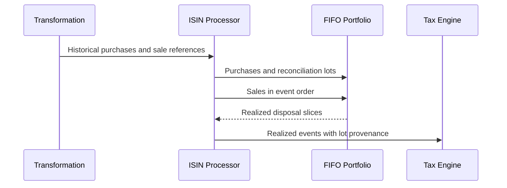

# Reconciliation and cost-basis provenance

I keep source-backed acquisitions distinct from reconstructed inventory. A reconciliation can restore continuity in positions without inventing documentary evidence for the original purchase cost.

## Implementation map

| Module | Selected implementation entry points |
|---|---|
| `backend/engines/analytics/pipeline/processor/isin_processor.py` | `is_indian_rights_entitlement_isin()` (L32), `process()` (L84) |
| `backend/engines/analytics/core/fifo.py` | `active_lots()` (L30), `buy()` (L34), `sell()` (L102), `get_closing_units()` (L223), `get_closing_shadow_units()` (L226), `get_terminal_value()` (L229), `get_shadow_terminal_value()` (L232) |
| `backend/transform/investments.py` | `get_purchase_reference()` (L9), `get_sale_reference()` (L46), `transform_stg_investment_market_data()` (L129), `get_f_tf_investment_purchase_data()` (L279), `get_f_tf_investment_sale_data()` (L343), `get_d_investment_master()` (L419) |
| `backend/utils/identity.py` | `canonicalize_value()` (L39), `generate_deterministic_id()` (L75) |

## Execution model



## Two distinct cost bases

The transformation layer calculates historical average purchase-cost references for sale context. The investment engine separately consumes FIFO lots to calculate realized disposals. These are not interchangeable metrics.

## Reconciliation lot identity

When a reconciliation group is present, lot identity incorporates its canonical operation identifier rather than rehashing floating-point quantities.

## Evidence quality

Reconciliation-origin lots can propagate CHECK_REQUIRED classification into downstream tax events. I avoid presenting these as independently substantiated taxable cost bases.

## Balance checks

Operational paise-to-paise reconciliation is a real workload observation; it does not prove every synthetic or exceptional input branch is validated. I describe explicit implementation checks instead of general guarantees.

## Implementation excerpts

The following short excerpts are copied from the actual implementation. I use the surrounding source module as the authority for complete branch behavior.

### `is_indian_rights_entitlement_isin()` · `backend/engines/analytics/pipeline/processor/isin_processor.py:32`

```python
def is_indian_rights_entitlement_isin(isin: str | None) -> bool:
    """Return whether an Indian ISIN matches the observed RE code pattern.

    The ``20`` substring is a candidate classifier (Python slice [7:9]), not
    proof of an expiry event. Transaction-level checks are still required.
    """
    if not isin:
        return False

    normalized = isin.strip().upper()
    return len(normalized) == 12 and normalized.startswith("INE") and normalized[7:9] == "20"
```

### `process()` · `backend/engines/analytics/pipeline/processor/isin_processor.py:84`

```python
    def process(
        self,
        isin: str,
        p_inst: list[dict[str, Any]],
        s_inst: list[dict[str, Any]],
        m_inst: list[dict[str, Any]],
        master_row: dict[str, Any],
        bm_map: dict[date, float],
    ) -> ISINProcessResult | None:
        if not m_inst:
            return None

        logger.debug(f"[Processor] ISIN {isin} computing across {len(m_inst)} historical dates.")

```

## Boundaries and related specifications

I keep physical schemas in [the reference catalog](../reference/README.md), operational lineage in [Control Plane documentation](../control-plane/README.md), and ETL publication semantics in [Data Engineering](../data-engineering/README.md). I do not equate the existence of an algorithm with automated validation of every exceptional input.
