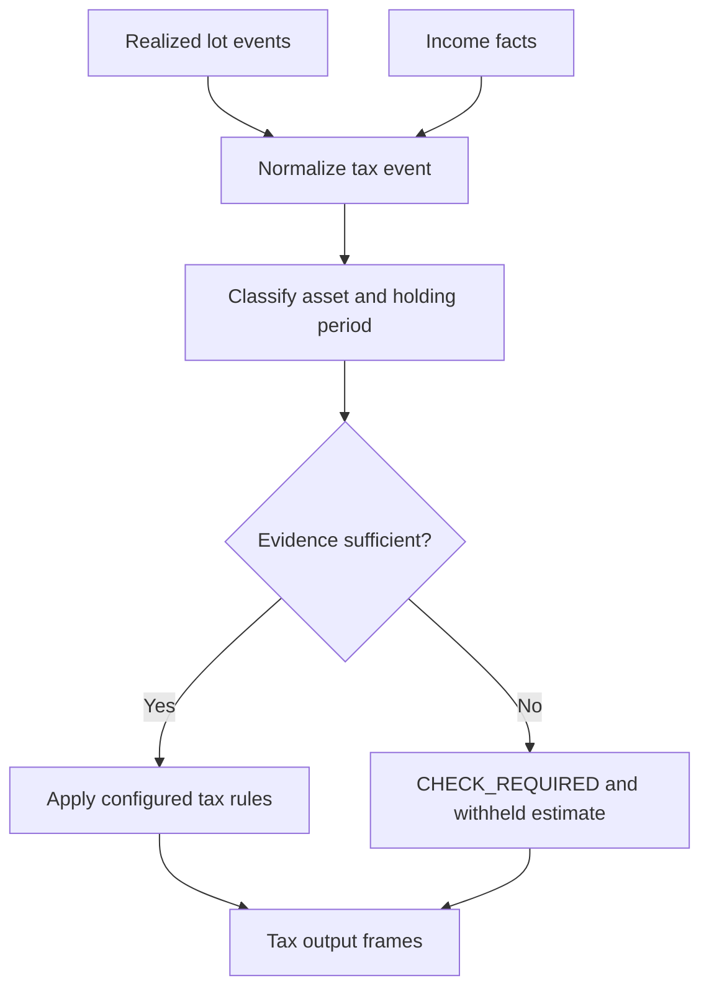

# Tax-event provenance and classification

I derive tax estimates from normalized financial events while retaining the distinction between broker-supported events and events inferred from reconciliation.

## Implementation map

| Module | Selected implementation entry points |
|---|---|
| `backend/engines/tax/tax_engine.py` | `run()` (L27) |
| `backend/engines/tax/core/base_events.py` | `build()` (L60) |
| `backend/engines/tax/core/gold_formatter.py` | `format_tax_year_summary()` (L29), `format_tax_income_breakdown()` (L140), `format_tax_reconciliation()` (L203) |
| `backend/engines/analytics/core/fifo.py` | `active_lots()` (L30), `buy()` (L34), `sell()` (L102), `get_closing_units()` (L223), `get_closing_shadow_units()` (L226), `get_terminal_value()` (L229), `get_shadow_terminal_value()` (L232) |

## Execution model



## Event origins

Realized disposal events and income facts enter tax processing through separate sources. Their origin determines which facts are available for classification and estimation.

## Classification rules

The tax engine applies category-specific rules and holding-period logic. Foreign/US equity and listed domestic equity do not share an identical classification prefix.

## Reconciliation safeguards

When acquisition evidence is incomplete, CHECK_REQUIRED provenance can suppress computed estimates. That is an intentional quality distinction, not a missing numeric result to silently fill.

## Output boundary

Tax outputs are estimates driven by configured rules and event data. They should not be described as automatically certified filings or as a replacement for independent tax review.

## Implementation excerpts

The following short excerpts are copied from the actual implementation. I use the surrounding source module as the authority for complete branch behavior.

### `run()` · `backend/engines/tax/tax_engine.py:27`

```python
    def run(self) -> dict[str, pl.DataFrame]:
        if self.rules is None:
            raise ValueError("FinancialRules must be provided to execute the Tax Engine.")

        lf_tax_events = BaseEventsBuilder(
            df_income=self.df_income,
            df_realized_events=self.df_realized_events,
            df_subcategory=self.df_subcategory,
            rules=self.rules,
            df_macro_parameters=self.df_macro_parameters,
        ).build()

        exclusions = self.rules.assumptions.tax.investment_exclusions
        investment_exclusion_uids = sorted(
```

### `build()` · `backend/engines/tax/core/base_events.py:60`

```python
    def build(self) -> pl.LazyFrame:
        """Return validated, deterministic TaxEvents as a LazyFrame."""
        if self.rules is None:
            raise ValueError("FinancialRules are required to build canonical TaxEvents.")

        self._validate_subcategory_dimension()
        self.rules.validate_investment_exclusion_uids(self.df_subcategory)
        credit_subheads = self._tax_credit_subhead_map()
        self._validate_tax_credit_uids(credit_subheads)
        configured_exclusions = set(
            self.rules.assumptions.tax.investment_exclusions.stcg_sub_cat_ids
            + self.rules.assumptions.tax.investment_exclusions.ltcg_sub_cat_ids
        )
        credit_overlap = sorted(configured_exclusions.intersection(credit_subheads))
```

## Boundaries and related specifications

I keep physical schemas in [the reference catalog](../reference/README.md), operational lineage in [Control Plane documentation](../control-plane/README.md), and ETL publication semantics in [Data Engineering](../data-engineering/README.md). I do not equate the existence of an algorithm with automated validation of every exceptional input.
