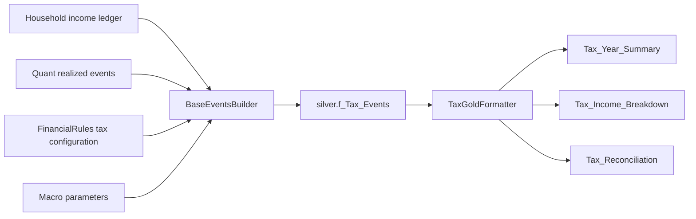
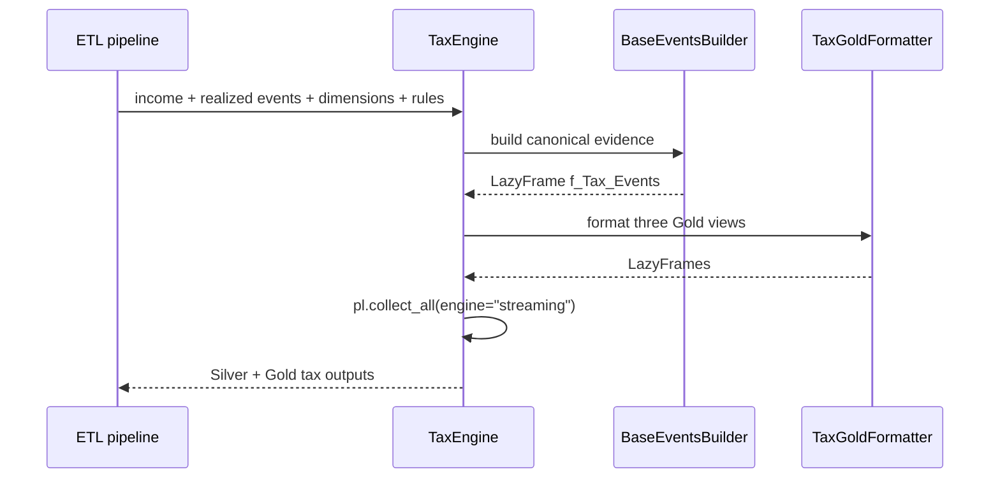
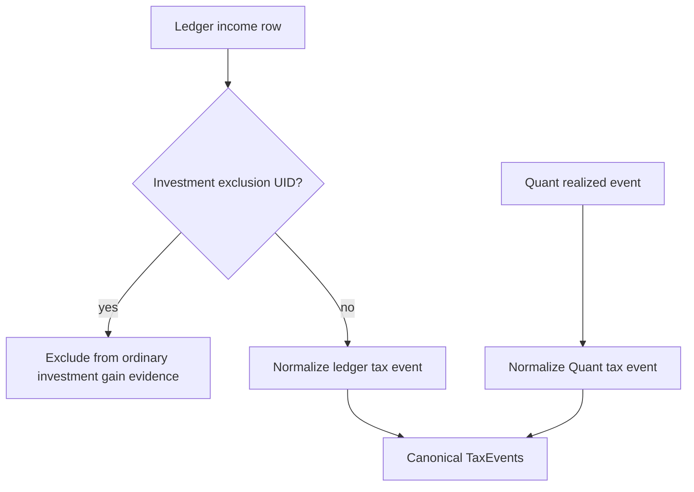
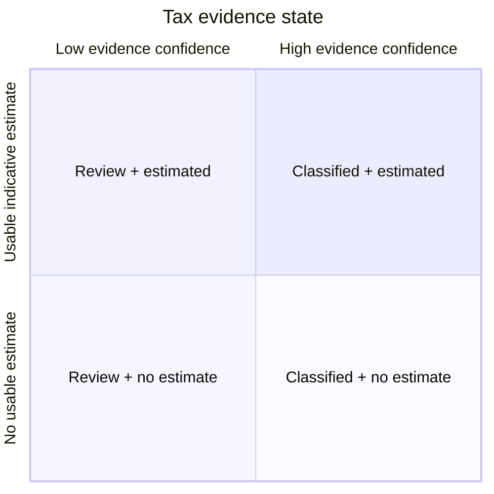
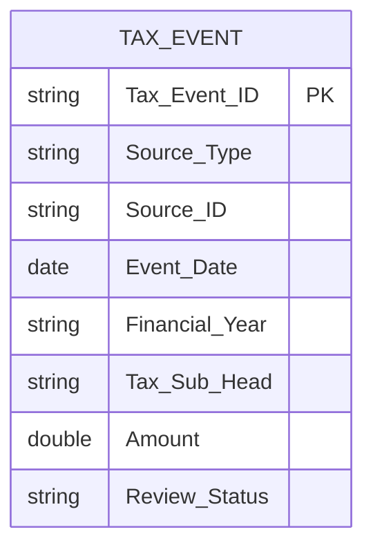
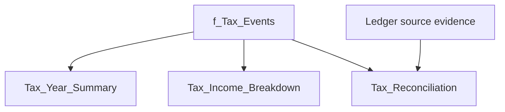
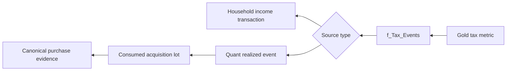
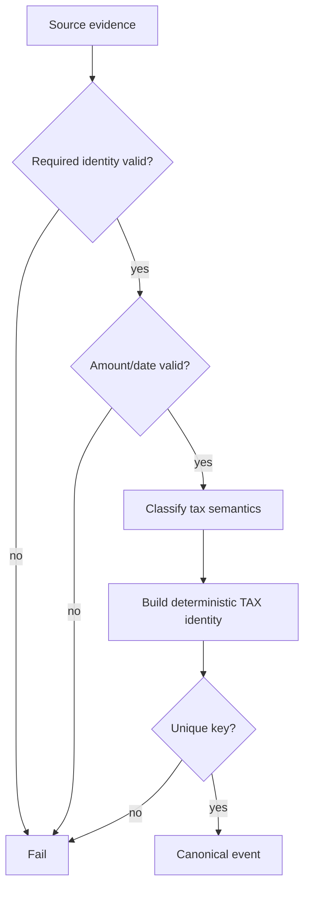
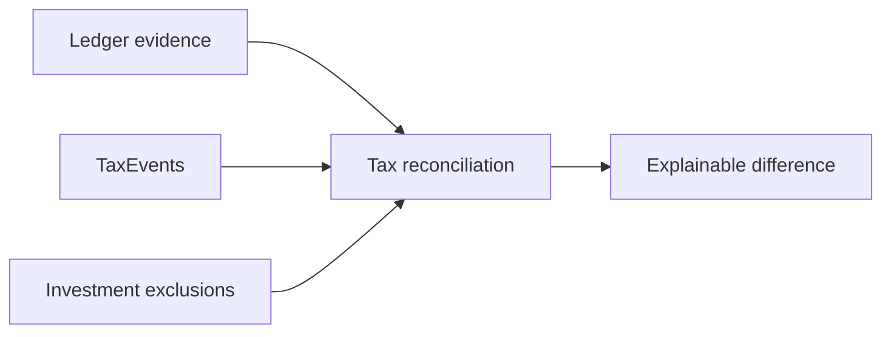
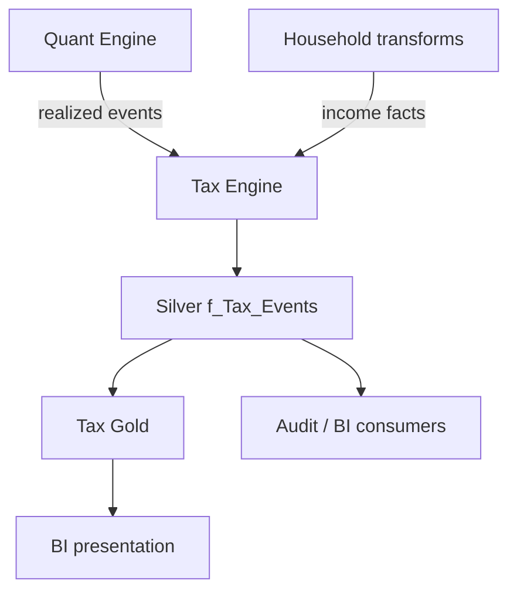

# Tax Methodology

Personal Finance ETL treats taxation as an evidence problem before it treats it as a calculation problem. The Tax Engine normalizes tax-relevant household and investment evidence, preserves provenance and review state, and publishes indicative analytical views without pretending to be a statutory filing engine.


## Scope and authority

The Tax Engine is an **evidence-normalization and presentation pipeline**. It consumes household income evidence and Quant-owned realized investment events, converts them into one canonical tax-event model, and derives three Gold views. It does not reconstruct investment lots and it does not claim to calculate a final statutory income-tax liability.

That ownership boundary is deliberate:



The implementation lives primarily in `backend/engines/tax/`. `TaxEngine.run()` is the orchestration boundary; `BaseEventsBuilder` owns canonical evidence normalization; `TaxGoldFormatter` owns presentation-only aggregates. Investment realization remains a Quant responsibility. Tax consumes that evidence instead of quietly inventing a second FIFO engine, because one FIFO engine is quite enough excitement for a personal-finance application.


## Execution contract

`TaxEngine.run()` requires `FinancialRules` and receives four financial inputs: income transactions, realized investment events, the income-subcategory dimension, and optional macro parameters.

```python
if self.rules is None:
    raise ValueError("FinancialRules must be provided to execute the Tax Engine.")

lf_tax_events = BaseEventsBuilder(
    df_income=self.df_income,
    df_realized_events=self.df_realized_events,
    df_subcategory=self.df_subcategory,
    rules=self.rules,
    df_macro_parameters=self.df_macro_parameters,
).build()
```

The engine collects the canonical events and all three Gold projections together with Polars streaming execution. Its returned keys are `df_f_tax_events`, `df_p_tax_year_summary`, `df_p_tax_income_breakdown`, and `df_p_tax_reconciliation`.




## Evidence sources and double-count protection

There are two canonical evidence families.

| Source | Financial meaning | Authority |
|---|---|---|
| Household income ledger | salary, interest, dividend, tax-credit and other ledger income evidence | household transformation |
| Quant realized events | realized investment disposals and Quant-derived STCG/LTCG evidence | Investment Quant Engine |

Investment-related ledger subcategories can overlap economically with Quant realized events. `FinancialRules.assumptions.tax.investment_exclusions` therefore contains STCG/LTCG subcategory IDs that are excluded from the ordinary ledger path.



The exclusion is a **double-count boundary**, not a statement that the original household transaction is wrong. The ledger remains canonical household evidence; the tax layer merely chooses which evidence source owns the tax interpretation.


## Ledger-income normalization

`BaseEventsBuilder._normalize_ledger_income()` maps household income evidence into tax events. It validates identifiers and amounts, resolves tax sub-head semantics from the income-subcategory dimension and rules, derives financial year from event date, and attaches an indicative ordinary-income rate when available.

Important semantics include:

- source identity is preserved rather than replaced by row position;
- ordinary income and tax-credit evidence follow different normalization paths;
- configured investment-gain subcategories are not allowed to duplicate Quant realization evidence;
- missing required identifiers or malformed financial amounts fail closed;
- tax-event identity is deterministic.

The event identity contract is conceptually:

```text
TAX(Source_Type, Source_ID, Tax_Sub_Head)
```

The actual identifier is produced through the canonical identity protocol documented separately, including namespace ordering and serialization rules.


## Tax-credit evidence and signed amounts

Tax credits are identified through configured `tax_credit_sub_cat_ids`. The configuration is validated for duplicates and ambiguous mappings. The builder validates those configured UIDs against the subcategory dimension before producing events.

Tax credits preserve the **signed household-ledger convention**. A TDS entry that is negative in the canonical ledger is not silently converted into a positive number merely because a presentation convention might look tidier.


This is an important modeling rule: sign semantics belong to the source financial model. Presentation can explain the sign; normalization should not rewrite economic evidence to make a chart less surprising.


## Quant realized-event normalization

`_normalize_quant_realized_events()` converts Quant-owned disposal evidence into tax events. The Tax Engine does **not** recompute FIFO, acquisition basis, holding period, or realized gain. It consumes those results.

Quant-derived classification can supply STCG/LTCG semantics. `_quant_sub_head()` determines the tax sub-head and whether the classification needs review. The resulting tax event can therefore contain both a financial amount and an evidence-quality state.


This separation prevents tax presentation logic from becoming a second source of truth for investment economics.


## Evidence quality versus estimated amount

A central semantic distinction is that **evidence quality and estimate availability are independent dimensions**. An event may be marked `CHECK_REQUIRED` while still carrying an indicative tax rate or estimated amount.



`CHECK_REQUIRED` therefore does not mean “throw away the amount.” It means the classification/evidence requires human review. This is particularly appropriate for a tax-preparation system where uncertainty should be surfaced rather than laundered into false certainty.


## Indicative tax rates and estimates

Ordinary-income rates can be sourced from macro parameters, while investment realized events can already carry Quant-derived indicative tax information. The engine preserves estimates as **indicative**.

The general positive-gain form used by investment realization is:

$$
\text{Indicative Tax} = \max(0,\text{Realized Gain}) \times \text{Applicable Rate}
$$

The applicable rate depends on the event classification and configured financial parameters. A negative realized gain is evidence of a loss, not a negative tax liability generated by this simplified estimator.

The Tax Engine deliberately stops before statutory set-off, carry-forward and final-liability logic. That boundary is documented because “estimated tax” and “income-tax return computation” are very different products, despite both containing the word tax.


## Canonical f_Tax_Events contract

`silver.f_Tax_Events` is the canonical normalized tax-evidence fact. Its role is to make heterogeneous evidence comparable without erasing provenance.

At minimum, the model carries concepts for source type/source identity, event date and financial year, tax head/sub-head classification, taxable/evidence amount, indicative rate/estimate, review status and deterministic event identity. The exact physical schema is specified in [Silver Data Contracts](../reference/silver-data-contracts.md).

The grain is **one normalized tax-relevant evidence event**, not one taxpayer/year aggregate.



The ER diagram is semantic; the physical column list remains owned by the Reference layer.


## Gold tax presentation

`TaxGoldFormatter` produces three distinct views.

### Tax Year Summary

Annual roll-up of normalized tax evidence and indicative estimates. It answers “what does the year look like?” rather than exposing event-level detail.

### Tax Income Breakdown

Breaks tax-relevant income into presentation categories/sub-heads. It is useful for understanding composition rather than reconciliation.

### Tax Reconciliation

Compares normalized tax evidence with ledger/source evidence so differences and exclusions remain visible.



The Gold layer is presentation-only. It does not gain authority merely because it is easier to read.


## Validation and fail-closed behavior

The tax path contains defensive validation for configuration, subcategory mappings, required source IDs, dates, numeric amounts and deterministic event keys. Invalid financial evidence is not quietly coerced into a plausible-looking zero.

Representative failure classes include:

| Failure | Behavior |
|---|---|
| `FinancialRules` missing | Tax Engine refuses execution |
| duplicate tax-credit mapping | configuration validation fails |
| configured UID absent from dimension | normalization fails |
| missing required source ID | event creation fails |
| invalid/non-finite required amount | event creation fails |
| malformed event date | event creation fails |
| duplicate deterministic event key | event-key validation fails |

This is intentionally stricter than a dashboard formatter. Tax evidence that cannot be identified reliably should not receive a cheerful aggregate and a shrug.


## What the Tax Engine guarantees

The implementation supports the following defensible guarantees:

1. Investment realization is consumed from the Quant authority rather than recomputed.
2. Configured ledger exclusions protect against obvious investment-income double counting.
3. Tax events retain source provenance and deterministic identity.
4. Tax-credit sign semantics are preserved from the household ledger.
5. Review status is distinct from indicative estimate availability.
6. Gold outputs are derived from the canonical tax-event fact.
7. Required identifiers and amounts are validated rather than silently invented.


## What the Tax Engine does not guarantee

The Tax Engine is **not** a statutory Indian income-tax computation or filing engine. The implementation does not claim complete handling of capital-loss set-off, carry-forward, every exemption/deduction, surcharge/cess interactions, final tax payable, return-form selection, filing eligibility, or jurisdictional advice.

Its contract is narrower and more useful: organize tax-relevant financial evidence, preserve provenance, prevent known double counting, attach indicative estimates where supported, and make review gaps visible.

That boundary should remain boringly explicit. Tax documentation is not the place for confidence cosplay.


## Audit path

A tax number should be traceable backward:



This path is what makes the Tax Engine evidence-first. Presentation can summarize aggressively because canonical events preserve the route back to the financial facts.


## Implementation map

| Responsibility | Source authority |
|---|---|
| orchestration | `backend/engines/tax/tax_engine.py` |
| evidence normalization | `backend/engines/tax/core/base_events.py` |
| Gold formatting | `backend/engines/tax/core/gold_formatter.py` |
| tax configuration | `backend/config/financial_rules.py` |
| investment realization | `backend/engines/analytics/core/fifo.py` and Quant pipeline |
| physical Silver/Gold contracts | `backend/load/schema/` + `backend/load/registry.py` |

The Finance layer explains semantics; Reference owns the exact DDL.


## Event-state invariants

The canonical tax-event layer is governed by several invariants that are more important than any individual Gold measure.

1. Every event must retain a source family and source identity.
2. Investment realization must originate from Quant evidence rather than ledger inference when Quant owns the event.
3. Financial year is derived from the event date, not copied from an arbitrary presentation label.
4. Required monetary evidence must be numeric and finite.
5. Configured tax-credit subcategories must resolve unambiguously.
6. Deterministic tax-event keys must be unique at their contract grain.
7. Review state must not erase an otherwise usable indicative estimate.



These invariants keep the event fact auditable even when classification confidence is imperfect.

## Financial-year semantics

The builder derives financial year from the event date. Tax grouping is therefore downstream of dated evidence rather than being treated as a free-form source attribute. This is important when source systems use calendar-year labels, statement periods, or inconsistent textual FY representations.

A dated event remains the primary fact. Annual Gold aggregation is a view over those facts.

## Source provenance matrix

| Event family | Source identity | Amount authority | Classification authority | Typical review risk |
|---|---|---|---|---|
| ordinary ledger income | income transaction | household ledger | subcategory/rules | incomplete mapping |
| tax credit | income transaction | signed ledger amount | configured credit mapping | ambiguous UID mapping |
| realized STCG/LTCG | Quant realized event | Quant FIFO | Quant + tax normalization | fallback/default classification |

This matrix prevents an easy conceptual mistake: a tax event is not a new economic transaction. It is a normalized interpretation of an existing economic event.

## Reconciliation semantics

`Tax_Reconciliation` is informational. It exists to make source-to-tax transformations inspectable, including exclusions and differences between ledger evidence and normalized tax evidence. It does not “repair” the household ledger and it does not mutate Quant realized events.



The direction of authority remains upstream-to-downstream. Reconciliation explains; it does not rewrite history.

## Edge cases

### Empty evidence sets

An empty evidence family is different from malformed evidence. A period with no realized investment events can legitimately contribute no Quant tax events. A realized-event row with a missing source identity is malformed and fails validation.

### Loss events

A realized investment loss remains financially relevant evidence even when the simplified positive-gain tax estimator produces no positive tax amount. Loss evidence must not disappear merely because this engine does not implement statutory loss set-off/carry-forward.

### Default classifications

Where Quant supplies default STCG/LTCG classification codes, Tax can normalize them while preserving review semantics. A default is not magically upgraded into statutory certainty by passing through another module.

### Negative tax credits

Negative signed credits are retained because they reflect the canonical household ledger convention. Consumers must interpret the sign contract rather than applying `abs()` as a cosmetic reflex.

## Producer and consumer boundaries



The Tax Engine is therefore both a consumer of canonical evidence and a producer of canonical tax evidence. Gold remains a consumer-facing projection.

## Design trade-offs

The simplified engine deliberately trades statutory completeness for provenance, determinism and maintainability. A comprehensive statutory engine would require a much larger rule surface covering jurisdiction-specific set-off ordering, deductions, exemptions, surcharge, cess, regime selection, filing status and year-specific legislative change.

That would be a different product boundary. The current implementation instead focuses on a smaller contract it can support transparently from the financial evidence already present in the system.

## Review checklist

When auditing a tax output, verify in this order:

1. Which canonical source event produced it?
2. Was the source owned by household finance or Quant?
3. Was the ledger subcategory excluded to avoid duplication?
4. Which tax head/sub-head was assigned?
5. Is the classification marked for review?
6. Which rate/estimate source was used?
7. Does the Gold aggregate preserve the event-level total?

That path keeps tax review anchored to evidence instead of starting from a dashboard total and reverse-engineering hope.

## Related specifications

- [Financial Model](financial-model.md)
- [FIFO and Realized Events](fifo-and-realized-events.md)
- [Investment Reconciliation](investment-reconciliation.md)
- [Silver Data Contracts](../reference/silver-data-contracts.md)
- [Gold Data Contracts](../reference/gold-data-contracts.md)
- [Financial Rules Reference](../configuration/financial-rules-reference.md)
