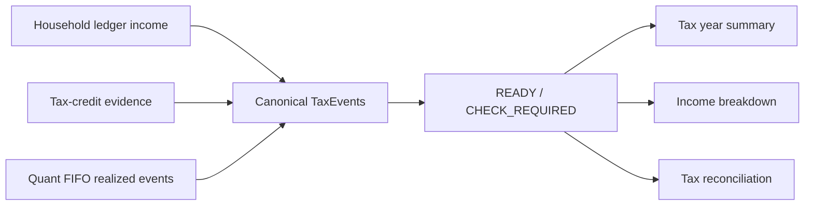
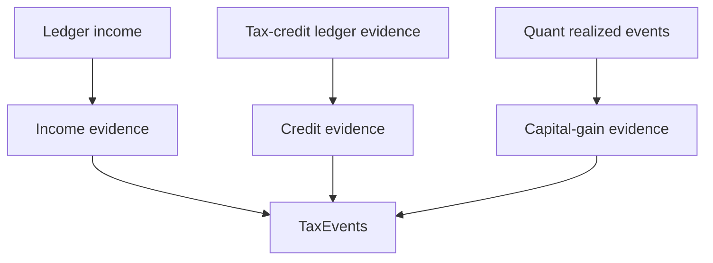
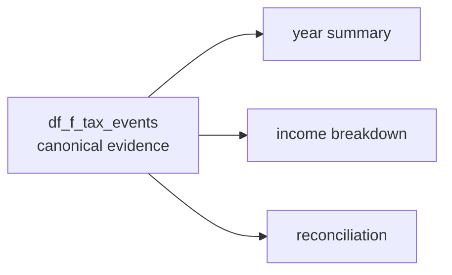
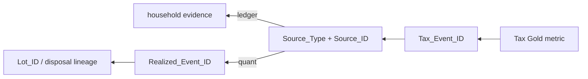

# Tax Methodology

Tax sits at an awkward boundary in any financial system.

The source evidence is real. The classification can be deterministic. The arithmetic can be reproducible. But that still does **not** turn an analytics pipeline into a statutory assessment engine.

I therefore treat Tax as an **evidence-and-estimation domain**:

```text
financial evidence
    ↓
canonical TaxEvents
    ↓
classification + indicative rate evidence
    ↓
review status
    ↓
presentation / reconciliation marts
```

The distinction is deliberate. The system can tell me **what evidence exists, how it was classified, which indicative rate was applied, and where review is required**. It does not claim to replace a return filing, final statutory computation, or professional judgement.

That boundary is the starting point for everything in this document.

---

## 1. The Tax engine begins with evidence, not liability

The Tax application layer does not calculate realized gains itself. It consumes already reconstructed investment evidence and household income evidence, then normalizes them into one canonical Tax event model.



This architecture protects three different authorities:

| Layer | Authority |
|---|---|
| Household ledger | observed income / credit evidence |
| Investment Quant | realized investment disposal economics |
| Tax domain | Tax classification, canonical event semantics, indicative estimation |
| Gold Tax marts | presentation and reconciliation only |

That separation matters because recalculating investment gains inside Tax would create a second FIFO engine. Two engines agreeing most of the time is not a control environment. It is a future incident report with excellent formatting.

---

## 2. Application orchestration stays intentionally thin

`application/tax/tax_service.py` owns the sequence, not the formulas.

```python
class TaxService:
    """Orchestrate evidence normalization and presentation-only tax aggregates."""

    def run(self) -> dict[str, pl.DataFrame]:
        if self.rules is None:
            raise ValueError("FinancialRules must be provided to execute the Tax Engine.")

        lf_tax_events = BaseEventsBuilder(
            df_income=self.df_income,
            df_realized_events=self.df_realized_events,
            df_subcategory=self.df_subcategory,
            rules=self.rules,
            df_macro_parameters=self.df_macro_parameters,
        ).build()
```

The service then constructs the three presentation views and materializes the four LazyFrames together with Polars streaming execution.

```python
lazy_frames = [
    lf_tax_events,
    formatter.format_tax_year_summary(),
    formatter.format_tax_income_breakdown(),
    formatter.format_tax_reconciliation(),
]
collected = pl.collect_all(lazy_frames, engine="streaming")
```

That gives the application layer one clear job:

> coordinate the Tax use case while leaving financial meaning in `domain.tax` and physical persistence in the warehouse.

---

## 3. One canonical TaxEvent vocabulary

The canonical model is `TAX_EVENT_SCHEMA` in `domain/tax/events.py`.

It includes:

```text
Tax_Event_ID
FY
Event_Date
Source_Type
Source_ID
Income_Head
Tax_Sub_Head
Amount_INR
Applied_Rate
Estimated_Tax
CURRENCY_ID
Tax_Status
Tax_Status_Reason
ISIN
Lot_ID
```

The grain is:

> **one row per source evidence item × Tax sub-head**

The natural key is therefore:

```text
Source_Type × Source_ID × Tax_Sub_Head
```

The builder explicitly rejects duplicate natural keys before publication.

```python
def _validate_event_keys(self, df: pl.DataFrame) -> None:
    key_columns = ["Source_Type", "Source_ID", "Tax_Sub_Head"]
    duplicates = df.group_by(key_columns).len().filter(pl.col("len") > 1)
    if not duplicates.is_empty():
        keys = duplicates.select(key_columns).to_dicts()
        raise ValueError(
            "Duplicate canonical TaxEvent natural key(s) detected "
            f"(Source_Type, Source_ID, Tax_Sub_Head): {keys[:10]}"
        )
```

The contract is intentionally event-oriented rather than “annual Tax summary first.” Annual reporting is downstream presentation. Evidence identity stays finer-grained.

---

## 4. Deterministic Tax event identity

Tax event IDs are computed from the source identity and Tax sub-head.

Conceptually:

```text
Source_Type
+ Source_ID
+ Tax_Sub_Head
        ↓
canonical deterministic identity
        ↓
Tax_Event_ID
```

This is important because annual aggregation can change without changing the identity of the underlying evidence.

A ledger income event and a Quant realized event should remain independently traceable even if both ultimately land under the same financial year and income head.

---

## 5. Three evidence streams, three semantics

The builder normalizes three sources:



The streams are intentionally not forced through one generic mapper because their provenance and failure semantics differ.

### Ledger income

Ledger evidence represents observed household income categories and subcategories.

The Tax domain maps eligible ledger rows to Tax heads/sub-heads while preserving the original source identity.

### Tax-credit evidence

Tax credits are not ordinary income. Their configured subcategory UIDs are validated separately and normalized into their own event semantics.

### Quant realized events

Investment realized gains/losses come from the canonical FIFO engine.

Tax consumes those events. It does not recompute disposal economics.

---

## 6. Double-count protection is a first-class control

Investment gains may already exist as household ledger classifications while the Quant engine independently reconstructs authoritative FIFO realized events.

Without exclusions, the same economic gain could appear twice.

`BaseEventsBuilder.build()` therefore validates configured investment-exclusion UIDs and prevents overlap with configured Tax-credit subheads.

```python
configured_exclusions = set(
    self.rules.assumptions.tax.investment_exclusions.stcg_sub_cat_ids
    + self.rules.assumptions.tax.investment_exclusions.ltcg_sub_cat_ids
)
credit_overlap = sorted(configured_exclusions.intersection(credit_subheads))
if credit_overlap:
    raise ValueError(
        "A subcategory UID cannot be both an investment-gain exclusion and a tax credit: "
        f"{credit_overlap}"
    )
```

The rule is simple:

> if Quant owns realized investment gain reconstruction, ledger classifications that would duplicate that gain must be excluded from Tax income normalization.

This is not a cosmetic configuration choice. It is a duplicate-evidence control.

---

## 7. Ledger income normalization

Ledger rows are filtered and mapped through the configured Tax head/sub-head structure.

The important semantics are:

- source evidence remains traceable;
- amounts are represented in INR for Tax presentation;
- configured investment-gain exclusions are respected;
- Tax-credit rows are diverted to the credit path;
- classification must remain deterministic.

Indicative ordinary-income rates may come from macro/rule context where available.

The Tax event does **not** claim that the applied rate is the final marginal statutory rate after every deduction, surcharge, rebate, slab interaction, or return-level adjustment.

That distinction is why the field is called `Applied_Rate`, not `Final_Legal_Truth_Pct`.

---

## 8. Tax-credit evidence preserves sign and provenance

Credit evidence can represent taxes already deducted/paid or other configured credit categories.

The model preserves signed evidence rather than silently converting every amount into “positive Tax paid.”

That matters for reconciliation because the presentation layer needs to know whether a credit offsets estimated Tax or represents another direction of flow.

A sign convention is only useful when it remains stable from source evidence through presentation.

---

## 9. Quant realized events carry stronger investment lineage

The Quant path starts from `Realized_Event_ID`, disposal date, realized gain/loss, instrument metadata, lot identity, currency, and indicative Tax fields calculated during investment processing.

`_build_quant_tax_event()` is deliberately defensive.

```python
source_id = self._required_id(row.get("Realized_Event_ID"), "Realized_Event_ID")
event_date = self._as_date(row.get("Disposal_Date"), "Quant Disposal_Date", source_id)
amount = self._required_amount(
    row.get("Realized_Gain_Loss"), "Realized_Gain_Loss", source_id
)
sub_head, classification_known = self._quant_sub_head(row)
is_reconciliation = str(row.get("Lot_Source_Type") or "").upper() == "RECONCILIATION"
```

That distinction between ordinary trade lots and reconciliation lots is crucial.

A realized event based on reconstructed reconciliation evidence is not epistemically identical to one backed by original acquisition evidence.

---

## 10. `CHECK_REQUIRED` is a financial control, not an error string

The Tax domain does not force every event into a fake “valid estimate.”

Quant events accumulate explicit review reasons when:

- the lot is reconciliation-derived;
- Tax classification is unmapped/invalid;
- ISIN is missing;
- Lot ID is missing;
- currency is missing;
- applied rate is unavailable/invalid;
- estimated Tax is unavailable/invalid.

```python
if is_reconciliation or applied_rate is None or estimated_tax is None:
    applied_rate = None
    estimated_tax = None

return {
    ...
    "Tax_Status": "CHECK_REQUIRED" if status_reasons else "READY",
    "Tax_Status_Reason": " ".join(status_reasons) or None,
}
```

This is one of the strongest design choices in the Tax model.

> **Uncertain evidence remains uncertain.**

The system would rather publish `CHECK_REQUIRED` than manufacture a precise-looking number from incomplete provenance.

---

## 11. Classification is deterministic but configurable

`TaxClassifier` maps investment metadata into configured Tax sub-heads.

The classification layer handles differences such as:

```text
equity
mutual-fund equity
mutual-fund debt
US equity
other configured investment classes
```

Holding-period and configured cutoff semantics can affect the resulting sub-head.

The exact rates and classification parameters live in `FinancialRules`; the Tax domain consumes validated policy rather than hard-coding all assumptions inside event normalization.

This keeps policy configurable without making the event model ambiguous.

---

## 12. Indicative estimation is intentionally narrower than statutory Tax

`TaxEstimator` cleans and validates optional numeric estimates and resolves ordinary-income rate context.

The estimator rejects non-finite values and invalid rates rather than propagating them downstream.

The important semantic boundary is:

```text
canonical evidence
+ configured rate assumptions
= indicative estimate

not

canonical evidence
+ configured rate assumptions
= filed statutory liability
```

The latter would require a much broader legal model.

---

## 13. Financial-year semantics

Each Tax event receives an `FY` derived from its event date.

The financial year is therefore an attribute of the evidence event, not something inferred only during Gold aggregation.

That keeps yearly grouping reproducible and allows event-level audit.

A financial-year summary can be rebuilt from canonical events without reinterpreting the source date semantics.

---

## 14. Gold Tax tables are presentation, not authority

`TaxGoldFormatter` produces three presentation views:

```text
df_p_tax_year_summary
df_p_tax_income_breakdown
df_p_tax_reconciliation
```

Their purpose is analytical consumption.

The authority remains `df_f_tax_events`.



This means a Gold view may change presentation grain without changing event identity.

---

## 15. Reconciliation compares estimate and evidence without rewriting either

Tax reconciliation exists to answer a practical question:

> Given the Tax evidence and configured estimates, what credits/withholdings/other evidence are available for comparison?

It does not mutate canonical events to make the numbers agree.

That mirrors the broader project philosophy:

> reconciliation records disagreement; it does not erase it.

---

## 16. Validation is fail-closed where evidence is required

The Tax engine raises when required identity/amount/date fields are malformed.

For example, `_required_amount()` rejects null, non-numeric, and non-finite values rather than quietly converting them to zero.

That prevents this extremely dangerous transformation:

```text
invalid populated amount
    ↓
null
    ↓
0
    ↓
plausible but wrong Tax result
```

Financial software should not turn data-quality problems into neat charts.

---

## 17. Event-state invariants

A canonical Tax event should satisfy these invariants:

1. `Source_Type`, `Source_ID`, and `Tax_Sub_Head` form a unique natural key.
2. `Tax_Event_ID` is deterministic for the same event identity.
3. `Event_Date` is valid.
4. `Amount_INR` is finite.
5. Tax status is explicit.
6. Missing indicative estimates remain null when review is required.
7. Quant realized events retain instrument/lot lineage when available.
8. Reconciliation-derived lots cannot silently masquerade as fully evidenced acquisition lots.

These invariants are more important than the annual totals because they determine whether those totals are auditable.

---

## 18. Audit path

A Tax number should be traceable backwards:



For investment events this path can extend through FIFO lots to the acquisition evidence that created them.

That is the real value of the Tax layer: not merely producing a number, but preserving enough lineage to challenge the number.

---

## 19. What the Tax engine guarantees

Within its implemented scope, the Tax layer provides:

- deterministic canonical event normalization;
- event-level provenance;
- configured investment double-count protection;
- deterministic classification under current policy;
- explicit review states;
- indicative estimates where sufficient evidence exists;
- presentation summaries derived from canonical events;
- reconciliation views that preserve independent evidence.

---

## 20. What the Tax engine does not guarantee

It does **not** claim to model every statutory rule or return-level interaction.

Examples outside the guaranteed scope can include:

- complete slab/regime computation;
- every exemption/deduction;
- surcharge/cess interactions unless explicitly modeled;
- carry-forward/set-off across all statutory categories;
- return filing;
- final tax payable/refundable amount;
- legal interpretation.

Those are not bugs hidden behind fine print. They define the product boundary.

---

## 21. The backward-looking story ends here

Up to this point, the Finance documentation has mostly answered questions about **what happened**:

```text
what did I earn?
what did I spend?
what did I buy?
what did I sell?
what gain was realized?
what Tax evidence follows?
```

The next problem is different:

> Given the financial state I have now, what might happen next?

That is where deterministic reconstruction stops and FIRE modeling begins.

The distinction matters because a deterministic Tax event and a stochastic retirement path are not two flavors of the same “financial calculation.” One is evidence classification. The other is a model of possible futures.

## Related specifications

- [Financial Model](financial-model.md)
- [FIFO & Realized Events](fifo-and-realized-events.md)
- [Investment Reconciliation](investment-reconciliation.md)
- [Financial Rules Reference](../configuration/financial-rules-reference.md)
- [Metrics & Methodology](metrics-and-methodology.md)
