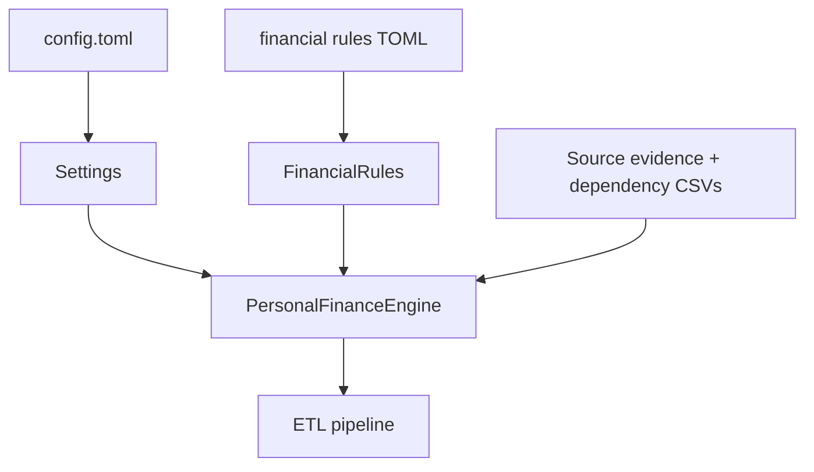
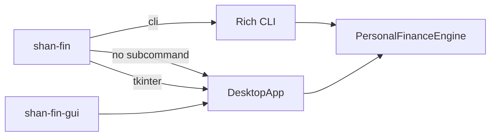

# Getting Started

Personal Finance ETL is a local-first financial data platform. Getting Started is the shortest safe route from an installed Python package to a validated pipeline run, a populated DuckDB analytical warehouse, and a SQLite Control Plane that records how that run happened.

This section deliberately does **not** re-teach the architecture. It explains what must exist, which command actually launches what, what a first run creates, and where to go when the system refuses to proceed. That refusal is usually useful: financial pipelines should be slightly less trusting than a spreadsheet opened from an email attachment.


## Want the guided operating tour?

Use **[Running & Exploring](https://github.com/tks18/personal-finance-etl/wiki/15-Running-and-Exploring)** for the conceptual walkthrough of entry points, first-run behavior, outputs, automation, snapshots, and the local documentation portal. Use this section for the exact installation and operating steps.

## Journey


| Step | Guide | Outcome |
|---|---|---|
| 1 | [Installation](installation.md) | Python environment and application entry points |
| 2 | [Quick Start](quick-start.md) | Valid configuration, first run, and output databases |
| 3 | [CLI and Desktop](cli-and-desktop.md) | Daily operation, snapshots, restore, docs, unattended execution |

## What you need before the first run

Personal Finance ETL does not manufacture source evidence. A runnable environment needs the household source database folder, statement folder, and the configuration CSV dependencies named by `Settings`.



The two configuration surfaces have different jobs:

- `config.toml` tells the application **where physical evidence and databases live**.
- the financial-rules TOML tells the application **how financial evidence is classified and modeled**.

See [Configuration Reference](../configuration/configuration-reference.md) and [Financial Rules Reference](../configuration/financial-rules-reference.md) before adapting either file beyond the first working setup.

## Entry points

The installed package exposes two console scripts:

```text
shan-fin
shan-fin-gui
```

`shan-fin` is the launcher. With no subcommand it opens the desktop application; `shan-fin cli` opens terminal mode. `shan-fin-gui` launches the desktop application directly.



Both interfaces use the same backend facade. Choosing the GUI does not select a different financial engine; it selects a different control surface.

## First-run mental model

A successful run creates or updates two coordinated databases under `TARGET_DB_BASE_PATH`:

- the SQLite Raw Store / Control Plane, which owns historical operational provenance and persistent source synchronization state;
- the DuckDB analytical warehouse, which owns Bronze, Silver, Gold, and current Meta projections.

The detailed persistence model belongs in [Warehouse Architecture](../architecture/warehouse-architecture.md). For a first run, the important rule is simpler: **treat the pair as one application state**, especially when backing up or restoring it.

## When something fails

Start with the layer that failed:

| Symptom | First place to look |
|---|---|
| missing source/config path | [Quick Start](quick-start.md#configuration-validation) |
| package/command unavailable | [Installation](installation.md#verify-the-installation) |
| CLI or desktop behavior unclear | [CLI and Desktop](cli-and-desktop.md) |
| pipeline/data failure | [Testing and Validation](../developer/testing-and-validation.md) |
| database recovery issue | [Backup and Restore](../architecture/backup-and-restore.md) |
| contract/schema mismatch | [Data Contract and Schema Evolution](../developer/data-contract-and-schema-evolution.md) |

## Related specifications

- [System Architecture](../architecture/system-architecture.md)
- [Configuration Reference](../configuration/configuration-reference.md)
- [Financial Rules Reference](../configuration/financial-rules-reference.md)
- [Development Guide](../developer/development-guide.md)
- [Testing and Validation](../developer/testing-and-validation.md)
