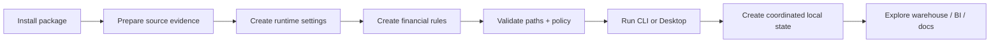
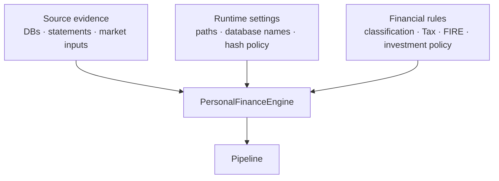

# Getting Started

Personal Finance ETL is easiest to understand when the first experience mirrors the way the system itself is designed: **prepare evidence, validate policy, run one coordinated pipeline, inspect what became durable, then repeat deliberately**.

This section is the shortest safe path from an installed package to a working local financial data platform. It deliberately avoids re-teaching the entire architecture. The deeper technical contracts already live elsewhere; here the goal is operational confidence.

The first useful question is not “which button do I press?” It is:

> **What must already be true before the application is allowed to touch my financial state?**

That question drives the whole journey.



## The three guides in this section

| Guide | Question it answers | Outcome |
| --- | --- | --- |
| [Installation](installation.md) | How do I install and verify the application? | working package and entry points |
| [Quick Start](quick-start.md) | What inputs do I need for the first real run? | validated configuration and first coordinated pipeline run |
| [CLI and Desktop](cli-and-desktop.md) | How do I operate the application day to day? | confident use of CLI, Desktop, snapshots, restore, docs, and unattended execution |

The order matters. Installing the package before understanding configuration is harmless. Running against half-configured financial evidence is much less charming.

## What the application expects from me

A working environment needs three different kinds of input:



These inputs are intentionally separated because they answer different questions.

### Source evidence

Evidence tells the system **what happened or what was observed**.

Examples include:

- household source databases;
- broker statements;
- market observations;
- benchmark inputs;
- FX inputs;
- opening balances;
- dependency CSVs used to normalize or enrich evidence.

The application does not invent missing source history simply because the pipeline would prefer a complete story.

### Runtime settings

`config.toml` tells the application **where the evidence and databases live**.

Its canonical model is `config.settings.Settings`.

Runtime settings include:

- source folders;
- statement folders;
- warehouse destination;
- Control Plane database name;
- dependency CSV paths;
- file-hash policy.

They do **not** own financial policy.

### Financial rules

The financial-rules TOML tells the application **how evidence should be interpreted and modeled**.

That includes policy such as:

- transaction classification;
- investment exclusions;
- Tax rules;
- portfolio rules;
- FIRE assumptions;
- stochastic simulation settings.

See [Configuration Reference](../configuration/configuration-reference.md) and [Financial Rules Reference](../configuration/financial-rules-reference.md) before adapting either surface beyond a first working setup.

## One application, two interfaces

The installed package exposes two console scripts:

```text
shan-fin
shan-fin-gui
```

`shan-fin` is the canonical launcher.

```text
shan-fin
    → Desktop

shan-fin tkinter
    → Desktop

shan-fin cli
    → Rich terminal CLI

shan-fin-gui
    → Desktop directly
```

Both interfaces call the same application façade:

```python
class PersonalFinanceEngine:
    """Unified Façade for the entire Personal Finance Backend and Presentation boundary."""

    def __init__(self, container: ContainerProtocol | None = None) -> None:
        self.container = container
        self._prefs = PreferencesManager()
```

Source: `src/personal_finance_etl/application/facade.py`

The interface changes. The financial engine does not.

## What a first successful run creates

A successful run creates or updates **coordinated local application state** under `TARGET_DB_BASE_PATH`.

At minimum, that means:

- a SQLite Raw Store / Control Plane;
- a DuckDB analytical warehouse.

Those stores have different authority:

```text
SQLite Control Plane
    historical operational truth
    source/artifact history
    run lifecycle
    recovery metadata

DuckDB warehouse
    Bronze
    Silver
    Gold
    current Meta context
```

They are coordinated, but they are not one distributed ACID database. That distinction matters most when snapshots, restore, or partial commit recovery enter the story.

For the deeper model, see [System Architecture](../architecture/system-architecture.md), [Warehouse Architecture](../architecture/warehouse-architecture.md), and [Reliability and Recovery](../architecture/reliability-and-recovery.md).

## What “success” means on the first run

A successful first run is not merely “the process exited with code 0.”

It means:

1. runtime paths were valid;
2. financial rules loaded successfully;
3. source evidence was discovered/acquired;
4. the Control Plane recorded the run;
5. Bronze state synchronized;
6. canonical transformations completed;
7. analytical contracts published;
8. both persistence surfaces reached a truthful lifecycle outcome.

That is why the application may refuse to continue when configuration is incomplete. Financial pipelines should be slightly less trusting than a spreadsheet opened from an email attachment.

## Where to go when something fails

| Symptom | First guide |
| --- | --- |
| command/package missing | [Installation](installation.md) |
| source/config path invalid | [Quick Start](quick-start.md) |
| rules fail to load/validate | [Financial Rules Reference](../configuration/financial-rules-reference.md) |
| unsure whether to use CLI/Desktop | [CLI and Desktop](cli-and-desktop.md) |
| pipeline/data failure | [Testing and Validation](../developer/testing-and-validation.md) |
| schema/contract mismatch | [Data Contract and Schema Evolution](../developer/data-contract-and-schema-evolution.md) |
| snapshot/restore problem | [Backup and Restore](../architecture/backup-and-restore.md) |
| cross-database recovery state unclear | [Reliability and Recovery](../architecture/reliability-and-recovery.md) |

## The next question

Once the application is installed, the next useful question is obvious:

> **What exactly needs to be installed, and how do I prove the environment is the same one the repository expects?**

That is where [Installation](installation.md) begins.

## Related specifications

- [System Architecture](../architecture/system-architecture.md)
- [Configuration Reference](../configuration/configuration-reference.md)
- [Financial Rules Reference](../configuration/financial-rules-reference.md)
- [Development Guide](../developer/development-guide.md)
