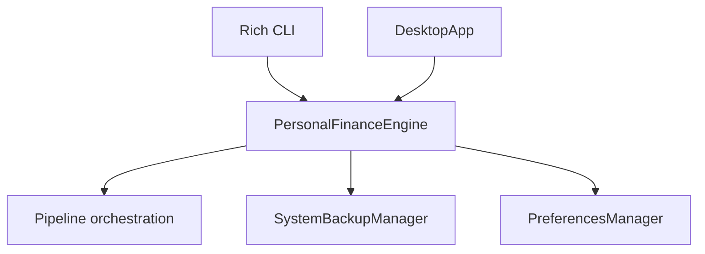
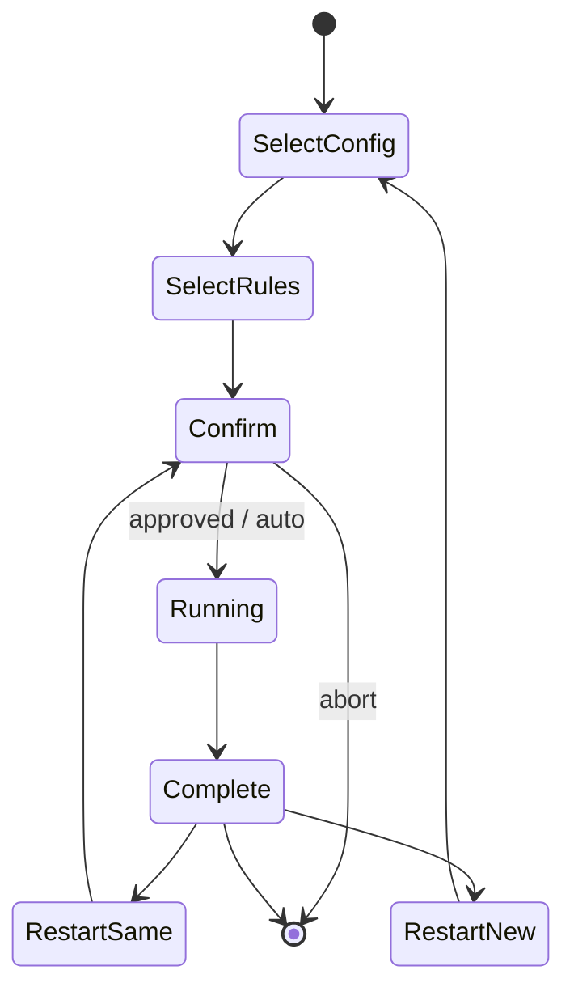
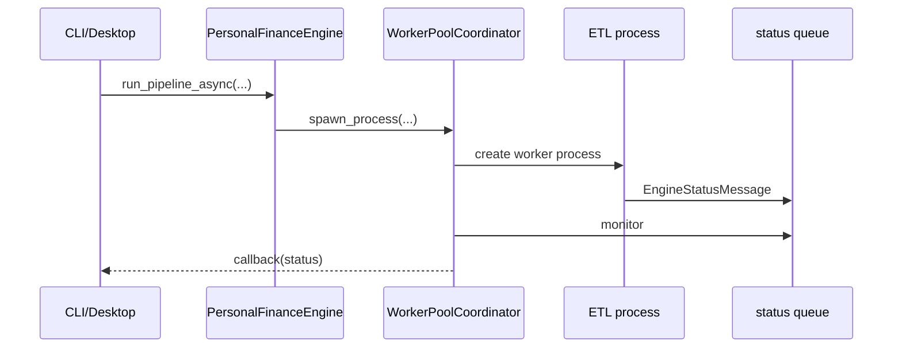

# CLI and Desktop

Personal Finance ETL has two operating surfaces and one financial engine.

That distinction is the most important thing to understand about the presentation layer:

> **CLI and Desktop choose how I control the application. They do not select different finance logic.**

Both surfaces terminate in `PersonalFinanceEngine`, which exposes configuration, pipeline execution, snapshot, restore, and preference-facing workflows to presentation code.



## The launcher contract

The canonical launcher is `presentation.launcher:main`.

Its parser defines:

```python
cli_parser = subparsers.add_parser("cli", help="Launch the terminal CLI")
cli_parser.add_argument("--config", type=str, help="Path to config.toml", default=None)
cli_parser.add_argument("--rules", type=str, help="Path to rules.toml", default=None)
cli_parser.add_argument("--snapshot", action="store_true", ...)
cli_parser.add_argument("--restore", type=str, ...)
cli_parser.add_argument("--auto", action="store_true", ...)
cli_parser.add_argument("--cron", action="store_true", ...)
cli_parser.add_argument("--docs", action="store_true", ...)
```

Source: `src/personal_finance_etl/presentation/launcher.py`

No subcommand defaults to the Desktop application.

## Entry-point matrix

| Command | Behavior |
| --- | --- |
| `shan-fin` | Desktop |
| `shan-fin tkinter` | Desktop |
| `shan-fin-gui` | Desktop directly |
| `shan-fin cli` | Rich terminal CLI |
| `shan-fin cli --docs` | open integrated documentation |

The installed scripts are declared in `pyproject.toml`.

## CLI operating modes

The CLI supports several distinct workflows.

### Interactive pipeline run

```bash
shan-fin cli --config path/to/config.toml --rules path/to/rules.toml
```

The CLI can prompt for configuration/rules and retain recent selections.

### Automatic run

```bash
shan-fin cli --config ... --rules ... --auto
```

`--auto` skips the explicit ignite confirmation.

It does **not** make invalid configuration acceptable.

### Unattended / cron-style run

```bash
shan-fin cli --config ... --rules ... --cron
```

`--cron` implies automatic execution and exits after completion rather than entering the interactive restart menu.

### Snapshot

```bash
shan-fin cli --config path/to/config.toml --snapshot
```

### Restore

```bash
shan-fin cli --config path/to/config.toml --restore path/to/backup.zip
```

### Documentation portal

```bash
shan-fin cli --docs
```

## Interactive lifecycle



Interface state is not pipeline state.

Each pipeline execution receives its own operational run lifecycle regardless of whether the UI reused the same configuration.

## Asynchronous execution

The façade exposes:

```python
def run_pipeline_async(
    self,
    config_path: str,
    rules_path: str,
    on_status: Callable[[EngineStatusMessage], None],
) -> None:
    status_queue: multiprocessing.Queue[EngineStatusMessage] = multiprocessing.Queue()
    process = WorkerPoolCoordinator.spawn_process(status_queue, config_path, rules_path)
    WorkerPoolCoordinator.monitor_queue(process, status_queue, on_status)
```

Source: `src/personal_finance_etl/application/facade.py`

The presentation surface does not run the heavy ETL directly in its event loop.



That separation matters most for Desktop responsiveness and process isolation.

## Typed status messages

Presentation does not need to infer machine state from arbitrary strings.

Status crosses the boundary through `EngineStatusMessage` and logging/status contracts.

The UI can still render human-friendly messages, but machine meaning remains structured.

This is the same principle used throughout the system: logs explain state; typed contracts carry state.

## Desktop responsibilities

The Desktop application owns human interaction:

- configuration/rules selection;
- running the pipeline;
- progress/status rendering;
- snapshot/restore actions;
- integrated docs access;
- tabs/widgets/theme behavior.

It does not own:

- FIFO;
- Tax logic;
- FIRE simulation;
- warehouse publication;
- recovery semantics.

A visually convenient place to put logic is still the wrong place if it changes financial meaning.

## Preferences are not financial configuration

Recent config/rules paths are persisted through `PreferencesManager`.

That is convenience state.

It is intentionally separate from:

```text
Settings
    runtime topology

FinancialRules
    financial policy
```

A recently opened file path should not become part of the financial model merely because the UI remembers it.

## Snapshot behavior

`PersonalFinanceEngine.snapshot_database_detailed()` loads `Settings`, constructs `SystemBackupManager`, and creates a coordinated snapshot for the configured DuckDB/SQLite pair.

```python
backup_mgr = SystemBackupManager(
    cfg.TARGET_DB_BASE_PATH,
    sqlite_db_name=cfg.RAW_DOCUMENT_STORE_NAME,
    duckdb_name=cfg.TARGET_DB_NAME,
)
return backup_mgr.create_snapshot()
```

Source: `src/personal_finance_etl/application/facade.py`

The presentation layer receives typed `SnapshotResult` / `SnapshotOutcome` semantics rather than implementing backup logic itself.

## Restore behavior

Restore follows the same boundary.

The façade returns a typed `RestoreResult` containing:

- outcome;
- active database state;
- error message where relevant.

If the active database files are in use, the compatibility wrapper raises `PermissionError` so the interface can surface a specific operating problem.

Restore semantics are specified in [Backup and Restore](../architecture/backup-and-restore.md).

## Integrated documentation

The application ships the docs tree and uses a manifest-driven catalog.

The docs presentation layer separates:

```text
manifest/catalog
    which documents exist and in what order

renderer
    Markdown/HTML conversion

guides window
    user-facing navigation
```

That means the docs portal is not a hard-coded list of filenames living inside a window class.

The documentation itself behaves like a product surface with its own catalog contract.

## Choosing an interface

Use the **CLI** when:

- automating runs;
- profiling;
- diagnosing logs;
- scripting snapshots;
- running unattended;
- preferring terminal workflows.

Use **Desktop** when:

- selecting files interactively;
- watching status visually;
- browsing docs inside the application;
- operating the tool as a local desktop product.

Use **synchronous engine execution** from developer/test contexts when profiling or deterministic in-process execution is useful.

The financial outputs should not depend on which control surface started the run.

## Failure behavior

Presentation should distinguish at least:

```text
configuration validation failure
pipeline failure
abnormal worker process exit
snapshot failure
restore validation failure
restore install failure
permission/in-use failure
```

Do not collapse those into one “Something went wrong” modal if the backend already knows exactly what happened.

Useful systems preserve information all the way to the person who needs to act on it.

## The interface boundary

The final mental model is simple:

```text
presentation
    asks

application façade
    coordinates

domain / infrastructure
    decide and perform

presentation
    renders the result
```

That closes the operational journey. Once a reader can install, configure, run, recover, and explore the system, the next useful question is no longer operational.

It is contextual:

> **Why does this project exist, and what kind of engineering did it become?**

That is the purpose of the [About](../about/README.md) section.

## Related specifications

- [Application and Dependency Architecture](../architecture/application-and-dependency-architecture.md)
- [Backup and Restore](../architecture/backup-and-restore.md)
- [Tooling, Quality and Release Engineering](../developer/tooling-quality-and-release-engineering.md)

## Observability and UI Narrative Sinks

The application separates user-facing narrative from detailed forensic debugging:

- **Concise Narrative Log**: The CLI (`RichNarrativeSink`) and CustomTkinter Desktop (`DesktopNarrativeSink`) render only significant milestones (`>>`, `✓`) and actionable failure summaries. Diagnostic chatter is dropped automatically.
- **Forensic JSONL Trace**: Deep operational telemetry (ticker cache hits, table row counts, ISIN completion timings) is streamed to `outputs/logs/runs/trace_{run_id}.jsonl`.
- **Single Error Summary**: On fatal failures, the desktop interface presents a single actionable error diagnostic rather than multiple modal popups.
