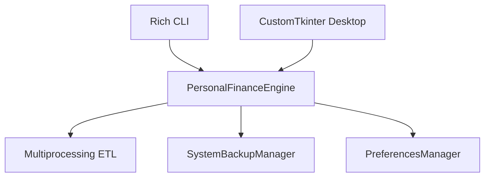
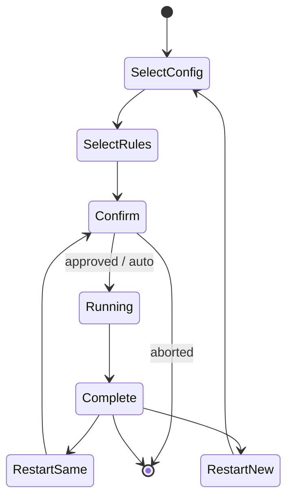
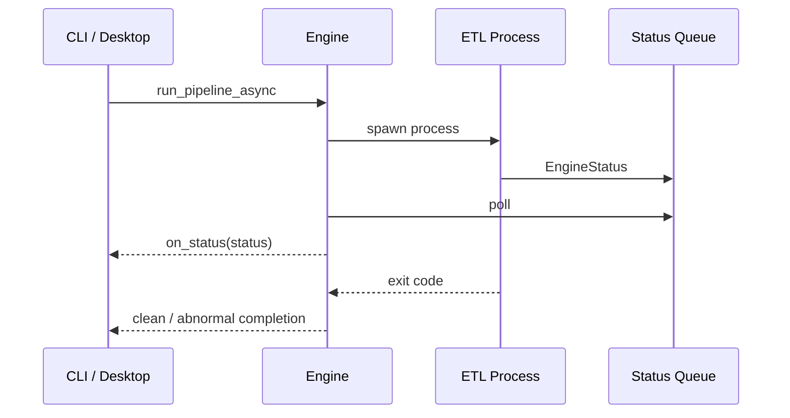
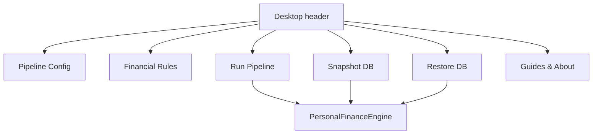

# CLI and Desktop

## Purpose

Personal Finance ETL exposes terminal and desktop control surfaces over the same backend facade. This document specifies what each interface actually does, which commands exist, how asynchronous execution is surfaced, and where interface convenience stops and backend authority begins.

The core rule is simple:

> CLI and Desktop choose **how the user controls the application**. They do not choose different financial logic.

## Shared backend

Both interfaces depend on `backend/api/engine.py`:

```python
class PersonalFinanceEngine:
    """Unified Facade for the entire Personal Finance Backend."""

    def __init__(self) -> None:
        self._prefs = PreferencesManager()
```

The facade owns:

- recent configuration/rules paths;
- configuration loading checks;
- asynchronous pipeline execution;
- coordinated snapshots;
- coordinated restores.



## Launcher behavior

`shan-fin` maps to `personal_finance_etl.frontend.launcher:main`.

The launcher defines two subcommands:

```text
cli
    terminal interface

tkinter
    desktop interface
```

If no subcommand is supplied, the launcher defaults to the desktop application.

| Command | Result |
|---|---|
| `shan-fin` | desktop |
| `shan-fin tkinter` | desktop |
| `shan-fin-gui` | desktop directly |
| `shan-fin cli` | terminal CLI |

## CLI arguments

The actual launcher contract is:

```text
shan-fin cli [--config PATH]
             [--rules PATH]
             [--snapshot]
             [--restore BACKUP_ZIP]
             [--auto]
             [--cron]
             [--docs]
```

### `--config`

Path to the runtime Settings TOML.

### `--rules`

Path to the FinancialRules TOML.

### `--auto`

Bypasses the interactive “ignite pipeline” confirmation. It does not imply that missing configuration/rules paths can be ignored; the CLI still needs those inputs and can prompt for them.

### `--cron`

Sets unattended mode and implies `--auto`. After the pipeline completes, the CLI exits instead of presenting the restart menu.

### `--docs`

Opens the integrated documentation/guides window and exits without running ETL.

```bash
shan-fin cli --docs
```

### `--snapshot`

Creates a coordinated database snapshot using the selected config.

```bash
shan-fin cli --config "C:/path/config.toml" --snapshot
```

If `--config` is omitted, the CLI prompts for a recent/new config path.

### `--restore`

Restores a backup ZIP using the selected config to locate the target database pair.

```bash
shan-fin cli --config "C:/path/config.toml" --restore "C:/path/snapshot.zip"
```

The CLI displays an overwrite warning and requires confirmation. Restore permission errors are surfaced separately from generic restore failures.

## Interactive CLI lifecycle



After a non-cron run, the CLI offers:

1. restart with previous configuration;
2. restart with new configuration;
3. exit.

This is interface state only. Each pipeline execution still receives a new operational run identity.

## Status transport

`PersonalFinanceEngine.run_pipeline_async()` launches the pipeline in a separate `multiprocessing.Process` and creates a monitoring thread for the status queue.

```python
process = multiprocessing.Process(
    target=process_wrapper,
    args=(status_queue, config_path, rules_path),
    daemon=True,
)
process.start()
```

The monitor converts legacy tuple statuses when necessary and invokes the interface callback with `EngineStatus` objects.



This keeps the UI responsive while the ETL performs CPU/database work in another process.

## CLI status rendering

The Rich CLI maps `LogLevel` to distinct presentation styles and updates a 0–100% progress bar from backend progress values in the 0.0–1.0 range.

Completion is recognized from backend lifecycle messages such as:

```text
Process completed cleanly.
Process exited abnormally.
```

or a critical pipeline failure status.

The CLI also catches `KeyboardInterrupt` while waiting and exits with a non-zero status.

## Desktop application

The desktop UI is implemented in `frontend/desktop/app.py` using CustomTkinter.

Its main control surface includes:

- Pipeline Config selector;
- Financial Rules selector;
- Run Pipeline button;
- Snapshot DB button;
- Restore DB button;
- Guides & About button;
- status/log panel.



## Recent paths and preferences

`PreferencesManager` stores recent config/rules paths under the user application-data directory:

```text
PersonalFinanceETL/prefs.json
```

On Windows, the base is `%APPDATA%`; when `APPDATA` is unavailable, the implementation falls back to the user home directory.

Only existing recent paths are returned. Each list is capped at ten entries.

This preference file is convenience state, not financial evidence or pipeline provenance.

## Desktop configuration selection

When a config path is selected, the desktop calls `engine.validate_config(path)`. The current facade implementation tests whether `Settings.from_toml(path)` succeeds; the full path-existence validation still occurs in the pipeline lifecycle.

That nuance matters: the desktop’s early selection check is not equivalent to the full `Settings.validate_config()` run-readiness gate.

## Snapshot and restore

Both CLI and Desktop call the same backend methods:

```python
def snapshot_database(self, config_path: str) -> str | None:
    ...

def restore_database(self, config_path: str, backup_zip_path: str) -> bool:
    ...
```

The backend constructs `SystemBackupManager` from:

- `TARGET_DB_BASE_PATH`;
- `RAW_DOCUMENT_STORE_NAME`;
- `TARGET_DB_NAME`.

The detailed locking/checkpoint/archive/rollback protocol is intentionally documented in [Backup and Restore](../architecture/backup-and-restore.md), not duplicated here.

## Integrated documentation

Both interface families can open the shared documentation renderer:

- CLI: `shan-fin cli --docs`;
- Desktop: **Guides & About**.

The renderer is a frontend concern over the repository documentation manifest. Updating the documentation catalog later therefore requires the manifest to stay synchronized with the actual files.

## Choosing an interface

| Need | Recommended surface |
|---|---|
| first exploratory run | Desktop or interactive CLI |
| terminal visibility and logs | CLI |
| scheduled/unattended execution | CLI `--cron` |
| confirmation-free manual run | CLI `--auto` |
| visual file selection | Desktop |
| snapshot/restore | either |
| integrated docs | either |

There is no financial-accuracy advantage to one interface. Both ultimately invoke the same backend pipeline.

## Failure behavior

### Child process exits abnormally

The engine monitor emits:

```text
Process exited abnormally.
```

when the child process terminates with a non-zero exit code and a natural terminal status was not sufficient.

### UI callback/status failure

The queue-monitor thread is defensive around queue timeouts and callback transport. Operational failure provenance still belongs to the pipeline/Control Plane rather than the UI widget tree.

### Snapshot returns `None`

The facade intentionally collapses snapshot exceptions to `None` for the UI. The CLI reports that the snapshot failed or the database does not yet exist.

### Restore permission failure

`PermissionError` is deliberately re-raised by the backend facade so interfaces can show a meaningful filesystem/lock error.

## Interface boundary

The interfaces should not acquire financial logic. Classification, FIFO, tax, FIRE, contracts and recovery semantics belong to backend modules. A UI that starts recomputing finance independently would create two financial systems with matching buttons, which is a remarkably efficient way to ruin reconciliation.

## Related specifications

- [Quick Start](quick-start.md)
- [System Architecture](../architecture/system-architecture.md)
- [Configuration Reference](../configuration/configuration-reference.md)
- [Backup and Restore](../architecture/backup-and-restore.md)
- [Testing and Validation](../developer/testing-and-validation.md)
