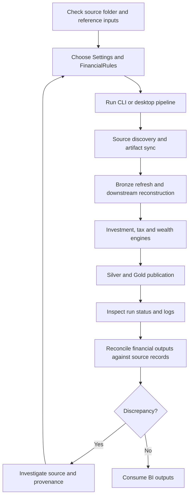
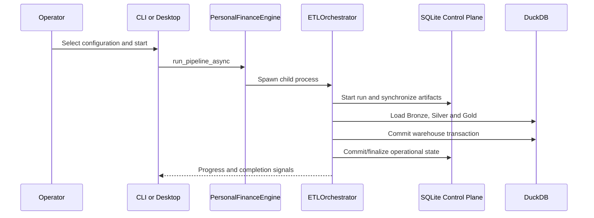
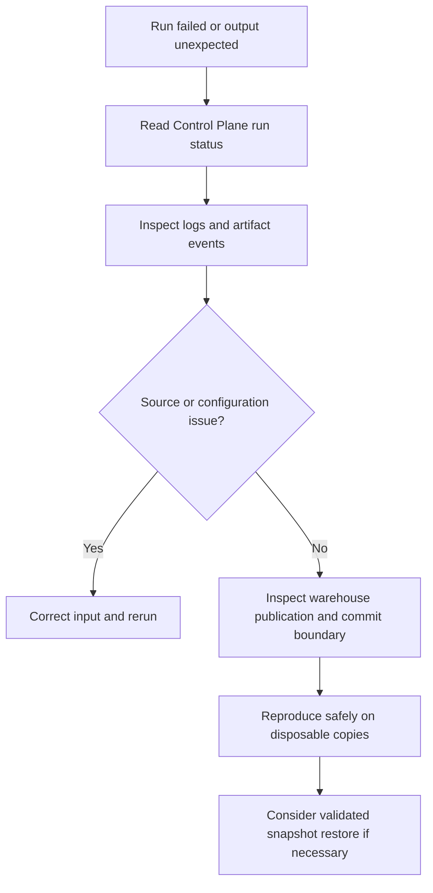

# Daily operating workflow

I use Personal Finance ETL as a local-first financial data platform in my day-to-day workflow. I separate the repeatable operational sequence from the financial mathematics and physical schemas, which have their own specifications.

## End-to-end operating sequence



I do not treat the GUI progress bar as an accounting reconciliation. I verify the resulting financial outputs against my trusted source records.

## Before a run

I verify that my source directories and mapping files are reachable, that the expected broker exports and reference files have arrived, and that the selected Settings and FinancialRules files represent the intended financial assumptions. For first-time setup, I use [Installation](installation.md) and [Configuration](configuration.md).

## Start execution

```bash
shan-fin cli --config /path/to/config.toml
```

I use the CLI or desktop frontend to launch the same backend orchestration. The application facade starts a separate process and communicates status back to the interface. The exact CLI options and restore confirmation behavior are documented in [Running the Pipeline](running-the-pipeline.md).

## Execution and state ownership



The two databases have separate transaction boundaries. I inspect durable run records when a failure occurs rather than inferring success from a UI message.

## What I verify after execution

| Check | Why it matters |
|---|---|
| Final run state | Confirms operational completion independently of progress display |
| Artifact changes | Explains which files were discovered, changed, renamed or healed |
| Analytical publication | Confirms expected Silver and Gold tables are present |
| Financial reconciliation | Confirms the produced figures match trusted financial source records |
| Logs and exceptions | Preserves the evidence needed to investigate abnormal behavior |

My reported daily workload has reached 1,629 artifacts, with approximately 20-second cached and 40-second fresh runs. Those are observed timings, not performance guarantees.

## When a run fails



I do not edit production database files while a run is active. For restore procedures I follow [Running the Pipeline](running-the-pipeline.md) and the [Operations backup specification](../operations/backup-and-restore.md).

## Code authority

**Implementation:** `src/personal_finance_etl/backend/api/engine.py` (near line 71).

```python
    def run_pipeline_async(
        self,
        config_path: str,
        rules_path: str,
        on_status: Callable[[EngineStatus], None],
    ) -> None:
        """
        Spawns the multiprocessing ETL pipeline and fires the callback
        whenever a status update is received.
        """
        status_queue: multiprocessing.Queue[EngineStatus | tuple[str, Any | None, float | None]] = (
            multiprocessing.Queue()
        )

        process = multiprocessing.Process(
            target=process_wrapper,
            args=(status_queue, config_path, rules_path),
```

The application facade is the entry point for the child-process execution model. I use [Interfaces](../interfaces/README.md) for detailed callback and multiprocessing semantics.

## Related specifications

I use [Control Plane run lifecycle](../control-plane/run-lifecycle.md), [Data Engineering](../data-engineering/README.md), [Operations](../operations/README.md), and [Finance](../finance/README.md) for the deeper implementation contracts.

