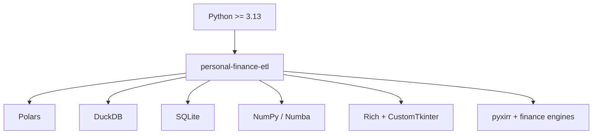
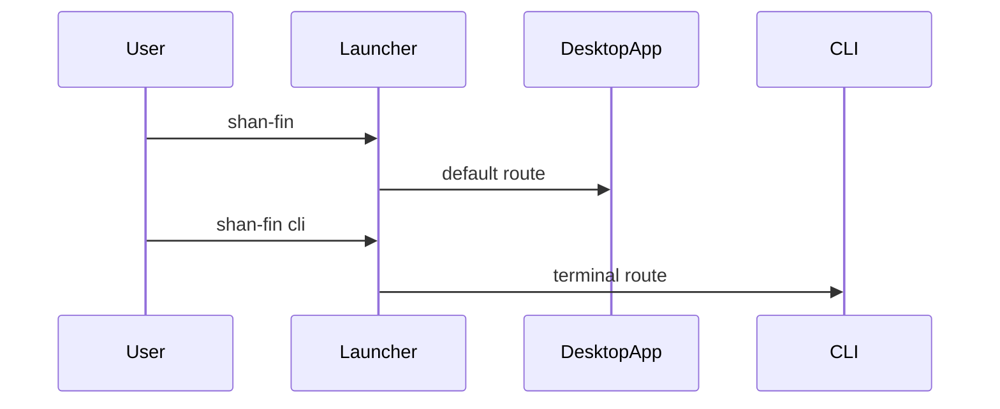

# Installation

## Purpose

Installation establishes a Python environment in which Personal Finance ETL can import its backend, launch its CLI and desktop interfaces, and execute the local data stack. It does **not** make the pipeline runnable by itself: source evidence and valid configuration are separate prerequisites.

The package requires **Python 3.13 or newer**. The project metadata in `pyproject.toml` is the installation authority.

## Runtime stack



The application is local-first. DuckDB and SQLite are local databases, source files remain local, and the desktop/CLI interfaces invoke the same local backend.

## Package metadata

The project declares:

```toml
[project]
name = "personal-finance-etl"
requires-python = ">=3.13"

[project.scripts]
shan-fin = "personal_finance_etl.frontend.launcher:main"
shan-fin-gui = "personal_finance_etl.frontend.desktop.app:main"
```

Source: `pyproject.toml`.

These entry points are worth understanding because `shan-fin` is a launcher, not merely the CLI binary.

## Install from the repository

From a cloned repository, create or activate a Python 3.13+ environment and install the project using the package workflow appropriate to the checkout. The repository uses Hatchling as its build backend and includes a `uv.lock`, so `uv` is the natural project-development workflow.

```bash
uv sync
```

For an installed package rather than a development checkout, install the built/published package using the environment manager of choice.

The documentation intentionally avoids pinning an installation command to a release artifact or index URL. Release distribution is package metadata; the runtime contract is Python 3.13+ plus the declared dependencies.

## Development dependencies

The project separates runtime dependencies from a development group. Development tooling includes static/type/lint and packaging utilities such as:

- `mypy`;
- `pyright`;
- `ruff`;
- `vulture`;
- `pyinstaller`;
- `poethepoet`.

These are developer tools, not prerequisites for an ordinary end-user pipeline run.

## Verify the installation

### Launcher help

```bash
shan-fin --help
```

The launcher should expose the `cli` and `tkinter` subcommands.

### CLI help

```bash
shan-fin cli --help
```

The CLI currently supports:

```text
--config PATH
--rules PATH
--snapshot
--restore BACKUP_ZIP
--auto
--cron
--docs
```

### Desktop

Either command launches the desktop interface:

```bash
shan-fin
```

or:

```bash
shan-fin-gui
```

The explicit launcher form also works:

```bash
shan-fin tkinter
```



## Windows behavior

The application contains explicit Windows handling in the CLI, including UTF-8 stdout/stderr reconfiguration. The desktop application uses CustomTkinter and local file dialogs. Snapshot/restore and pipeline operations operate on local filesystem paths, so permissions and file locks remain relevant even when installation itself succeeded.

## Installation is not configuration

A successful `shan-fin --help` proves that the package and launcher are available. It does **not** prove that the ETL can run.

A runnable configuration additionally requires:

- `SOURCE_DB_FOLDER`;
- `STATEMENTS_FOLDER`;
- `TARGET_DB_BASE_PATH`;
- column master CSV;
- MF ISIN mapping CSV;
- benchmark mapping CSV;
- benchmark master CSV;
- macro parameters CSV;
- opening-balance CSV;
- currency mapping CSV;
- a valid financial-rules TOML.

That transition is covered in [Quick Start](quick-start.md).

## Common installation failures

| Failure | Meaning | Action |
|---|---|---|
| `shan-fin` not found | environment/script path is not active | activate the intended environment and verify installation |
| Python version rejected | interpreter is below project minimum | use Python 3.13+ |
| desktop import/display failure | GUI/runtime dependency or environment issue | verify project dependencies and desktop-capable environment |
| pipeline later rejects paths | installation succeeded but configuration is invalid | continue with Quick Start |

## Packaging boundary

Installation should not mutate financial data. The first financial state transition occurs when the configured pipeline runs. This separation is useful during troubleshooting: package/import problems and data/configuration problems are different classes of failure and should stay that way.

## Related specifications

- [Quick Start](quick-start.md)
- [CLI and Desktop](cli-and-desktop.md)
- [Configuration Reference](../configuration/configuration-reference.md)
- [Development Guide](../developer/development-guide.md)
- [System Architecture](../architecture/system-architecture.md)
