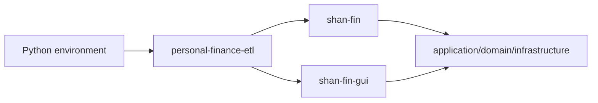

# Installation

Installation is the smallest technical step in the project, but it establishes an important boundary:

> **The Python environment should come from the same package metadata that builds and publishes the application.**

The project does not maintain a parallel universe of hand-edited dependency lists. Runtime, development, build, and publishing behavior are all anchored in `pyproject.toml`.

## Runtime contract

The package requires modern Python and is installed as `personal-finance-etl`.

The runtime stack includes:

- Polars for transformation execution;
- DuckDB for analytical persistence;
- SQLite for the Control Plane;
- Pydantic for validated configuration;
- Rich for the terminal interface;
- CustomTkinter / Tkinter surfaces for Desktop;
- Numba for selected numerical kernels;
- PyXIRR for cash-flow return calculations;
- yfinance for supported market acquisition paths;
- pywebview + Markdown for integrated documentation rendering.

The important point is not the list. It is that each dependency belongs to a clear boundary in the architecture.



## Install from the repository

For active development, use the repository environment and development dependency group managed through `uv`.

A normal workflow is:

```bash
uv sync --group dev
```

Then verify the installed entry points:

```bash
uv run shan-fin --help
uv run shan-fin cli --help
```

The exact dependency set comes from `pyproject.toml`, not from this page. Documentation should explain the contract; package metadata should own exact versions.

## Install the published package

For normal package installation:

```bash
uv pip install personal-finance-etl
```

or use the equivalent installer for the active Python environment.

After installation:

```bash
shan-fin --help
shan-fin cli --help
```

A successful import alone is useful, but the console entry points verify the package metadata as well.

## What the package installs

The project declares:

```toml
[project.scripts]
shan-fin = "personal_finance_etl.presentation.launcher:main"
shan-fin-gui = "personal_finance_etl.presentation.desktop.app:main"
```

Source: `pyproject.toml`

Those scripts deliberately terminate in the presentation layer. They do not point directly into the ETL orchestrator.

That preserves the dependency story:

```text
console script
    → presentation
    → application façade
    → application orchestration
    → domain / infrastructure
```

## Why the launcher owns process bootstrap

The canonical launcher calls:

```python
def main() -> None:
    """Canonical entrypoint function for both terminal and desktop interfaces."""
    multiprocessing.freeze_support()

    parser = build_argument_parser()
    args = parser.parse_args()
```

Source: `src/personal_finance_etl/presentation/launcher.py`

`multiprocessing.freeze_support()` matters because the application supports both ordinary Python execution and packaged Desktop execution.

It is a small line with an architectural job: process bootstrap belongs at the presentation/application boundary, not scattered through financial modules.

## Development dependencies

The development group includes the repository's quality and delivery tooling:

```text
Mypy
Poe the Poet
PyInstaller
Pylint
Pyright
Pytest
Ruff
tkreload
Vulture
```

These are not runtime requirements for every user. They support development, certification, packaging, and local feedback loops.

The complete engineering workflow is documented in [Tooling, Quality and Release Engineering](../developer/tooling-quality-and-release-engineering.md).

## Verify imports

For a quick package sanity check:

```bash
python -c "import personal_finance_etl; print(personal_finance_etl.__name__)"
```

Then verify both entry points.

The useful hierarchy is:

```text
package imports
    ↓
entry points resolve
    ↓
configuration loads
    ↓
real pipeline runs
```

Do not jump from “import works” to “production financial state is safe.” Those are wildly different certifications.

## Verify the CLI parser

The launcher exposes two subcommands:

```text
cli
    Rich terminal control surface

tkinter
    Desktop application
```

`cli` additionally supports:

```text
--config
--rules
--snapshot
--restore
--auto
--cron
--docs
```

Those options are specified in [CLI and Desktop](cli-and-desktop.md).

## Windows and packaged execution

The application is intentionally friendly to Windows/Desktop workflows because its real operating environment includes local files, Excel/Power BI adjacency, and a Desktop surface.

That does not mean the architecture is Windows-only.

The distinction is:

```text
financial/domain model
    platform-neutral Python

presentation / packaging choices
    optimized for the actual operating environment
```

PyInstaller packaging is handled through the repository's developer tooling rather than being part of the normal source-install path.

## Package contents

The build configuration intentionally includes:

- root `README.md`;
- the `docs/` tree;
- logo assets.

That supports integrated documentation rendering from the installed application.

The docs are therefore not merely repository decoration. They are part of the product surface.

## Installation is not configuration

A perfectly installed package can still be unrunnable.

The application requires real local paths and policy inputs:

```text
SOURCE_DB_FOLDER
STATEMENTS_FOLDER
TARGET_DB_BASE_PATH
dependency CSV paths
financial rules TOML
```

Those belong to configuration, not installation.

The next question is therefore:

> **What evidence and configuration do I need before I run the engine for real?**

That is the purpose of [Quick Start](quick-start.md).

## Common installation failures

### `shan-fin` is not found

Confirm the environment containing the package is active and that its scripts directory is on the shell path.

With `uv`, prefer `uv run shan-fin ...` while diagnosing.

### Python requirement mismatch

Use the Python requirement declared in `pyproject.toml`.

Do not “solve” an incompatible interpreter by gradually downgrading random dependencies until something imports. That is dependency Jenga.

### Desktop cannot start

First verify:

1. the package imports;
2. `shan-fin --help` works;
3. the CLI starts;
4. then diagnose the Desktop/Tk environment.

That isolates packaging from presentation issues.

### Development tooling is missing

Install the development dependency group rather than manually adding one tool at a time.

The repository quality gate assumes a coherent toolchain.

## Installation boundary

Installation proves:

```text
Python can resolve the package
console scripts exist
dependencies can be imported
```

It does **not** prove:

```text
local evidence exists
financial rules are correct
warehouse state is valid
recovery is healthy
```

That boundary keeps the next guide honest.

## Related specifications

- [Quick Start](quick-start.md)
- [CLI and Desktop](cli-and-desktop.md)
- [Tooling, Quality and Release Engineering](../developer/tooling-quality-and-release-engineering.md)
