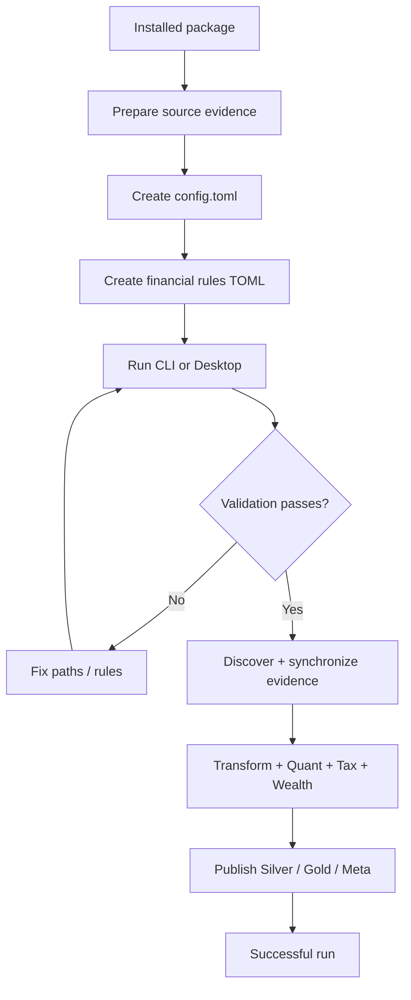
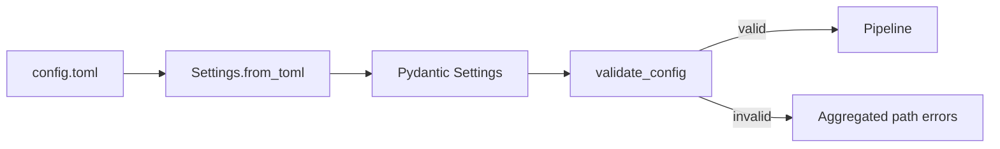
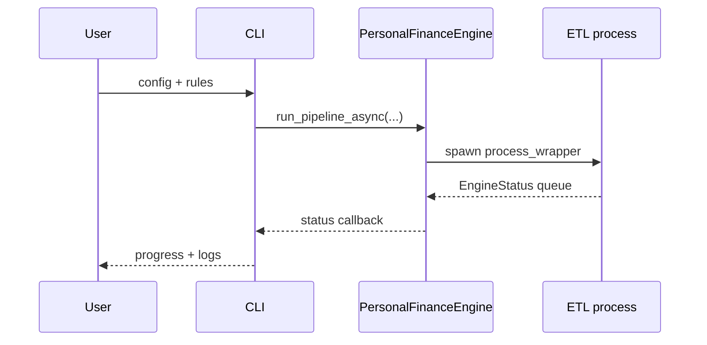
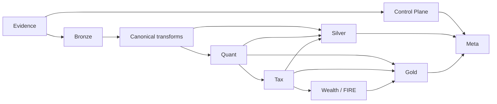

# Quick Start

## Goal

This guide takes a working installation to the first successful ETL run. The target state is not merely “the process exited.” A useful first run should establish:

1. valid physical configuration;
2. valid financial rules;
3. a SQLite Control Plane / Raw Store;
4. a DuckDB warehouse with registered analytical outputs;
5. a successful run record and usable Gold/Meta state.



## 1. Prepare the physical inputs

`Settings.validate_config()` requires two directories and seven dependency files.

### Required directories

| Setting | Role |
|---|---|
| `SOURCE_DB_FOLDER` | source database/input folder |
| `STATEMENTS_FOLDER` | statement artifacts discovered by the pipeline |

### Required dependency files

| Setting | Role |
|---|---|
| `COLUMN_MASTER_PATH` | source-column normalization/mapping |
| `MF_ISIN_CSV_PATH` | mutual-fund ISIN mapping |
| `BENCHMARK_MAPPING_CSV_PATH` | instrument/benchmark mapping |
| `BENCHMARK_MASTER_CSV_PATH` | benchmark master |
| `MACRO_PARAMETERS_CSV_PATH` | financial-year/macro parameters |
| `OPENING_BALANCE_CSV_PATH` | opening household balances |
| `CURRENCY_MAPPING_CSV_PATH` | currency mapping |

`TARGET_DB_BASE_PATH` must also be non-empty. The directory itself may be created by the application; the source directories/files above must already exist.

## 2. Create `config.toml`

A minimal shape follows the current `Settings` model:

```toml
SOURCE_DB_FOLDER = "C:/path/to/source-db-folder"
TARGET_DB_BASE_PATH = "C:/path/to/output"
TARGET_DB_NAME = "Personal_Finance_DB.duckdb"
RAW_DOCUMENT_STORE_NAME = "Personal_Finance_DB_Raw_Store.sqlite"
STATEMENTS_FOLDER = "C:/path/to/statements"

COLUMN_MASTER_PATH = "C:/path/to/column_master.csv"
MF_ISIN_CSV_PATH = "C:/path/to/mf_isin.csv"
BENCHMARK_MAPPING_CSV_PATH = "C:/path/to/benchmark_mapping.csv"
BENCHMARK_MASTER_CSV_PATH = "C:/path/to/benchmark_master.csv"
MACRO_PARAMETERS_CSV_PATH = "C:/path/to/macro_parameters.csv"
OPENING_BALANCE_CSV_PATH = "C:/path/to/opening_balances.csv"
CURRENCY_MAPPING_CSV_PATH = "C:/path/to/currency_mapping.csv"

[FILE_HASH_POLICY]
csv = true
excel = false
sqlite = false
```

The paths above are placeholders, not repository defaults.

### Important loading behavior

The source implementation is intentionally permissive at parse time:

```python
@classmethod
def from_toml(cls, filepath: str) -> Settings:
    if not os.path.exists(filepath):
        return cls()

    with open(filepath, "rb") as f:
        data = tomllib.load(f)

    cfg = cls(**data)
    PreferencesManager().add_recent_config(filepath)
    return cfg
```

A missing TOML can therefore produce a default `Settings` object. That does **not** make it runnable.

## Configuration validation

The pipeline calls the stronger validation contract:

```python
def validate_config(self) -> None:
    ...
    if errors:
        raise FileNotFoundError(
            "Configuration Validation Failed. The following paths are missing or invalid:\n"
            + "\n".join(errors)
        )
```



This distinction matters during troubleshooting: **parseable is not runnable**.

## 3. Prepare financial rules

The financial-rules TOML is a separate configuration authority. It controls classification, financial assumptions, tax interpretation, portfolio behavior, and FIRE/stochastic parameters.

Do not copy an old rules file blindly. The Pydantic models in `backend/config/financial_rules.py` are the current schema authority, and historical example files can lag the implementation.

Use:

- [Financial Rules Reference](../configuration/financial-rules-reference.md) for the general rule tree;
- [FIRE and Simulation Reference](../configuration/fire-and-simulation-reference.md) for stochastic configuration.

## 4. Run interactively

```bash
shan-fin cli --config "C:/path/config.toml" --rules "C:/path/financial_rules.toml"
```

The CLI displays the selected configuration/rules pair and asks for confirmation before starting.

If paths are omitted, the CLI presents recent paths when available or prompts for new ones.



## 5. Run without confirmation

For scripted-but-observed execution:

```bash
shan-fin cli --config "C:/path/config.toml" --rules "C:/path/financial_rules.toml" --auto
```

For unattended execution that exits after completion:

```bash
shan-fin cli --config "C:/path/config.toml" --rules "C:/path/financial_rules.toml" --cron
```

`--cron` implies `--auto` in the launcher logic.

## 6. Understand what the run does

At a high level:



The first run is usually the broadest because the Control Plane has not previously synchronized the source artifacts. Later runs use artifact identity/hash/synchronization state to decide what needs ingestion, while Silver and Gold remain complete analytical publications from current Bronze state.

## 7. Expected database outputs

Under `TARGET_DB_BASE_PATH`, the configured names default to:

```text
Personal_Finance_DB.duckdb
Personal_Finance_DB_Raw_Store.sqlite
```

The SQLite file is not disposable cache. It contains Control Plane state and retained source/provenance data. Do not back up only DuckDB and assume the application has been fully preserved.

## 8. What success means

A clean CLI run ends with the backend status message:

```text
Process completed cleanly.
```

The process lifecycle also records run status in the Control Plane. For a more defensible validation than “green text appeared,” inspect:

- the latest Control Plane run state;
- expected Silver/Gold contracts;
- Meta row counts;
- application logs for warnings/errors;
- key financial reconciliation outputs relevant to the changed evidence.

See [Testing and Validation](../developer/testing-and-validation.md).

## 9. First snapshot

After establishing a trusted baseline, create a coordinated snapshot:

```bash
shan-fin cli --config "C:/path/config.toml" --snapshot
```

The snapshot operation uses the configured target directory/database names and coordinates the DuckDB + SQLite pair. Detailed recovery semantics belong in [Backup and Restore](../architecture/backup-and-restore.md).

## Failure guide

| Failure | Likely layer | Response |
|---|---|---|
| configuration validation failed | Settings / filesystem | fix every listed missing path |
| financial-rules parse/validation failure | FinancialRules | compare against current Pydantic schema |
| source extraction/schema error | Extract/Bronze | inspect source artifact and mapping contract |
| missing/unregistered analytical output | registry/publication | inspect producer + Data Contract Registry |
| Quant/Tax financial invariant failure | financial engine | inspect the named instrument/event and source evidence |
| abnormal process exit | execution | inspect emitted status/log/failure record |

## What not to do

Do not “fix” a failed first run by deleting one database at random. DuckDB and the SQLite Control Plane have different responsibilities and coordinated recovery semantics.

Do not suppress a validation failure merely to reach Gold. A financial warehouse that finishes by ignoring its own evidence gates is not a successful pipeline; it is a very fast rumor generator.

## Related specifications

- [Configuration Reference](../configuration/configuration-reference.md)
- [Financial Rules Reference](../configuration/financial-rules-reference.md)
- [Data Lifecycle](../architecture/data-lifecycle.md)
- [Warehouse Architecture](../architecture/warehouse-architecture.md)
- [Testing and Validation](../developer/testing-and-validation.md)
- [Backup and Restore](../architecture/backup-and-restore.md)
