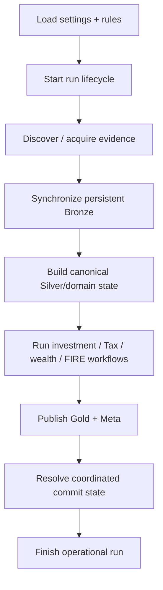

# Quick Start

The goal of a first run is not to exercise every feature.

It is to establish one trustworthy end-to-end loop:

```text
local evidence
    → validated configuration
    → validated financial policy
    → coordinated run
    → inspectable local state
```

If that loop works, everything else becomes easier to reason about.

## 1. Prepare the physical inputs

The canonical runtime settings model requires two directories and several dependency files.

`Settings.validate_config()` currently validates:

```python
required_dirs = [
    ("SOURCE_DB_FOLDER", self.SOURCE_DB_FOLDER),
    ("STATEMENTS_FOLDER", self.STATEMENTS_FOLDER),
]

required_files = [
    ("COLUMN_MASTER_PATH", self.COLUMN_MASTER_PATH),
    ("MF_ISIN_CSV_PATH", self.MF_ISIN_CSV_PATH),
    ("BENCHMARK_MAPPING_CSV_PATH", self.BENCHMARK_MAPPING_CSV_PATH),
    ("BENCHMARK_MASTER_CSV_PATH", self.BENCHMARK_MASTER_CSV_PATH),
    ("MACRO_PARAMETERS_CSV_PATH", self.MACRO_PARAMETERS_CSV_PATH),
    ("OPENING_BALANCE_CSV_PATH", self.OPENING_BALANCE_CSV_PATH),
    ("CURRENCY_MAPPING_CSV_PATH", self.CURRENCY_MAPPING_CSV_PATH),
]
```

Source: `src/personal_finance_etl/config/settings.py`

That list is the current runtime contract. A historical example configuration is never more authoritative than the Pydantic model that actually loads today.

## 2. Create `config.toml`

A minimal shape follows the `Settings` fields:

```toml
SOURCE_DB_FOLDER = "C:/Finance/source-db"
TARGET_DB_BASE_PATH = "C:/Finance/output"
TARGET_DB_NAME = "Personal_Finance_DB.duckdb"
RAW_DOCUMENT_STORE_NAME = "Personal_Finance_DB_Raw_Store.sqlite"

COLUMN_MASTER_PATH = "C:/Finance/config/column_master.csv"
MF_ISIN_CSV_PATH = "C:/Finance/config/mf_isin.csv"
BENCHMARK_MAPPING_CSV_PATH = "C:/Finance/config/benchmark_mapping.csv"
BENCHMARK_MASTER_CSV_PATH = "C:/Finance/config/benchmark_master.csv"
MACRO_PARAMETERS_CSV_PATH = "C:/Finance/config/macro_parameters.csv"
OPENING_BALANCE_CSV_PATH = "C:/Finance/config/opening_balance.csv"
CURRENCY_MAPPING_CSV_PATH = "C:/Finance/config/currency_mapping.csv"
STATEMENTS_FOLDER = "C:/Finance/statements"

[FILE_HASH_POLICY]
csv = true
excel = false
sqlite = false
```

Use local paths appropriate to the actual environment.

The destination directory may be created automatically, but `TARGET_DB_BASE_PATH` itself cannot be blank.

## 3. Understand hashing before changing it

`FILE_HASH_POLICY` controls content hashing by file category.

Hashing participates in incremental evidence identity and deduplication.

Do not disable or alter hashing casually to “make the run faster” without understanding the artifact lifecycle documented in [Control Plane and Artifact Lifecycle](../architecture/control-plane-artifact-lifecycle.md).

## 4. Validate the runtime settings

`Settings.validate_config()` raises a `FileNotFoundError` containing all missing/invalid required paths.

That is deliberate.

A failed config should be fixed before ETL begins rather than converted into a collection of downstream “file not found” surprises.

The model itself separates configuration loading from path validation:

```text
from_toml()
    parses typed settings

validate_config()
    proves required local resources exist
```

## 5. Prepare financial rules

The financial-rules TOML is a separate contract.

This separation prevents runtime topology from becoming mixed with financial meaning.

Configuration answers:

> Where are my files and databases?

Financial rules answer:

> How should my evidence be classified and modeled?

Before changing rules, read:

- [Financial Rules Reference](../configuration/financial-rules-reference.md)
- [FIRE and Simulation Reference](../configuration/fire-and-simulation-reference.md)

A first run should use a rules file whose semantics are understood, not one generated by filling every field with something that “looks reasonable.” Finance has enough ways to be wrong without configuration cosplay.

## 6. Launch the CLI interactively

```bash
shan-fin cli --config "C:/Finance/config.toml" --rules "C:/Finance/rules.toml"
```

Without `--auto`, the CLI keeps the human confirmation step.

That is useful during setup because it gives one last boundary between configuration selection and pipeline mutation.

## 7. Launch the Desktop

Either:

```bash
shan-fin
```

or:

```bash
shan-fin-gui
```

The Desktop uses the same application façade and pipeline as the CLI.

Choose based on workflow, not financial behavior.

## 8. Unattended execution

Once the environment is stable:

```bash
shan-fin cli \
  --config "C:/Finance/config.toml" \
  --rules "C:/Finance/rules.toml" \
  --cron
```

`--cron` implies unattended/automatic execution and exits after completion.

Use it only after interactive runs have established that:

- configuration is valid;
- rules are valid;
- source discovery is stable;
- the pipeline completes cleanly.

Automation should remove repetitive interaction, not remove understanding.

## 9. What the first run actually does

A high-level lifecycle is:



The full sequence is specified in [Data Lifecycle](../architecture/data-lifecycle.md).

## 10. Expected outputs

Under `TARGET_DB_BASE_PATH`, expect the configured database pair:

```text
DuckDB warehouse
SQLite Raw Store / Control Plane
```

The warehouse contains the analytical layers:

```text
Bronze
Silver
Gold
Meta
```

The Control Plane retains operational history and evidence metadata.

Do not inspect one store and assume it tells the whole story.

## 11. What success looks like

A successful run should give you confidence in three dimensions.

### Operational

The run reached a clean lifecycle outcome.

### Analytical

Expected contracts were published and can be queried.

### Financial

The resulting measures/reconciliations are plausible and consistent with known evidence.

The third step matters. A technically successful pipeline can still reveal a financially meaningful discrepancy that deserves investigation.

## 12. Inspect before automating

After the first run:

- inspect Control Plane run history;
- inspect expected Gold tables;
- review reconciliation outputs;
- check high-level cashflow/wealth/investment values against known reality;
- verify any foreign-currency positions have valid FX evidence;
- review Tax/FIRE outputs as evidence/decision support, not statutory prophecy.

The system is designed to surface disagreement. Do not treat every reconciliation warning as a software defect.

## 13. Create the first snapshot

Once the state is trusted:

```bash
shan-fin cli --config "C:/Finance/config.toml" --snapshot
```

Snapshots coordinate the DuckDB and SQLite application state.

For restore semantics and validation, see [Backup and Restore](../architecture/backup-and-restore.md).

## 14. Open the integrated docs

```bash
shan-fin cli --docs
```

The package includes the documentation tree and loads it through the documentation manifest/rendering layer.

This is useful for a local-first project: operational documentation travels with the application instead of requiring a browser tab scavenger hunt.

## 15. Common first-run failures

### Configuration validation fails

Fix all missing/invalid paths reported by `Settings.validate_config()`.

### Financial rules fail to load

Validate the rules model and semantic invariants. Do not bypass policy validation simply to reach the pipeline.

### Provider/source extraction is incomplete

Inspect typed extraction outcomes and Control Plane provider-request history where applicable.

### Warehouse publication fails

Use the contract/schema and testing documentation to identify whether the failure is physical, semantic, or lifecycle-related.

### Reconciliation shows differences

That may be the system doing its job.

Compare reconstructed state with the independent observation and inspect the reconciliation event before deciding which side is wrong.

### Foreign values look suspicious

Check FX evidence and local-vs-base currency semantics. The system intentionally does not treat missing foreign FX as `1.0`.

## 16. What not to do

Do not:

- run against copied configuration without reviewing local paths;
- treat a sample TOML as more authoritative than current models;
- change identity/hash behavior during first setup;
- use `--cron` before interactive behavior is trusted;
- restore one database manually from a coordinated backup;
- “fix” reconciliation by editing outputs until they agree;
- interpret stochastic FIRE percentiles as deterministic forecasts.

## The next question

Once a first run works, the interesting operational question becomes:

> **Which interface should I use for daily work, and how do snapshots, restore, status, preferences, and integrated docs behave?**

That is [CLI and Desktop](cli-and-desktop.md).

## Related specifications

- [Configuration Reference](../configuration/configuration-reference.md)
- [Data Lifecycle](../architecture/data-lifecycle.md)
- [Control Plane and Artifact Lifecycle](../architecture/control-plane-artifact-lifecycle.md)
- [Backup and Restore](../architecture/backup-and-restore.md)
