  
PERSONAL FINANCIAL SYSTEMS ENGINEERING

  <h1>From fragmented financial evidence to explainable financial state.</h1>
  
A local-first personal financial systems platform spanning data engineering, investment accounting, reconciliation, Tax evidence, wealth analytics and FIRE planning.

  

    <a class="pf-btn pf-btn-primary" href="architecture/README/">Explore the System</a>
    <a class="pf-btn pf-btn-secondary" href="architecture/system-architecture/">View Architecture</a>
    <a class="pf-text-link" href="https://github.com/tks18/personal-finance-etl">GitHub ↗</a>
  

  
Python · Polars · DuckDB · SQLite · Power BI

  
Built by <strong>Sudharshan TK · Shan.tk</strong> Chartered Accountant × Data &amp; Software Engineer

Built for one household. Engineered slightly beyond reasonable requirements. 😄

01 · THE PROBLEM

## Personal finance rarely arrives as one clean dataset.

  HouseholdBrokersMarketFXReference

The hard part is not collecting files. It is reconstructing financial state without losing the evidence that produced it.

02 · THE SYSTEM

## One local system. Explicit financial truth.

```mermaid
flowchart LR
    E["Evidence<br/>Household · Brokers · Market · FX"] --> C["Control Plane + Bronze<br/>History · Provenance · Source State"]
    C --> S["Canonical State<br/>Household · Market · Investments"]
    S --> F["Financial Engines<br/>FIFO · Reconciliation · Tax · FIRE"]
    F --> W["Analytical Warehouse<br/>Silver · Gold · Meta"]
    W --> D["Decisions<br/>Power BI · CLI · Desktop"]

    classDef evidence fill:#2563eb,color:#fff,stroke:#60a5fa
    classDef infra fill:#6d28d9,color:#fff,stroke:#a78bfa
    classDef finance fill:#059669,color:#fff,stroke:#34d399
    classDef presentation fill:#27272a,color:#fff,stroke:#71717a

    class E evidence
    class C,W infra
    class S,F finance
    class D presentation
```

03 · FOUR PILLARS

## Finance, data and software engineering in one system.

  <a class="pf-card" href="finance/README/">
    
01 · FINANCIAL ENGINEERING

    <h3>Reconstruct the economics.</h3>
    
FIFO · reconciliation · performance · FX · Tax · wealth · FIRE

  </a>
  <a class="pf-card" href="architecture/README/">
    
02 · DATA PLATFORM

    <h3>Preserve the evidence.</h3>
    
Contracts · lineage · Polars · DuckDB · SQLite Control Plane

  </a>
  <a class="pf-card" href="finance/metrics-and-methodology/">
    
03 · DECISION INTELLIGENCE

    <h3>Serve decisions, not mystery numbers.</h3>
    
Portfolio analytics · household state · Power BI · planning

  </a>
  <a class="pf-card" href="architecture/reliability-and-recovery/">
    
04 · RELIABILITY & SOFTWARE

    <h3>Make the result believable.</h3>
    
Typed architecture · recovery · observability · testing · packaging

  </a>

04 · THE RECEIPTS

## The receipts.

  
<strong>20</strong>Bronze contracts

  
<strong>24</strong>Silver tables

  
<strong>22</strong>Gold tables

  
<strong>53</strong>Canonical specs

  
<strong>10</strong>Control Plane tables

05 · BUILT DIFFERENTLY

## The principles are part of the architecture.

  
<h3>Evidence first.</h3>
Observed and reconstructed state stay distinguishable.

  
<h3>Local first.</h3>
Sensitive personal financial evidence stays local.

  
<h3>Deterministic where possible.</h3>
Identity, reconstruction and replay are explicit.

  
<h3>Explicit about uncertainty.</h3>
Estimates, reconciliation and stochastic futures are labelled as such.

06 · EXPLORE

## Pick the question you want answered.

  <a class="pf-route" href="architecture/system-architecture/"><strong>Understand the Architecture</strong>Ownership, lifecycle, Control Plane, warehouse and reliability. →</a>
  <a class="pf-route" href="finance/README/"><strong>Explore Financial Engineering</strong>Household finance, investments, Tax, wealth and FIRE. →</a>
  <a class="pf-route" href="developer/README/"><strong>Build on the System</strong>Engineering standards, extension paths, testing and release discipline. →</a>
  <a class="pf-route" href="reference/README/"><strong>Verify the Contracts</strong>Physical schemas, grain, identity and ownership. →</a>

07 · CREATOR

## Built by Shan.tk.

  

    <h3>Sudharshan TK</h3>
    
Chartered Accountant × Data &amp; Software Engineer

    
Personal Finance ETL is where finance, data engineering, software architecture and an unreasonable amount of curiosity ended up in the same repository.

    
<strong>Finance gave me the questions. Data gave me the structure. Software engineering let me build the answers.</strong>

  

  

    <a href="https://github.com/tks18">GitHub ↗</a>
    <a href="https://www.linkedin.com/in/sudharshan-tk">LinkedIn ↗</a>
    <a href="about/about-me/">About Shan.tk →</a>
  

  

    READY TO GO DEEPER?
    <h2>Preserve the evidence. Reconstruct the state. Explain the decision.</h2>
  

  <a class="pf-btn pf-btn-primary" href="documentation-guide/">Open the Documentation Guide</a>

