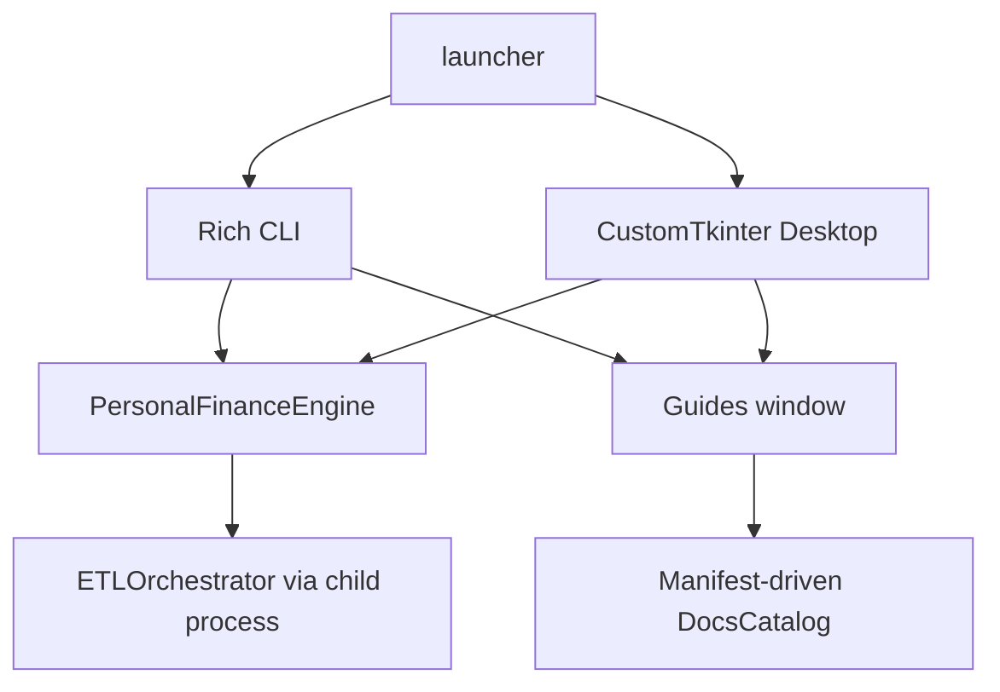

# Interfaces: CLI, desktop, and documentation surfaces

I expose one local financial engine through multiple presentation surfaces. This domain specifies their concrete implementations, callback contracts, process boundaries, and documentation integration. I keep accounting and warehouse semantics in the backend domains rather than repeating them here.

## Interface map

## Read by responsibility

| Specification | Why I wrote it |
|---|---|
| [Application facade](application-facade.md) | shared backend boundary and API |
| [CLI architecture](cli-architecture.md) | commands, prompts, unattended mode, exit behavior |
| [Desktop GUI](desktop-gui-architecture.md) | widgets, callbacks, and UI ownership |
| [Multiprocessing and progress](multiprocessing-and-progress.md) | queue, monitor thread, and terminal status semantics |
| [Documentation renderer](documentation-renderer.md) | manifest, catalog, rendering, and guides window |
## Authority and scope

The backend implementation remains the authority for financial calculations, contracts, and persistence. The CLI and GUI do not implement separate financial pipelines. For architectural placement see [Architecture](../architecture/README.md); for data processing see [Data Engineering](../data-engineering/README.md); for failures and recovery see [Operations](../operations/README.md).
