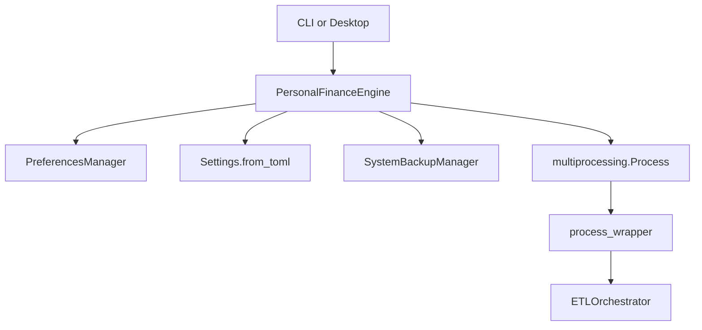

# Application facade and backend boundary

I keep the user-facing surfaces thin and delegate financial processing to the backend. This specification describes the actual implementation, including meaningful failure boundaries rather than inferred guarantees.

## Component responsibility



I expose `PersonalFinanceEngine` as the shared application-facing API. It owns recent-path preferences, lightweight settings validation, coordinated backup and restore delegation, and asynchronous pipeline launch. It does not calculate investment metrics itself.
## Callable surface

| Method | Input | Observable result |
|---|---|---|
| `get_recent_configs` | none | stored configuration paths |
| `get_recent_rules` | none | stored rules paths |
| `add_recent_rules` | path | updates preferences |
| `validate_config` | path | boolean; exceptions suppressed |
| `snapshot_database` | config path | snapshot path or `None` |
| `restore_database` | config path, archive | boolean; `PermissionError` propagated |
| `run_pipeline_async` | config, rules, callback | starts child and monitor thread |

**Source:** `src/personal_finance_etl/backend/api/engine.py` (around line 13)

```python
class PersonalFinanceEngine:
    """Unified Facade for the entire Personal Finance Backend."""

    def __init__(self) -> None:
        self._prefs = PreferencesManager()

    # --- Configuration Management ---

    def get_recent_configs(self) -> list[str]:
        return self._prefs.get_recent_configs()

    def get_recent_rules(self) -> list[str]:
        return self._prefs.get_recent_rules()

```


## Backup API semantics

**Source:** `src/personal_finance_etl/backend/api/engine.py` (around line 39)

```python
    def snapshot_database(self, config_path: str) -> str | None:
        """Creates a backup snapshot of the DuckDB instance."""
        try:
            cfg = Settings.from_toml(config_path)
            backup_mgr = SystemBackupManager(
                cfg.TARGET_DB_BASE_PATH,
                sqlite_db_name=cfg.RAW_DOCUMENT_STORE_NAME,
                duckdb_name=cfg.TARGET_DB_NAME,
            )
            return backup_mgr.create_snapshot()
        except Exception:
            return None

    def restore_database(self, config_path: str, backup_zip_path: str) -> bool:
        """Restores the DuckDB and SQLite Raw Store from a coordinated backup zip."""
```

**Source:** `src/personal_finance_etl/backend/api/engine.py` (around line 52)

```python
    def restore_database(self, config_path: str, backup_zip_path: str) -> bool:
        """Restores the DuckDB and SQLite Raw Store from a coordinated backup zip."""
        try:
            cfg = Settings.from_toml(config_path)
            backup_mgr = SystemBackupManager(
                cfg.TARGET_DB_BASE_PATH,
                sqlite_db_name=cfg.RAW_DOCUMENT_STORE_NAME,
                duckdb_name=cfg.TARGET_DB_NAME,
            )
            backup_mgr.restore_snapshot(backup_zip_path)
            return True
        except PermissionError as pe:
            # We want to bubble up the detailed PermissionError for UI to show
            raise pe
        except Exception:
            return False

    # --- Pipeline Execution ---
```

I do not treat the facade return values as complete diagnostics. Most backup errors become `None` or `False`, while restore permission failures are explicitly re-raised. For backup integrity and rollback semantics see [Operations](../operations/README.md).
## Asynchronous execution contract

**Source:** `src/personal_finance_etl/backend/api/engine.py` (around line 71)

```python
    def run_pipeline_async(
        self,
        config_path: str,
        rules_path: str,
        on_status: Callable[[EngineStatus], None],
    ) -> None:
        """
        Spawns the multiprocessing ETL pipeline and fires the callback
        whenever a status update is received.
        """
        status_queue: multiprocessing.Queue[EngineStatus | tuple[str, Any | None, float | None]] = (
            multiprocessing.Queue()
        )

        process = multiprocessing.Process(
            target=process_wrapper,
            args=(status_queue, config_path, rules_path),
            daemon=True,
```

The method starts a daemon child process and then starts a daemon monitoring thread. Its return value is `None`; completion and failure are reported through `on_status`, not through a synchronous result or a returned future.
## Design boundary

I deliberately share this facade between CLI and GUI to avoid two competing pipeline implementations. The callback contract is user-interface-facing, while durable run outcomes are owned by the Control Plane. See [Run lifecycle](../control-plane/run-lifecycle.md).
