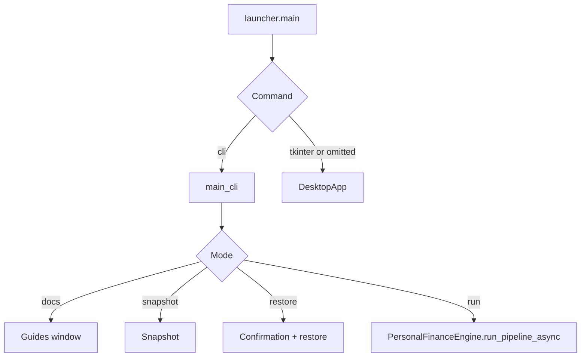

# CLI architecture and command dispatch

I keep the user-facing surfaces thin and delegate financial processing to the backend. This specification describes the actual implementation, including meaningful failure boundaries rather than inferred guarantees.

## Entry-point dispatch



**Source:** `src/personal_finance_etl/frontend/launcher.py` (around line 8)

```python
def main() -> None:
    multiprocessing.freeze_support()

    parser = argparse.ArgumentParser(description="Personal Finance Quant Engine")
    subparsers = parser.add_subparsers(dest="command", help="Frontend to launch")

    # CLI Subcommand
    cli_parser = subparsers.add_parser("cli", help="Launch the savage terminal CLI")
    cli_parser.add_argument("--config", type=str, help="Path to config.toml", default=None)
    cli_parser.add_argument("--rules", type=str, help="Path to rules.toml", default=None)
    cli_parser.add_argument(
        "--snapshot",
        action="store_true",
        help="Snapshot the DuckDB database instead of running ETL",
    )
    cli_parser.add_argument(
```


## CLI options

| Option | Source behavior |
|---|---|
| `--config` | supplies operational TOML path |
| `--rules` | supplies financial rules TOML path |
| `--auto` | bypasses run confirmation |
| `--cron` | implies `--auto`, exits after a run; **does not schedule recurring execution** |
| `--snapshot` | invokes snapshot branch and exits |
| `--restore PATH` | prompts for confirmation before restoring |
| `--docs` | launches documentation window and exits |

**Source:** `src/personal_finance_etl/frontend/launcher.py` (around line 16)

```python
    cli_parser.add_argument("--config", type=str, help="Path to config.toml", default=None)
    cli_parser.add_argument("--rules", type=str, help="Path to rules.toml", default=None)
    cli_parser.add_argument(
        "--snapshot",
        action="store_true",
        help="Snapshot the DuckDB database instead of running ETL",
    )
    cli_parser.add_argument(
        "--restore",
        type=str,
        help="Path to backup zip file to restore (requires --config)",
        default=None,
    )
    cli_parser.add_argument(
        "--auto",
        action="store_true",
        help="Bypass confirmation prompts and automatically start the pipeline",
```


## Interactive resolution

When paths are absent I present stored recent paths and allow manual entry. I separate config and rules selection and persist the chosen rules path. `--auto` skips the run confirmation, not every prompt needed to resolve missing paths.

**Source:** `src/personal_finance_etl/frontend/cli/app.py` (around line 71)

```python
def get_file_interactive(prompt_text: str, recents: list[str]) -> str:
    if not recents:
        return Prompt.ask(f"[bold cyan]Enter path for {prompt_text}[/bold cyan]")

    console.print(f"\n[bold yellow]--- Recent {prompt_text} ---[/bold yellow]")
    for i, path in enumerate(recents, 1):
        console.print(f"[{i}] [cyan]{path}[/cyan]")
    console.print(f"[{len(recents) + 1}] [magenta]Enter a new path manually...[/magenta]")

    while True:
        choice = Prompt.ask(
            f"[bold cyan]Select {prompt_text} (1-{len(recents) + 1})[/bold cyan]", default="1"
        )
        try:
            choice_idx = int(choice) - 1
            if 0 <= choice_idx < len(recents):
```


## Progress and completion

The CLI uses Rich progress and an event to wait for a terminal status message. The callback renders messages according to `LogLevel`, and progress fractions are multiplied by 100.

**Source:** `src/personal_finance_etl/frontend/cli/app.py` (around line 229)

```python
                if status.progress is not None:
                    # Update bar (backend sends 0.0 to 1.0)
                    progress.update(main_task, completed=status.progress * 100.0)

                if (
                    status.msg in ("Process completed cleanly.", "Process exited abnormally.")
                    or "Critical Pipeline Failure" in status.msg
                ):
                    completion_event.set()

            engine.run_pipeline_async(config_path, rules_path, on_status)

            try:
                completion_event.wait()
```


## Exit-status caveat

The current CLI unconditionally sets progress to 100 after the completion event, prints its normal completion banner, and `--cron` exits with code 0 even if the callback received an abnormal completion message. I do **not** promise reliable nonzero process exit status for failed unattended runs. This is a source-level limitation, not an endorsement of that behavior.

**Source:** `src/personal_finance_etl/frontend/cli/app.py` (around line 242)

```python
                completion_event.wait()
                # Force progress to 100% on clean completion
                progress.update(main_task, completed=100.0)
            except KeyboardInterrupt:
                progress.console.print(
                    "\n[bold red]Pipeline forcefully terminated by user.[/bold red]"
                )
                sys.exit(1)

        console.print("\n[bold green]=== SYSTEM HALTED. OPERATION COMPLETE. ===[/bold green]\n")

        if cron_mode:
            sys.exit(0)

        console.print("\n[bold cyan]--- What would you like to do next? ---[/bold cyan]")
        console.print("[1] Restart pipeline with PREVIOUS configuration")
        console.print("[2] Restart pipeline with NEW configuration")
```


## Scope

The CLI is a presentation and command-dispatch layer, not a separate scheduler or ETL engine. For backend failure semantics see [Operations](../operations/README.md).
