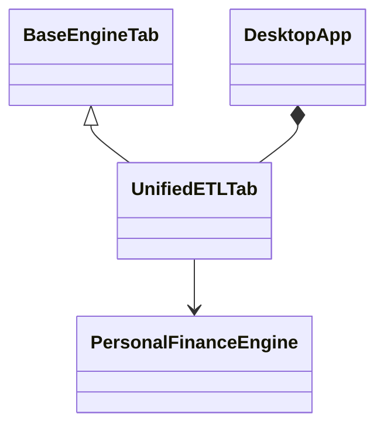

# Desktop GUI architecture

I keep the user-facing surfaces thin and delegate financial processing to the backend. This specification describes the actual implementation, including meaningful failure boundaries rather than inferred guarantees.

## UI composition



I use CustomTkinter for the desktop shell. `UnifiedETLTab` derives from `BaseEngineTab`, which centralizes the log panel, progress widgets, and common styling. `DesktopApp` owns the top-level window and embeds the ETL tab.
## Component entry points

**Source:** `src/personal_finance_etl/frontend/desktop/app.py` (around line 24)

```python
class UnifiedETLTab(BaseEngineTab):
    """Unified Control Panel for the ETL, Benchmark, and Quant Engines."""

    def __init__(self, parent: ctk.CTk | ctk.CTkFrame) -> None:
        super().__init__(parent)

        self.engine = PersonalFinanceEngine()
        self._run_btn_text = "▶  Run Pipeline"
        self.config_path_var = ctk.StringVar()
        self.rules_path_var = ctk.StringVar()

        self._build_header()
        self._build_log_panel()
        self._configure_log_tags()

```

**Source:** `src/personal_finance_etl/frontend/desktop/app.py` (around line 402)

```python
class DesktopApp(ctk.CTk):  # type: ignore
    """Root application window."""

    def __init__(self) -> None:
        super().__init__()
        self.title("Shan's Personal Finance ETL")
        self.geometry("960x660")
        self.minsize(760, 500)
        self.configure(fg_color="#0D1117")

        icon_path = resource_path("logo.ico")
        if os.path.exists(icon_path):
            self.after(200, lambda: self.iconbitmap(icon_path))

        self.grid_columnconfigure(0, weight=1)
        self.grid_rowconfigure(0, weight=1)
```


## User actions

| Callback | Responsibility |
|---|---|
| `_on_config_selected` | react to selected configuration |
| `_select_file` | choose a local file |
| `_start_pipeline` | begin backend pipeline |
| `_snapshot_db` | request coordinated snapshot |
| `_restore_db` | initiate restore workflow |

**Source:** `src/personal_finance_etl/frontend/desktop/app.py` (around line 294)

```python
    def _start_pipeline(self) -> None:
        self.run_btn.configure(state="disabled", text="Running...")
        self.status_log.configure(state="normal")
        self.status_log.delete("1.0", "end")
        self.status_log.configure(state="disabled")

        self.engine.run_pipeline_async(
            config_path=self.config_path_var.get(),
            rules_path=self.rules_path_var.get(),
            on_status=lambda status: self.handle_status(self.run_btn, status),
        )

```

**Source:** `src/personal_finance_etl/frontend/desktop/app.py` (around line 340)

```python
    def _restore_db(self) -> None:
        zip_path = filedialog.askopenfilename(
            title="Select Snapshot ZIP",
            filetypes=[("Zip files", "*.zip")],
        )
        if not zip_path:
            return

        # Disable buttons
        self.run_btn.configure(state="disabled")
        self.snapshot_btn.configure(state="disabled")
        self.restore_btn.configure(state="disabled", text="Restoring...")

        # Run safely
        try:
```


## Progress and log panel

**Source:** `src/personal_finance_etl/frontend/desktop/base_tab.py` (around line 30)

```python
    def _build_log_panel(self) -> None:
        panel = ctk.CTkFrame(self, fg_color=Color.BG, corner_radius=0)
        panel.grid(row=1, column=0, sticky="nsew")
        panel.grid_columnconfigure(1, weight=1)
        panel.grid_rowconfigure(0, weight=1)

        content = ctk.CTkFrame(panel, fg_color="transparent")
        content.grid(row=0, column=1, sticky="nsew")
        content.grid_columnconfigure(0, weight=1)
        content.grid_rowconfigure(1, weight=1)

        prog = ctk.CTkFrame(content, fg_color="transparent")
        prog.grid(row=0, column=0, sticky="ew", padx=14, pady=(10, 0))
        prog.grid_columnconfigure(0, weight=1)

        self.progress = ctk.CTkProgressBar(
            prog,
```

**Source:** `src/personal_finance_etl/frontend/desktop/base_tab.py` (around line 83)

```python
    def _set_progress(self, value: float) -> None:
        self.progress.set(value)
        self.pct_label.configure(text=f"{int(value * 100)}%")

    def _log(self, msg: str, level: str = "info") -> None:
        ts = time.strftime("%H:%M:%S")
```

I present transient progress and logs in the interface. These widgets are not substitutes for persisted Control Plane run history. A visually completed progress bar is not a durable transaction commit record.
## Error boundaries

I distinguish GUI exception handling and status messaging from backend transaction guarantees. The facade catches some backup errors and propagates permission errors; the child-process monitor reports process exit status separately. See [Multiprocessing and progress](multiprocessing-and-progress.md).
