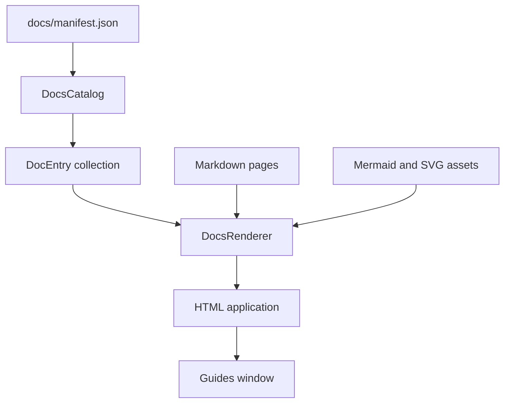

# Manifest-driven documentation interface

I keep the user-facing surfaces thin and delegate financial processing to the backend. This specification describes the actual implementation, including meaningful failure boundaries rather than inferred guarantees.

## Documentation delivery architecture



I use one manifest-driven catalog for documentation discovery and ordering. The renderer consumes that catalog and builds an HTML application. The guides window exposes the result from the application interfaces.
## Manifest contract

**Source:** `src/personal_finance_etl/frontend/commons/docs/manifest.py` (around line 7)

```python
class DocEntry:
    section: str
    title: str
    path: str
    order: int


class DocsCatalog:
    def __init__(self, docs_dir: str):
        self.docs_dir = docs_dir
        self.manifest_path = os.path.join(docs_dir, "manifest.json")
        self.catalog: list[DocEntry] = self._build_catalog()

    def _build_catalog(self) -> list[DocEntry]:
        catalog: list[DocEntry] = []
```

**Source:** `src/personal_finance_etl/frontend/commons/docs/manifest.py` (around line 20)

```python
    def _build_catalog(self) -> list[DocEntry]:
        catalog: list[DocEntry] = []
        if not os.path.exists(self.manifest_path):
            return catalog

        with open(self.manifest_path, encoding="utf-8") as f:
            manifest_data = json.load(f)

        for section_data in manifest_data.get("sections", []):
            section_title = section_data.get("title", "")
            for page in section_data.get("pages", []):
                catalog.append(
                    DocEntry(
                        section=section_title,
                        title=page.get("title", ""),
                        path=page.get("path", ""),
                        order=page.get("order", 9999),
                    )
```

The manifest contains `sections`, each with a section `title` and `pages`. Pages supply `title`, `path`, and optional `order` (default 9999). `DocsCatalog` sorts all entries by `(order, title)` and groups them by section label.
## Rendering pipeline

**Source:** `src/personal_finance_etl/frontend/commons/docs/renderer.py` (around line 13)

```python
class DocsRenderer:
    def __init__(self, catalog: DocsCatalog):
        self.catalog = catalog

    def _inject_logo(self, text: str, src_pattern: str) -> str:
        logo_path = resource_path("logo.png")
        if os.path.exists(logo_path):
            with open(logo_path, "rb") as img_f:
                b64_logo = base64.b64encode(img_f.read()).decode("utf-8")
                return text.replace(src_pattern, f'src="data:image/png;base64,{b64_logo}"')
        return text

    @staticmethod
    def _load_mermaid_js() -> str:
        """Load the bundled Mermaid runtime."""
```

**Source:** `src/personal_finance_etl/frontend/commons/docs/renderer.py` (around line 77)

```python
    def build_html_app(self) -> str:
        """Read all markdown docs and compile them into a single HTML web app string."""
        docs_to_render: dict[str, dict[str, str]] = {}
        path_to_title: dict[str, str] = {}

        docs_dir = self.catalog.docs_dir
        mermaid_js = self._load_mermaid_js()
        svg_pan_zoom_js = self._load_svg_pan_zoom_js()

        for entry in self.catalog.get_all_docs():
            full_path = os.path.normpath(os.path.join(docs_dir, entry.path))
            # Canonical document identity is repository/package-root relative.
            # Manifest entries are relative to docs/, so prefix with docs/ first:
            #   ../README.md -> README.md
            #   README.md    -> docs/README.md
            #   finance/x.md -> docs/finance/x.md
            manifest_path = entry.path.replace("\\", "/")
            norm_path = posixpath.normpath(posixpath.join("docs", manifest_path))
```

The renderer handles Markdown-to-HTML presentation and embedded diagram resources. The actual implementation should be consulted for asset resolution and browser integration; I do not assume every Markdown or Mermaid feature is supported by every rendering surface.
## Guides window

**Source:** `src/personal_finance_etl/frontend/commons/docs/guides_window.py` (around line 16)

```python
def show_guides_window() -> None:
    """Create and show the pywebview documentation window."""
    docs_dir = resource_path("docs")
    catalog = DocsCatalog(docs_dir)
    renderer = DocsRenderer(catalog)

    html = renderer.build_html_app()
    icon_path = resource_path("logo.ico")

    # WebView2's NavigateToString() has a hard ~1.5 MB limit on the HTML string.
    # Writing to a temp file and using url= bypasses this entirely.
    tmp_html = tempfile.NamedTemporaryFile(
        mode="w",
        suffix=".html",
        encoding="utf-8",
        delete=False,
```

The CLI `--docs` branch opens the same guides-window implementation. The desktop uses the common docs infrastructure rather than maintaining a separate hardcoded page list.
## Manifest maintenance invariant

A Markdown file added to `/docs` is not automatically discoverable. I must add it to `manifest.json`, update paths when files move, remove obsolete entries, and validate that each referenced path exists. I will perform the final manifest reconciliation after all documentation subfolders and the docs root README are complete.
## Compatibility and navigation

I distinguish a link resolving in the GitHub repository from a page being discoverable in the in-app documentation catalog. Both require validation. See [Developer](../developer/README.md) for extension practices and [Getting Started](../getting-started/README.md) for user-facing instructions.
