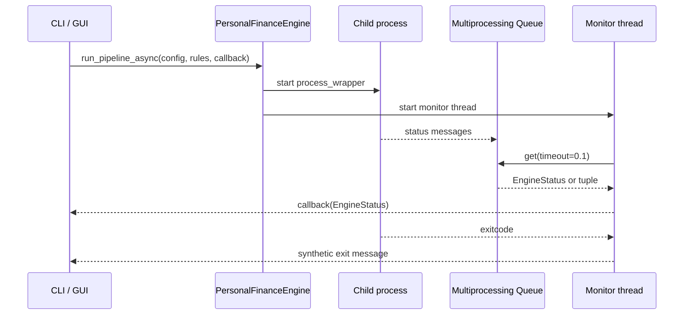

# Multiprocessing, status messages, and progress

I keep the user-facing surfaces thin and delegate financial processing to the backend. This specification describes the actual implementation, including meaningful failure boundaries rather than inferred guarantees.

## Process and thread topology



I use a multiprocessing queue to decouple backend execution from UI presentation. A monitor thread consumes queue items while the process is alive or messages remain buffered.
## Status conversion

**Source:** `src/personal_finance_etl/backend/api/engine.py` (around line 100)

```python
                    if isinstance(item, tuple):
                        msg, data, prog = item
                        status = EngineStatus(
                            msg=str(msg) if msg else "",
                            data=data,
                            progress=float(prog) if prog is not None else None,
                        )
                        # Infer level
                        if msg:
                            lw = str(msg).lower()
                            if "error" in lw or msg.startswith("Error"):
                                status.level = LogLevel.ERROR
                            elif (
                                "✅" in msg
                                or "complete" in lw
                                or "success" in lw
                                or "✓" in msg
                                or "exported" in lw
                            ):
```

The monitor converts legacy `(message, data, progress)` tuples to `EngineStatus` and infers severity from message text. Already-typed `EngineStatus` values pass through. This inference is heuristic, not a formal error taxonomy.
## Terminal signals

**Source:** `src/personal_finance_etl/backend/api/engine.py` (around line 142)

```python
            if process.exitcode is not None:
                if process.exitcode != 0:
                    on_status(
                        EngineStatus(msg="Process exited abnormally.", data=None, progress=0.0)
                    )
                else:
                    on_status(
                        EngineStatus(msg="Process completed cleanly.", data=None, progress=1.0)
                    )

        threading.Thread(target=_queue_monitor, daemon=True).start()
```

After draining the queue, the monitor emits an additional synthetic clean or abnormal exit message. Consumers should not assume one and only one completion message, because the child can also emit a terminal message.
## Progress units and presentation

The backend progress model uses fractional values, typically 0 to 1. Rich CLI converts fractions to a 0–100 display. Desktop progress uses a fractional progress bar. Neither progress value proves that both DuckDB and SQLite committed atomically.

**Source:** `src/personal_finance_etl/frontend/cli/app.py` (around line 229)

```python
                if status.progress is not None:
                    # Update bar (backend sends 0.0 to 1.0)
                    progress.update(main_task, completed=status.progress * 100.0)

                if (
```

**Source:** `src/personal_finance_etl/frontend/desktop/base_tab.py` (around line 83)

```python
    def _set_progress(self, value: float) -> None:
        self.progress.set(value)
        self.pct_label.configure(text=f"{int(value * 100)}%")

    def _log(self, msg: str, level: str = "info") -> None:
```


## Failure and cancellation boundaries

The child is started as a daemon process. The CLI catches `KeyboardInterrupt` in its wait path, but the shown code does not establish a general-purpose cancellation protocol or reliable unattended nonzero exit codes. I keep operational failure guarantees in [Operations](../operations/README.md), not in progress UI claims.
