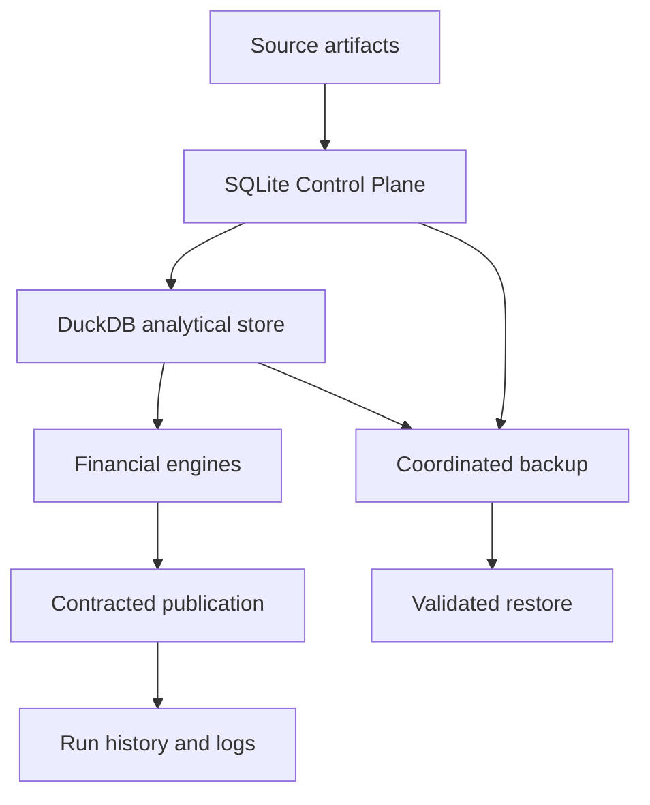

# Operations and production behavior

I run this financial platform as a local, operational system. This domain records how I handle transactions, failures, snapshots, observability, and performance without confusing operational evidence with guarantees that the implementation cannot provide.

## Operational map

I separate operational authority from analytical state. The Control Plane retains durable history while DuckDB materializes analytical outputs.
## Read by responsibility

| Specification | Responsibility |
|---|---|
| [Reliability and recovery](reliability-and-recovery.md) | recovery model, limits and invariants |
| [Transaction boundaries](transaction-boundaries.md) | SQLite and DuckDB ordering |
| [Backup and restore](backup-and-restore.md) | snapshot and restoration mechanics |
| [Performance](performance-and-benchmarking.md) | workloads and measurement discipline |
| [Observability](observability-and-run-history.md) | execution evidence and diagnostics |
| [Failure scenarios](failure-scenarios.md) | explicit failure and recovery matrix |
## Cross-domain authority

For run-state implementation see [Control Plane](../control-plane/run-lifecycle.md); for ingestion semantics see [Data Engineering](../data-engineering/README.md); for user commands see [Interfaces](../interfaces/README.md). The exact physical schemas belong in [Reference](../reference/README.md).
