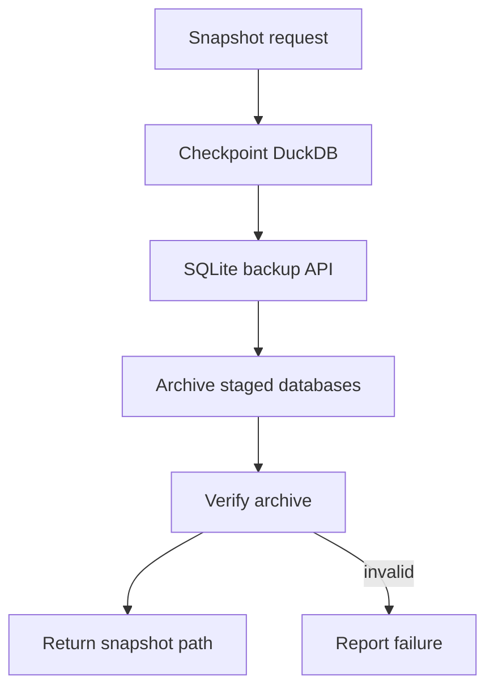
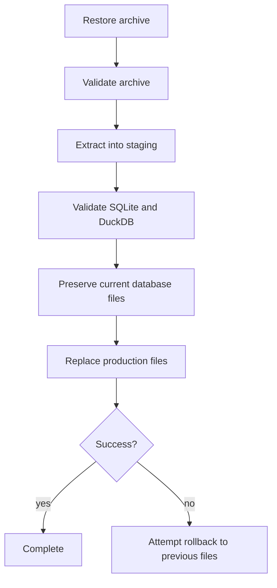

# Coordinated backup and restore

I provide a coordinated snapshot and restore workflow for my two local database files. Its correctness depends on checkpointing, validation, staged replacement, and preserving the previous files during a failed restore.

## Snapshot path



I do not treat a ZIP file as a trustworthy backup merely because it exists. The implementation checkpoints and validates database copies and verifies the archive before reporting a successful snapshot.
## Backup manager

**Implementation:** `backend/load/backup.py` near line 17.

```python
class SystemBackupManager:
    """Coordinate SQLite Control Plane and DuckDB state as one recovery unit."""

    def __init__(
        self,
        base_path: str,
        sqlite_db_name: str = "Raw_Documents.sqlite",
        duckdb_name: str = "Personal_Finance_DB.duckdb",
    ):
        self.base_path = base_path
        self.sqlite_path = os.path.join(base_path, sqlite_db_name)
        self.duckdb_path = os.path.join(base_path, duckdb_name)
        self.backup_dir = os.path.join(base_path, "backups")
        os.makedirs(self.backup_dir, exist_ok=True)

```

**Implementation:** `backend/load/backup.py` near line 33.

```python
    def _checkpoint_duckdb(db_path: str) -> None:
        """Flush committed DuckDB state before a filesystem-level snapshot."""

        connection = duckdb.connect(db_path)
        try:
            connection.execute("CHECKPOINT")
        finally:
            connection.close()

    @staticmethod
    def _validate_sqlite(db_path: str) -> None:
        connection = sqlite3.connect(f"file:{db_path}?mode=ro", uri=True)
```

**Implementation:** `backend/load/backup.py` near line 57.

```python
    def create_snapshot(self) -> str | None:
        """Create an atomic archive of a checkpointed, coordinated database pair."""
        missing = [
            os.path.basename(path)
            for path in (self.sqlite_path, self.duckdb_path)
            if not os.path.isfile(path)
        ]
        if missing:
            logger.error(
                "Cannot create coordinated snapshot. Missing required database(s): "
                + ", ".join(missing)
            )
            return None

        lock_path = os.path.join(self.base_path, "pipeline.lock")
        temp_sqlite: str | None = None
```


## Restore path



**Implementation:** `backend/load/backup.py` near line 144.

```python
    def restore_snapshot(self, zip_path: str) -> None:
        """Restore the pair atomically, rolling back to the complete prior pair on failure."""
        if not os.path.isfile(zip_path):
            raise FileNotFoundError(f"Backup file not found: {zip_path}")

        lock_path = os.path.join(self.base_path, "pipeline.lock")
        temp_root = get_temp_dir()
        os.makedirs(temp_root, exist_ok=True)
        temp_extract_dir = tempfile.mkdtemp(prefix="snapshot_restore_", dir=temp_root)

        try:
            with FileLock(lock_path, timeout=0):
                required_names = {
                    os.path.basename(self.sqlite_path),
                    os.path.basename(self.duckdb_path),
                }
                duckdb_wal_name = os.path.basename(self.duckdb_path) + ".wal"
```


## Validation and rollback limits

I validate extracted databases before replacing the production files. I preserve prior files for rollback if replacement fails. This is a coordinated file-restoration workflow, not a live two-database atomic commit. External consumers should not keep database connections open during restoration.
## User-facing entry points

**Implementation:** `backend/api/engine.py` near line 39.

```python
    def snapshot_database(self, config_path: str) -> str | None:
        """Creates a backup snapshot of the DuckDB instance."""
        try:
            cfg = Settings.from_toml(config_path)
            backup_mgr = SystemBackupManager(
                cfg.TARGET_DB_BASE_PATH,
                sqlite_db_name=cfg.RAW_DOCUMENT_STORE_NAME,
                duckdb_name=cfg.TARGET_DB_NAME,
            )
            return backup_mgr.create_snapshot()
        except Exception:
            return None

```

**Implementation:** `backend/api/engine.py` near line 52.

```python
    def restore_database(self, config_path: str, backup_zip_path: str) -> bool:
        """Restores the DuckDB and SQLite Raw Store from a coordinated backup zip."""
        try:
            cfg = Settings.from_toml(config_path)
            backup_mgr = SystemBackupManager(
                cfg.TARGET_DB_BASE_PATH,
                sqlite_db_name=cfg.RAW_DOCUMENT_STORE_NAME,
                duckdb_name=cfg.TARGET_DB_NAME,
            )
            backup_mgr.restore_snapshot(backup_zip_path)
            return True
        except PermissionError as pe:
            # We want to bubble up the detailed PermissionError for UI to show
            raise pe
        except Exception:
```

The facade may translate backup failures into `None` or `False`, with permission errors treated separately. The CLI restore path requires confirmation. For actual command behavior see [CLI architecture](../interfaces/cli-architecture.md).
## Failure considerations

I distinguish archive corruption, schema validation failure, file permissions, database locks, and interrupted replacement. The implementation can mitigate some of these; it cannot guarantee restoration after power loss during every filesystem operation.
