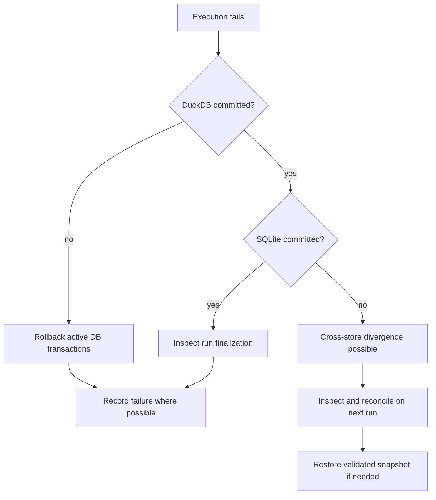

# Failure scenarios and recovery matrix

I model failures by the state that survives them. This prevents vague promises such as “the whole pipeline always rolls back” when two independent databases are involved.

## Failure decision flow



I separate recoverable transactional work from already-committed state. The exact response depends on the failure point.
## Scenario matrix

| Scenario | Possible surviving state | Response and boundary |
|---|---|---|
| Source parse fails before commit | run identity and failure evidence | rollback active analytical work |
| DuckDB transaction fails | SQLite run metadata may remain | rollback where possible and mark failure |
| SQLite commit fails after DuckDB commit | DuckDB ahead of Control Plane | reconcile; not globally atomic |
| Missing source artifact | historical identity may remain | synchronize removals according to policy |
| Stale process termination | incomplete run state | stale-run recovery logic |
| Snapshot archive invalid | existing DB files should remain | reject before replacement |
| Restore replacement interrupted | partial filesystem state possible | attempt rollback; manual recovery may be required |
| CLI child fails in cron mode | failure status can be displayed but exit code 0 | do not rely solely on process exit status |
## Commit divergence

**Implementation:** `backend/pipeline/etl_pipeline.py` near line 248.

```python
    def run(self) -> None:
        self.cfg.validate_config()

        validate_registry()

        start_time = time.perf_counter()

        run_id = None
        cp = None
        log_file_path = self.db_manager.db_path.replace(".duckdb", ".log")

        try:
            add_queue_handler(cast("multiprocessing.Queue[Any]", self.status_queue))
            add_file_handler(log_file_path)
```

The two database commit calls are independent. I therefore document healing and snapshot restoration as separate operational tools rather than a distributed transaction substitute.
## Backup restore failures

**Implementation:** `backend/load/backup.py` near line 144.

```python
    def restore_snapshot(self, zip_path: str) -> None:
        """Restore the pair atomically, rolling back to the complete prior pair on failure."""
        if not os.path.isfile(zip_path):
            raise FileNotFoundError(f"Backup file not found: {zip_path}")

        lock_path = os.path.join(self.base_path, "pipeline.lock")
        temp_root = get_temp_dir()
        os.makedirs(temp_root, exist_ok=True)
        temp_extract_dir = tempfile.mkdtemp(prefix="snapshot_restore_", dir=temp_root)

        try:
            with FileLock(lock_path, timeout=0):
                required_names = {
                    os.path.basename(self.sqlite_path),
                    os.path.basename(self.duckdb_path),
                }
```

The restore path validates staged copies before replacement and preserves old files for rollback. I do not claim immunity to arbitrary filesystem interruption.
## Operator response

I begin with the Control Plane run record and compressed logs, then inspect artifact events and physical analytical state. If integrity is in doubt, I restore from a verified snapshot rather than assume an incomplete run left everything unchanged.
## Known gaps and test targets

Runtime fixtures should exercise interrupted commit ordering, stale runs, invalid archives, locked files, and CLI child failures. I avoid treating ordinary daily success as proof of these exceptional branches.
