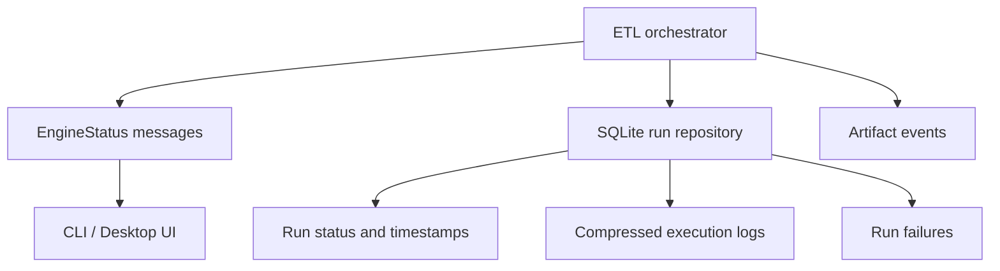

# Observability, run history, and execution evidence

I use a dedicated operational history to distinguish a run that was started, a run that completed, and a run whose UI merely reached a terminal progress message.

## Evidence flow



The UI status stream is ephemeral. The Control Plane records durable operational metadata, including failure and log evidence.
## Run repository

**Implementation:** `backend/load/control_plane/run_repo.py` near line 33.

```python
    def start_run(self, cfg_json: str | None = None, rules_json: str | None = None) -> str:
        run_id = str(uuid.uuid4())
        now = datetime.now().isoformat(timespec="seconds")
        settings_id: str | None = None
        rules_id: str | None = None
        with self.db.atomic():
            for payload, prefix, table in (
                (cfg_json, "snap_set_", "cp_settings_snapshots"),
                (rules_json, "snap_rule_", "cp_rules_snapshots"),
            ):
                if not payload:
                    continue
                canonical = self._canonical_json(payload)
                digest = hashlib.sha256(canonical.encode("utf-8")).hexdigest()
                snapshot_id = f"{prefix}{digest}"
```

**Implementation:** `backend/load/control_plane/run_repo.py` near line 81.

```python
    def update_run_status(self, run_id: str, status: str) -> None:
        normalized_status = status.strip().upper()
        if not normalized_status:
            raise ValueError("Run status must be a non-empty string.")
        with self.db.atomic():
            cursor = self.db.conn.execute(
                "UPDATE cp_runs SET status = ? WHERE run_id = ?", (normalized_status, run_id)
            )
            if cursor.rowcount != 1:
                raise KeyError(f"Cannot update unknown run ID: {run_id}")

    def save_execution_log(self, run_id: str, log_data: bytes) -> None:
```

**Implementation:** `backend/load/control_plane/run_repo.py` near line 100.

```python
    def finish_run(self, run_id: str, status: str) -> None:
        normalized_status = status.strip().upper()
        if not normalized_status:
            raise ValueError("Run status must be a non-empty string.")
        now = datetime.now().isoformat(timespec="seconds")
        with self.db.atomic():
            cursor = self.db.conn.execute(
                "UPDATE cp_runs SET status = ?, finished_at = ? WHERE run_id = ?",
                (normalized_status, now, run_id),
            )
            if cursor.rowcount != 1:
                raise KeyError(f"Cannot finish unknown run ID: {run_id}")

```


## Persisted logs and failures

**Implementation:** `backend/load/control_plane/run_repo.py` near line 92.

```python
    def save_execution_log(self, run_id: str, log_data: bytes) -> None:
        with self.db.atomic():
            cursor = self.db.conn.execute(
                "UPDATE cp_runs SET execution_log = ? WHERE run_id = ?", (log_data, run_id)
            )
            if cursor.rowcount != 1:
                raise KeyError(f"Cannot save execution log for unknown run ID: {run_id}")

    def finish_run(self, run_id: str, status: str) -> None:
        normalized_status = status.strip().upper()
        if not normalized_status:
            raise ValueError("Run status must be a non-empty string.")
```

**Implementation:** `backend/load/control_plane/run_repo.py` near line 214.

```python
    def log_run_failure(
        self,
        run_id: str,
        failed_isin: str | None,
        stage: str,
        error_type: str,
        error_message: str,
        traceback_log: str | None = None,
    ) -> None:
        now = datetime.now().isoformat(timespec="seconds")
        self.db.conn.execute(
            """INSERT INTO cp_run_failures
               (run_id, failed_isin, stage, error_type, error_message, traceback_log, created_at)
               VALUES (?, ?, ?, ?, ?, ?, ?)""",
            (run_id, failed_isin, stage, error_type, error_message, traceback_log, now),
        )
```

I keep compressed execution evidence associated with run identity. Failure records and status changes must be interpreted together; a successful status alone does not prove every financial value is correct.
## Stale-run recovery

**Implementation:** `backend/load/control_plane/run_repo.py` near line 231.

```python
    def recover_stale_runs(self) -> None:
        """Atomically mark interrupted runs failed; safe to repeat after a crash."""
        now = datetime.now().isoformat(timespec="seconds")
        recovered = 0
        with self.db.atomic():
            stale_runs = self.db.conn.execute(
                "SELECT run_id, status FROM cp_runs WHERE UPPER(status) IN ('STARTED', 'RUNNING', 'COMMITTING')"
            ).fetchall()
            for run_id, status in stale_runs:
                cursor = self.db.conn.execute(
                    "UPDATE cp_runs SET status = 'FAILED', finished_at = ? "
                    "WHERE run_id = ? AND UPPER(status) IN ('STARTED', 'RUNNING', 'COMMITTING')",
                    (now, run_id),
                )
                if cursor.rowcount != 1:
```

I handle stale operational runs explicitly. A stale run can indicate interrupted execution rather than a completed transaction. This is why run status must not be inferred from UI progress.
## Diagnostics contract

When investigating a failed run I correlate run ID, timestamps, artifact events, failure entries, logs, and the final database state. For physical table definitions see [Control Plane schema](../reference/control-plane-schema.md).
